# 📚 CSE 420 — Compiler Design
## Lecture 1: Introduction to Compilers & Language Translation

> **Course:** CSE 420 — Compiler Design  
> **Topic:** Lecture 1 — Introduction to Compilers, Language Processors, and Compiler Architecture  
> **Reference Textbook:** *Compilers: Principles, Techniques, and Tools* (2nd Edition / "The Dragon Book") by Alfred V. Aho, Monica S. Lam, Ravi Sethi, and Jeffrey D. Ullman (Chapter 1, Sections 1.1–1.6)  
> **Course Lectures & Notes:** Dr. Muhammad Nur Yanhaona (Department of Computer Science & Engineering)  
> **Supplementary Article:** *Compiler vs. Interpreter: Know The Difference And When To Use Each Of Them* by Rakia Ben Sassi  

---

## 📑 Table of Contents

1. [What is a Compiler?](#1-what-is-a-compiler)
   - [Definition & Conceptual View](#11-definition-conceptual-view)
   - [Execution Flow: Translating vs Running](#12-execution-flow-translating-vs-running)
   - [The "Mother of All Programs"](#13-the-mother-of-all-programs)
   - [Does a Compiler Understand the Whole Program?](#14-does-a-compiler-understand-the-whole-program)
   - [Real-Life Analogies](#15-real-life-analogies)
2. [Why Do We Need Compilers?](#2-why-do-we-need-compilers)
   - [The Semantic Gap](#21-the-semantic-gap)
   - [Levels of Programming Languages](#22-levels-of-programming-languages)
   - [Comparative Analysis of Language Levels](#23-comparative-analysis-of-language-levels)
3. [Language Processors Overview](#3-language-processors-overview)
   - [Definition & Spectrum of Language Processors](#31-definition-spectrum-of-language-processors)
   - [Taxonomy of Language Processors](#32-taxonomy-of-language-processors)
4. [Compiler vs Interpreter: Deep Comparative Analysis](#4-compiler-vs-interpreter-deep-comparative-analysis)
   - [Operational Differences](#41-operational-differences)
   - [Detailed Multi-Dimensional Comparison Table](#42-detailed-multi-dimensional-comparison-table)
   - [Language vs Implementation: A Vital Distinction](#43-language-vs-implementation-a-vital-distinction)
5. [Hybrid Compilation: The Java & .NET Execution Model](#5-hybrid-compilation-the-java-net-execution-model)
   - [The Hybrid Philosophy](#51-the-hybrid-philosophy)
   - [Step-by-Step Architecture: Java Source to Silicon](#52-step-by-step-architecture-java-source-to-silicon)
   - [The Java Runtime Environment (JRE) Internal Pipeline](#53-the-java-runtime-environment-jre-internal-pipeline)
   - [Why Hybrid? Portability vs Performance](#54-why-hybrid-portability-vs-performance)
6. [The Complete Language Processing System](#6-the-complete-language-processing-system)
   - [Architectural Overview](#61-architectural-overview)
   - [Step 1: The Preprocessor](#62-step-1-the-preprocessor)
   - [Step 2: The Compiler](#63-step-2-the-compiler)
   - [Step 3: The Assembler & Its Internal Tasks](#64-step-3-the-assembler-its-internal-tasks)
   - [Step 4: The Linker (Static & Dynamic)](#65-step-4-the-linker-static-dynamic)
   - [Step 5: The Loader](#66-step-5-the-loader)
   - [Hands-On Toolchain Demonstration: The GNU GCC Pipeline](#67-hands-on-toolchain-demonstration-the-gnu-gcc-pipeline)
7. [The Structure of a Compiler: Phases & Modularity](#7-the-structure-of-a-compiler-phases-modularity)
   - [Analysis (Front End) vs Synthesis (Back End)](#71-analysis-front-end-vs-synthesis-back-end)
   - [Natural Language Analogy: How Humans Process Speech](#72-natural-language-analogy-how-humans-process-speech)
   - [Diplomatic Interpreter Analogy: Optimization in Context](#73-diplomatic-interpreter-analogy-optimization-in-context)
   - [Why Separate Front End and Back End? The $N \times M$ vs $N + M$ Principle](#74-why-separate-front-end-and-back-end-the-n-times-m-vs-n-m-principle)
8. [Detailed Walkthrough of the Six Compiler Phases](#8-detailed-walkthrough-of-the-six-compiler-phases)
   - [8.1 Phase 1: Lexical Analysis (Scanning)](#81-phase-1-lexical-analysis-scanning)
   - [8.2 Phase 2: Syntax Analysis (Parsing)](#82-phase-2-syntax-analysis-parsing)
   - [8.3 Phase 3: Semantic Analysis](#83-phase-3-semantic-analysis)
   - [8.4 Phase 4: Intermediate Code Generation (ICG)](#84-phase-4-intermediate-code-generation-icg)
   - [8.5 Phase 5: Code Optimization](#85-phase-5-code-optimization)
   - [8.6 Phase 6: Code Generation](#86-phase-6-code-generation)
9. [Complete End-to-End Translation Trace](#9-complete-end-to-end-translation-trace)
   - [The Canonical Assignment: `position = initial + rate * 60`](#91-the-canonical-assignment-position-initial-rate-60)
   - [Step-by-Step Evolution Diagram](#92-step-by-step-evolution-diagram)
   - [Evolution of the Symbol Table](#93-evolution-of-the-symbol-table)
10. [Symbol Table Management](#10-symbol-table-management)
    - [Role Across All Compiler Phases](#101-role-across-all-compiler-phases)
    - [Stored Attributes & Metadata](#102-stored-attributes-metadata)
    - [Data Structure Requirements & Implementation](#103-data-structure-requirements-implementation)
11. [Grouping Phases into Passes](#11-grouping-phases-into-passes)
    - [Definition of a Pass](#111-definition-of-a-pass)
    - [Single-Pass vs Multi-Pass Compilers](#112-single-pass-vs-multi-pass-compilers)
    - [Historical Memory Constraints vs Modern Systems](#113-historical-memory-constraints-vs-modern-systems)
    - [Backpatching in Single-Pass Compilers](#114-backpatching-in-single-pass-compilers)
12. [Compiler Construction Tools](#12-compiler-construction-tools)
    - [Automated Compiler Components](#121-automated-compiler-components)
    - [Parser Generators, Scanner Generators & Toolsets](#122-parser-generators-scanner-generators-toolsets)
13. [Types of Compilers](#13-types-of-compilers)
    - [Comprehensive Taxonomy (10 Types)](#131-comprehensive-taxonomy-10-types)
    - [Cross-Compilers & Native Compilers](#132-cross-compilers-native-compilers)
    - [Bootstrapping & The Bootstrap Problem](#133-bootstrapping-the-bootstrap-problem)
    - [Transpilers (Source-to-Source Compilers)](#134-transpilers-source-to-source-compilers-deep-dive)
    - [AOT vs JIT Compilers](#135-aot-vs-jit-compilers)
14. [Types of Interpreters](#14-types-of-interpreters)
    - [Historical Context (1952 to Present)](#141-historical-context-1952-to-present)
    - [Bytecode Interpreters](#142-bytecode-interpreters)
    - [Threaded Code Interpreters](#143-threaded-code-interpreters)
    - [Abstract Syntax Tree (AST) Interpreters](#144-abstract-syntax-tree-ast-interpreters)
15. [Evolution of Programming Languages](#15-evolution-of-programming-languages)
    - [The Five Generations (1GL to 5GL)](#151-the-five-generations-1gl-to-5gl)
    - [Paradigm Classifications](#152-paradigm-classifications)
    - [Historical Timeline (1940s to 2020s)](#153-historical-timeline-1940s-to-2020s)
    - [Impact of Compilers on Language Design: The `register` Case Study](#154-impact-of-compilers-on-language-design-the-register-case-study)
16. [The Science of Building a Compiler](#16-the-science-of-building-a-compiler)
    - [Mathematical Modeling in Compiler Design](#161-mathematical-modeling-in-compiler-design)
    - [The Science of Code Optimization](#162-the-science-of-code-optimization)
    - [Fundamental Limits: Undecidability & Heuristics](#163-fundamental-limits-undecidability-heuristics)
17. [Applications of Compiler Technology Beyond Compilers](#17-applications-of-compiler-technology-beyond-compilers)
    - [17.1 Implementation of High-Level Programming Languages](#171-implementation-of-high-level-programming-languages)
    - [17.2 Optimizations for Computer Architectures (Parallelism & Caches)](#172-optimizations-for-computer-architectures-parallelism-caches)
    - [17.3 Design of New Computer Architectures (RISC & Co-Design)](#173-design-of-new-computer-architectures-risc-co-design)
    - [17.4 Program Translations (Binary Translation, Hardware Synthesis, SQL)](#174-program-translations-binary-translation-hardware-synthesis-sql)
    - [17.5 Software Productivity & Security Tools](#175-software-productivity-security-tools)
18. [Programming Language Basics: Static vs Dynamic](#18-programming-language-basics-static-vs-dynamic)
    - [The Static/Dynamic Distinction (Compile-Time vs Run-Time)](#181-the-staticdynamic-distinction-compile-time-vs-run-time)
    - [Static Scope (Lexical Scope) vs Dynamic Scope](#182-static-scope-lexical-scope-vs-dynamic-scope)
    - [The Dual Meaning of `static`: Scope vs Memory Allocation](#183-the-dual-meaning-of-static-scope-vs-memory-allocation)
19. [Errors in Compilation & Error Classification](#19-errors-in-compilation-error-classification)
    - [What is a Compilation Error?](#191-what-is-a-compilation-error)
    - [Phase-Wise Error Detection (Why Synthesis Never Reports Errors)](#192-phase-wise-error-detection-why-synthesis-never-reports-errors)
    - [Compilation Success $\\neq$ Program Correctness!](#193-compilation-success-neq-program-correctness)
    - [Compilation Errors vs Runtime Errors vs Logical Errors](#194-compilation-errors-vs-runtime-errors-vs-logical-errors)
20. [Comprehensive Practice Questions & Exercises](#20-comprehensive-practice-questions-exercises)
    - [Dragon Book Section 1.1 Exercises (1.1.1 to 1.1.5 with Detailed Solutions)](#201-dragon-book-section-11-exercises-with-solutions)
    - [Dragon Book Exercise 1.3.1 (Complete 10-Language Classification Matrix)](#202-dragon-book-exercise-131-language-classification-matrix)
    - [Worked Step-by-Step Translation Problems](#203-worked-step-by-step-translation-problems)
    - [University Exam & Conceptual Review Questions](#204-university-exam-conceptual-review-questions)
21. [Key Takeaways & Exam Quick Reference](#21-key-takeaways-exam-quick-reference)

---

## 1. What is a Compiler?

### 1.1 Definition & Conceptual View

A **compiler** is a specialized computer program that reads an entire program written in one language—the **source language**—and translates it into an equivalent program written in another language—the **target language**.

```
┌────────────────────────────────────────┐
│             Source Program             │
│        (e.g., C, C++, Rust, Go)        │
└───────────────────┬────────────────────┘
                    │
                    ▼
          ┌──────────────────┐
          │     COMPILER     │ ───► Diagnostic Error Messages
          └─────────┬────────┘
                    │
                    ▼
┌────────────────────────────────────────┐
│             Target Program             │
│      (e.g., Machine Code, Assembly)    │
└────────────────────────────────────────┘
```
*Figure 1.1: A Compiler (Dragon Book Figure 1.1)*

### 1.2 Execution Flow: Translating vs Running

A foundational concept emphasized in compiler theory is the **complete separation between compilation time and execution time**:

1. **Compilation Phase:** The compiler processes the source text offline. It checks the code for syntactic and semantic correctness and generates target machine code. The compiler itself produces **no user output** from the program's algorithms; it only creates the target file.
2. **Execution Phase:** Once the machine-code target program exists, the CPU executes it directly. The target program accepts user input data and produces the desired outputs.

```
┌─────────────┐
│  User Input │ ────────┐
└─────────────┘         │
                        ▼
             ┌─────────────────────┐
             │    Target Program   │ ────────► ┌──────────────┐
             │    (Machine Code)   │           │ Program Output│
             └─────────────────────┘           └──────────────┘
```
*Figure 1.2: Running the Target Program (Dragon Book Figure 1.2)*

> **Key Distinction:** Unlike an interpreter, the compiler is **not present in memory** when the program is being executed by the user. Once machine code is generated, the compiler has finished its job.

---

### 1.3 The "Mother of All Programs"

In computer systems, the compiler occupies a legendary place: it is frequently called the **"Mother of All Programs"** 🏆.

**Why?**
- Every operating system (Windows, Linux, macOS), device driver, web browser, video game, database, and background daemon must be compiled into binary machine instructions before the CPU silicon can execute it.
- Without compilers, humanity would still be writing every single piece of software in binary punch cards or manual hexadecimal opcodes (`01001000 10001001 ...`).
- **The Chicken-and-Egg Paradox:** Since a compiler is itself software, what compiled the very first compiler? The original compiler had to be painstakingly crafted by hand in pure raw machine language! Once that first compiler worked, it was used to compile better compilers, bootstrapping the entire modern software universe.

---

### 1.4 Does a Compiler Understand the Whole Program?

In lecture notes by **Dr. Muhammad Nur Yanhaona**, a profound philosophical and practical insight is highlighted:

> ⚠️ **Critical Insight from Dr. Muhammad Nur Yanhaona:**  
> *"Hold on! Compiler did not try to understand the meaning of the entire program as a human listener does in real-life conversation. Actually, **no compiler can determine the meaning of the whole program given to it.**  
> The overall meaning and intent of the program is only understood by the programmer who wrote it. The compiler generates machine executable code purely based on the mechanical understanding of the **building-block expressions and statements**."*

**Why is this true?**
- If a programmer writes an algorithm intended to calculate prime numbers, but accidentally writes a loop that calculates Fibonacci numbers, the compiler has no way of knowing your *intent*.
- The compiler checks if each statement follows grammatical rules (syntax) and if types and scopes are coherent (semantics). It does **not** evaluate whether the program satisfies your business logic or mathematical objective.
- This is why a program can compile with **zero errors and zero warnings**, yet produce completely erroneous output or run forever in an infinite loop!

---

### 1.5 Real-Life Analogies

To solidify your intuition, consider these two real-life analogies:

1. **The Book Publisher Analogy:**
   - Imagine an author writes a brilliant novel in Russian. A professional translation house translates the **entire novel** into English, prints 10,000 physical copies, and sells them in bookshops.
   - Readers can read the English book instantly at normal reading speed without the translator present. This is **compilation**.
   - If a live tourist guide translates spoken words sentence-by-sentence as a person walks through a museum, that is **interpretation**.
2. **The Chef's Recipe Card:**
   - A compiler translates a complex French culinary recipe into a checklist of simple kitchen station actions (chop, boil, bake at 180°C).
   - The chef does not need to speak French while cooking; they simply follow the translated steps.

---

## 2. Why Do We Need Compilers?

### 2.1 The Semantic Gap

Human beings and computer processors "think" at radically different levels of abstraction:

- **Human Thinking (High-Level):**
  - We think in terms of business rules, mathematical equations, domain entities, objects, collections, and algorithms:
    ```java
    if (student.getCGPA() >= 3.5 && student.hasCompletedPrerequisites()) {
        student.enroll(course);
    }
    ```
- **Silicon Hardware (Low-Level):**
  - A CPU consists of arithmetic logic units (ALUs), registers, and buses. It only understands primitive bit patterns:
    - Load 64-bit value from memory address `0x7FFF04` into Register `RAX`.
    - Compare Register `RAX` with immediate value `0x3F800000`.
    - Jump to instruction memory offset `0x401050` if the Zero Flag is cleared.

> **The Problem:** Writing complex modern software directly in machine code is virtually impossible for humans—it is agonizingly slow, extremely error-prone, impossible to maintain, and tied to a single specific CPU model.

The compiler exists to **bridge this massive semantic gap**.

---

### 2.2 Levels of Programming Languages

Programming languages are categorized into distinct evolutionary tiers based on their distance from computer hardware:

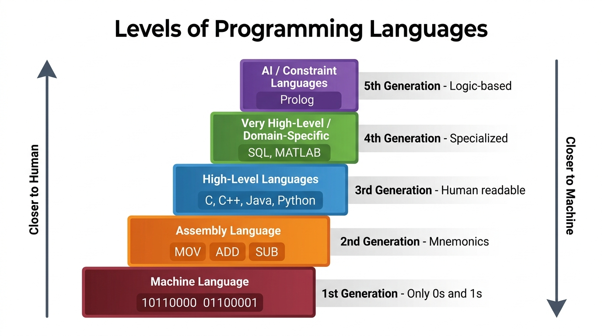
*Figure 2.1: Hierarchy of Programming Languages (From High-Level Abstraction to Bare-Metal Silicon)*

---

### 2.3 Comparative Analysis of Language Levels

| Level | Language Category | Examples | Characteristics | Hardware Dependency |
|---|---|---|---|---|
| **Tier 1** | **High-Level Languages (HLL)** | C, C++, Java, Python, Rust, Go, C# | Human-readable, rich control flow (`while`, `for`, `switch`), complex data types, structured modularity. | **Hardware Independent:** Runs on any CPU once compiled or interpreted. |
| **Tier 2** | **Assembly Language** | x86-64 ASM, ARM64 ASM, RISC-V ASM | Low-level mnemonics (`MOV`, `ADD`, `CMP`, `JNZ`), direct register names (`%rax`, `r0`), explicit memory addressing. | **Architecture Specific:** Assembly written for Intel x86 will fail on an Apple Silicon M-series ARM chip! |
| **Tier 3** | **Machine Code / Binary** | `01001000 89 C8 ...` | Raw sequences of binary bits (0s and 1s) representing opcodes, register IDs, and address offsets. | **Pure Hardware:** Directly executed by the CPU instruction decoder. |

---

## 3. Language Processors Overview

### 3.1 Definition & Spectrum of Language Processors

A **language processor** is any software system capable of processing, analyzing, transforming, or executing computer programs written in a programming language.

Compilers are the most sophisticated language processors, but they form part of a rich ecosystem of translation tools that work together.

---

### 3.2 Taxonomy of Language Processors

| Processor | Input | Output | Primary Role & Operational Behavior |
|---|---|---|---|
| **Compiler** | High-Level Source Code | Target Machine Code / Assembly | Translates the entire program offline before execution; performs deep analysis and optimizations. |
| **Interpreter** | High-Level Source Code | Immediate Output / Actions | Translates and executes instructions statement-by-statement at runtime without generating standalone binaries. |
| **Assembler** | Assembly Language | Relocatable Machine Code | Converts mnemonic assembly instructions directly into raw machine binary opcodes and relocation tables. |
| **Preprocessor** | Raw Source Code with Directives | Expanded / Pure Source Code | Handles macro substitutions, file inclusions (`#include`), and conditional compilation directives before parsing begins. |
| **Linker** | Relocatable Object Files + Libraries | Executable Machine Code Binary | Resolves cross-file symbol references, combines memory sections, and binds external library routines. |
| **Loader** | Executable Binary on Disk | Memory-Resident Running Process | Allocates address space in RAM, maps text and data segments, initializes CPU registers, and triggers execution. |
| **Transpiler** | High-Level Source Code | Another High-Level Language | Source-to-source translation across comparable abstraction tiers (e.g., TypeScript $\\to$ JavaScript, C++ $\\to$ C). |
| **Decompiler** | Low-Level Machine Code / Bytecode | High-Level Source Representation | Reverse-engineers machine instructions back into readable high-level control flow and data structures. |
| **Disassembler** | Machine Code Binary | Assembly Language Mnemonics | Translates raw binary byte streams back into readable assembly language instructions (e.g., IDA Pro, Ghidra). |

---

## 4. Compiler vs Interpreter: Deep Comparative Analysis

### 4.1 Operational Differences

The distinction between a **compiler** and an **interpreter** is one of the most fundamental concepts in computer science.

```
┌──────────────────┐
│  Source Program  │ ───────┐
└──────────────────┘        │
                            ▼
┌──────────────────┐    ┌───────────────┐
│    User Input    │ ──►│  INTERPRETER  │ ───► Program Output
└──────────────────┘    └───────┬───────┘
                                │
                                ▼
                     Diagnostic Error Messages
```
*Figure 4.1: An Interpreter (Dragon Book Figure 1.3)*

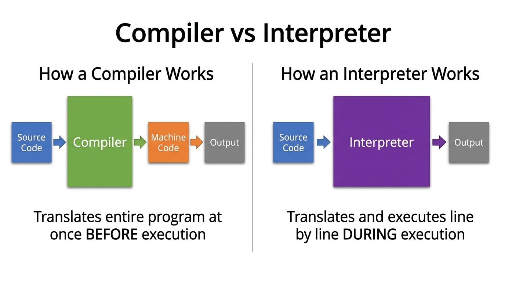
*Figure 4.2: Architectural Comparison of Compilation vs Interpretation*

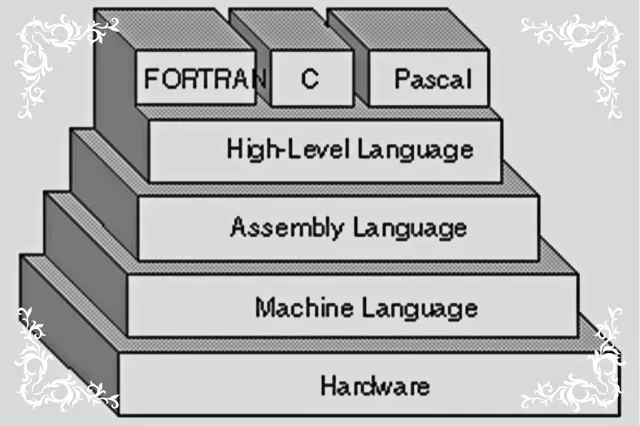
*Figure 4.3: Summary Comparison (from Rakia Ben Sassi's Guide)*

---

### 4.2 Detailed Multi-Dimensional Comparison Table

| Dimension | Compiler | Interpreter |
|---|---|---|
| **Translation Unit** | Translates the **entire source program** as an integrated whole before any execution begins. | Translates and executes the program **line-by-line** or statement-by-statement dynamically. |
| **Execution Timing** | Two distinct steps: First compile to target binary, then run the binary independently later. | Single continuous step: Translation and execution happen simultaneously in real time. |
| **Execution Speed** | **Significantly faster (5x to 100x):** Code is already optimized native CPU machine instructions. | **Slower:** Software overhead of continuously decoding, validating, and dispatching statements. |
| **Analysis Time** | Takes considerable time upfront during the compilation phase to parse and optimize code. | Very little startup delay; begins interpreting the very first line almost instantaneously. |
| **Error Reporting** | Collects and displays **all lexical, syntactic, and semantic errors** after analyzing the code. | Stops immediately at the **first line** containing an error; subsequent errors remain hidden. |
| **Output Artifact** | Produces a permanent, standalone target executable file (e.g., `.exe`, ELF binary, `.o`). | Does **not** produce a separate machine code file; leaves no standalone executable on disk. |
| **Memory Footprint** | Efficient at runtime: Only the compiled binary and necessary runtime libraries occupy RAM. | Requires both the interpreter engine and the source script to remain resident in RAM. |
| **Debugging Experience** | More complex to debug runtime issues without debug symbols (`-g`); requires dedicated debuggers. | Very interactive and intuitive: Interactive REPLs allow inspecting variable state immediately. |
| **Optimization Scope** | **Global optimization:** Can analyze entire function call graphs, inline code, and vectorize loops. | **Local / Minimal optimization:** Only sees statements as they are encountered sequentially. |
| **Code Portability** | Generates machine code tied to one specific CPU architecture (x86, ARM) and OS. | The source script runs on **any platform** that possesses a compatible interpreter. |
| **Representative Examples** | C, C++, Rust, Go, Fortran, Swift, Zig | Python, Ruby, PHP, Perl, JavaScript (originally), Shell Script (Bash) |

---

### 4.3 Language vs Implementation: A Vital Distinction

In popular programming discussions, people frequently say *"C is a compiled language"* or *"Python is an interpreted language"*. However, as emphasized in modern compiler literature:

> ⚡ **Crucial Insight:**  
> **A programming language is merely a specification of syntax and semantics.**  
> Being "compiled" or "interpreted" is an attribute of the **implementation (the tool)**, not an inherent property of the language itself!

- **C** is almost universally compiled to machine code for maximum performance, yet fully functioning **C interpreters** exist (such as `Ch` and `PicoC`).
- **JavaScript** was initially designed as a purely interpreted scripting language in Netscape Navigator, but all modern production JavaScript engines (e.g., Google Chrome's **V8**, Mozilla's **SpiderMonkey**) utilize sophisticated **Just-In-Time (JIT) compilation** to achieve blazing native speeds.
- **Python** is commonly called interpreted, but standard CPython first transparently compiles `.py` source into bytecode (`.pyc` files) before interpreting it with the CPython Virtual Machine. Alternatives like **PyPy** use JIT compilation to compile Python code straight into machine code at runtime!

---

## 5. Hybrid Compilation: The Java & .NET Execution Model

### 5.1 The Hybrid Philosophy

Why force a binary choice between pure compilation and pure interpretation? Modern enterprise language environments combine the strengths of both approaches into a **hybrid execution architecture**:

```
┌──────────────────┐
│  Source Program  │
│  (e.g., .java)   │
└─────────┬────────┘
          │
          ▼
   ┌──────────────┐
   │  Translator  │ (javac compiler)
   └──────┬───────┘
          │
          ▼
┌──────────────────┐
│   Intermediate   │ (Bytecode: .class file)
│     Program      │
└─────────┬────────┘
          │
          ├────────────────────────┐
          ▼                        ▼
┌──────────────────┐    ┌─────────────────────┐
│    User Input    │ ──►│   Virtual Machine   │ ──► Program Output
└──────────────────┘    │ (Interpreter + JIT) │
                        └─────────────────────┘
```
*Figure 5.1: A Hybrid Language Processor (Dragon Book Figure 1.4)*

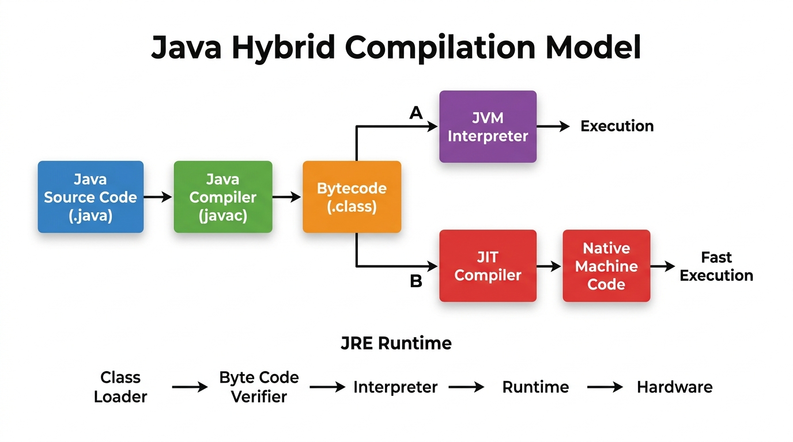
*Figure 5.2: Java Hybrid Compilation and Execution Architecture*

---

### 5.2 Step-by-Step Architecture: Java Source to Silicon

```
1. Developer writes Source Code          ──►  HelloWorld.java
2. Java Compiler (`javac`) compiles it    ──►  HelloWorld.class (Java Bytecode)
3. Java Virtual Machine (JVM) loads it   ──►  Interprets Bytecode statement-by-statement
4. JVM JIT Compiler monitors hot code    ──►  Compiles frequently called methods into Native Machine Code!
```

---

### 5.3 The Java Runtime Environment (JRE) Internal Pipeline

Rakia Ben Sassi documents the five internal stages of the Java runtime execution flow:

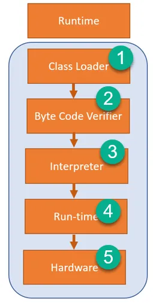
*Figure 5.4: JRE Internal Architecture (from Rakia Ben Sassi)*

```
┌─────────────────┐     ┌───────────────────────┐     ┌─────────────────┐     ┌─────────────────┐     ┌──────────────┐
│  Class Loader   │ ──► │  Byte Code Verifier   │ ──► │   Interpreter   │ ──► │ Runtime Engine  │ ──► │ CPU Hardware │
│       ①         │     │          ②            │     │   & JIT (③)     │     │       ④         │     │      ⑤       │
└─────────────────┘     └───────────────────────┘     └─────────────────┘     └─────────────────┘     └──────────────┘
```

1. **Class Loader (①):** Reads the compiled `.class` binary byte stream from disk or network into memory.
2. **Byte Code Verifier (②):** Rigorously inspects the loaded bytecode to guarantee it does not violate Java security constraints, perform illegal pointer math, or cause buffer overflows.
3. **Execution Engine (Interpreter & JIT Compiler) (③):**
   - The **Interpreter** reads bytecode instructions and executes them immediately.
   - The **Just-In-Time (JIT) Compiler** runs alongside the interpreter. It monitors execution counters ("profiling") to identify **hot spots** (loops and heavily invoked functions). It dynamically translates those hot bytecode segments into **native CPU machine code** and caches them in memory.
4. **Runtime Environment (JRE System Libraries) (④):** Manages dynamic memory allocation, thread synchronization, and garbage collection.
5. **Hardware Layer (⑤):** The physical microprocessor (x86-64, ARM) executes the instructions.

---

### 5.4 Why Hybrid? Portability vs Performance

- **Write Once, Run Anywhere (WORA):** Bytecode is completely agnostic of host CPU architectures. A `.class` file generated on a Windows x86 machine runs identically on a Linux ARM server or a macOS laptop without recompilation.
- **Near-Native Performance:** Because the JIT compiler compiles performance-critical loops into raw machine instructions at runtime, Java programs achieve speeds approaching hand-optimized C/C++ after an initial warmup phase!

---

## 6. The Complete Language Processing System

### 6.1 Architectural Overview

A compiler is rarely an isolated monolith. In real-world software engineering, creating a fully functioning executable binary requires an orchestrated pipeline of software tools collectively known as the **Language-Processing System**:

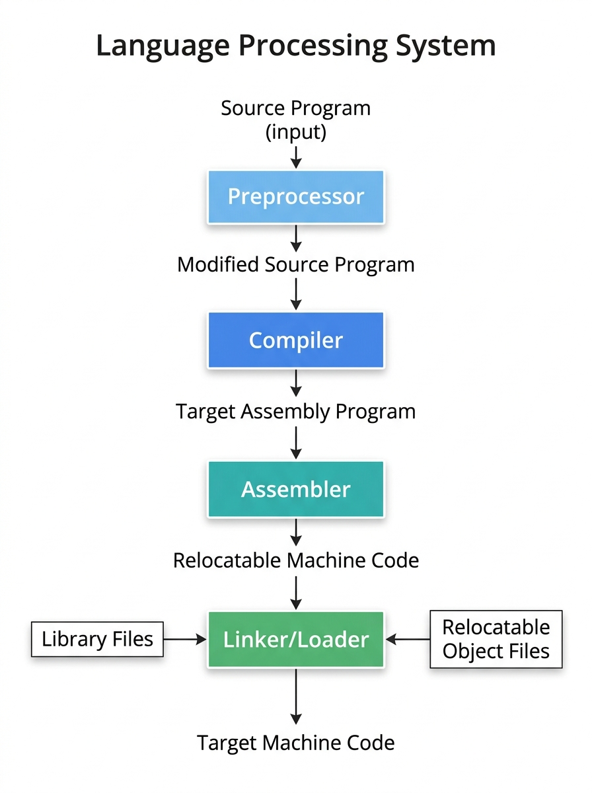
*Figure 6.1: The Complete Language-Processing System (Dragon Book Figure 1.5)*

---

### 6.2 Step 1: The Preprocessor

Before a compiler ever inspects a line of code, the **Preprocessor** transforms the raw source files:

1. **Macro Expansion:** Replaces symbolic macro constants and macro functions with their literal text substitutions:
   ```c
   #define BUFFER_SIZE 1024
   #define SQUARE(x) ((x) * (x))
   // Everywhere BUFFER_SIZE appears, it is substituted with 1024
   ```
2. **Header File Inclusion:** Recursively copies the entire text of referenced header files into the compilation unit:
   ```c
   #include <stdio.h>
   // The preprocessor replaces this single line with thousands of lines of declarations from stdio.h
   ```
3. **Conditional Compilation:** Strips out code blocks guarded by preprocessor conditions (`#ifdef`, `#ifndef`, `#if`):
   ```c
   #ifdef DEBUG
       printf("Debug trace\n");
   #endif
   ```
4. **Comment Stripping:** Discards all single-line (`//`) and multi-line (`/* ... */`) comments, replacing them with single whitespace characters.

---

### 6.3 Step 2: The Compiler

The **Compiler** receives the clean, modified source stream and translates it into **Target Assembly Language**.

**Why produce assembly language rather than direct machine binary?**
1. **Separation of Concerns:** Translating high-level logic into symbolic assembly is intellectually cleaner than managing binary encodings, bit alignment, and memory relocations directly.
2. **Debugging Transparency:** Assembly is human-readable. Compiler writers and systems engineers can inspect the generated assembly (`.s` file) to verify optimization effectiveness and debug compiler bugs.
3. **Modularity:** Different assemblers can handle target-specific encoding quirks without modifying the compiler's core engine.

---

### 6.4 Step 3: The Assembler & Its Internal Tasks

The **Assembler** translates human-readable symbolic assembly mnemonics into **relocatable machine code**.

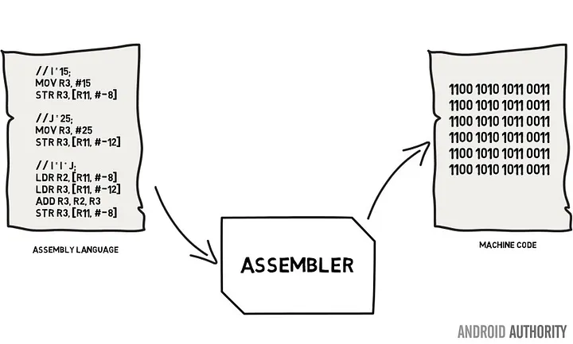
*Figure 6.2: Assembler Workflow (from Rakia Ben Sassi)*

#### Detailed Internal Tasks of an Assembler (Dragon Book Exercise 1.1.5):
An assembler must perform several critical operations to turn assembly into object code:
1. **Instruction Mapping (Opcode Translation):** Translates symbolic operation codes (mnemonics like `MOV`, `ADD`, `SUB`, `JMP`) into their exact binary hardware bit patterns.
2. **Symbol Resolution (Two-Pass Assembly):**
   - **Pass 1:** Scans the assembly code, maintains a **Location Counter (LC)**, and constructs a **Symbol Table** recording the relative address offset of every label and variable name.
   - **Pass 2:** Replaces all symbolic label references in jump and branch instructions (`JMP loop_start`) with concrete numeric memory offsets.
3. **Literal Pool Construction:** Allocates storage for immediate constants and literals defined in the code.
4. **Relocation Dictionary Creation:** Generates a **Relocation Table** that marks every instruction or memory address that will need adjustment when the program is placed at a specific base address in RAM.
5. **Object File Generation:** Emits standard relocatable object files (such as ELF format on Linux, PE format on Windows, or Mach-O on macOS) containing distinct `.text` (code), `.data` (initialized data), and `.bss` (uninitialized data) sections.

---

### 6.5 Step 4: The Linker (Static & Dynamic)

Large real-world software applications are never contained in a single source file. Programs are divided across dozens or thousands of independent compilation units, plus external libraries (such as the standard C library `libc`):

```c
// math_utils.c
double computeHypotenuse(double a, double b) { ... }

// main.c
#include <stdio.h>
extern double computeHypotenuse(double a, double b);
int main() {
    printf("%f\n", computeHypotenuse(3.0, 4.0));
    return 0;
}
```

When `main.c` is compiled into `main.o`, the compiler does not know the memory address of `computeHypotenuse` or `printf`. It leaves placeholders known as **unresolved external symbols**.

#### The Linker's Responsibilities:
1. **Symbol Resolution:** Connects every external symbol reference to its definitive function or variable definition across all object files and library archives (`.a`, `.lib`).
2. **Section Merging & Relocation:** Combines all `.text` code sections from each object file into one contiguous executable code segment, and all `.data` sections into one contiguous data segment. It updates all cross-module memory pointers to their final relative positions.
3. **Static vs Dynamic Linking:**
   - **Static Linking:** The linker copies the actual machine code of library functions directly into the final executable binary. (Self-contained, but results in larger file sizes).
   - **Dynamic Linking:** The linker inserts dynamic reference stubs. The operating system links shared libraries (`.so` on Linux, `.dll` on Windows) when the program is launched or on-demand at runtime.

---

### 6.6 Step 5: The Loader

The **Loader** is the operating system component responsible for preparing an executable program on disk for active execution in computer memory:

1. **Address Space Allocation:** Requests a new virtual address space from the OS kernel.
2. **Segment Mapping:** Reads executable code and initialized data from the binary file on disk and copies them into the allocated virtual memory pages.
3. **Memory Relocation:** If the program cannot be loaded at its preferred base address, the loader adjusts memory pointers according to the binary's relocation tables.
4. **Stack & Heap Initialization:** Allocates initial runtime stack frames for function calls and sets up the process heap for dynamic allocation (`malloc`).
5. **Register Initialization & Handoff:** Populates CPU registers, sets the Stack Pointer (`SP`), points the Program Counter (`PC` / `EIP` / `RIP`) to the program's designated entry point (`_start` / `main`), and transfers CPU control to begin execution!

---

### 6.7 Hands-On Toolchain Demonstration: The GNU GCC Pipeline

You can observe every single stage of this language-processing pipeline in your own terminal using standard `gcc` flags:

```bash
# -------------------------------------------------------------------------
# STAGE 1: Preprocessing only (-E)
# Produces preprocessed pure C code (expanded macros & included headers)
# -------------------------------------------------------------------------
gcc -E main.c -o main.i

# -------------------------------------------------------------------------
# STAGE 2: Compilation proper (-S)
# Translates preprocessed C code into human-readable assembly language
# -------------------------------------------------------------------------
gcc -S main.i -o main.s

# -------------------------------------------------------------------------
# STAGE 3: Assembly (-c)
# Translates assembly language into relocatable machine code object file
# -------------------------------------------------------------------------
gcc -c main.s -o main.o

# -------------------------------------------------------------------------
# STAGE 4: Linking
# Combines object files and resolves standard library calls to produce binary
# -------------------------------------------------------------------------
gcc main.o -o my_program

# -------------------------------------------------------------------------
# STAGE 5: Loading & Running
# The OS loader maps my_program into memory and executes it
# -------------------------------------------------------------------------
./my_program
```

---

## 7. The Structure of a Compiler: Phases & Modularity

### 7.1 Analysis (Front End) vs Synthesis (Back End)

The internal architecture of any production compiler is split into two major conceptual realms: **Analysis** and **Synthesis**:

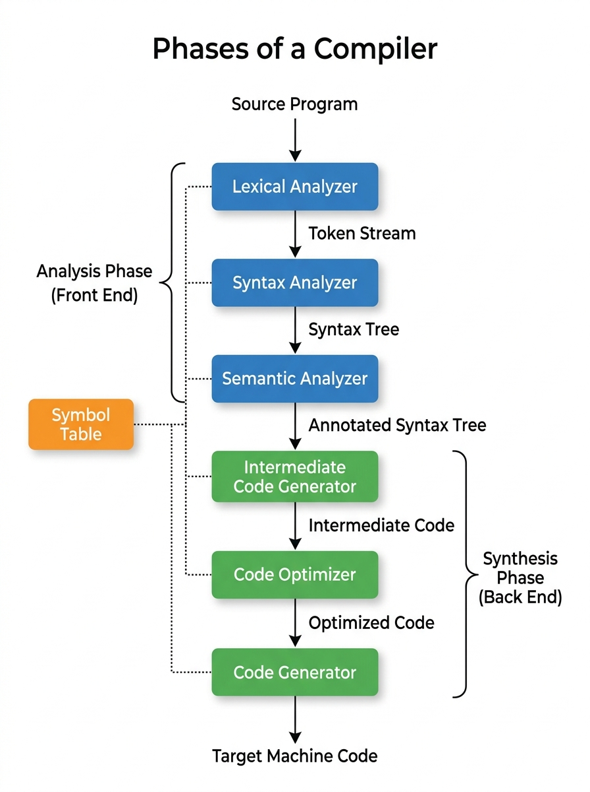
*Figure 7.1: The Six Distinct Phases of a Compiler and Supporting Infrastructure*

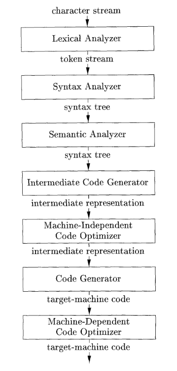
*Figure 7.2: Canonical Compiler Architecture (Dragon Book Figure 1.6 / Lecture Notes of Dr. Muhammad Nur Yanhaona)*

```
┌────────────────────────────────────────────────────────────────────────┐
│                        ANALYSIS (FRONT END)                            │
│  - Lexical Analysis (Scanning)                                         │
│  - Syntax Analysis (Parsing)                                           │
│  - Semantic Analysis (Type & Scope Checking)                           │
│  - Intermediate Code Generation                                        │
│  - MACHINE-INDEPENDENT: Only understands source programming language   │
└───────────────────────────────────┬────────────────────────────────────┘
                                    │ Intermediate Representation (IR)
                                    ▼
┌────────────────────────────────────────────────────────────────────────┐
│                        SYNTHESIS (BACK END)                            │
│  - Target-Independent & Target-Dependent Code Optimization            │
│  - Code Generation (Register Allocation & Instruction Selection)       │
│  - MACHINE-DEPENDENT: Strictly tied to target CPU architecture (ISA)  │
└────────────────────────────────────────────────────────────────────────┘
```

| Realm | Common Name | Compiler Phases Included | Primary Objective & Scope |
|---|---|---|---|
| **Analysis** | **Front End** | Lexical Analysis, Syntax Analysis, Semantic Analysis, Intermediate Code Generation | Breaks down the source code into constituent syntactic pieces, verifies grammar, checks semantic consistency, and emits intermediate code. **100% Machine Independent.** |
| **Synthesis** | **Back End** | Code Optimization, Code Generation | Takes the intermediate representation and constructs the target machine instructions. Handles register allocation, memory layout, and pipeline scheduling. **Machine Dependent.** |

---

### 7.2 Natural Language Analogy: How Humans Process Speech

In lecture notes by **Dr. Muhammad Nur Yanhaona**, an elegant analogy explains why compiler stages mirror human linguistic cognition:

> 🗣️ **The Classroom Speech Scenario (Dr. Muhammad Nur Yanhaona):**  
> Consider a student walking up to a friend and saying:  
> *"I am thinking about taking CSE 420 (Compiler Design) course this semester. I am also taking 3 other CSE courses at the same time. Do you think I am putting too much pressure on myself? My CGPA is 3.5. Do you think I am studious enough to do well in four CSE courses in a single semester? If you think I should drop CSE 420, what course would you suggest me to take in its place?"*

How does your brain process and respond to this speech?
1. **Characters & Symbols:** You first recognize raw phonetic sounds, alphabet letters, digits (`3.5`, `420`), and punctuation marks.
2. **Words (Tokens):** You group letters into recognized English words (*"taking"*, *"course"*, *"CGPA"*).
3. **Grammar (Syntax):** You analyze the sequence of words to recognize sentence fragments (*"If you think I should drop..."*) and complete sentences (questions vs statements).
4. **Meaning (Semantics):** You evaluate the contextual meaning: You understand that `3.5` is a grade metric and that taking 4 demanding engineering courses causes heavy academic workload.
5. **Action (Synthesis):** Only after understanding the speech do you formulate advice and speak a response!

#### Mapping Human Cognition to Compiler Phases:

| Level of Human Understanding | Corresponding Compiler Phase | Compiler Terminology |
|---|---|---|
| Letters, digits, punctuation marks | **Lexical Analysis (Scanning)** | Alphabet characters & Delimiters |
| Recognizing individual words | **Token Generation** | Tokens & Lexemes |
| Sentence fragments & full sentences | **Syntax Analysis (Parsing)** | Expressions & Statements |
| Understanding sentence meaning | **Semantic Analysis** | Type Checking, Scope & Attributes |
| Formulating advice & taking action | **Code Generation (Synthesis)** | Emitting Machine Instructions |

---

### 7.3 Diplomatic Interpreter Analogy: Optimization in Context

Dr. Yanhaona presents another compelling analogy to illustrate **Compiler Optimization**:

> 🌐 **The State Summit Analogy (Dr. Muhammad Nur Yanhaona):**  
> *"Consider a summit meeting between two heads of state from the USA and Russia who only speak their native languages. They require a professional diplomatic interpreter.  
> A great human interpreter does not translate each spoken sentence word-for-word rigidly into the other language. Instead, the interpreter finds the most concise, articulate way to convey the **exact meaning with fewer, more effective sentences**.  
> In the exact same way, a compiler's optimization phase eliminates redundant operations, removes dead computations, and restructures expressions to make the code run faster and use less memory—**while keeping the program's observable behavior 100% identical!**"*

---

### 7.4 Why Separate Front End and Back End? The $N \times M$ vs $N + M$ Principle

Decoupling the Front End from the Back End is the greatest architectural breakthrough in modern compiler engineering.

#### The Portability Multiplier Problem:
Imagine software engineers want to support:
- **$N$ Programming Languages:** C, C++, Rust, Go, Swift, Fortran ($N = 6$)
- **$M$ Target CPU Architectures:** x86-64, ARM64, RISC-V, MIPS, WebAssembly ($M = 5$)

- **If Compilers are Monolithic (Without Decoupled IR):**  
  You must build a complete bespoke compiler for every combination:
  $$\text{Total Compilers Needed} = N \times M = 6 \times 5 = 30 \text{ compilers!}$$

- **If Front End and Back End are Decoupled via Intermediate Representation (IR):**  
  You only build:
  - $N$ language-specific Front Ends (which compile source to IR)
  - $M$ architecture-specific Back Ends (which compile IR to machine code)
  $$\text{Total Components Needed} = N + M = 6 + 5 = 11 \text{ components!}$$

```
   Source Languages                    Universal IR                   Target Architectures
┌─────────────────────┐                                             ┌─────────────────────┐
│     C Front End     │ ──┐                                     ┌──►│    x86-64 Back End  │
├─────────────────────┤   │                                     │   ├─────────────────────┤
│    Rust Front End   │ ──┼──► ┌───────────────────────────┐ ───┼──►│    ARM64 Back End   │
├─────────────────────┤   │    │  Intermediate             │   │   ├─────────────────────┤
│    Swift Front End  │ ──┼──► │  Representation (IR)      │ ───┼──►│    RISC-V Back End  │
├─────────────────────┤   │    │  (e.g., LLVM Bitcode)     │   │   ├─────────────────────┤
│     Go Front End    │ ──┘    └───────────────────────────┘   └───►│  WebAssembly Back End│
└─────────────────────┘                                             └─────────────────────┘
```

> 🌟 **Real-World Case Study: LLVM**  
> Modern systems languages (Rust, Swift, Clang/C++, Zig, Kotlin/Native) all implement language front ends that emit **LLVM Intermediate Representation (LLVM IR)**. They automatically inherit thousands of person-years of world-class optimization algorithms and native code generation for every CPU architecture supported by the LLVM backend!

---

## 8. Detailed Walkthrough of the Six Compiler Phases

Let us trace how a compiler processes source code across all six phases, using the textbook's canonical assignment statement:

```c
position = initial + rate * 60
```

---

### 8.1 Phase 1: Lexical Analysis (Scanning)

**Objective:** Reads the input stream of raw source characters from left to right and groups them into meaningful character sequences called **lexemes**. For each lexeme, the lexical analyzer outputs a **token**.

**Token Structure:**
$$\langle \text{token-name}, \; \text{attribute-value} \rangle$$

- **token-name:** An abstract grammatical category (e.g., `id` for identifier, `assign_op`, `mult_op`, `num`).
- **attribute-value:** A pointer or reference into the **Symbol Table** (for identifiers) or the literal constant value.

#### Tokenizing `position = initial + rate * 60`:

| Lexeme | Token Produced | Explanation |
|---|---|---|
| `position` | `⟨id, 1⟩` | Identifier; points to entry index `1` in the Symbol Table. |
| `=` | `⟨=⟩` | Assignment operator token (often represented without attribute). |
| `initial` | `⟨id, 2⟩` | Identifier; points to entry index `2` in the Symbol Table. |
| `+` | `⟨+⟩` | Addition operator token. |
| `rate` | `⟨id, 3⟩` | Identifier; points to entry index `3` in the Symbol Table. |
| `*` | `⟨*⟩` | Multiplication operator token. |
| `60` | `⟨60⟩` | Numeric integer constant literal. |

**Resulting Token Stream:**
```
⟨id, 1⟩  ⟨=⟩  ⟨id, 2⟩  ⟨+⟩  ⟨id, 3⟩  ⟨*⟩  ⟨60⟩
```

> **Housekeeping:** Whitespace characters (spaces, tabs, newlines) and comments are recognized and silently discarded by the scanner.

---

### 8.2 Phase 2: Syntax Analysis (Parsing)

**Objective:** Receives the flat token stream and constructs a hierarchical syntactic representation—most commonly a **Syntax Tree** (or Parse Tree)—that reflects the grammatical structure of the programming language.

In a syntax tree:
- Each **interior node** represents an **operator** or computation.
- The **children** of an operator node represent its **operands** (arguments).

#### Syntax Tree for `position = initial + rate * 60`:

```
          =
        /   \
    ⟨id, 1⟩    +
             /   \
         ⟨id, 2⟩    *
                  /   \
              ⟨id, 3⟩   60
```

#### Why does the tree have this shape?
- **Operator Precedence:** Multiplication (`*`) binds more tightly than addition (`+`). Therefore, the subtree for `rate * 60` is nested deeper in the tree so that it must be computed **before** the addition.
- **Associativity:** The assignment operator (`=`) has the lowest precedence; the final computed sum becomes the right-hand child of `=`.

---

### 8.3 Phase 3: Semantic Analysis

**Objective:** Uses the syntax tree and the symbol table to check the source program for **semantic consistency** with the language definition. It ensures that operations have valid meanings.

#### Key Functions of Semantic Analysis:
1. **Type Checking:** Confirms that each operator receives operands of valid, compatible data types (e.g., preventing adding a string to an array pointer).
2. **Type Coercion (Implicit Conversion):** If the language permits mixed-mode arithmetic, the semantic analyzer inserts explicit conversion operators into the syntax tree.
3. **Scope & Declaration Verification:** Guarantees that every identifier used in an expression has been declared within the active lexical scope.

#### Concrete Coercion Example:
Suppose that `position`, `initial`, and `rate` are declared as **floating-point numbers** (`float`), while `60` is written as an **integer literal**:

```c
float position, initial, rate;
position = initial + rate * 60;
```

A CPU floating-point multiplier cannot multiply an IEEE-754 float by a raw two's-complement integer directly. The compiler must convert `60` into a float.

The semantic analyzer annotates the syntax tree with an **`inttofloat`** conversion node:

```
          =
        /   \
    ⟨id, 1⟩    +
             /   \
         ⟨id, 2⟩    *
                  /   \
              ⟨id, 3⟩  inttofloat
                           |
                          60
```

---

### 8.4 Phase 4: Intermediate Code Generation (ICG)

**Objective:** Translates the decorated syntax tree into an explicit, low-level, machine-independent **Intermediate Representation (IR)**.

The most widely used intermediate representation in compiler theory is **Three-Address Code (TAC)**.

#### Fundamental Properties of Three-Address Code:
1. Every instruction has **at most one operator** on the right side of an assignment.
2. The compiler invents **temporary variables** ($t_1, t_2, t_3, \dots$) to store intermediate subexpression results.
3. Complex hierarchical tree expressions are flattened into an unambiguous, linear sequence of simple instructions.

#### Three-Address Code for our statement:
```
t1 = inttofloat(60)
t2 = id3 * t1
t3 = id2 + t2
id1 = t3
```

---

### 8.5 Phase 5: Code Optimization

**Objective:** Analyzes and transforms the intermediate code to make the resulting machine program run **faster**, consume **less memory**, or use **less electrical power**, without altering the program's output.

#### Two Classes of Optimization:
1. **Machine-Independent Optimization:** Operates purely on the intermediate representation:
   - **Constant Folding & Constant Propagation:** Computing operations on known constants at compile time:
     $$inttofloat(60) \implies 60.0$$
   - **Copy Propagation & Dead-Code Elimination:** Eliminating intermediate temporary variables that are assigned and used only once ($t_3$):
2. **Machine-Dependent Optimization:** Leverages knowledge of the target CPU architecture:
   - **Strength Reduction:** Replacing expensive mathematical operations with cheaper CPU equivalents:
     $$x \times 8 \implies x \ll 3 \quad \text{(bit shift is 10x faster than integer multiplication!)}$$
   - **Instruction Reordering:** Rearranging machine instructions to prevent CPU pipeline stalls and cache misses.

#### Optimized Three-Address Code:
```
t1 = id3 * 60.0
id1 = id2 + t1
```
*Notice how the instruction count dropped from 4 instructions to just 2 instructions!*

#### The Three Golden Rules of Compiler Optimization (Dragon Book Section 1.4.2):
1. **Semantic Preservation:** The transformation must **never change the observable meaning** of the source program under any execution input.
2. **Measurable Improvement on Average:** The optimization must measurably reduce execution time, binary size, or power consumption across realistic workloads.
3. **Engineering Cost-Effectiveness:** The optimization must not demand excessive compilation time or impractical compiler implementation complexity.

---

### 8.6 Phase 6: Code Generation

**Objective:** Maps the optimized intermediate code into **Target Machine Code** (or Assembly Language).

#### Critical Tasks of the Code Generator:
1. **Instruction Selection:** Choosing the best CPU machine instructions to represent each intermediate operation.
2. **Register Allocation & Assignment:** Deciding which program variables and temporaries reside in high-speed CPU registers ($R_1, R_2, \dots$) versus slow main memory.
3. **Memory Address Binding:** Determining the exact memory offsets for global and local variables.

#### Emitted Target Assembly Code:
Assuming our target architecture provides floating-point registers $R_1$ and $R_2$:

```asm
LDF   R2, id3         ; Load 'rate' from memory into Floating-Point Register R2
MULF  R2, R2, #60.0   ; Multiply R2 by constant 60.0, store result in R2
LDF   R1, id2         ; Load 'initial' from memory into Register R1
ADDF  R1, R1, R2      ; Add R2 to R1 (initial + rate * 60.0), store result in R1
STF   id1, R1         ; Store result from R1 into memory address for 'position'
```

- `LDF` = Load Floating-point value from memory into register.
- `MULF` = Multiply Floating-point registers.
- `ADDF` = Add Floating-point registers.
- `STF` = Store Floating-point register into memory.
- `#60.0` = Immediate literal floating-point constant.

---

## 9. Complete End-to-End Translation Trace

### 9.1 The Canonical Assignment: `position = initial + rate * 60`

The diagram below illustrates the exact step-by-step transformation of this statement through the entire compilation pipeline:

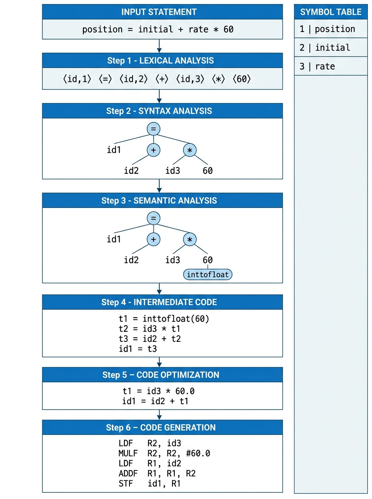
*Figure 9.1: Complete Translation Pipeline Trace (Dragon Book Figure 1.7)*

---

### 9.2 Step-by-Step Evolution Diagram

```
[SOURCE CODE]
position = initial + rate * 60
       │
       ▼
[LEXICAL ANALYZER]
⟨id, 1⟩ ⟨=⟩ ⟨id, 2⟩ ⟨+⟩ ⟨id, 3⟩ ⟨*⟩ ⟨60⟩
       │
       ▼
[SYNTAX ANALYZER]
            =
          /   \
      ⟨id, 1⟩    +
               /   \
           ⟨id, 2⟩    *
                    /   \
                ⟨id, 3⟩   60
       │
       ▼
[SEMANTIC ANALYZER]
            =
          /   \
      ⟨id, 1⟩    +
               /   \
           ⟨id, 2⟩    *
                    /   \
                ⟨id, 3⟩  inttofloat
                             |
                            60
       │
       ▼
[INTERMEDIATE CODE GENERATOR]
t1 = inttofloat(60)
t2 = id3 * t1
t3 = id2 + t2
id1 = t3
       │
       ▼
[CODE OPTIMIZER]
t1 = id3 * 60.0
id1 = id2 + t1
       │
       ▼
[CODE GENERATOR]
LDF   R2, id3
MULF  R2, R2, #60.0
LDF   R1, id2
ADDF  R1, R1, R2
STF   id1, R1
```

---

### 9.3 Evolution of the Symbol Table

As the compiler progresses from lexical analysis to code generation, the **Symbol Table** grows with rich semantic attributes:

```
┌───────┬──────────┬─────────────┬───────────┬────────────────┬─────────────────┐
│ Index │   Name   │  Data Type  │ Byte Size │ Storage Scope  │ Memory Address  │
├───────┼──────────┼─────────────┼───────────┼────────────────┼─────────────────┤
│   1   │ position │ float       │ 4 bytes   │ global         │ [BasePtr - 0x10]│
│   2   │ initial  │ float       │ 4 bytes   │ global         │ [BasePtr - 0x14]│
│   3   │ rate     │ float       │ 4 bytes   │ global         │ [BasePtr - 0x18]│
└───────┴──────────┴─────────────┴───────────┴────────────────┴─────────────────┘
```

---

## 10. Symbol Table Management

### 10.1 Role Across All Compiler Phases

The **Symbol Table** is the central information repository used continuously throughout **all phases** of the compilation process. It maintains an authoritative record for every identifier (variable name, constant, function name, class, or label) found in the program.

```
                   ┌───────────────────────────────┐
                   │    LEXICAL ANALYZER (SCANNER) │
                   └───────────────┬───────────────┘
                                   │ Inserts new identifier names
                                   ▼
                   ┌───────────────────────────────┐
                   │         SYMBOL TABLE          │ ◄───► SYNTAX ANALYZER
                   └───────┬───────────────▲───────┘       (Checks grammar)
                           │               │
        Populates types    │               │ Queries types & scopes
        & array dimensions ▼               │
                   ┌───────────────────────┴───────┐
                   │       SEMANTIC ANALYZER       │
                   └───────────────┬───────────────┘
                                   │ Provides type & size info
                                   ▼
                   ┌───────────────────────────────┐
                   │  INTERMEDIATE CODE GENERATOR  │
                   └───────────────┬───────────────┘
                                   │ Provides variable life-times
                                   ▼
                   ┌───────────────────────────────┐
                   │         CODE OPTIMIZER        │
                   └───────────────┬───────────────┘
                                   │ Provides memory offsets
                                   ▼
                   ┌───────────────────────────────┐
                   │         CODE GENERATOR        │
                   └───────────────────────────────┘
```

---

### 10.2 Stored Attributes & Metadata

For each program identifier, the symbol table records:
1. **Lexeme (Name):** The raw string identifier (e.g., `totalScore`, `calcAvg`).
2. **Data Type:** Basic types (`int`, `float`, `char`) or derived types (`pointer`, `array`, `struct`, `class`).
3. **Storage Size:** Number of bytes required in memory (e.g., 4 bytes for float, 8 bytes for 64-bit pointer).
4. **Memory Location / Offset:** Assigned base-pointer relative stack offset or global static address.
5. **Lexical Scope Level:** Block nesting level where the identifier is declared (local vs global vs class member).
6. **For Functions & Procedures:** Number of formal parameters, parameter types, parameter passing mechanism (by-value vs by-reference), and return type.

---

### 10.3 Data Structure Requirements & Implementation

Because the symbol table is queried and updated thousands of times during compilation, performance is vital:
- **Search Efficiency:** Must support average **$O(1)$ lookup time** to find identifier entries rapidly.
- **Dynamic Growth:** Must scale gracefully as hundreds of new symbols are declared.
- **Scope Handling:** Implemented using **Hash Tables with Separate Chaining** combined with a **Scope Stack** (or cactus stack). When entering a nested block (`{ ... }`), a new symbol scope table is pushed; when exiting the block (`}`), the local scope is popped or marked inaccessible.

---

## 11. Grouping Phases into Passes

### 11.1 Definition of a Pass

In compiler implementation, a **pass** refers to **one complete traversal of the source program or its intermediate representation (reading the input and writing a new representation)**.

- A **Phase** is a logical step in the translation process (e.g., Lexical Analysis, Optimization).
- A **Pass** is a physical traversal over the code.

Several logical phases can be grouped together into a **single pass**!

```
Pass 1 (Front End Pass):   Lexical Analysis + Syntax Analysis + Semantic Analysis +
                           Intermediate Code Generation (All in memory)

Pass 2 (Optimization Pass): Machine-Independent Code Optimization on the IR

Pass 3 (Back End Pass):    Target-Specific Code Generation for a designated CPU
```

---

### 11.2 Single-Pass vs Multi-Pass Compilers

| Characteristic | Single-Pass Compiler | Multi-Pass Compiler |
|---|---|---|
| **Traversal Count** | Scans the source code **exactly once** from beginning to end. | Scans intermediate representations **multiple times**. |
| **Compilation Speed** | Blazing fast compilation; minimum I/O overhead. | Slower compilation time; processes IR across passes. |
| **Memory Footprint** | Extremely low RAM required; processes code sequentially. | Higher RAM required to keep full AST / IR in memory. |
| **Optimization Quality** | Minimal or localized optimization; cannot perform global analysis. | **Extremely high optimization:** Performs inter-procedural analysis and loop transforms. |
| **Forward References** | Cannot handle forward references easily (requires backpatching). | Naturally handles forward references across modules. |
| **Historical Example** | Early Pascal, Turbo Pascal, early C compilers. | Modern GCC, Clang/LLVM, Rust compiler (`rustc`). |

---

### 11.3 Historical Memory Constraints vs Modern Systems

In the 1960s and 1970s, computers like the PDP-11 or IBM 7090 possessed only a few kilobytes of RAM (e.g., 32 KB or 64 KB). A compiler could not possibly hold the entire program's syntax tree in memory at once!

- **Historical Workaround:** Compilers were strictly broken into many small passes. Pass 1 read source cards and wrote intermediate tokens to magnetic tape; Pass 2 read the tape and wrote assembly to another tape!
- **Modern Reality:** Today's workstations possess gigabytes of RAM. Modern compilers retain complete syntax trees and rich Intermediate Representations in high-speed memory, enabling dozens of sophisticated optimization passes.

---

### 11.4 Backpatching in Single-Pass Compilers

In a single-pass compiler, what happens if code contains a **forward jump**?
```c
goto target_label;
...
target_label: x = 10;
```
When the compiler encounters `goto target_label;`, it does not yet know the memory address of `target_label`!

**The Backpatching Solution:**
1. The compiler emits the jump instruction with a blank address field (`JMP ???`).
2. It adds the address of this incomplete instruction to a list associated with `target_label`.
3. When `target_label` is finally encountered later in the pass, the compiler goes back and "patches" the correct address into all previously emitted jump instructions!

---

## 12. Compiler Construction Tools

### 12.1 Automated Compiler Components

Writing a production compiler completely from scratch by hand is an enormous undertaking. Fortunately, computer scientists have automated the creation of standard compiler phases through **compiler-construction tools** (often called *compiler-compilers*):

```
Grammar Specification (.y) ──────► ┌──────────────────┐ ─────► Parser Source Code (y.tab.c)
                                   │ Parser Generator │
Regular Expressions (.l)   ──────► │  (Yacc / Bison)  │ ─────► Scanner Source Code (lex.yy.c)
                                   └──────────────────┘
```

These generators take declarative specifications of language grammar and tokens, and automatically synthesize bulletproof C or C++ source code for the scanner and parser!

---

### 12.2 Parser Generators, Scanner Generators & Toolsets

| Tool Category | What it Automatically Generates | Prominent Industry Examples |
|---|---|---|
| **Scanner Generators** | Produces lexical analyzers directly from **Regular Expressions** and token definitions. | **Lex**, **Flex** (Fast Lexical Analyzer) |
| **Parser Generators** | Produces syntax analyzers directly from formal **Context-Free Grammars** (BNF notation). | **Yacc** (Yet Another Compiler-Compiler), **Bison**, **ANTLR** |
| **Syntax-Directed Translation Engines** | Traverses parse trees and produces intermediate code based on attribute evaluation rules. | Embedded within modern AST visitor frameworks |
| **Automatic Code-Generator Generators** | Generates machine code generators from instruction-set pattern rules and target architecture specifications. | Pattern-matching tree rewriting systems (e.g., Twig, BURG) |
| **Data-Flow Analysis Engines** | Analyzes how values and definitions flow through graphs to support optimization. | LLVM Analysis Passes, GCC Tree-SSA engines |
| **Integrated Compiler Toolsets** | Comprehensive modular suites offering full front ends, middle optimizers, and target back ends. | **LLVM Infrastructure**, **GCC (GNU Compiler Collection)** |

---

## 13. Types of Compilers

### 13.1 Comprehensive Taxonomy (10 Types)

Compilers are engineered for different computing platforms, deployment environments, and performance needs. Below is the complete taxonomy:

| Type | Technical Definition & Operational Behavior | Real-World Example |
|---|---|---|
| **1. Native Compiler** | A compiler running on a specific CPU and OS that produces machine code for that **exact same CPU and OS**. | Running GCC on an x86-64 Linux workstation to generate an x86-64 Linux binary. |
| **2. Cross-Compiler** | A compiler running on one host CPU/OS that generates machine code for a **completely different target CPU/OS**. Essential for embedded systems and mobile development! | Compiling an ARM64 Android or Raspberry Pi binary on an x86-64 Windows desktop. |
| **3. Bootstrap Compiler** | A compiler written in the **exact same programming language** that it compiles! (Requires bootstrapping). | Writing the C++ compiler in C++, or the Go compiler in Go. |
| **4. Decompiler** | Reverse translation tool that translates low-level machine code or bytecode back into high-level source code. | **Ghidra** (NSA), **IDA Pro**, **JD-GUI** (Java decompiler). |
| **5. Source-to-Source Compiler (Transpiler)** | Translates code from one high-level programming language to another high-level language at a similar abstraction tier. | **Babel** (ES6+ $\\to$ ES5), **TypeScript Compiler** (`tsc`), **Emscripten** (C/C++ $\\to$ JS/WebAssembly), **Cfront** (original C++ compiler). |
| **6. Language Rewriter** | Translates or transforms expressions within the **same programming language** without changing target language. | JSX transformation tools, macro expanders, code obfuscators. |
| **7. Bytecode Compiler** | Translates high-level source code into intermediate bytecode instructions designed for a virtual machine. | `javac` (Java $\\to$ JVM bytecode), `cpython` compiler (Python $\\to$ `.pyc` bytecode). |
| **8. Just-In-Time (JIT) Compiler** | Defers machine code compilation until **runtime**, compiling frequently executed code paths directly into native instructions. | Google Chrome **V8** (JavaScript), Java **HotSpot JVM**, PyPy (Python), .NET CLR. |
| **9. Ahead-Of-Time (AOT) Compiler** | Compiles high-level code or intermediate bytecode entirely into native machine code **prior to program execution**. | **Angular AOT compiler** (HTML/TS $\\to$ optimized JS at build time), Rust (`rustc`), Go. |
| **10. Assembler** | Translates low-level assembly language mnemonics directly into binary machine code. (The reverse is a **Disassembler**). | **NASM**, **GAS** (GNU Assembler), **MASM**. |

---

### 13.2 Cross-Compilers & Native Compilers

- **Native Compiler:** If you are sitting at an Intel x86-64 laptop running Windows, and you invoke `gcc program.c -o program.exe`, the compiler executes on x86-64 Windows and produces an executable that runs on x86-64 Windows. This is a **Native Compiler**.
- **Cross-Compiler:** If you are building software for a Smart TV, a drone, an automotive ECU, or an iPhone, the embedded device may lack the RAM, CPU power, and storage needed to run a heavy compiler.  
  Instead, you run a **Cross-Compiler** on your powerful desktop workstation (the *host machine*) that targets the embedded CPU architecture (the *target machine*). Once compiled, the binary is flashed onto the embedded device.

---

### 13.3 Bootstrapping & The Bootstrap Problem

A **Bootstrap Compiler** is a compiler written in the language that it compiles!
For instance, the **Go compiler (`6g` / `gc`)** is written in Go, and the **Rust compiler (`rustc`)** is written in Rust.

#### The Chicken-and-Egg Dilemma:
If the Rust compiler is written in Rust, how do you compile the Rust compiler if you don't already have a Rust compiler?

#### The Bootstrapping Solution:
1. **Stage 0 (The Seed):** Write the very first, minimal version of the language compiler in an existing language (e.g., C++).
2. **Stage 1:** Use that Stage 0 compiler to compile a new, feature-complete compiler written in the language itself!
3. **Stage 2 (Self-Hosting):** From that moment forward, the compiler is **self-hosting**—it compiles its own future versions and optimizations!

---

### 13.4 Transpilers (Source-to-Source Compilers): Deep Dive

Transpilers play an enormous role in modern web development and software engineering:

```
TypeScript Code  ────────► ┌───────────────────────────┐ ────────► JavaScript Code
(Static Types)            │    TypeScript Transpiler   │          (ES5 / ES6 Browser Ready)
                          └───────────────────────────┘
```

1. **Babel:** Allows developers to write modern ECMAScript (ES2023+ with optional chaining, async/await, decorators) and compiles it into backwards-compatible ES5 JavaScript that runs on older browsers.
2. **Emscripten:** Uses the LLVM backend to compile large C and C++ game engines (e.g., Unreal Engine, Unity games) directly into JavaScript and WebAssembly so they run at near-native speeds inside web browsers!
3. **Cfront (The Historic C++ Transpiler):**
   - Created in 1983 by **Bjarne Stroustrup** (the creator of C++).
   - Rather than creating a full machine-code backend for every computer in existence, Stroustrup wrote Cfront as a transpiler that converted **C++ into standard C**!
   - The generated C was deliberately unformatted (no indentation or styling) because it was fed straight into the host machine's existing C compiler. This allowed C++ to achieve instantaneous worldwide portability!

---

### 13.5 AOT vs JIT Compilers

| Feature | Ahead-Of-Time (AOT) Compilation | Just-In-Time (JIT) Compilation |
|---|---|---|
| **Compilation Time** | At build time (before deployment). | At runtime (while the user is running the program). |
| **Startup Delay** | **Instantaneous startup:** Machine code is immediately ready. | Slower startup ("warmup lag") while bytecode is profiled. |
| **Runtime Memory Overhead** | Minimum: No compiler resides in runtime RAM. | Higher: JIT compiler, profiler, and IR remain in RAM. |
| **Runtime Profile Information** | None: Cannot predict runtime input distributions. | **Adaptive Optimization:** Uses live hardware profiling to optimize code paths based on actual user data! |

---

## 14. Types of Interpreters

### 14.1 Historical Context (1952 to Present)

Interpreters have been a cornerstone of computer science since the earliest days of computing:
- **1952:** Interpreters were utilized on early mainframe computers to simplify programming and translate between incompatible machine instruction sets.
- **1960:** **LISP** became the first prominent interpreted high-level programming language.
- Today, languages like Python, Ruby, PHP, and JavaScript maintain immense popularity largely because interpreter environments offer rapid prototyping and interactive development.

---

### 14.2 Bytecode Interpreters

In a **bytecode interpreter**, source code is compiled into a compact, linear intermediate stream of instructions where each operation begins with a 1-byte opcode:
- Since an opcode is one byte ($8$ bits), a bytecode virtual machine can define up to **256 distinct instructions** ($2^8 = 256$).
- Each instruction is decoded and dispatched via an internal `switch` loop:
  ```c
  while (running) {
      uint8_t opcode = *pc++;
      switch (opcode) {
          case OP_LOAD:  /* load local variable */ break;
          case OP_ADD:   /* add top stack values */ break;
          case OP_STORE: /* store result */ break;
      }
  }
  ```
- **Examples:** Java Virtual Machine (JVM), Python Virtual Machine (PVM).

---

### 14.3 Threaded Code Interpreters

Unlike bytecode interpreters that manipulate numeric byte opcodes, a **threaded code interpreter** uses **memory pointers**:
- Each instruction in the instruction stream is a **direct pointer** to the memory address of the sub-routine or function that implements that operation!
- Eliminates the overhead of the central `switch` dispatch loop.
- **Example:** **Forth** code, historically used in **Open Firmware** boot systems in Apple PowerPC and Sun SPARC workstations. Forth compiles into intermediate "F-Code" and executes via a threaded code interpreter.

---

### 14.4 Abstract Syntax Tree (AST) Interpreters

An **AST Interpreter** skips generating flat linear bytecode altogether:
1. It parses source code and constructs an optimized Abstract Syntax Tree.
2. It executes the program by **recursively walking the nodes of the tree** directly at runtime!

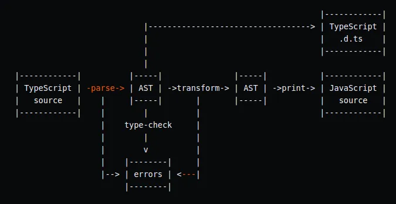
*Figure 14.1: Abstract Syntax Tree Transpiler & Interpreter Architecture (from Rakia Ben Sassi)*

#### The Trade-Off of AST Interpreters:
- **Advantages:** Retains full program context, scoping relationships, and semantic metadata. Ideal for performing sophisticated static analysis, interactive debugging, and runtime type checking.
- **Disadvantages:** Walking an object-oriented tree at runtime causes severe pointer chasing and frequent CPU cache misses. Pure AST interpreters run significantly slower than bytecode interpreters.

---

## 15. Evolution of Programming Languages

### 15.1 The Five Generations (1GL to 5GL)

The evolution of programming languages reflects a continuous push to raise the level of abstraction, enabling humans to describe complex computational logic without getting bogged down in hardware minutiae:

| Generation | Category | Notable Languages | Defining Characteristics & Abstraction Mechanism |
|---|---|---|---|
| **1st Generation (1GL)** | **Machine Language** | Raw binary opcodes (`01001000 ...`) | Machine-level instructions encoded in binary bits. Executed directly by CPU circuits with zero abstraction. Highly tedious and platform-bound. |
| **2nd Generation (2GL)** | **Assembly Language** | Intel x86 ASM, ARM ASM, Motorola 68000 | Replaces numeric opcodes with human-readable mnemonics (`MOV`, `ADD`, `JMP`) and symbolic memory labels. Directly mapped 1:1 to machine instructions. |
| **3rd Generation (3GL)** | **High-Level Languages** | Fortran, COBOL, Lisp, C, C++, Java, Rust | Introduces structured control flow (`if/else`, `while`, `for`), algebraic math expressions, and rich type abstractions. Machine-independent. |
| **4th Generation (4GL)** | **Domain-Specific / Declarative** | SQL, NOMAD, PostScript, MATLAB, R | Non-procedural languages engineered for specific problem domains. Focuses on **what result to obtain** rather than specifying step-by-step memory instructions. |
| **5th Generation (5GL)** | **Logic & Constraint Languages** | Prolog, OPS5, Mercury | Solves computational problems based on declared logical facts, inference rules, and mathematical constraints rather than algorithmic workflows. |

---

### 15.2 Paradigm Classifications

Programming languages can also be classified across multiple orthogonal paradigms:

```
┌────────────────────────────────────────────────────────────────────────┐
│                        PROGRAMMING PARADIGMS                           │
├──────────────────────────────────┬─────────────────────────────────────┤
│        IMPERATIVE / PROCEDURAL   │             DECLARATIVE             │
│  - Specifies HOW computation     │  - Specifies WHAT computation       │
│    is executed step-by-step.     │    result is desired.               │
│  - Mutable state & variables.    │  - Immutable data & pure logic.     │
│  - e.g., C, C++, Java, Pascal.   │  - e.g., SQL, Haskell, Prolog.      │
├──────────────────────────────────┼─────────────────────────────────────┤
│         OBJECT-ORIENTED (OOP)    │             FUNCTIONAL              │
│  - Organizes code around objects │  - Treats computation as mathematical│
│    containing data and methods.  │    functions without side effects.  │
│  - e.g., Java, C++, Python, C#.  │  - e.g., Haskell, ML, Lisp, Clojure.│
├──────────────────────────────────┼─────────────────────────────────────┤
│             VON NEUMANN          │              SCRIPTING              │
│  - Mirrors hardware architecture:│  - Interpreted, high-level languages│
│    memory cells modified by      │    designed for rapid gluing of     │
│    sequential CPU instructions.  │    heterogeneous software components│
│  - e.g., C, Fortran.             │  - e.g., Python, Bash, Perl, Ruby.  │
└──────────────────────────────────┴─────────────────────────────────────┘
```

---

### 15.3 Historical Timeline (1940s to 2020s)

```
1940s  ──► Machine Language (Raw binary patch panels & punch cards)
1950s  ──► Assembly Language (First mnemonics, EDSAC Initial Orders)
1957   ──► FORTRAN (First high-level scientific language by John Backus at IBM)
1959   ──► COBOL (Common Business-Oriented Language led by Grace Hopper)
1960   ──► LISP (John McCarthy; symbolic computing; first functional & interpreted HLL)
1967   ──► Simula 67 (Ole-Johan Dahl & Kristen Nygaard; first object-oriented language)
1972   ──► C (Dennis Ritchie at Bell Labs; power of systems programming)
1983   ──► C++ (Bjarne Stroustrup; OOP combined with C efficiency; original Cfront transpiler)
1991   ──► Python (Guido van Rossum; readable scripting language)
1995   ──► Java (Sun Microsystems; WORA hybrid bytecode) & JavaScript (Brendan Eich)
2000s  ──► C# (.NET CLR hybrid), Swift (Apple), Go (Google)
2010s+ ──► Rust (Mozilla; memory safety without garbage collection via compiler borrow checker)
```

---

### 15.4 Impact of Compilers on Language Design: The `register` Case Study

The evolution of compilers deeply influences how programming languages are designed. A classic historical example from **Dragon Book Section 1.5.1** is the **`register` keyword in C**:

#### The Historical Context:
- When the C programming language was created in the mid-1970s, early compilers were simplistic and could not determine which variables should reside in high-speed CPU registers.
- The language designers introduced the `register` keyword so programmers could give the compiler a manual hint:
  ```c
  register int counter = 0;  // Suggests keeping 'counter' in a CPU register
  ```

#### Why `register` Became Obsolete:
- In the 1980s, compiler researchers developed brilliant **Graph Coloring Register Allocation Algorithms** (Chaitin, Briggs).
- These algorithms mathematically model variable lifespans ("live ranges") and compute mathematically optimal register assignments across entire functions.
- Modern compilers perform register allocation **far better than human programmers can**!
- Consequently, in modern C and C++, the `register` keyword is completely ignored by optimizing compilers (and was formally removed in C++17). **Compiler sophistication made a language feature obsolete!**

---

## 16. The Science of Building a Compiler

### 16.1 Mathematical Modeling in Compiler Design

Compiler design is a masterpiece of applied mathematics and computer science theory. Complex real-world software translation problems are abstracted into rigorous mathematical models:

```
Compiler Phase             Mathematical Model / Formal Theory
───────────────────────    ──────────────────────────────────────────────────
Lexical Analysis     ──►   Finite-State Automata (DFA / NFA) & Regular Expressions
Syntax Analysis      ──►   Context-Free Grammars (CFG), Pushdown Automata, LL/LR Parsing
Semantic Analysis    ──►   Attribute Grammars & Type Systems
Intermediate Code    ──►   Abstract Syntax Trees (AST) & Linear 3-Address Tuples
Code Optimization    ──►   Control-Flow Graphs (CFG), Dominator Trees, Fixed-Point Data-Flow Equations
Register Allocation  ──►   Graph Coloring (NP-Complete graph reduction algorithms)
```

---

### 16.2 The Science of Code Optimization

Optimizing code is not about magic tricks—it is grounded in formal program semantics:
1. **Safety / Semantic Preservation:** An optimization is **illegal** if there exists even a single possible runtime execution path where the program produces a different observable output or crashes prematurely.
2. **Conservative Approximations:** If the compiler cannot prove beyond all doubt that an optimization is 100% safe, it must conservatively assume it is unsafe and **leave the code unchanged**!

---

### 16.3 Fundamental Limits: Undecidability & Heuristics

A profound truth of theoretical computer science establishes the limits of compilation:

> 🛑 **Theorem (Rice's Theorem / Undecidability of Equivalence):**  
> Determining whether two arbitrary computer programs compute the exact same function is **computationally undecidable**. Furthermore, generating the mathematically optimal machine code for an arbitrary program is an undecidable problem!

**What this means for Compiler Writers:**
- No compiler can ever be "perfect" or find the theoretical absolute best machine instructions for every program.
- Compiler engineers rely on **heuristics**—clever mathematical algorithms that guarantee correctness while achieving near-optimal performance in practice.

---

## 17. Applications of Compiler Technology Beyond Compilers

Techniques pioneered in compiler construction have revolutionized fields far outside programming language translation:

```
                                  COMPILER TECHNOLOGY
                                           │
         ┌───────────────────┬─────────────┴───────┬───────────────────┐
         ▼                   ▼                     ▼                   ▼
┌──────────────────┐┌──────────────────┐┌──────────────────┐┌──────────────────┐
│   Hardware &     ││ Computer System  ││ Program & Binary ││ Software Quality│
│ Architecture     ││   Optimization   ││   Translation    ││   & Security     │
│   Co-Design      ││ (Parallelism &   ││ (Synthesis, SQL, ││ (Static Analysis,│
│ (RISC, VLIW)     ││  Cache Locality) ││   Emulation)     ││  Bounds Checks)  │
└──────────────────┘└──────────────────┘└──────────────────┘└──────────────────┘
```

---

### 17.1 Implementation of High-Level Programming Languages

High-level programming abstractions (objects, polymorphism, dynamic memory, lambdas) carry potential runtime performance overheads known as **abstraction penalties**. Advanced compiler technology eliminates these penalties:
- **Procedure Inlining:** Replaces function call overhead with the literal body of the function.
- **Devirtualization:** Statically resolves polymorphic virtual method calls into direct jumps when the concrete class type is known.
- **Escape Analysis:** Determines if an object dynamically allocated via `new` never escapes the current method stack frame; if so, the compiler allocates it on the high-speed CPU stack rather than the heap, eliminating garbage collection overhead!

---

### 17.2 Optimizations for Computer Architectures (Parallelism & Caches)

Modern high-performance computer systems rely heavily on compiler optimization to harness hardware capabilities:

#### 1. Exploiting Parallelism:
- **Instruction-Level Parallelism (ILP):** Compilers reschedule independent instructions so superscalar CPU pipelines can execute 4 to 8 instructions per cycle simultaneously.
- **Very Long Instruction Word (VLIW):** Architectures like the Intel IA-64 (Itanium) have hardware that cannot dynamically schedule instructions; they depend entirely on the compiler to bundle multiple operations into one instruction word!
- **SIMD Vectorization:** Modern compilers automatically recognize sequential array operations and transform them into Vector Instructions (AVX-512, ARM Neon) that process 8 to 16 data items in a single clock cycle.
- **Multi-Core Auto-Parallelization:** Compilers automatically identify parallelizable loops in scientific code and distribute iterations across multiple processor cores using thread pools.

#### 2. Optimizing Memory Hierarchies:
Accessing data from main memory (RAM) is **hundreds of times slower** than accessing CPU cache registers:

$$\text{CPU Register (0.5 ns)} \ll \text{L1 Cache (1 ns)} \ll \text{L2 Cache (4 ns)} \ll \text{RAM (100 ns)}$$

- **Cache Miss Penalty:** A CPU cache miss causes pipeline stalls lasting up to 200 clock cycles!
- **Loop Tiling (Loop Blocking):** In large matrix multiplications, compilers divide massive matrices into small blocks ("tiles") that fit entirely within high-speed L1 cache memory, reducing cache misses by over **90%**!
- **Code Layout Reordering:** Reordering functions in memory so frequently executed routines sit together inside the CPU Instruction Cache ($I$-cache).

---

### 17.3 Design of New Computer Architectures (RISC & Co-Design)

Compilers transformed how hardware is designed:

#### The RISC Revolution:
- In the 1970s, computers used **CISC** (Complex Instruction-Set Computer) designs with hundreds of complicated instructions designed to make manual assembly programming easier.
- Computer scientists (John Hennessy and David Patterson) demonstrated that modern compilers can synthesize complex operations far more efficiently using a small, orthogonal set of simple instructions: **RISC** (Reduced Instruction-Set Computer).
- RISC processors (ARM, MIPS, RISC-V, SPARC) are simpler to fabricate, consume dramatically less electrical power, and run at higher clock frequencies!

#### Hardware/Software Co-Design:
Today, hardware engineers never build a physical silicon CPU chip without first writing a compiler for it. Compilers running on software simulators evaluate proposed CPU architectural changes before millions of dollars are spent manufacturing silicon!

---

### 17.4 Program Translations (Binary Translation, Hardware Synthesis, SQL)

1. **Binary Translation:**
   - Translates machine code compiled for one CPU to run on an entirely different CPU architecture!
   - **Apple Rosetta 2:** Translates Intel x86-64 Mac applications into native ARM64 code for Apple Silicon M-series chips with astonishing performance.
   - **Transmeta Crusoe:** An ultra-low-power VLIW CPU that dynamically translated x86 instructions into native VLIW code.
2. **Hardware Synthesis:**
   - Modern computer microchips are designed using hardware description languages like **Verilog** and **VHDL**.
   - **Hardware Synthesis Compilers** translate these register-transfer-level (RTL) code descriptions into gate-level netlists and physical transistor layouts!
3. **Database Query Compilation:**
   - SQL queries (`SELECT ... WHERE ...`) are declarative descriptions of data retrieval.
   - Modern database engines (such as PostgreSQL, MySQL, and Spark SQL) compile SQL queries into optimized relational algebra execution plans.
4. **Compiled Simulation:**
   - Simulating circuit designs using an interpreter can take days. Compiling the circuit equations directly into native machine code accelerates simulation by multiple orders of magnitude.

---

### 17.5 Software Productivity & Security Tools

Data-flow analysis techniques originally engineered for compiler optimization have become the backbone of modern cybersecurity and software reliability:

#### 1. Static Analysis vs Testing:
- **Software Testing:** Executes the program against specific test input cases. It only uncovers bugs along paths that are actively executed.
- **Static Analysis (Compiler-Based):** Analyzes the code without running it. It mathematically examines **all possible execution paths simultaneously**!

#### 2. Soundness vs Completeness:
Because program behavior is undecidable, static bug detection tools make trade-offs:
- **Sound Tools:** Never miss a real bug (zero false negatives), but may report false alarms.
- **Complete Tools:** Every warning is a guaranteed bug, but may miss subtle bugs.
- Compilers must be strictly conservative, whereas bug finders balance accuracy.

#### 3. Type Checking & Tainted-Data Tracking:
- Analyzers track untrusted input strings supplied by web users.
- If a string marked "tainted/dangerous" reaches an SQL query or shell execution statement without sanitization, the compiler flags a critical **SQL Injection** or **Remote Code Execution** vulnerability before the software is ever deployed!

#### 4. Bounds Checking & Buffer Overflows:
- In low-level languages like C and C++, array indexing does not automatically verify memory bounds.
- If an attacker supplies input larger than the allocated memory buffer, the data spills over, overwriting adjacent memory and hijacking the CPU execution pointer (the classic **Buffer Overflow Attack**).
- Compiler data-flow analysis eliminates redundant array bounds checks in safe languages while identifying buffer overflow vulnerabilities in legacy C code.

```c
// Vulnerable legacy code:
char buffer[16];
gets(buffer);  // DANGEROUS! No bounds check -> Buffer overflow!

// Safe alternative:
fgets(buffer, sizeof(buffer), stdin); // Bounds checked
```

#### 5. Memory-Management Tools & Garbage Collection:
- Automated static memory analyzers (such as **Purify**, **Valgrind**, and LLVM's **AddressSanitizer (ASan)**) locate memory leaks, dangling pointers, and double-free bugs.
- Modern managed runtimes employ automatic **Garbage Collection (GC)**, completely eliminating memory management vulnerabilities at the cost of modest runtime overhead.

---

## 18. Programming Language Basics: Static vs Dynamic

*(From Dragon Book Chapter 1, Section 1.6 / Page 25)*

### 18.1 The Static/Dynamic Distinction (Compile-Time vs Run-Time)

When designing a programming language and its compiler, a foundational design decision is: **Which decisions are made by the compiler, and which decisions are deferred until runtime?**

```
┌───────────────────────────────────────┬───────────────────────────────────────┐
│        STATIC POLICY (COMPILE-TIME)   │        DYNAMIC POLICY (RUN-TIME)      │
├───────────────────────────────────────┼───────────────────────────────────────┤
│ - Decisions made by the COMPILER by   │ - Decisions made only when the        │
│   examining the source code text.     │   program is EXECUTING.               │
│ - Zero runtime execution overhead.    │ - Requires runtime tracking and checks│
│ - Detected errors reported before run.│ - Errors manifest as runtime crashes. │
│ - e.g., Static typing in C/Java.      │ - e.g., Dynamic typing in Python/JS.  │
└───────────────────────────────────────┴───────────────────────────────────────┘
```

---

### 18.2 Static Scope (Lexical Scope) vs Dynamic Scope

The **scope of a declaration** defines the region of a program in which uses of an identifier refer to that declaration:

#### 1. Static Scope (Lexical Scope):
- A language uses **static scope** if it is possible to determine the declaration associated with every variable identifier **purely by looking at the static text of the program**.
- The nesting of textual code blocks and function definitions dictates visibility.
- **Used by:** C, C++, Java, Rust, Python, Go.

#### 2. Dynamic Scope:
- A language uses **dynamic scope** if the declaration associated with an identifier depends on the **sequence of runtime function calls** (the dynamic call stack)!
- As the program executes, the exact same variable reference `x` inside a function can bind to completely different declarations depending on *who called that function*.
- **Used by:** Early LISP, Perl (variables declared with `local`), Bash shell functions.

#### Concrete Comparative Code Example:

```c
int x = 10;  // Global variable

void print_x() {
    printf("%d\n", x);
}

void foo() {
    int x = 20;  // Local variable in foo
    print_x();
}

int main() {
    foo();
    return 0;
}
```

- **Under Static Scoping (C / Java):**  
  When `print_x()` is compiled, the compiler looks textually outward and sees the global `int x = 10;`.  
  **Output: `10`**
- **Under Dynamic Scoping:**  
  When `print_x()` executes, it checks the active call stack. Since `print_x()` was invoked by `foo()`, and `foo()` declared a local `x = 20`, it uses `foo`'s `x`!  
  **Output: `20`**

---

### 18.3 The Dual Meaning of `static`: Scope vs Memory Allocation

In languages like C and Java, the keyword `static` can cause confusion for students because it is used in two completely distinct contexts:

```java
public class Account {
    public static int bankCode = 101;  // Static variable
    public int accountNumber;          // Instance variable
}
```

1. **Static Scoping:** Refers to identifier name visibility governed by lexical block nesting.
2. **Static Storage Allocation (`public static int bankCode;`):**  
   Here, "static" has **nothing to do with scope**! Instead, it informs the compiler that:
   - The memory location for `bankCode` can be determined **at compile time**.
   - There is a **single, shared location in memory** for this variable across the entire class, rather than a separate copy instantiated inside each individual object instance on the heap!

---

## 19. Errors in Compilation & Error Classification

### 19.1 What is a Compilation Error?

In the words of **Dr. Muhammad Nur Yanhaona**:

> ❗ *"Compilation errors are those errors that are identified during the **analysis phase** of the compiler.  
> If the compiler cannot identify what token you wanted in a situation, or finds grammatical mistakes, or cannot determine any meaning out of an expression/statement, only then it throws errors. Such errors make it impossible for it to generate a machine code equivalent."*

---

### 19.2 Phase-Wise Error Detection (Why Synthesis Never Reports Errors)

A fundamental architectural principle of compilers:

> 🛡️ **The Synthesis Phase (Back End) NEVER reports errors!**  
> All error detection and diagnostic reporting occurs exclusively in the **Analysis Phase (Front End)**!

| Error Category | Compiler Phase that Detects It | Root Cause | Concrete Code Example |
|---|---|---|---|
| **Lexical Error** | **Lexical Analysis (Scanner)** | The scanner encounters a character sequence that does not match any valid token pattern. | `int 3total = 100;` *(Identifier starts with digit)*, or illegal character `@#` outside strings. |
| **Syntax Error** | **Syntax Analysis (Parser)** | The token stream violates the formal Context-Free Grammar rules of the language. | `int x = 5 + * 2;` *(Two consecutive operators without operand)*, or missing closing bracket `}`. |
| **Semantic Error** | **Semantic Analysis** | Structurally valid code that violates type rules, scope rules, or language semantics. | `int x = "hello";` *(Assigning string literal to int)*, or undeclared variable use. |

**Why does the Synthesis phase never report errors?**
- By the time the intermediate representation (IR) reaches the synthesis phase (optimization and code generation), the front end has already mathematically verified that the program is syntactically well-formed, semantically consistent, and type-safe.
- The synthesis phase is a mechanical translation from verified IR into machine opcodes. It only optimizes and generates instructions; it does not evaluate source code validity.

---

### 19.3 Compilation Success $\neq$ Program Correctness!

A program that compiles with **zero errors and zero warnings** is **NOT** guaranteed to be correct!

```c
#include <stdio.h>

int main() {
    // 1. Compiles with zero errors, but CRASHES at runtime:
    int *ptr = NULL;
    printf("%d\n", *ptr);  // Segmentation Fault! Null pointer dereference!

    // 2. Compiles with zero errors, but has a CRITICAL LOGICAL ERROR:
    int sum = 0;
    for (int i = 1; i <= 100; i++) {
        sum -= i;  // Programmer intended += but typed -= !
    }
    return 0;
}
```

The compiler only checks **structural and semantic validity** according to the language rules. It cannot read your mind or verify algorithmic intent!

---

### 19.4 Compilation Errors vs Runtime Errors vs Logical Errors

| Category | When Detected? | Detected By? | Examples |
|---|---|---|---|
| **Compilation Error** | Before execution (Compile-time). | Compiler front-end analysis. | Missing semicolon `;`, undeclared variable, type mismatch. |
| **Runtime Error** | During program execution. | OS kernel or CPU exception handler. | Division by zero, null pointer dereference, stack overflow, array index out of bounds. |
| **Logical Error** | When comparing program output with intended results. | The human developer or software tester. | Using `<` instead of `<=`, wrong mathematical formula, off-by-one errors. |

---

## 20. Comprehensive Practice Questions & Exercises

### 20.1 Dragon Book Section 1.1 Exercises with Solutions

#### Exercise 1.1.1: What is the difference between a compiler and an interpreter?

<details>
<summary><b>🔍 Click to view complete solution</b></summary>

**Solution:**
A **compiler** translates the entire source program written in a high-level language into an equivalent target machine-language program **all at once, before program execution begins**. The resulting target machine code is saved to disk as an independent executable file. When the user executes the program, the CPU runs the compiled machine code directly without the compiler present.

An **interpreter**, by contrast, translates and executes the source program **line-by-line or statement-by-statement at runtime**. It does not generate a separate standalone machine-code binary file on disk; rather, the interpreter software must remain actively running in memory throughout the entire execution of the program.

- **Speed:** Compiled programs run significantly faster because translation and optimization are completed ahead of time.
- **Diagnostics:** Interpreters provide superior error localization and immediate feedback because they execute code incrementally.
</details>

---

#### Exercise 1.1.2: What are the advantages of (a) a compiler over an interpreter and (b) an interpreter over a compiler?

<details>
<summary><b>🔍 Click to view complete solution</b></summary>

**Solution:**

**(a) Advantages of a Compiler over an Interpreter:**
1. **Execution Speed:** Compiled machine code executes at bare-metal CPU hardware speeds, running 5 to 100 times faster than interpreted code because there is no runtime translation overhead.
2. **Global Code Optimization:** The compiler can analyze the entire program structure simultaneously, enabling deep optimizations like loop unrolling, function inlining, auto-vectorization, and register allocation.
3. **Intellectual Property Protection:** Compilers distribute standalone binary machine code, shielding original source code logic from end users.
4. **Self-Contained Deployment:** The end user does not need to install a compiler or language runtime engine on their machine to run the executable.

**(b) Advantages of an Interpreter over a Compiler:**
1. **Interactive Development & Rapid Prototyping:** Developers can test small code fragments immediately without waiting for lengthy compilation and linking cycles.
2. **Superior Runtime Error Diagnostics:** When an error occurs, the interpreter reports the exact line number, call stack, and live variable values at the moment of failure.
3. **Cross-Platform Portability:** The exact same source script can run unmodified across Windows, Linux, and macOS, provided a platform-specific interpreter is installed.
4. **Dynamic Flexibility:** Allows runtime features like `eval()`, dynamic code generation, and interactive REPL environments.
</details>

---

#### Exercise 1.1.3: What advantages are there to a language-processing system in which the compiler produces assembly language rather than machine language?

<details>
<summary><b>🔍 Click to view complete solution</b></summary>

**Solution:**
1. **Ease of Compiler Construction:** Producing symbolic assembly language mnemonics (`MOV`, `ADD`, `JMP`) is significantly easier for compiler writers than managing complex binary bit encodings, opcode byte alignments, and relocation tables directly.
2. **Enhanced Debuggability & Transparency:** Human systems programmers and compiler engineers can open the generated assembly (`.s`) file in a text editor to inspect the quality of the generated code and verify optimizations.
3. **Modularity & Reusability:** The compiler can delegate the tedious tasks of machine-level address binding, instruction encoding, and platform-specific object file formatting (ELF, PE, Mach-O) to an existing, well-tested assembler.
</details>

---

#### Exercise 1.1.4: A compiler that translates a high-level language into another high-level language is called a source-to-source translator (transpiler). What advantages are there to using C as a target language for a compiler?

<details>
<summary><b>🔍 Click to view complete solution</b></summary>

**Solution:**
Using C as the intermediate target language provides immense practical engineering benefits:
1. **Instant Universal Portability:** C compilers (such as GCC and Clang) exist for virtually every computer architecture, microprocessor, operating system, and embedded microcontroller on Earth. By emitting C, a new programming language instantly runs on all these platforms without needing to write dozens of CPU backends!
2. **Access to World-Class Optimizers:** Mature C compilers have benefited from over 40 years of optimization research. By emitting C, the new language automatically inherits aggressive loop optimizations, register allocation, and vectorization performed by the C compiler.
3. **Seamless Interoperability with System APIs:** C is the lingua franca of operating systems. Emitting C makes it trivial to link with existing operating system system calls and native C libraries.
4. **Historical Validation:** This exact strategy was used by **Bjarne Stroustrup** when creating **Cfront** (the original C++ compiler), allowing C++ to achieve rapid global adoption.
</details>

---

#### Exercise 1.1.5: Describe some of the tasks that an assembler needs to perform.

<details>
<summary><b>🔍 Click to view complete solution</b></summary>

**Solution:**
An assembler translates assembly language into relocatable machine code. Its primary tasks include:
1. **Mnemonic-to-Opcode Translation:** Translates symbolic operation codes (e.g., `ADD`, `MOV`, `SUB`) into their corresponding binary machine code bit patterns.
2. **Symbol Table Generation (Pass 1):** Scans the source assembly to discover all user-defined labels and symbolic variable names, tracking their memory offsets using a **Location Counter (LC)**.
3. **Symbolic Address Resolution (Pass 2):** Replaces symbolic jump targets (`JMP loop_end`) and variable references with exact relative numerical displacements or memory offsets.
4. **Literal Pool Construction:** Allocates storage and evaluates constants and literal values defined in the code.
5. **Relocation Table Generation:** Marks all instruction addresses that must be adjusted by the linker or loader when the program is placed at a specific base memory address in RAM.
6. **Object File Generation:** Structures the resulting machine code into standardized relocatable object file sections (`.text` for code, `.data` for initialized variables, `.bss` for uninitialized memory).
</details>

---

### 20.2 Dragon Book Exercise 1.3.1: Language Classification Matrix

**Exercise 1.3.1:** Indicate which of the following terms apply to each language:
- **(a)** Imperative  
- **(b)** Declarative  
- **(c)** von Neumann  
- **(d)** Object-Oriented  
- **(e)** Functional  
- **(f)** Third-Generation (3GL)  
- **(g)** Fourth-Generation (4GL)  
- **(h)** Scripting  

#### Complete Comprehensive Matrix:

| Language | Paradigm & Generation Classifications | Detailed Architectural Rationale |
|---|---|---|
| **1. C** | **(a), (c), (f)** | **Imperative**, **von Neumann** (heavily based on sequential memory modification and CPU pointers), **3rd Generation**. |
| **2. C++** | **(a), (c), (d), (f)** | **Imperative**, **von Neumann**, **Object-Oriented** (classes, inheritance, polymorphism), **3rd Generation**. |
| **3. COBOL** | **(a), (c), (f)** | **Imperative**, **von Neumann** (structured business record updating), **3rd Generation**. |
| **4. Fortran** | **(a), (c), (f)** | **Imperative**, **von Neumann** (the original von Neumann formula translation language), **3rd Generation**. |
| **5. Java** | **(a), (d), (f)** | **Imperative**, **Object-Oriented** (pure class-based structure), **3rd Generation**. *(Abstracts raw von Neumann memory pointers via JVM references).* |
| **6. Lisp** | **(b), (e), (f)** | **Declarative**, **Functional** (expression evaluation without side effects; first-class functions), **3rd Generation**. |
| **7. ML** | **(b), (e), (f)** | **Declarative**, **Functional** (strongly typed pure functional language), **3rd Generation**. |
| **8. Perl** | **(a), (f), (h)** | **Imperative**, **3rd Generation**, **Scripting** (designed for rapid text manipulation, regex processing, and system administration glue). |
| **9. Python** | **(a), (d), (f), (h)** | **Imperative**, **Object-Oriented** (first-class objects), **3rd Generation**, **Scripting** (dynamically typed, interpreted execution). |
| **10. Visual Basic (VB)** | **(a), (c), (d), (f)** | **Imperative**, **von Neumann**, **Object-Oriented** (component object model), **3rd Generation**. |
| **11. SQL** | **(b), (g)** | **Declarative** (specifies *what* data to query, never *how* to loop over disk pages), **4th Generation (4GL)**. |

---

### 20.3 Worked Step-by-Step Translation Problems

#### Problem 1: Full Phase Trace of `result = a + b * 5`

**Given:** `result`, `a`, and `b` are declared as type `float`, and `5` is an integer literal constant. Trace the statement through all six compiler phases.

<details>
<summary><b>🔍 Click to view complete step-by-step walkthrough</b></summary>

**Step 1: Lexical Analysis (Scanning)**
- The scanner breaks the character stream into lexemes and produces tokens:
  - `result` $\to$ `⟨id, 1⟩`
  - `=` $\to$ `⟨=⟩`
  - `a` $\to$ `⟨id, 2⟩`
  - `+` $\to$ `⟨+⟩`
  - `b` $\to$ `⟨id, 3⟩`
  - `*` $\to$ `⟨*⟩`
  - `5` $\to$ `⟨5⟩`
- **Output Token Stream:** `⟨id, 1⟩ ⟨=⟩ ⟨id, 2⟩ ⟨+⟩ ⟨id, 3⟩ ⟨*⟩ ⟨5⟩`

**Step 2: Syntax Analysis (Parsing)**
- Constructs the hierarchical Syntax Tree adhering to operator precedence (`*` before `+`, `=` last):
```
          =
        /   \
    ⟨id, 1⟩    +
             /   \
         ⟨id, 2⟩    *
                  /   \
              ⟨id, 3⟩   5
```

**Step 3: Semantic Analysis (Type Checking & Coercion)**
- The analyzer checks operand types:
  - `id3` (`b`) is `float`.
  - `5` is `int`.
  - Multiplication requires matching floating-point operands.
- The analyzer inserts an **`inttofloat`** type coercion node:
```
          =
        /   \
    ⟨id, 1⟩    +
             /   \
         ⟨id, 2⟩    *
                  /   \
              ⟨id, 3⟩  inttofloat
                           |
                           5
```

**Step 4: Intermediate Code Generation (Three-Address Code)**
- Generates machine-independent three-address instructions:
```
t1 = inttofloat(5)
t2 = id3 * t1
t3 = id2 + t2
id1 = t3
```

**Step 5: Code Optimization**
- **Constant Folding:** `inttofloat(5)` evaluated at compile time $\to$ `5.0`.
- **Copy Propagation / Temporary Elimination:** Eliminates `t3`:
```
t1 = id3 * 5.0
id1 = id2 + t1
```

**Step 6: Code Generation (Target Assembly Code)**
- Maps intermediate code to CPU registers ($R_1, R_2$):
```asm
LDF   R2, id3         ; Load 'b' into Floating-Point Register R2
MULF  R2, R2, #5.0    ; R2 = b * 5.0
LDF   R1, id2         ; Load 'a' into Register R1
ADDF  R1, R1, R2      ; R1 = a + (b * 5.0)
STF   id1, R1         ; Store result into 'result'
```
</details>

---

#### Problem 2: Parenthesized Arithmetic `x = (a + b) * (c - d)`

**Given:** An arithmetic expression with parentheses overriding standard precedence. Trace the Syntax Tree and Three-Address Code.

<details>
<summary><b>🔍 Click to view complete solution</b></summary>

**Syntax Tree Construction:**
Because parentheses force `(a + b)` and `(c - d)` to evaluate before multiplication, both additions/subtractions are subtrees beneath the root multiplication `*`:

```
              =
            /   \
        ⟨id, x⟩    *
                 /   \
                +     -
               / \   / \
              a   b c   d
```

**Three-Address Code (TAC):**
```
t1 = a + b
t2 = c - d
t3 = t1 * t2
x = t3
```
*(Notice how parentheses disappear entirely in Three-Address Code because the explicit order of linear instructions enforces the exact evaluation order!)*
</details>

---

### 20.4 University Exam & Conceptual Review Questions

#### Q1: Why is the Compiler called the "Mother of All Programs"?
<details>
<summary><b>Click to see answer</b></summary>
Because all modern computer software (operating systems, web browsers, databases, compilers) must be translated into machine-executable binary by a compiler. The first compiler had to be written directly in machine code, and from that seed, the entire modern software universe was constructed!
</details>

---

#### Q2: What is the difference between Single-Pass and Multi-Pass compilers? Why are modern compilers multi-pass?
<details>
<summary><b>Click to see answer</b></summary>
A **single-pass compiler** traverses the source code once, emitting target code on the fly. It is extremely fast and uses minimal RAM, but cannot perform deep global optimizations and requires backpatching for forward references.

A **multi-pass compiler** translates code into an Intermediate Representation (IR) and traverses the IR multiple times. Modern compilers are multi-pass because modern computers possess ample RAM, and multiple passes enable aggressive global optimizations (function inlining, loop vectorization, dead code elimination) and clean decoupling between language front ends and hardware back ends.
</details>

---

#### Q3: Why does the Synthesis phase of a compiler NEVER report errors?
<details>
<summary><b>Click to see answer</b></summary>
Because all validation of the source code—lexical, grammatical (syntax), and semantic (type consistency, scope)—is performed completely by the Analysis phase (Front End). By the time Intermediate Code is passed to the Synthesis phase, the code has already been certified as structurally and semantically valid. The synthesis phase only mechanically translates and optimizes instructions into machine code.
</details>

---

#### Q4: What is the difference between Static Scope and Dynamic Scope? Give examples.
<details>
<summary><b>Click to see answer</b></summary>
Under **Static Scope (Lexical Scope)**, the scope of a variable is determined purely by the textual nesting of blocks in the source code at compile time (used by C, C++, Java, Python).

Under **Dynamic Scope**, variable resolution depends on the dynamic sequence of runtime function calls (the runtime call stack). A variable reference binds to the most recently activated declaration on the call stack (used by early LISP, Perl's `local`, and Bash).
</details>

---

## 21. Key Takeaways & Exam Quick Reference

```
╔══════════════════════════════════════════════════════════════════════════════════════╗
║                     CSE 420: LECTURE 1 — MASTER EXAM REVISION CARD                   ║
╠══════════════════════════════════════════════════════════════════════════════════════╣
║                                                                                      ║
║  1. COMPILER vs INTERPRETER:                                                         ║
║     • Compiler: Translates entire program before execution → Fast execution         ║
║     • Interpreter: Translates & executes line-by-line at runtime → Slower execution  ║
║                                                                                      ║
║  2. LANGUAGE-PROCESSING SYSTEM:                                                      ║
║     Source → [Preprocessor] → Modified Source → [Compiler] → Assembly →              ║
║     [Assembler] → Relocatable Object Code → [Linker] → Executable → [Loader] → RAM   ║
║                                                                                      ║
║  3. TWO MAJOR REALMS:                                                                ║
║     • Analysis (Front End): Machine-Independent (Lexical, Syntax, Semantic, IR)     ║
║     • Synthesis (Back End): Machine-Dependent (Optimization, Code Generation)       ║
║                                                                                      ║
║  4. THE SIX PHASES OF A COMPILER:                                                    ║
║     ① Lexical Analysis: Character stream → Tokens ⟨id, attr⟩ (discards whitespace)  ║
║     ② Syntax Analysis: Tokens → Syntax Tree (enforces grammar & precedence)         ║
║     ③ Semantic Analysis: Syntax Tree → Type-checked / Coerced Decorated Tree        ║
║     ④ Intermediate Code Gen: Decorated Tree → Three-Address Code (TAC)              ║
║     ⑤ Code Optimization: Constant folding, dead code removal (preserves semantics)   ║
║     ⑥ Code Generation: TAC → Target Machine Instructions (Register Allocation)      ║
║                                                                                      ║
║  5. SYMBOL TABLE:                                                                    ║
║     Central data structure accessed by ALL phases; stores identifier names, types,   ║
║     memory sizes, scopes, offsets. Implemented via Hash Tables for O(1) lookup.      ║
║                                                                                      ║
║  6. MODULARITY FORMULA:                                                              ║
║     $N$ languages + $M$ architectures = $N + M$ compilers with common IR             ║
║     (without IR, requires $N \times M$ bespoke compilers!). Example: LLVM.          ║
║                                                                                      ║
║  7. HYBRID MODEL (JAVA):                                                             ║
║     Source (.java) → javac → Bytecode (.class) → JVM (Interpreter + JIT) → Machine   ║
║                                                                                      ║
║  8. ERROR REALM RULE:                                                                ║
║     Compilation errors are identified ONLY in the Analysis Phase.                    ║
║     The Synthesis Phase NEVER reports errors!                                        ║
║     Compilation Success ≠ Correct Program (Runtime & logical errors still possible). ║
║                                                                                      ║
║  9. STATIC vs DYNAMIC:                                                               ║
║     Static = Compile-time decision (Lexical Scope)                                  ║
║     Dynamic = Run-time decision (Dynamic Scope via Call Stack)                       ║
║                                                                                      ║
║ 10. OPTIMIZATION GOLDEN RULES:                                                       ║
║     ① Must preserve meaning (correctness first!)                                     ║
║     ② Must improve performance on average                                            ║
║     ③ Compilation time cost must be reasonable                                       ║
║                                                                                      ║
╚══════════════════════════════════════════════════════════════════════════════════════╝
```

---

> 📖 **Looking Ahead to Lecture 2:**  
> In Lecture 2, we will dive deeply into **Phase 1: Lexical Analysis**—exploring how tokens are formally specified using **Regular Expressions**, converted into **Non-deterministic Finite Automata (NFA)** via Thompson's Construction, transformed into **Deterministic Finite Automata (DFA)** using the Subset Construction, and implemented using **Flex**.

---

### 📚 Primary Reading Material Citations:
1. **Aho, A. V., Lam, M. S., Sethi, R., & Ullman, J. D.** (2006). *Compilers: Principles, Techniques, and Tools* (2nd Edition / "The Dragon Book"). Pearson / Addison-Wesley. Chapter 1: Introduction (Sections 1.1–1.6).
2. **Yanhaona, Dr. Muhammad Nur.** *Lesson 1: Architecture of a Compiler and its Behavior*. Department of Computer Science and Engineering.
3. **Ben Sassi, Rakia.** (2021). *Compiler vs. Interpreter: Know The Difference And When To Use Each Of Them*. Better Programming.
