# 📚 CSE 420 — Compiler Design
## Lecture 2: Lexical Analysis, Input Buffering & Regular Expressions

> **Course:** CSE 420 — Compiler Design  
> **Topic:** Lecture 2 — The Lexical Analyzer, Tokenization, Input Buffering Techniques, Formal Language Theory, and Regular Expressions (Theory to Practice)  
> **Reference Textbook:** *Compilers: Principles, Techniques, and Tools* (2nd Edition / "The Dragon Book") by Alfred V. Aho, Monica S. Lam, Ravi Sethi, and Jeffrey D. Ullman (Chapter 3, Sections 3.1–3.4)  
> **Course Lectures & Notes:** Dr. Muhammad Nur Yanhaona (Department of Computer Science & Engineering)  
> **Supplemental Practical Guide:** *Regular Expressions: Theory, Implementation, and Optimization* by Ray Toal (Loyola Marymount University)  

---

## 📑 Table of Contents

1. [Overview & Role of the Lexical Analyzer](#1-overview--role-of-the-lexical-analyzer)
   - [1.1 What is Lexical Analysis (Scanning)?](#11-what-is-lexical-analysis-scanning)
   - [1.2 Architectural Interaction with Parser & Symbol Table](#12-architectural-interaction-with-parser--symbol-table)
   - [1.3 The getNextToken() Mechanism & Demand-Driven Architecture](#13-the-getnexttoken-mechanism--demand-driven-architecture)
   - [1.4 Secondary & Housekeeping Tasks](#14-secondary--housekeeping-tasks)
   - [1.5 Two-Phase Cascade: Scanning vs Lexical Analysis Proper](#15-two-phase-cascade-scanning-vs-lexical-analysis-proper)
   - [1.6 Real-Life Intuition & Analogies](#16-real-life-intuition--analogies)
2. [Why Separate Lexical Analysis from Parsing?](#2-why-separate-lexical-analysis-from-parsing)
   - [2.1 Simplicity of Design & Clean Separation of Concerns](#21-simplicity-of-design--clean-separation-of-concerns)
   - [2.2 Compiler Efficiency & High-Throughput Buffering](#22-compiler-efficiency--high-throughput-buffering)
   - [2.3 Compiler Portability & Device Independence](#23-compiler-portability--device-independence)
3. [The Core Trinity: Tokens, Patterns, and Lexemes](#3-the-core-trinity-tokens-patterns-and-lexemes)
   - [3.1 Precise Formal Definitions](#31-precise-formal-definitions)
   - [3.2 The Canonical Distinction Table](#32-the-canonical-distinction-table)
   - [3.3 The Five Universal Classes of Tokens](#33-the-five-universal-classes-of-tokens)
   - [3.4 Concrete Code Trace: C and C++ Statement Dissection](#34-concrete-code-trace-c-and-c-statement-dissection)
4. [Attributes for Tokens & Symbol Table Interaction](#4-attributes-for-tokens--symbol-table-interaction)
   - [4.1 Why Token Names Alone Are Insufficient](#41-why-token-names-alone-are-insufficient)
   - [4.2 The Mathematical and Structural Representation of Token Attributes](#42-the-mathematical-and-structural-representation-of-token-attributes)
   - [4.3 Symbol Table Pointers as Identifier Attributes](#43-symbol-table-pointers-as-identifier-attributes)
   - [4.4 Complete Trace: Einstein's Mass-Energy Equivalence in Fortran ($E = mc^2$)](#44-complete-trace-einsteins-mass-energy-equivalence-in-fortran-e--mc2)
5. [Tricky Problems When Recognizing Tokens & Language Quirks](#5-tricky-problems-when-recognizing-tokens--language-quirks)
   - [5.1 The Fixed-Format Fortran Ambiguity (DO 5 I = 1.25 vs DO 5 I = 1,25)](#51-the-fixed-format-fortran-ambiguity-do-5-i--125-vs-do-5-i--125)
   - [5.2 Non-Reserved Keywords in PL/I (The DECLARE Dilemma)](#52-non-reserved-keywords-in-pli-the-declare-dilemma)
   - [5.3 The "Maximal Munch" Rule & C++ Nested Templates (`>>` vs `> >`)](#53-the-maximal-munch-rule--c-nested-templates--vs--)
6. [Lexical Errors & Recovery Strategies](#6-lexical-errors--recovery-strategies)
   - [6.1 Why Lexers Cannot Detect Misspellings Locally (The `fi` Paradox)](#61-why-lexers-cannot-detect-misspellings-locally-the-fi-paradox)
   - [6.2 Panic Mode Error Recovery](#62-panic-mode-error-recovery)
   - [6.3 The Four Elementary Error-Repair Transformations](#63-the-four-elementary-error-repair-transformations)
   - [6.4 Minimum Edit Distance vs Practical Overhead](#64-minimum-edit-distance-vs-practical-overhead)
7. [Input Buffering Techniques: Speeding Up Character Scanning](#7-input-buffering-techniques-speeding-up-character-scanning)
   - [7.1 The Critical I/O Bottleneck in Compilers](#71-the-critical-io-bottleneck-in-compilers)
   - [7.2 The Double-Buffer Scheme (Buffer Pairs of Size $N$)](#72-the-double-buffer-scheme-buffer-pairs-of-size-n)
   - [7.3 The Two Pointers: `lexemeBegin` and `forward`](#73-the-two-pointers-lexemebegin-and-forward)
   - [7.4 Can We Run Out of Buffer Space?](#74-can-we-run-out-of-buffer-space)
8. [Sentinels: Optimizing the Lookahead Loop](#8-sentinels-optimizing-the-lookahead-loop)
   - [8.1 The Double-Test Problem in Standard Buffering](#81-the-double-test-problem-in-standard-buffering)
   - [8.2 The Sentinel Solution: Adding `eof` at Buffer Boundaries](#82-the-sentinel-solution-adding-eof-at-buffer-boundaries)
   - [8.3 The Lookahead Algorithm with Sentinels (Step-by-Step C Implementation)](#83-the-lookahead-algorithm-with-sentinels-step-by-step-c-implementation)
   - [8.4 Implementing Multiway Branches via Direct Jump Tables](#84-implementing-multiway-branches-via-direct-jump-tables)
9. [Formal Language Theory: Alphabets, Strings, and Languages](#9-formal-language-theory-alphabets-strings-and-languages)
   - [9.1 Alphabets ($\Sigma$)](#91-alphabets-sigma)
   - [9.2 Strings over an Alphabet](#92-strings-over-an-alphabet)
   - [9.3 Terminology for Parts of Strings (Prefix, Suffix, Substring, Subsequence)](#93-terminology-for-parts-of-strings-prefix-suffix-substring-subsequence)
   - [9.4 String Operations: Concatenation and Exponentiation](#94-string-operations-concatenation-and-exponentiation)
   - [9.5 Mathematical Definition of a Language](#95-mathematical-definition-of-a-language)
10. [Operations on Languages](#10-operations-on-languages)
    - [10.1 Union ($L \cup M$)](#101-union-l-cup-m)
    - [10.2 Concatenation ($LM$)](#102-concatenation-lm)
    - [10.3 Kleene Closure ($L^*$) vs Positive Closure ($L^+$)](#103-kleene-closure-l-vs-positive-closure-l)
    - [10.4 Algebraic Properties & Worked Combinatorial Examples](#104-algebraic-properties--worked-combinatorial-examples)
11. [Regular Expressions: Formal Foundation](#11-regular-expressions-formal-foundation)
    - [11.1 Inductive Definition: Basis and Induction Rules](#111-inductive-definition-basis-and-induction-rules)
    - [11.2 Operator Precedence and Associativity Rules](#112-operator-precedence-and-associativity-rules)
    - [11.3 Regular Sets & Language Denotation](#113-regular-sets--language-denotation)
    - [11.4 The Seven Fundamental Algebraic Laws for Regular Expressions](#114-the-seven-fundamental-algebraic-laws-for-regular-expressions)
12. [Regular Definitions & Hierarchical Pattern Construction](#12-regular-definitions--hierarchical-pattern-construction)
    - [12.1 Definition of Regular Definitions ($d_i \to r_i$)](#121-definition-of-regular-definitions-d_i-to-r_i)
    - [12.2 Preventing Circularity & Recursion](#122-preventing-circularity--recursion)
    - [12.3 Regular Definition for Identifiers across Languages](#123-regular-definition-for-identifiers-across-languages)
    - [12.4 Regular Definition for Unsigned Integers & Floating-Point Numbers](#124-regular-definition-for-unsigned-integers--floating-point-numbers)
13. [Extensions to Regular Expressions in Compiler Tools (Lex/Flex)](#13-extensions-to-regular-expressions-in-compiler-tools-lexflex)
    - [13.1 Positive Closure ($r^+$) and Optional Elements ($r?$)](#131-positive-closure-r-and-optional-elements-r)
    - [13.2 Character Classes and Ranges ($[a-z]$, $[0-9]$, $[^a-z]$)](#132-character-classes-and-ranges)
    - [13.3 Bounded Repetition ($r\{m, n\}$)](#133-bounded-repetition-rmn)
    - [13.4 Line Anchors ($^$ and $\$) and Trailing Context ($r_1 / r_2$)](#134-line-anchors-and-trailing-context)
    - [13.5 Lex Metacharacter Reference Guide & Escape Rules](#135-lex-metacharacter-reference-guide--escape-rules)
14. [Lexical Analyzer Generators: The Lex/Flex Ecosystem](#14-lexical-analyzer-generators-the-lexflex-ecosystem)
    - [14.1 Why Automated Lexer Generators?](#141-why-automated-lexer-generators)
    - [14.2 The Lex Workflow: Specification to Object Code](#142-the-lex-workflow-specification-to-object-code)
    - [14.3 Structure of a Lex Specification File (`lex.l`)](#143-structure-of-a-lex-specification-file-lexl)
    - [14.4 Rule Disambiguation Principles (Longest Match & First Match)](#144-rule-disambiguation-principles-longest-match--first-match)
    - [14.5 Keywords vs Identifiers Priority Rule](#145-keywords-vs-identifiers-priority-rule)
15. [Practical Regular Expressions: Modern Engines & Deep Concepts](#15-practical-regular-expressions-modern-engines--deep-concepts)
    - [15.1 Formal Regular Expressions vs Modern Practical Regex](#151-formal-regular-expressions-vs-modern-practical-regex)
    - [15.2 The Four Core Programming Operations (Validation, Extraction, Search, Replace)](#152-the-four-core-programming-operations)
    - [15.3 Capturing Groups vs Non-Capturing Groups (`(?:...)`)](#153-capturing-groups-vs-non-capturing-groups)
    - [15.4 Quantifier Taxonomy: Greedy vs Reluctant (Lazy) vs Possessive](#154-quantifier-taxonomy-greedy-vs-reluctant-lazy-vs-possessive)
    - [15.5 Zero-Width Assertions: Lookahead & Lookbehind (Positive & Negative)](#155-zero-width-assertions-lookahead--lookbehind)
    - [15.6 Regex Modifiers / Flags (`g, i, m, s, x, d, u`)](#156-regex-modifiers--flags)
    - [15.7 Performance Pitfalls & Catastrophic Backtracking](#157-performance-pitfalls--catastrophic-backtracking)
    - [15.8 Ten Golden Rules for High-Performance Regex](#158-ten-golden-rules-for-high-performance-regex)
16. [Cross-Language Implementations & Hands-On Code](#16-cross-language-implementations--hands-on-code)
    - [16.1 C / Flex Implementation](#161-c--flex-implementation)
    - [16.2 Python (`re` Module)](#162-python-re-module)
    - [16.3 Java (`Pattern` and `Matcher` Advanced Features)](#163-java-pattern-and-matcher-advanced-features)
    - [16.4 JavaScript (`RegExp`, `exec`, `replace`)](#164-javascript-regexp-exec-replace)
    - [16.5 Ruby & Perl Idiomatic Regex](#165-ruby--perl-idiomatic-regex)
17. [Recognition of Tokens: Transition Diagrams & Automata Preview](#17-recognition-of-tokens-transition-diagrams--automata-preview)
    - [17.1 Transition Diagrams for Identifiers and Numbers](#171-transition-diagrams-for-identifiers-and-numbers)
    - [17.2 Transition Diagrams for Relational Operators (`<`, `<=`, `<>`, `>`, `>=`, `=`)](#172-transition-diagrams-for-relational-operators)
    - [17.3 Branching Grammar Fragment: The Big Picture Connection](#173-branching-grammar-fragment-the-big-picture-connection)
18. [Dragon Book Exercises with Complete Step-by-Step Solutions](#18-dragon-book-exercises-with-complete-step-by-step-solutions)
    - [18.1 Section 3.1 Exercises (3.1.1 to 3.1.2)](#181-section-31-exercises-with-solutions)
    - [18.2 Section 3.3 Exercises (3.3.1 to 3.3.12 Complete Worked Solutions)](#182-section-33-exercises-with-solutions)
19. [Interactive Review Quiz Cards](#19-interactive-review-quiz-cards)
20. [Key Takeaways & Master Exam Revision Card](#20-key-takeaways--master-exam-revision-card)

---

## 1. Overview & Role of the Lexical Analyzer

### 1.1 What is Lexical Analysis (Scanning)?

In the compiler architecture, the **Lexical Analyzer** (conventionally known as the **Scanner**) is the very first phase of the analysis engine (Front End). Its overarching mandate is straightforward yet critically fundamental:

> 🎯 **Primary Mission of the Lexical Analyzer:**  
> The Lexical Analyzer reads the raw stream of characters comprising the source code (typically read from a file or buffer), groups those characters into meaningful atomic character sequences called **lexemes**, and outputs a stream of structured objects called **tokens** to the Syntax Analyzer (Parser).

```
                    ┌────────────────────────────┐
                    │        Source Code         │
                    │  (Raw Character Stream)    │
                    │   e.g., "position = rate"  │
                    └─────────────┬──────────────┘
                                  │
                                  ▼
                    ┌────────────────────────────┐
                    │      LEXICAL ANALYZER      │ ◄────► [ Symbol Table ]
                    │         (Scanner)          │
                    └─────────────┬──────────────┘
                                  │
                                  ▼  Token Stream
                    ┌────────────────────────────┐
                    │      SYNTAX ANALYZER       │
                    │          (Parser)          │
                    └────────────────────────────┘
```

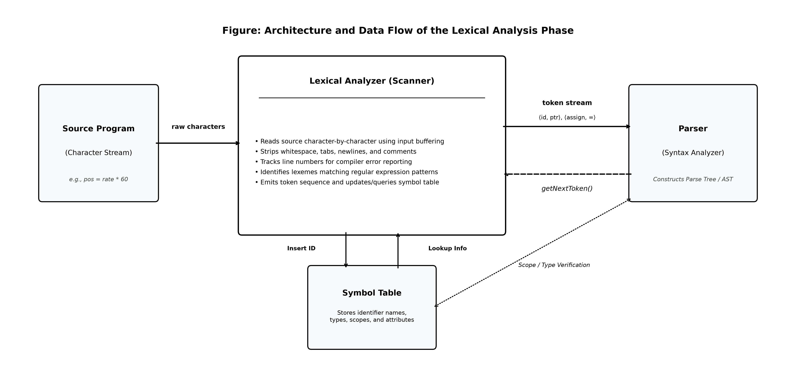
*Figure 1.1: Complete Overview of the Lexical Analysis Pipeline within the Compiler Front End*

---

### 1.2 Architectural Interaction with Parser & Symbol Table

The Lexical Analyzer does not operate in isolation. It maintains a constant, bidirectional dialogue with both the **Parser** and the **Symbol Table**:

1. **Dialogue with the Parser:**  
   The lexical analyzer is the gatekeeper of raw input. The parser never reads source files directly; it only consumes tokens handed to it by the lexical analyzer.
2. **Dialogue with the Symbol Table:**  
   - When the lexical analyzer discovers an identifier (such as a variable name `score` or a function name `calculate`), it checks whether that identifier is already in the Symbol Table.
   - If it is new, the lexer inserts the lexeme into the Symbol Table.
   - In certain language designs, the lexical analyzer reads information *back* from the Symbol Table (e.g., typedef names in C) to determine whether a word represents a generic variable identifier or a custom type token.

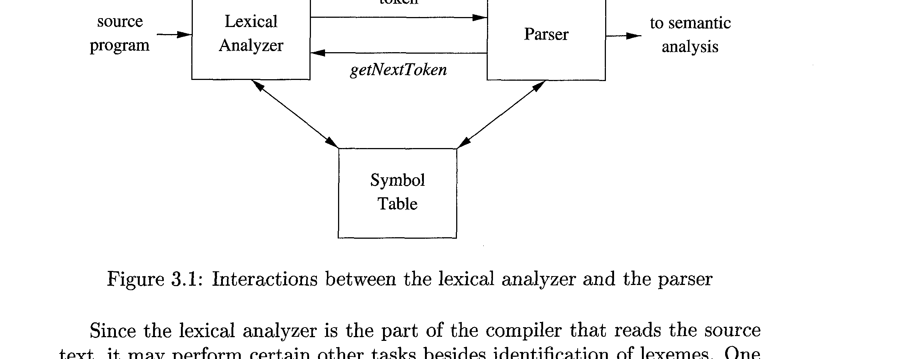
*Figure 1.2: Interactions between the Lexical Analyzer, the Parser, and the Symbol Table (Dragon Book Fig 3.1)*

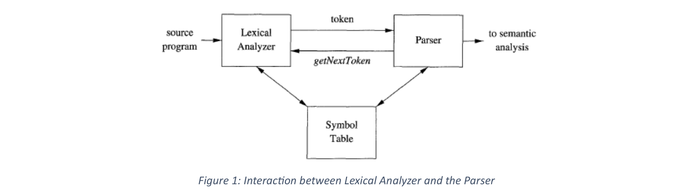
*Figure 1.3: Simplified Interaction Pipeline as Outlined in Course Lecture Notes (Dr. Muhammad Nur Yanhaona)*

---

### 1.3 The getNextToken() Mechanism & Demand-Driven Architecture

In most production compilers, the lexical analyzer is **not** implemented as a separate standalone pass that reads the whole source file at once and dumps a massive array of millions of tokens to disk before the parser starts.

Instead, the compiler utilizes a **demand-driven (producer-consumer)** architecture:

- The **Parser** acts as the *master / consumer*.
- The **Lexical Analyzer** acts as a *subroutine / producer*.
- Whenever the parser needs another grammatical unit to advance its grammar derivation or shift a state on its parsing stack, it executes a function call:
  ```c
  Token nextToken = getNextToken();
  ```
- The lexical analyzer awakes, advances its pointers across the input buffer, isolates the next lexeme, constructs the token pair `⟨token-name, attribute-value⟩`, and immediately returns it to the parser.
- **Why this matters:** This pipelined approach saves immense amounts of memory and allows the compiler to detect syntax and lexical errors incrementally as the program is read!

---

### 1.4 Secondary & Housekeeping Tasks

Because the lexical analyzer is the *sole* component of the compiler that inspects every single character of the source text, it is entrusted with several essential housekeeping chores:

1. **Stripping Comments:**  
   Comments (`// single-line` or `/* multi-line */` in C/C++, `#` in Python) exist exclusively for human developers. The CPU and parser have zero interest in comments. The lexical analyzer recognizes comments and quietly discards them without generating tokens.
2. **Eliminating Whitespace:**  
   Blanks, tabs (`\t`), newlines (`\n`), and carriage returns (`\r`) serve to separate tokens. The scanner collapses redundant whitespace and strips it away.
3. **Tracking Source Line Numbers for Diagnostic Error Messages:**  
   Whenever a newline character `\n` is encountered, the scanner increments a line counter. This allows the compiler to print helpful diagnostics like:  
   `Error on line 42, column 15: missing ';' before '}'`.
4. **Generating Error Listings:**  
   Some compilers have the scanner make a mirror copy of the source code, interweaving formatted diagnostic warnings directly beneath the offending line.
5. **Macro Expansion:**  
   If the language toolchain integrates macro preprocessing within the front end, the lexical analyzer replaces macro invocations (e.g., `#define PI 3.14159`) with their textual expansions before token emission.

---

### 1.5 Two-Phase Cascade: Scanning vs Lexical Analysis Proper

In many high-performance compiler designs, the lexical analysis phase is internally structured as a cascade of two distinct sequential sub-processes:

```
┌────────────────────┐     Raw Chars     ┌─────────────────────┐
│    Source Text     │ ────────────────► │       SCANNER       │
└────────────────────┘                   │ (Stripping Comments │
                                         │  & Whitespace)      │
                                         └──────────┬──────────┘
                                                    │ Compaction Stream
                                                    ▼
                                         ┌─────────────────────┐
                                         │  LEXICAL ANALYZER   │
                                         │       PROPER        │
                                         │ (Token Production)  │
                                         └──────────┬──────────┘
                                                    │ Tokens
                                                    ▼
                                                 PARSER
```

1. **Scanning (The Filter Stage):**  
   A simple, high-speed character processor that does not require knowledge of grammar or token patterns. It sweeps through raw text, discards comments, and compacts consecutive whitespace characters into a single space.
2. **Lexical Analysis Proper (The Tokenizer Stage):**  
   The complex finite-automaton engine that inspects the compacted characters, executes pattern matching, enters symbols into tables, and outputs the formal sequence of tokens.

---

### 1.6 Real-Life Intuition & Analogies

To understand why this phase exists, consider these everyday real-life parallels:

- **Analogy 1: Reading a English Sentence:**  
  When you read the sentence:
  > *"The quick brown fox jumps over the lazy dog."*  
  Your brain first recognizes the individual alphabetical letters: `t`, `h`, `e`, grouped by whitespace into words: **"The"**, **"quick"**, **"brown"**.  
  You do not verify the grammatical structure (Subject-Verb-Object) until you have identified the discrete words! Identifying the words is **Lexical Analysis**. Checking that the subject agrees with the verb is **Syntax Analysis (Parsing)**.
- **Analogy 2: The Airport Security Baggage Scanner:**  
  Before an airplane is loaded, luggage passes through an X-ray scanner. The scanner separates items into categories: liquid containers, electronic devices, clothing, prohibited items. It tags each item and filters out irrelevant clutter. The baggage handlers (the parser) only organize tagged bins into the aircraft hold.

---

## 2. Why Separate Lexical Analysis from Parsing?

A common question that students often ask in compiler design:  
*Why don't we combine lexical analysis and parsing into a single giant step? Why can't the parser read characters directly from the file?*

The Dragon Book (*Section 3.1.1*) and Dr. Yanhaona articulate **three foundational engineering reasons**:

```
                 WHY SEPARATE LEXICAL ANALYSIS & PARSING?
     ┌───────────────────────────────┬──────────────────────────────┐
     │                               │                              │
     ▼                               ▼                              ▼
1. SIMPLICITY OF DESIGN     2. COMPILER EFFICIENCY     3. COMPILER PORTABILITY
 • Cleaner grammars          • Fast, dedicated I/O      • Device-specific quirks
 • Parser ignores spaces     • Specialized buffering      isolated to lexer
 • No comment rules          • 80%+ time spent in I/O   • Clean cross-platform core
```

### 2.1 Simplicity of Design & Clean Separation of Concerns

- **Separation of concerns** is the golden rule of computer science.
- If the parser had to handle whitespace, indentation, comments, and character encodings inside its formal grammar, Context-Free Grammars (CFGs) would become extraordinarily bloated, fragile, and difficult to comprehend.
- **Example:** Imagine writing a CFG rule for an `if`-statement where every single keyword, variable, and parenthesis allowed arbitrary spaces, tabs, and multiline comments interspersed between every character! The grammar would explode by a factor of 10.
- By isolating character grouping into the lexical analyzer, the parser is free to focus strictly on structural language syntax (trees, expressions, control flow).

### 2.2 Compiler Efficiency & High-Throughput Buffering

- Empirical profiling of compilers demonstrates that **over 70% to 80% of total compilation execution time is spent simply reading source characters from disk and scanning them!**
- Syntactic analysis (parsing) involves complex recursive algorithms, stack operations, and tree nodes. Running such heavy machinery for every individual byte is catastrophically slow.
- A dedicated lexical analyzer uses specialized, lightning-fast buffering routines (such as two-buffer pairs and sentinels) and highly optimized Deterministic Finite Automata (DFA) state tables implemented in tight CPU register loops.

### 2.3 Compiler Portability & Device Independence

- Source code may arrive from different operating systems (CRLF `\\r\\n` on Windows vs LF `\\n` on Linux/macOS), varying character sets (ASCII, UTF-8, UTF-16, EBCDIC), or stream devices (interactive terminal stdin, memory pipes).
- All input-device quirks and character normalization can be cleanly restricted to the lexical analyzer.
- The rest of the compiler (the Parser, Semantic Analyzer, Optimizer, and Code Generator) remains completely platform-agnostic and clean.

---

## 3. The Core Trinity: Tokens, Patterns, and Lexemes

To master compiler design, you must establish complete mastery over three terms that are often confused by beginners: **Token**, **Pattern**, and **Lexeme**.

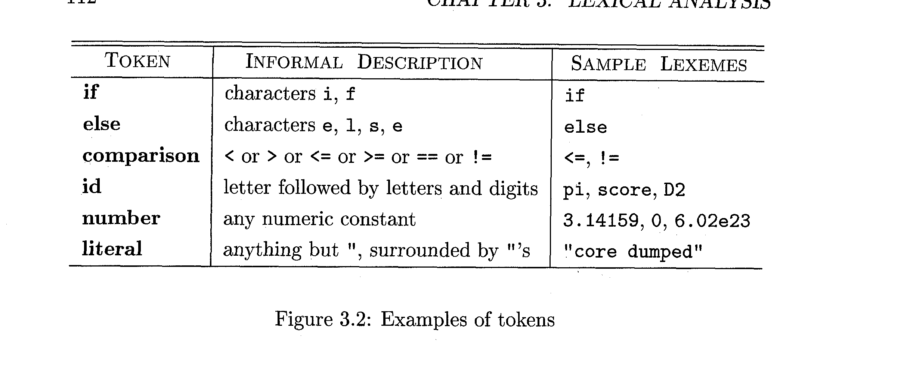
*Figure 3.1: Fundamental Definitions and Concrete Examples of Tokens, Patterns, and Lexemes (Dragon Book Fig 3.2)*

### 3.1 Precise Formal Definitions

1. **Token:**  
   A **Token** is an abstract category/symbol representing a specific grammatical unit. Formally, it is an ordered pair:
   $$\mathbf{Token} = \langle \text{Token Name}, \text{Optional Attribute Value} \rangle$$
   - The *Token Name* is an abstract terminal symbol processed by the parser (e.g., **id**, **number**, **if**, **assign_op**).
   - In textbook notation, token names are traditionally typeset in **boldface**.
2. **Pattern:**  
   A **Pattern** is the formal descriptive rule or specification that dictates what sequences of characters can form a particular token.
   - For a keyword like `while`, the pattern is simply the fixed characters: `'w'`, `'h'`, `'i'`, `'l'`, `'e'`.
   - For an identifier, the pattern is expressed using a **Regular Expression**: a letter or underscore, followed by zero or more letters, underscores, or digits.
3. **Lexeme:**  
   A **Lexeme** is the concrete, actual sequence of characters in the source code text that matches the pattern for a token and is identified by the lexical analyzer as an instance of that token.

---

### 3.2 The Canonical Distinction Table

| Concept | What is it? | Perspective | Examples |
|---|---|---|---|
| **Token** | Abstract syntactic category | The **Parser's** viewpoint | `id`, `number`, `if`, `relop`, `literal` |
| **Pattern** | Description / Regular Expression rule | The **Compiler Writer's** viewpoint | `[a-zA-Z_][a-zA-Z0-9_]*`, `[0-9]+` |
| **Lexeme** | Concrete source code substring | The **Programmer's / Source Text's** viewpoint | `count`, `score`, `3.14159`, `100`, `"hello"` |

---

### 3.3 The Five Universal Classes of Tokens

In virtually all modern programming languages (C, C++, Java, Rust, Python, Go), tokens fall into five universal classes:

1. **Keywords:** Language reserved words (`if`, `else`, `while`, `return`, `class`, `public`).
2. **Operators:** Arithmetic, logical, and relational symbols (`+`, `-`, `*`, `/`, `==`, `!=`, `<=`, `&&`).
3. **Identifiers:** Names chosen by the programmer for variables, functions, structs, arrays, and classes (`totalScore`, `calcAvg`, `Node`).
4. **Constants / Literals:** Numeric constants (`42`, `3.14159`, `0xFF`), boolean literals (`true`, `false`), character literals (`'a'`), and string literals (`"Syntax Error"`).
5. **Punctuation / Delimiters:** Structural separators (`(`, `)`, `{`, `}`, `[`, `]`, `,`, `;`, `:`).

---

### 3.4 Concrete Code Trace: C and C++ Statement Dissection

Let us examine the canonical C statement presented in Dragon Book *Example 3.1*:

```c
printf("Total = %d\\n", score);
```

Let us step through this line through the eyes of the lexical analyzer:

```
┌────────────────────────┬─────────────────────┬───────────────────────────────────────────┐
│ Lexeme in Source Text  │ Associated Token    │ Attribute Value (Passed to Parser/Table) │
├────────────────────────┼─────────────────────┼───────────────────────────────────────────┤
│ printf                 │ id                  │ Pointer to Symbol Table Entry for "printf"│
│ (                      │ (                   │ None (Token name suffices)               │
│ "Total = %d\\n"         │ literal             │ Pointer to string table: "Total = %d\\n"  │
│ ,                      │ ,                   │ None                                     │
│ score                  │ id                  │ Pointer to Symbol Table Entry for "score" │
│ )                      │ )                   │ None                                     │
│ ;                      │ ;                   │ None                                     │
└────────────────────────┴─────────────────────┴───────────────────────────────────────────┘
```

> 🔍 **Key Observation:** Notice that both `printf` and `score` produce the exact same token name: **id**. However, to prevent data loss, the lexical analyzer attaches an **attribute value** pointing to their distinct entries in the Symbol Table!

---

## 4. Attributes for Tokens & Symbol Table Interaction

### 4.1 Why Token Names Alone Are Insufficient

Consider what happens if the lexical analyzer only returns the token name to the parser:
- The pattern for the token **number** matches the lexeme `0`.
- The pattern for the token **number** also matches the lexeme `1000`.
- If the lexer only returns `⟨number⟩` to the parser, the parser knows that a number was encountered, but the **Code Generator** would have no idea whether to generate machine code loading `0` or loading `1000`!
- Similarly, if the lexer only outputs `⟨id⟩`, the code generator cannot tell if the variable is `salary` or `taxRate`.

Therefore, the lexical analyzer must attach an **attribute value** that encapsulates the specific characteristics of the matched lexeme.

```
Token Name: Influences grammatical PARSING decisions.
Attribute:  Influences semantic analysis and CODE GENERATION.
```

---

### 4.2 The Mathematical and Structural Representation of Token Attributes

Typically, a token carries at most one associated attribute pointer or structure:
- **For Operators:** Often, operators are grouped into classes. For example, comparison operators `<, <=, ==, !=, >, >=` can all share the token name **relop**. The attribute value indicates the specific relational operation:
  - `<` $\to \langle \mathbf{relop}, \text{LT} \rangle$
  - `<=` $\to \langle \mathbf{relop}, \text{LE} \rangle$
  - `==` $\to \langle \mathbf{relop}, \text{EQ} \rangle$
  - `!=` $\to \langle \mathbf{relop}, \text{NE} \rangle$
- **For Constants:** The attribute contains either the parsed binary value (e.g., `42`) or a pointer to the constant table.

---

### 4.3 Symbol Table Pointers as Identifier Attributes

For identifiers, the compiler must track a huge amount of metadata:
- The lexeme's character string (e.g., `"totalScore"`).
- Data type (`int`, `double`, `pointer to struct`).
- Storage location / memory offset on the runtime activation record.
- Scope level (global, local, block scope).
- First encountered source file line and column number.

Stashing all this information directly inside the token object would make tokens massive and slow to pass around.  
Instead, the compiler stores this data once in the **Symbol Table**, and the token's attribute is simply a lightweight **pointer to that Symbol Table entry**:

$$\langle \mathbf{id}, \text{entry\_ptr} \rangle$$

---

### 4.4 Complete Trace: Einstein's Mass-Energy Equivalence in Fortran ($E = mc^2$)

Consider the famous equation from Dragon Book *Example 3.2*, written in Fortran:

```fortran
E = M * C ** 2
```

Here is the precise sequence of token-attribute pairs generated by the lexical analyzer:

1. `E` $\implies \langle \mathbf{id}, \text{pointer to Symbol Table entry for } E \rangle$
2. `=` $\implies \langle \mathbf{assign\_op}, - \rangle$
3. `M` $\implies \langle \mathbf{id}, \text{pointer to Symbol Table entry for } M \rangle$
4. `*` $\implies \langle \mathbf{mult\_op}, - \rangle$
5. `C` $\implies \langle \mathbf{id}, \text{pointer to Symbol Table entry for } C \rangle$
6. `**` $\implies \langle \mathbf{exp\_op}, - \rangle$ *(Fortran exponentiation operator)*
7. `2` $\implies \langle \mathbf{number}, \text{integer value } 2 \rangle$

*(Note: In production compilers, numbers are typically stored as strings in a constant pool to prevent precision loss across target architectures).*

---

## 5. Tricky Problems When Recognizing Tokens & Language Quirks

Usually, scanning is straightforward. However, certain programming language specifications introduce bizarre quirks that require lookaheads or context sensitivity.

### 5.1 The Fixed-Format Fortran Ambiguity (DO 5 I = 1.25 vs DO 5 I = 1,25)

In historical fixed-format Fortran (and still supported in Fortran 90 backwards compatibility), **blanks (spaces) are completely ignored anywhere in a statement**!

Consider these two statements:

```fortran
DO 5 I = 1.25
DO 5 I = 1,25
```

Let us analyze how a compiler sees them:

1. **Statement 1:** `DO 5 I = 1.25`  
   Because blanks are ignored, this statement is equivalent to:
   ```fortran
   DO5I = 1.25
   ```
   This is an assignment of the floating-point constant `1.25` to a variable named `DO5I`!  
   The first token is **id** (`DO5I`), followed by **assign_op** (`=`), followed by **number** (`1.25`).
2. **Statement 2:** `DO 5 I = 1,25`  
   Because of the comma `,`, this is a `DO`-loop statement!  
   It instructs the runtime: *"Execute loop down to label 5, with loop counter variable I running from 1 up to 25."*  
   The first token is the keyword **DO**, followed by the label **5**, followed by identifier **I**, and so forth!

> ⚠️ **The Critical Takeaway:**  
> When the lexical analyzer reads the characters `D`, `O`, ` `, `5`, ` `, `I`, `=`, `1`, it **cannot know** whether `DO` is a keyword or the start of a variable name!  
> It must look ahead past the `1` until it sees either a period `.` or a comma `,` before it can decide what token to emit! This requires lookahead buffering.

---

### 5.2 Non-Reserved Keywords in PL/I (The DECLARE Dilemma)

In the PL/I language, keywords are **not reserved**! That means a programmer can legally declare a variable whose name happens to be the same as a keyword.

For example, consider the notorious PL/I statement:

```pli
DECLARE (ARG1, ARG2, ARG3)
```

Is `DECLARE` a keyword beginning a variable declaration statement, or is it a function call to a user-defined procedure named `DECLARE` passing three arguments?
- The lexical analyzer cannot resolve this ambiguity on its own.
- Modern languages learned from this nightmare and universally enforce **Reserved Words**: keywords cannot be used as identifier names.

---

### 5.3 The "Maximal Munch" Rule & C++ Nested Templates (`>>` vs `> >`)

Most lexical analyzers implement the **Longest Match (Maximal Munch)** principle: the lexer always absorbs the longest prefix of remaining input that matches any token pattern.

- In C/C++, if the input contains `---`, the lexer absorbs `--` (decrement operator) followed by `-` (subtraction operator), rather than `-` followed by `--`.
- **The C++ Template Bug:**  
  In older C++ (prior to C++11), writing nested templates like:
  ```cpp
  vector<vector<int>> matrix;
  ```
  caused a compiler syntax error!  
  **Why?** Because the scanner saw `>>` and eagerly munched it as the **bitwise right-shift operator** (`>>`) instead of two closing template angle brackets `>` and `>`! Programmers were forced to insert an explicit space: `vector<vector<int> > matrix;`.  
  (C++11 altered the standard to force the lexer to split `>>` in template contexts).

## 6. Lexical Errors & Recovery Strategies

### 6.1 Why Lexers Cannot Detect Misspellings Locally (The `fi` Paradox)

A crucial reality of lexical analysis is that the scanner operates with **extremely narrow local vision**: it only checks whether a sequence of characters matches a regular expression pattern. It knows nothing about variable declarations, types, or syntax rules.

> ❓ **The `fi` Paradox:**  
> Suppose a programmer writes `fi (x == 0)` intending to write `if (x == 0)`.  
> Can the lexical analyzer report an error stating *"You misspelled the keyword 'if'"*?

**No! Absolutely not!**  
- In C/C++/Java, `fi` is a completely valid identifier name (a variable or function name).
- The lexical analyzer simply matches `fi` as a valid lexeme for token **id**, attaches a symbol table pointer, and passes `⟨id, ptr⟩` to the parser.
- It is only when the **Parser** examines the grammar and sees an identifier followed by an open parenthesis where a control-flow statement was expected that a syntax error is discovered!

---

### 6.2 Panic Mode Error Recovery

So when *does* a lexical error actually occur?

> 🚨 **Definition of a Lexical Error:**  
> A lexical error occurs when the scanner encounters a character sequence where **no prefix of the remaining input matches the pattern for any valid token in the language**.  
> *Example:* A stray character in C like `@`, `$`, or `#` outside a preprocessor directive, or an unclosed string literal `"unterminated string`.

The simplest and most widely used recovery strategy is **Panic Mode Recovery**:
1. When the scanner gets stuck, it deletes successive characters from the remaining input stream, one by one.
2. It continues discarding characters until it finds a character that can serve as the beginning of a valid, well-formed token.
3. While this may cause subsequent cascade errors in the parser, it prevents the compiler from entering an infinite loop and allows it to continue checking the rest of the source file.

---

### 6.3 The Four Elementary Error-Repair Transformations

Beyond panic mode, sophisticated interactive development environments (IDEs) and compilers may attempt to actively **repair** the broken input prefix by applying one of four elementary transformations:

```
┌────────────────────────────────────────────────────────────────────────┐
│             FOUR ELEMENTARY LEXICAL ERROR TRANSFORMATIONS              │
├────────────────────────────────────────────────────────────────────────┤
│ 1. DELETE:     Delete one extraneous character from remaining input    │
│ 2. INSERT:     Insert a missing character into the remaining input     │
│ 3. REPLACE:    Replace an erroneous character with an expected one     │
│ 4. TRANSPOSE:  Transpose (swap) two adjacent characters (e.g., fi → if)│
└────────────────────────────────────────────────────────────────────────┘
```

The scanner tests whether applying a single transformation from this set can convert the offending prefix into a valid lexeme. This single-edit heuristic is extremely successful in practice, because over **80% of human typographical errors involve exactly one misplaced, omitted, or swapped keystroke**!

---

### 6.4 Minimum Edit Distance vs Practical Overhead

In theoretical computer science, one can design an algorithm that calculates the **Minimum Edit Distance** (Levenshtein Distance) to find the global minimum number of transformations required to turn the entire source program into valid tokens.

However, in production compilers:
- Computing global minimum edit distance is computationally expensive ($O(N \times M)$ dynamic programming).
- A compiler must compile millions of lines of code in seconds.
- Therefore, full global correction is universally rejected in practice in favor of fast single-character heuristics and panic-mode skipping.

---

## 7. Input Buffering Techniques: Speeding Up Character Scanning

### 7.1 The Critical I/O Bottleneck in Compilers

Reading source code character by character using simple operating system system calls (e.g., `fgetc()` or `read(fd, &c, 1)`) creates a massive performance bottleneck:
- Every OS system call incurs CPU context-switch overhead (user mode $\leftrightarrow$ kernel mode).
- A large software project containing 10,000,000 characters would invoke 10,000,000 system calls!
- To eliminate this overhead, compilers load large blocks of source characters into memory buffers using **block I/O**.

---

### 7.2 The Double-Buffer Scheme (Buffer Pairs of Size $N$)

The canonical solution presented in Dragon Book *Section 3.2.1* is the **Double-Buffer Scheme (Buffer Pairs)**:

- The compiler allocates two identical memory buffers, each of size $N$.
- $N$ is typically chosen to match the operating system's disk block size (usually **4096 bytes** or $4\text{ KB}$).
- With a single system call (`read(fd, buffer, N)`), an entire block of 4096 characters is loaded into memory in one operation.
- If fewer than $N$ characters remain in the file, a special character `eof` (end of file) marks the true termination of the input stream.

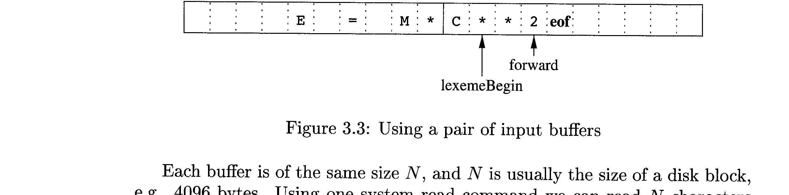
*Figure 7.1: The Double-Buffer Scheme with Two Alternating Buffers of Size $N$ (Dragon Book Fig 3.3)*

---

### 7.3 The Two Pointers: `lexemeBegin` and `forward`

The lexical analyzer maintains **two pointers** into the buffer pair:

1. **`lexemeBegin` Pointer:**  
   Marks the exact starting position of the current lexeme being recognized.
2. **`forward` Pointer:**  
   Scans ahead character by character until a token pattern match is successfully identified.

```
Buffer 1 (Size N = 4096)           Buffer 2 (Size N = 4096)
┌───┬───┬───┬───┬───┬───┬───┬───┐ ┌───┬───┬───┬───┬───┬───┬───┬───┐
│   │ E │ = │ M │ * │   │   │   │ │ C │ * │ * │ 2 │   │   │   │eof│
└───┴───┴───┴───┴───┴───┴───┴───┘ └───┴───┴───┴───┴───┴───┴───┴───┘
                                      ▲       ▲
                                      │       │
                                 lexemeBegin forward
```

#### How the Pointers Work in Practice:
- As the scanner examines characters, `forward` moves to the right.
- When a pattern is satisfied, the characters between `lexemeBegin` and `forward` form the lexeme.
- **Lookahead & Retraction:** In many cases, `forward` must look past the end of the lexeme to be sure it has ended. For example, when reading `**` in Fortran, `forward` moves to the character `2` before realizing that `**` is the complete operator. In this case, `forward` must be **retracted one character to the left**!
- Once the token is recorded and returned to the parser, `lexemeBegin` is advanced to the position immediately following the identified lexeme, ready to scan the next token.

---

### 7.4 Can We Run Out of Buffer Space?

Under normal conditions, buffer sizes of 4096 bytes are vastly greater than any identifier or keyword. However, two edge cases exist:

1. **Extremely Long String Literals:**  
   What if a string literal extends across hundreds of lines, exceeding buffer size $N$?  
   If the length of the lexeme exceeds $N$, reloading the second buffer would overwrite the beginning of the lexeme still pointed to by `lexemeBegin`!  
   *Solution:* Modern languages and compilers restrict string literals or encourage splitting them across lines and joining them with `+` (as in Java) or automatic literal concatenation (as in C: `"Hello " "World"`).
2. **Arbitrarily Long Lookahead:**  
   In languages with non-reserved keywords (like PL/I), determining whether an identifier is a keyword may theoretically require looking ahead past hundreds of characters. Modern language design avoids this by reserving all keywords.

---

## 8. Sentinels: Optimizing the Lookahead Loop

### 8.1 The Double-Test Problem in Standard Buffering

In the naive double-buffer implementation, every single time the `forward` pointer advances by one character, the code must execute **two conditional tests**:

1. **Test 1:** Have we reached the end of the current buffer?  
   *(If yes, reload the opposite buffer and reset `forward`)*.
2. **Test 2:** What character is being pointed to?  
   *(A multiway branch / `switch` statement on the character)*.

Because a compiler scans millions of characters, executing **two branch instructions for every single character** introduces significant branch-prediction and pipeline overhead!

---

### 8.2 The Sentinel Solution: Adding `eof` at Buffer Boundaries

To cut the testing overhead in half, the Dragon Book (*Section 3.2.2*) introduces **Sentinels**:

> 💡 **The Sentinel Concept:**  
> A **sentinel** is a special dummy character placed at the end of each buffer that cannot naturally appear in the source code text.  
> The natural choice for the sentinel character is **`eof`**.

Each buffer of size $N$ is extended by **one extra position** at its tail to store the `eof` sentinel:

```
Buffer 1 (Size N + 1)                 Buffer 2 (Size N + 1)
┌───┬───┬───┬───┬───┬───┬─────┐ ┌───┬───┬───┬───┬───┬───┬─────┐
│ E │ = │ M │ * │   │   │ eof │ │ C │ * │ * │ 2 │   │   │ eof │
└───┴───┴───┴───┴───┴───┴─────┘ └───┴───┴───┴───┴───┴───┴─────┘
                          ▲                               ▲
                          │                               │
                   Sentinel 1                      Sentinel 2
```

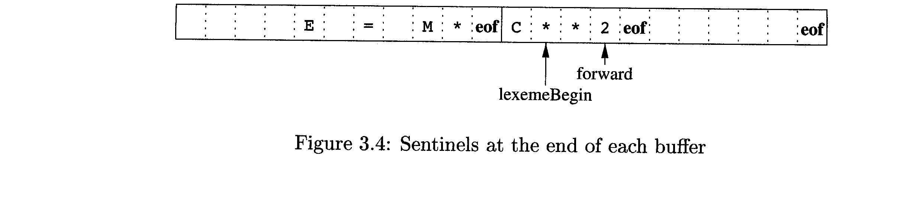
*Figure 8.1: Memory Organization of Buffer Pairs with End-of-Buffer Sentinels (Dragon Book Fig 3.4)*

---

### 8.3 The Lookahead Algorithm with Sentinels (Step-by-Step C Implementation)

With sentinels in place, the inner loop makes **only a single test per character**: it simply executes a `switch (*forward++)`.  
Only when the character read is actually `eof` does the code enter the handler to check whether it hit the end of Buffer 1, the end of Buffer 2, or the true end of the input file!

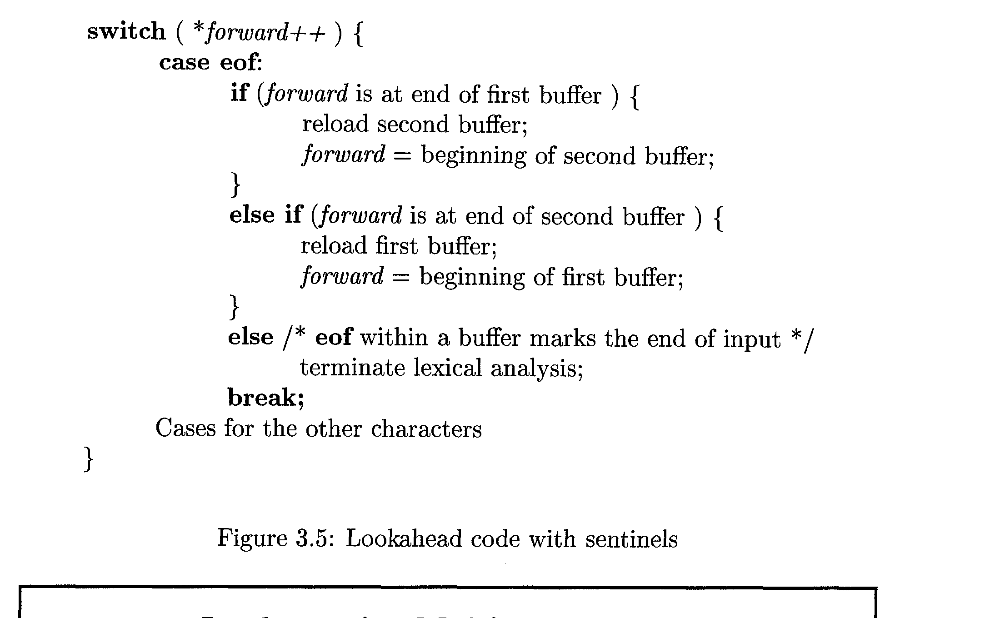
*Figure 8.2: The Optimized Lookahead Algorithm in C Utilizing Sentinels (Dragon Book Fig 3.5)*

```c
switch ( *forward++ ) {
    case eof:
        if (forward is at end of first buffer) {
            reload second buffer;
            forward = beginning of second buffer;
        }
        else if (forward is at end of second buffer) {
            reload first buffer;
            forward = beginning of first buffer;
        }
        else {
            /* eof encountered within a buffer marks genuine end of source input */
            terminate lexical analysis;
        }
        break;
        
    case '\\n':
        line_number++;
        break;
        
    case ' ':
    case '\\t':
        /* Whitespace: ignore and advance */
        break;
        
    /* Cases for all other normal source characters ... */
}
```

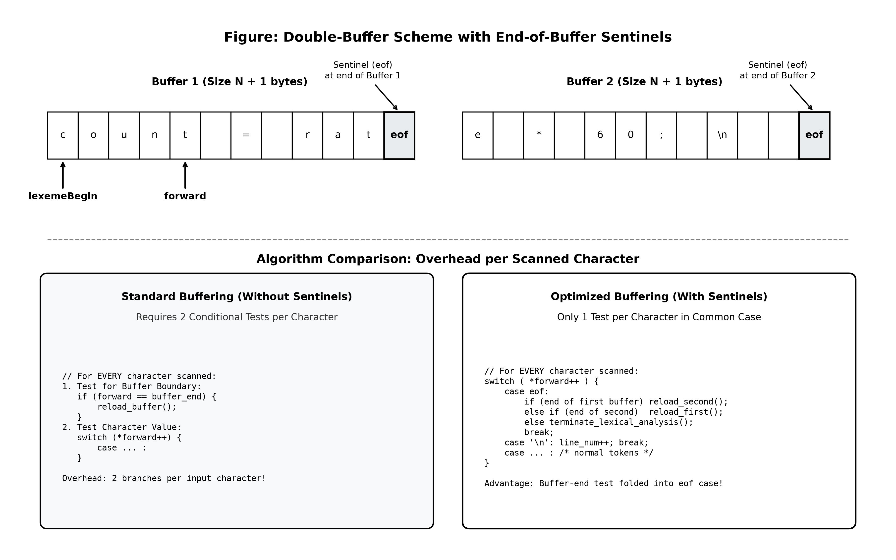
*Figure 8.3: Architectural Breakdown of the Buffer-Pair and Sentinel Lookahead Mechanism*

---

### 8.4 Implementing Multiway Branches via Direct Jump Tables

In modern C and C++ compilers, a `switch` statement over an 8-bit character (0 to 255) is translated by the back-end code generator into an **indirect jump table**:
- An array of 256 jump targets (code addresses) is created in memory.
- The CPU fetches the byte `*forward++`, uses it as an array index, and jumps to the handling code block in **a single $O(1)$ assembly instruction**:
  ```assembly
  movzbq  (%rdi), %rax          # load character into RAX
  jmp     *jump_table(,%rax,8)   # single indirect jump!
  ```
- This ensures maximum possible throughput for character scanning!

## 9. Formal Language Theory: Alphabets, Strings, and Languages

To write formal patterns that mathematically define programming language tokens, we rely on **Formal Language Theory** (Dragon Book *Section 3.3.1*).

### 9.1 Alphabets ($\Sigma$)

An **alphabet** (denoted $\Sigma$) is any finite set of symbols.
- **Binary Alphabet:** $\Sigma = \\{0, 1\\}$
- **ASCII Alphabet:** $\Sigma = \\{0, 1, \\dots, 127\\}$ (7-bit characters, standard for classic programming languages).
- **Unicode Alphabet:** Over 140,000 international characters, symbols, and emojis (used in Java, Python 3, Swift, Rust).

---

### 9.2 Strings over an Alphabet

A **string** (also referred to as a **sentence** or **word**) over an alphabet $\Sigma$ is a finite sequence of symbols chosen from $\Sigma$.
- **String Length ($|s|$):** The total number of symbol occurrences in $s$.  
  *Example:* If $s = \\text{"banana"}$, then $|s| = 6$.
- **The Empty String ($\epsilon$):** The unique string of length zero, denoted $\mathbf{\epsilon}$ (epsilon).  
  $|\\epsilon| = 0$.

---

### 9.3 Terminology for Parts of Strings (Prefix, Suffix, Substring, Subsequence)

Precise definitions for parts of a string $s$ are foundational:

| Term | Formal Definition | Example for string `"banana"` |
|---|---|---|
| **Prefix** | Any string obtained by removing zero or more symbols from the **end** of $s$. | `""`, `"b"`, `"ban"`, `"banana"` |
| **Suffix** | Any string obtained by removing zero or more symbols from the **beginning** of $s$. | `""`, `"a"`, `"ana"`, `"banana"` |
| **Substring** | Any string obtained by deleting any prefix and any suffix from $s$. (Contiguous sequence). | `""`, `"nan"`, `"an"`, `"banana"` |
| **Proper Prefix / Suffix / Substring** | Any prefix, suffix, or substring that is **neither $\epsilon$ nor equal to $s$ itself**. | For `"banana"`: `"ban"` is a proper prefix; `"banana"` and `""` are not! |
| **Subsequence** | Any string formed by deleting zero or more **not necessarily consecutive** symbols from $s$. | `"baan"`, `"bna"`, `"aa"` |

---

### 9.4 String Operations: Concatenation and Exponentiation

1. **Concatenation ($xy$):**  
   Appending string $y$ to the end of string $x$.  
   *Example:* If $x = \\text{"compiler"}$ and $y = \\text{"design"}$, then $xy = \\text{"compilerdesign"}$.  
   - **Identity Element:** The empty string $\epsilon$ is the identity for concatenation:
     $$\epsilon s = s \epsilon = s$$
2. **Exponentiation of Strings ($s^i$):**  
   Repeating string $s$ $i$ times:
   - $s^0 = \epsilon$
   - $s^1 = s$
   - $s^2 = ss$
   - $s^i = s^{i-1} s$ for $i > 0$.  
   *Example:* If $s = \\text{"ba"}$, then $s^3 = \\text{"bababa"}$.

---

### 9.5 Mathematical Definition of a Language

A **language** ($L$) over an alphabet $\Sigma$ is **any countable set of strings** over $\Sigma$.

Notice how broad this definition is:
- $\emptyset$ (the empty set) is a language (contains no strings).
- $\{\epsilon\}$ is a language (contains exactly one string of length 0).
- The set of all valid C programs is a language over the ASCII alphabet!
- The set of all syntactically correct English sentences is a language.
- A language does **not** require that any semantic meaning be attached to its strings—it is purely a mathematical set of sequences.

---

## 10. Operations on Languages

In compiler design, the lexical analyzer uses four fundamental set operations to build complex token patterns from simple alphabets (Dragon Book *Section 3.3.2*):

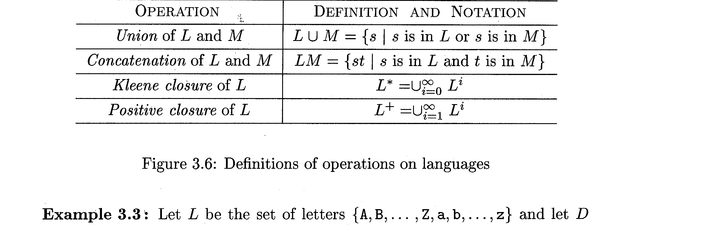
*Figure 10.1: Formal Definitions of Operations on Languages (Dragon Book Fig 3.6)*

### 10.1 Union ($L \cup M$)

The union of languages $L$ and $M$ contains all strings that belong to $L$, or to $M$, or to both:
$$L \cup M = \{ s \mid s \in L \text{ or } s \in M \}$$

### 10.2 Concatenation ($LM$)

The concatenation of languages $L$ and $M$ is formed by taking every string from $L$ and pairing it with every string from $M$ in all possible combinations:
$$LM = \{ st \mid s \in L \text{ and } t \in M \}$$

### 10.3 Kleene Closure ($L^*$) vs Positive Closure ($L^+$)

1. **Kleene Closure ($L^*$):**  
   Concatenating language $L$ **zero or more times**:
   $$L^* = \bigcup_{i=0}^\infty L^i = L^0 \cup L^1 \cup L^2 \cup L^3 \cup \dots$$
   where $L^0 = \{\epsilon\}$.  
   > ⚠️ **Key Rule:** The empty string $\mathbf{\epsilon}$ is **always guaranteed to be in $L^*$**, regardless of whether $\epsilon \in L$!
2. **Positive Closure ($L^+$):**  
   Concatenating language $L$ **one or more times**:
   $$L^+ = \bigcup_{i=1}^\infty L^i = L^1 \cup L^2 \cup L^3 \cup \dots$$
   - Relationship: $L^* = L^+ \cup \{\epsilon\}$ and $L^+ = LL^* = L^*L$.  
   - $\epsilon \in L^+$ *if and only if* $\epsilon \in L$.

---

### 10.4 Algebraic Properties & Worked Combinatorial Examples

Let $L$ be the alphabet of all uppercase and lowercase letters:  
$$L = \{A, B, \dots, Z, a, b, \dots, z\}$$  
and let $D$ be the alphabet of all digits:  
$$D = \{0, 1, 2, \dots, 9\}$$

Both $L$ and $D$ can be viewed as languages containing strings of length 1 ($|L| = 52, |D| = 10$).

Let us examine the languages formed by applying these operations (Dragon Book *Example 3.3*):

1. **$L \cup D$:**  
   The set of all single characters that are either a letter or a digit. Contains $52 + 10 = 62$ strings of length 1.
2. **$LD$:**  
   The set of all strings of length 2 consisting of one letter followed by one digit (e.g., `"a1"`, `"Z9"`). Contains $52 \times 10 = 520$ strings.
3. **$L^4$:**  
   The set of all 4-letter words. Contains $52^4 = 7,311,616$ strings.
4. **$L^*$:**  
   The set of all possible words made of letters, including the empty string $\epsilon$.
5. **$L(L \cup D)^*:**  
   The set of all strings of letters and digits that **begin with a letter**. This is the classic foundational pattern for **Identifiers** in programming languages!
6. **$D^+$:**  
   The set of all strings of one or more digits. This is the pattern for **Unsigned Integers**!

---

## 11. Regular Expressions: Formal Foundation

### 11.1 Inductive Definition: Basis and Induction Rules

A **Regular Expression** (denoted $r$) is a formal mathematical notation that denotes a regular language $L(r)$. It is defined recursively using two basis rules and four induction rules (Dragon Book *Section 3.3.3*):

#### BASIS (Primitive Expressions):
1. **Empty String ($\epsilon$):**  
   $\epsilon$ is a regular expression, and $L(\epsilon) = \{\epsilon\}$.
2. **Single Symbol ($a \in \Sigma$):**  
   If $a \in \Sigma$, then $\mathbf{a}$ is a regular expression, and $L(\mathbf{a}) = \{a\}$.

#### INDUCTION (Building Larger Expressions from $r$ and $s$):
1. **Union / Alternation:**  
   $(r) \mid (s)$ is a regular expression denoting $L(r) \cup L(s)$.
2. **Concatenation:**  
   $(r)(s)$ is a regular expression denoting $L(r)L(s)$.
3. **Kleene Closure:**  
   $(r)^*$ is a regular expression denoting $(L(r))^*$.
4. **Parenthesization:**  
   $(r)$ is a regular expression denoting $L(r)$.

---

### 11.2 Operator Precedence and Associativity Rules

To prevent writing cumbersome nested parentheses like `((a) | ((b)*(c)))`, we adopt standard precedence conventions:

```
┌───────────────────────────────┬─────────────────┬────────────────┐
│ Operator                      │ Precedence      │ Associativity  │
├───────────────────────────────┼─────────────────┼────────────────┤
│ Unary Kleene Star (*)         │ Highest         │ Left-to-right  │
│ Concatenation (juxtaposition) │ Second Highest  │ Left-to-right  │
│ Union / Alternation (|)       │ Lowest          │ Left-to-right  │
└───────────────────────────────┴─────────────────┴────────────────┘
```

*Example:* Under these rules, `a | b*c` is evaluated as `(a) | ((b*) c)`.

---

### 11.3 Regular Sets & Language Denotation

- A language that can be defined by a regular expression is called a **regular set** (or **regular language**).
- If two regular expressions $r$ and $s$ denote the exact same language ($L(r) = L(s)$), they are said to be **equivalent**, written:
  $$r = s$$
  *Example:* $(a \mid b) = (b \mid a)$ and $(a^*b^*)^* = (a \mid b)^*$.

---

### 11.4 The Seven Fundamental Algebraic Laws for Regular Expressions

Arbitrary regular expressions $r$, $s$, and $t$ obey seven algebraic axioms (Dragon Book *Figure 3.7*):

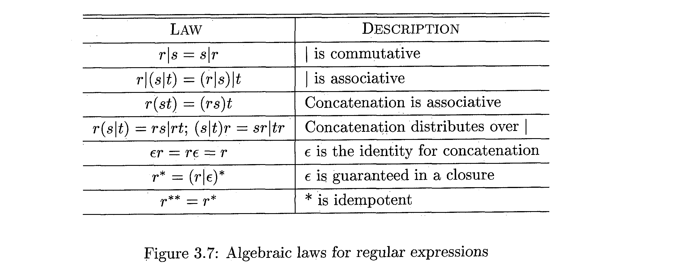
*Figure 11.1: Algebraic Laws for Equivalence of Regular Expressions (Dragon Book Fig 3.7)*

```
┌──────────────────────────────────────┬──────────────────────────────────────────┐
│ Algebraic Law                        │ Mathematical Property Description       │
├──────────────────────────────────────┼──────────────────────────────────────────┤
│ r | s = s | r                        │ | is commutative                         │
│ r | (s | t) = (r | s) | t            │ | is associative                         │
│ r(st) = (rs)t                        │ Concatenation is associative             │
│ r(s | t) = rs | rt                   │ Concatenation distributes over | (left)  │
│ (s | t)r = sr | tr                   │ Concatenation distributes over | (right) │
│ εr = rε = r                          │ ε is the identity for concatenation      │
│ r* = (r | ε)*                        │ ε is guaranteed in a closure             │
│ r** = r*                             │ * is idempotent (repeating star is moot) │
└──────────────────────────────────────┴──────────────────────────────────────────┘
```

---

## 12. Regular Definitions & Hierarchical Pattern Construction

### 12.1 Definition of Regular Definitions ($d_i \to r_i$)

In real compilers, writing one gigantic regular expression spanning 50 lines for a complex token is unreadable and prone to errors.  
Instead, we use **Regular Definitions** (Dragon Book *Section 3.3.4*): we assign names to subexpressions and use those names as building blocks in subsequent expressions:

$$d_1 \to r_1$$
$$d_2 \to r_2$$
$$\dots$$
$$d_n \to r_n$$

Where:
1. Each $d_i$ is a **new distinct name** (not a symbol in the basic alphabet $\Sigma$).
2. Each $r_i$ is a regular expression over the alphabet $\Sigma \cup \{d_1, d_2, \dots, d_{i-1}\}$.

---

### 12.2 Preventing Circularity & Recursion

> ⚠️ **The Non-Circularity Rule:**  
> Notice that $r_i$ can ONLY use names defined *prior* to it ($d_1, \dots, d_{i-1}$). It **CANNOT reference itself ($d_i$)**, nor can it reference names defined later!

**Why is recursion forbidden in regular definitions?**  
- If a definition could reference itself recursively, such as:  
  $$expr \to ( expr )$$  
  it would be capable of counting arbitrarily nested matching parentheses!
- Regular expressions (and finite automata) have **no memory stack** and cannot match balanced parentheses ($a^n b^n$).
- Matching recursive structures requires a **Context-Free Grammar (CFG)**, which is the domain of Phase 2 (Parsing)!

---

### 12.3 Regular Definition for Identifiers across Languages

Here is the formal regular definition for C/C++/Java identifiers (Dragon Book *Example 3.5*):

$$\begin{aligned}
letter\_ &\to A \mid B \mid \dots \mid Z \mid a \mid b \mid \dots \mid z \mid \_ \\
digit &\to 0 \mid 1 \mid 2 \mid \dots \mid 9 \\
id &\to letter\_ (letter\_ \mid digit)^*
\end{aligned}$$

---

### 12.4 Regular Definition for Unsigned Integers & Floating-Point Numbers

Consider unsigned numbers such as `5280`, `0.01234`, `6.02E23`, and `1.89E-4` (Dragon Book *Example 3.6*):

$$\begin{aligned}
digit &\to 0 \mid 1 \mid \dots \mid 9 \\
digits &\to digit\ digit^* \\
optionalFraction &\to .\, digits \mid \epsilon \\
optionalExponent &\to (E ( + \mid - \mid \epsilon ) digits) \mid \epsilon \\
number &\to digits\ optionalFraction\ optionalExponent
\end{aligned}$$

> 💡 **Subtle Detail:** Note that in this specification, `optionalFraction` requires at least one digit after the decimal point (`. digits`). Thus, `1.0` matches, but `1.` does not match as a number!

---

## 13. Extensions to Regular Expressions in Compiler Tools (Lex/Flex)

To make specification concise, compiler construction tools like **Lex** and **Flex** introduced notational shorthands (Dragon Book *Section 3.3.5*):

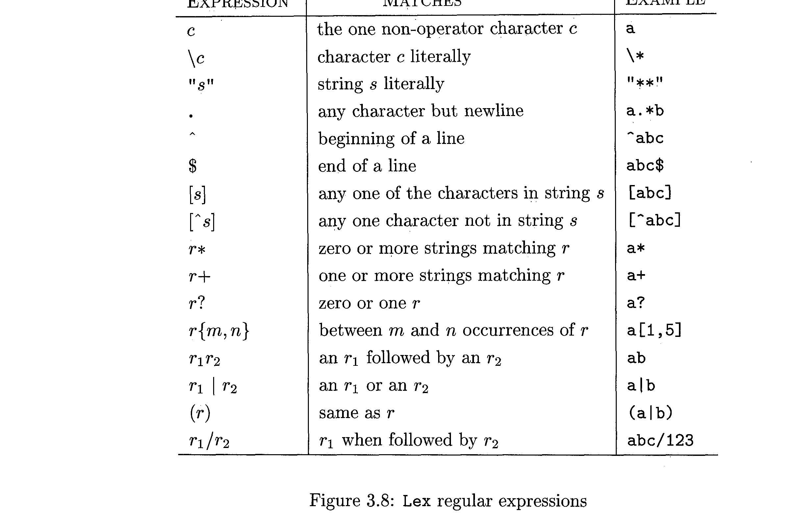
*Figure 13.1: Complete Lex Regular Expression Operator Reference (Dragon Book Fig 3.8)*

### 13.1 Positive Closure ($r^+$) and Optional Elements ($r?$)

1. **Positive Closure ($r^+$):**  
   Represents "one or more occurrences" of $r$.  
   $r^+ = rr^* = r^*r$.
2. **Optional Element ($r?$):**  
   Represents "zero or one occurrence" of $r$.  
   $r? = r \mid \epsilon$.

### 13.2 Character Classes and Ranges ($[a-z]$, $[0-9]$, $[^a-z]$)

- **Character Class:** $[abc] \equiv a \mid b \mid c$.
- **Range:** $[a-z] \equiv a \mid b \mid \dots \mid z$.
- **Complemented Character Class:** $[^0-9]$ matches any single character *except* a digit.

### 13.3 Bounded Repetition ($r\{m, n\}$)

- $r\{m, n\}$ matches between $m$ and $n$ occurrences of $r$.
- $r\{m\}$ matches exactly $m$ occurrences of $r$.
- $r\{m,\}$ matches $m$ or more occurrences of $r$.

### 13.4 Line Anchors ($^$ and $\$) and Trailing Context ($r_1 / r_2$)

- `^r`: Matches $r$ only at the beginning of a line.
- `r$`: Matches $r$ only at the end of a line.
- `r1 / r2` (Lookahead / Trailing Context in Lex): Matches $r_1$ only if it is immediately followed by $r_2$, but characters matching $r_2$ are **not consumed** and remain in the input buffer!

### 13.5 Rewriting the Definitions using Extensions

Using these shorthands, the regular definitions from the previous section become beautifully concise:

```lex
letter_   [A-Za-z_]
digit     [0-9]
id        {letter_}({letter_}|{digit})*

digits    [0-9]+
number    {digits}(\.{digits})?(E[+-]?{digits})?
```

## 14. Lexical Analyzer Generators: The Lex/Flex Ecosystem

### 14.1 Why Automated Lexer Generators?

In professional compiler engineering, writing a lexical analyzer by hand from scratch using manual loops and nested `if-else` blocks is tedious, error-prone, and painful to maintain. If the programming language designer decides to add a new operator (like `===` or `??=`), a hand-written scanner might require rewriting hundreds of lines of fragile logic.

As emphasized by **Dr. Muhammad Nur Yanhaona**:
> *"Given these tasks are tedious and the implementation process is the same regardless of the regular expressions, no one writes lexical analyzers on their own. Rather, a lexical analyzer generator tool, such as **LEX** or **FLEX**, is used."*

---

### 14.2 The Lex Workflow: Specification to Object Code

A tool like **Flex** (Fast Lexical Analyzer) takes a declarative specification file (`lex.l`) containing regular expressions and associated C code snippets, and compiles it into a blazing-fast C source file (`lex.yy.c`) representing a Deterministic Finite Automaton (DFA) transition matrix:

```
┌─────────────────────────┐
│     Lex Source File     │  (e.g., lex.l: contains regular
│      Specification      │   expressions & C code actions)
└────────────┬────────────┘
             │
             ▼
      [ LEX COMPILER ]
             │
             ▼
┌─────────────────────────┐
│        lex.yy.c         │  (C source code: contains DFA transition
│    (C Source Code)      │   tables & yylex() automaton driver)
└────────────┬────────────┘
             │
             ▼
      [ C COMPILER (gcc) ] ◄─── (main.c / Parser y.tab.c)
             │
             ▼
┌─────────────────────────┐
│       a.out / lexer     │  (Executable scanner engine)
└─────────────────────────┘
```

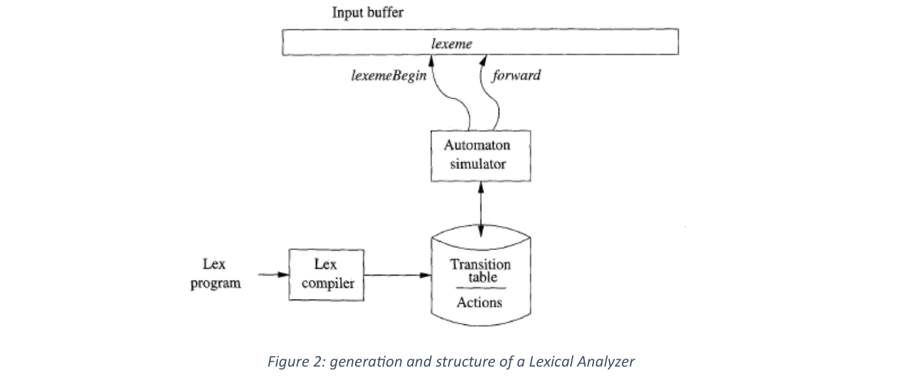
*Figure 14.1: Internal Generation and Architecture of a Generated Lexical Analyzer (Dr. Muhammad Nur Yanhaona Notes Fig 2)*

---

### 14.3 Structure of a Lex Specification File (`lex.l`)

A Lex specification file consists of three sections separated by `%%` delimiters:

```lex
%{
/* Section 1: Declarations & C Header Inclusions */
#include <stdio.h>
#include "y.tab.h" /* Token constants from Parser */
%}

/* Regular Definitions */
delim     [ \\t\\n]
ws        {delim}+
letter    [A-Za-z_]
digit     [0-9]
id        {letter}({letter}|{digit})*
number    {digit}+(\\.{digit}+)?(E[+-]?{digit}+)?

%%
/* Section 2: Translation Rules (Pattern -> C Action) */
{ws}            { /* Discard whitespace */ }
"if"            { return IF; }
"else"          { return ELSE; }
"while"         { return WHILE; }
{id}            { yylval.str = strdup(yytext); return ID; }
{number}        { yylval.val = atof(yytext); return NUMBER; }
"<="            { return LE; }
"=="            { return EQ; }
"="             { return ASSIGN; }
.               { printf("Lexical Error: unknown char %s\\n", yytext); }

%%
/* Section 3: Auxiliary C User Functions */
int yywrap() { return 1; }
```

---

### 14.4 Rule Disambiguation Principles (Longest Match & First Match)

When multiple patterns match the input text, Lex resolves conflicts using **two golden rules**:

1. **Rule 1: Longest Match (Maximal Munch):**  
   The lexer always chooses the pattern that matches the longest prefix of remaining input.  
   *Example:* If the input is `<=`, it matches `<=` as a single token, rather than `<` followed by `=`.
2. **Rule 2: First Match (Order of Appearance):**  
   If the exact same length matches multiple patterns, the lexer chooses the rule that appears **first in the specification file**!

---

### 14.5 Keywords vs Identifiers Priority Rule

Notice a crucial conflict in language grammar:
- The keyword `if` matches the pattern for keywords: `"if"`.
- BUT `if` also completely matches the pattern for identifiers: `{letter}({letter}|{digit})*`!

> ⚠️ **The Universal Lexer Rule:**  
> To prevent keywords from being mistakenly recognized as identifiers, **always place the regular expressions for keywords BEFORE the identifier rule in your Lex specification!**  
> Because the generator evaluates rules top-to-bottom on identical-length matches, the keyword rule will fire first!

---

## 15. Practical Regular Expressions: Modern Engines & Deep Concepts

Beyond compiler theory, regular expressions form the backbone of text processing in modern programming languages. The supplemental reference guide by **Ray Toal (LMU)** explores practical regex features implemented across Java, Python, JavaScript, and Ruby.

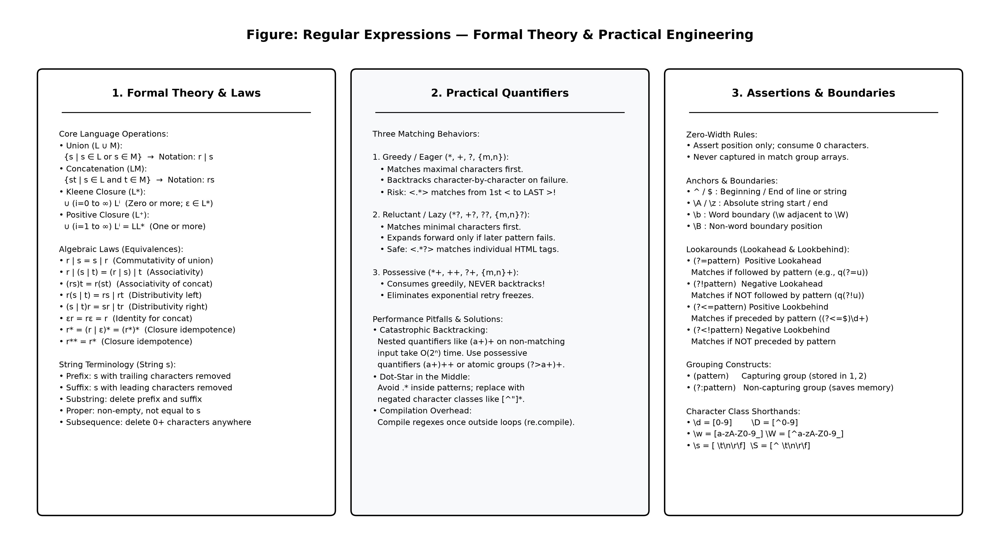
*Figure 15.1: Master Cheat Sheet — Formal Theory, Advanced Quantifiers, and Zero-Width Lookarounds*

### 15.1 Formal Regular Expressions vs Modern Practical Regex

In formal language theory (Chomsky Type-3), regular expressions can *only* describe regular languages that can be recognized by a Finite Automaton (no backreferences, no recursion).  
In modern programming languages (Perl, Python, PCRE), regex engines include extensions (like **backreferences** `\1`) that can recognize context-sensitive languages ($a^n b a^n$), surpassing formal Type-3 capability!

---

### 15.2 The Four Core Programming Operations

In software development, regular expressions fulfill four primary operations:
1. **Validation:** Checking whether a complete string satisfies a format (e.g., email or zip code).
2. **Searching:** Finding the position of a substring match within a larger document.
3. **Extraction:** Slicing out specific matched fragments or captured sub-groups.
4. **Substitution:** Replacing matched patterns with dynamic or static replacement strings.

---

### 15.3 Capturing Groups vs Non-Capturing Groups (`(?:...)`)

- **Capturing Group `(pattern)`:**  
  Parentheses create a sub-match group numbered by counting opening parentheses from left to right (`$1`, `$2`, `$3`).  
  *Overhead:* The regex engine must allocate memory, copy substrings, and track offsets for every captured group.
- **Non-Capturing Group `(?:pattern)`:**  
  Groups terms together purely for precedence (e.g., applying `+` or `|`) **without capturing into memory**.  
  *Example:* `(?:https?|ftp)://` groups the protocol alternatives without wasting CPU cycles capturing them.

---

### 15.4 Quantifier Taxonomy: Greedy vs Reluctant (Lazy) vs Possessive

In his *Regular Expressions* reference guide, **Ray Toal** categorizes quantifiers into **18 distinct types** formed by combining the 6 base repetition structures with the 3 engine matching behaviors:

#### The 18 Types of Quantifiers Matrix:

| Repetition Semantics | Eager / Greedy | Reluctant / Lazy | Possessive |
|---|:---:|:---:|:---:|
| **Zero or one instance** | `?` | `??` | `?+` |
| **Zero or more instances** | `*` | `*?` | `*+` |
| **One or more instances** | `+` | `+?` | `++` |
| **Exactly $m$ instances** | `{m}` | `{m}?` | `{m}+` |
| **At least $m$ instances** | `{m,}` | `{m,}?` | `{m,}+` |
| **Between $m$ and $n$ instances** | `{m,n}` | `{m,n}?` | `{m,n}+` |

#### Understanding the 3 Matching Behaviors:

1. **Eager / Greedy (`*`, `+`, `?`, `{m,n}`):**  
   - Matches as many characters as possible on the first forward pass.
   - If the downstream pattern fails, it **backtracks character by character** to find an overall match.
   - *Example:* On `<div><span>Hello</span></div>`, `/<.*>/` consumes all the way to the final `>`.
2. **Reluctant / Lazy (`*?`, `+?`, `??`, `{m,n}?`):**  
   - Matches as few characters as possible initially (e.g., zero for `*?`, one for `+?`).
   - Expands forward only if the subsequent subpatterns fail to match.
   - *Example:* On `<div><span>Hello</span></div>`, `/<.*?>/` matches each individual tag (`<div>`, `<span>`).
3. **Possessive (`*+`, `++`, `?+`, `{m,n}+`):**  
   - Consumes as many characters as possible greedily and **NEVER gives them back (no backtracking!)**.
   - If the subsequent subpattern fails, the entire match attempt fails immediately without recursive testing.
   - Prevents runaway CPU freezes caused by catastrophic backtracking!

---

### 15.5 Zero-Width Assertions: Lookahead & Lookbehind

**Lookarounds** test whether a pattern precedes or follows the current position, but **they consume ZERO characters** and do not capture:

```
┌──────────────────────┬─────────────────┬────────────────────────────────────────────────────────┐
│ Lookaround Type      │ Syntax          │ Practical Example & Meaning                            │
├──────────────────────┼─────────────────┼────────────────────────────────────────────────────────┤
│ Positive Lookahead   │ (?=pattern)     │ Hillary(?=\\s+Clinton) matches "Hillary" only if        │
│                      │                 │ followed by " Clinton" (does not consume " Clinton")   │
├──────────────────────┼─────────────────┼────────────────────────────────────────────────────────┤
│ Negative Lookahead   │ (?!pattern)     │ q(?!u) matches 'q' not followed by 'u' (e.g., in "Iraq")│
├──────────────────────┼─────────────────┼────────────────────────────────────────────────────────┤
│ Positive Lookbehind  │ (?<=pattern)    │ (?<=\\$)\\d+ matches digits only if preceded by a '$'   │
├──────────────────────┼─────────────────┼────────────────────────────────────────────────────────┤
│ Negative Lookbehind  │ (?<!pattern)    │ (?<![-+\\d])\\d+ matches digits not preceded by -, +, digit│
└──────────────────────┴─────────────────┴────────────────────────────────────────────────────────┘
```

---

### 15.6 Regex Modifiers / Flags (`g, i, m, s, x, d, u`)

Modifiers alter how the regex engine interprets patterns and character classes:

- **`g` (Global):** Find all matches throughout the input rather than stopping after the first match.
- **`i` (Ignore Case):** Case-insensitive matching (`[a-z]` matches `[A-Z]`).
- **`m` (Multiline):** Anchors `^` and `$` match the beginning and end of each individual line (separated by newline `\\n`), not just the entire text.
- **`s` (DOTALL / Singleline):** Allows the dot `.` to match **all characters including newlines `\\n`**.
- **`x` (Extended / Free-Spacing):** Ignores pattern whitespace and allows embedded `#` comments for maintainability.
- **`d` (Unix Line Mode):** Considers only the Unix line feed `\\n` (`U+000A`) as a line separator, ignoring Windows carriage return `\\r` or Unicode paragraph terminators.
- **`u` (Unicode):** Enables full Unicode character category matching (e.g., `\\p{L}` for any Unicode letter).

---

### 15.7 Performance Pitfalls & Catastrophic Backtracking

1. **Recompilation in Loops:**  
   Creating a regex object inside a loop forces the engine to parse, build the NFA/DFA, and allocate memory on every iteration. Always compile regexes **once** outside loops (`Pattern.compile()`, `re.compile()`).
2. **Dot-Star in the Middle:**  
   Writing `\"(.*)\"` causes the engine to scan to the very end of the line and backtrack character by character. Use a **negated character class** instead: `\"([^\"]*)\"`, or a reluctant quantifier `\"(.*?)\"`.
3. **Catastrophic Backtracking ($O(2^N)$):**  
   Nested repetitions such as `(a+)+$` or `(x+x+)+y` when tested against `xxxxxxxxxxxxxxxxxxxx` (without the trailing `y`) cause the engine to test every exponential permutation of group divisions. The CPU hits 100% and freezes indefinitely!

---

### 15.8 Ten Golden Rules for High-Performance Regex

1. Use **non-capturing groups `(?:...)`** unless you explicitly intend to extract the substring.
2. Replace lazy or greedy wildcards with **negated character classes** (`[^\\n]*` instead of `.*?`).
3. Use **possessive quantifiers** (`++`, `*+`) when backtracking is unnecessary.
4. **Spot-check first:** Check cheap conditions (`str.contains("@")`) before launching a massive regex.
5. Put the **most frequent alternative first** in a union (`"error" | "warn" | "debug"`).
6. **Factor out common prefixes:** Write `Good (?:morning|evening)` instead of `Good morning|Good evening`.
7. **Unroll small engine loops:** `\\d\\d\\d\\d\\d` runs faster than `\\d{5}` on many bytecode engines because it bypasses counter loop overhead; similarly, `aaaa+` is faster than `a{4,}`.
8. Anchor your regexes with `^` and `$` whenever validating complete inputs.
9. Avoid trailing open-ended quantifiers that overlap with previous expressions.
10. Always specify a timeout or maximum step limit when accepting user-supplied regex patterns.

---

## 16. Cross-Language Implementations & Hands-On Code

### 16.1 C / Flex Implementation

```c
/* scanner.l */
%{
#include <stdio.h>
%}

DIGIT    [0-9]
ID       [a-zA-Z_][a-zA-Z0-9_]*

%%
{DIGIT}+        { printf("NUMBER: %s\\n", yytext); }
"if"|"else"     { printf("KEYWORD: %s\\n", yytext); }
{ID}            { printf("IDENTIFIER: %s\\n", yytext); }
[ \\t\\n]+       /* ignore whitespace */
.               { printf("UNKNOWN: %s\\n", yytext); }
%%

int main() {
    yylex();
    return 0;
}
```

---

### 16.2 Python (`re` Module)

```python
import re

# Pre-compile for maximum throughput
pattern = re.compile(r'weighs (?P<weight>\d+(?:\.\d+)?) (?P<unit>\w+)')
text = "The package weighs 12.5 kilograms in total."

match = pattern.search(text)
if match:
    print("Full match:", match.group(0))
    print("Weight:", match.group('weight'))
    print("Unit:", match.group('unit'))
    print("Span:", match.span())
```

---

### 16.3 Java (`Pattern` and `Matcher` Advanced Features)

Java provides powerful set operations directly inside character classes:

```java
import java.util.regex.Pattern;
import java.util.regex.Matcher;

public class RegexDemo {
    public static void main(String[] args) {
        // Union: [a-d[m-p]] matches a-d or m-p
        // Intersection: [a-z&&[def]] matches only d, e, f
        // Subtraction: [a-z&&[^aeiou]] matches lowercase consonants
        Pattern consonantPattern = Pattern.compile("[a-z&&[^aeiou]]");
        Matcher m = consonantPattern.matcher("compiler");
        
        while (m.find()) {
            System.out.print(m.group() + " "); // c m p l r
        }
        System.out.println();
    }
}
```

---

### 16.4 JavaScript (`RegExp`, `exec`, `replace`)

```javascript
const text = "Call 1-800-555-1212 or 555-4321 for support.";
const phoneRegex = /(?:(\d{1,3})-)?(\d{3})-(\d{4})/g;

let match;
while ((match = phoneRegex.exec(text)) !== null) {
  console.log(`Found phone: ${match[0]} at index ${match.index}`);
  console.log(`Area: ${match[2]}, Number: ${match[3]}`);
}
```

---

### 16.5 Ruby & Perl Idiomatic Regex

```ruby
# Ruby regex with special match variables
text = "The thing weighs 2.5 kilograms."
if text =~ /weighs (\d+(\.\d+)?) (\w+)/
  puts "Matched string: #{$&}"
  puts "Number: #{$1}"
  puts "Unit: #{$3}"
  puts "Pre-match: #{$`}"
  puts "Post-match: #{$'}"
end
```

---

## 17. Recognition of Tokens: Transition Diagrams & Automata Preview

### 17.1 Transition Diagrams for Identifiers and Numbers

To convert regular expressions into actual C code, the compiler writer constructs **State Transition Diagrams**:
- Nodes represent **states**.
- Directed edges represent **input character transitions**.
- Double circles represent **accepting states** (token recognized).
- An asterisk `*` on an accepting state signifies that the scanner looked one character too far and must **retract the `forward` pointer by one character**.

```
State Transition Diagram for Identifier:
              letter or _                letter, digit, or _
       ┌───┐ ──────────────► ┌───┐ ──────────────────────┐
Start  │ 0 │                 │ 1 │                       │
       └───┘                 └───┘ ◄─────────────────────┘
                               │
                               │ other
                               ▼
                            ╔═════╗ *
                            ║  2  ║  Return token <id, entry_ptr>
                            ╚═════╝
```

---

### 17.2 Transition Diagrams for Relational Operators (`<`, `<=`, `<>`, `>`, `>=`, `=`)

Relational operators provide the classic demonstration of lookahead and retraction:

```
State Diagram for Relational Operators (relop):

               '='             ╔═══╗
         ┌───────────────────► ║ 1 ║  Return <relop, LE>
         │                     ╚═══╝
         │     '>'             ╔═══╗
         ├───────────────────► ║ 2 ║  Return <relop, NE>
    '<'  │                     ╚═══╝
──► (0) ─┤
         │    other            ╔═══╗ *
         └───────────────────► ║ 3 ║  Retract forward; Return <relop, LT>
                               ╚═══╝
```

---

### 17.3 Branching Grammar Fragment: The Big Picture Connection

In Dragon Book *Section 3.4*, the textbook links the tokens generated by the lexical analyzer with the grammar rules of the parser using a Pascal-like branching statement fragment:

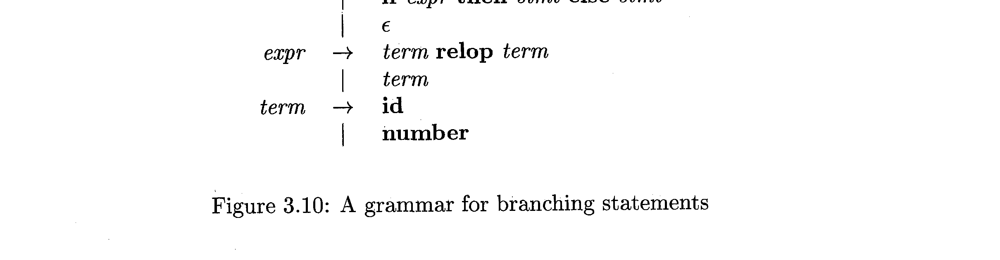
*Figure 17.1: Context-Free Grammar for Branching Statements (Dragon Book Fig 3.10)*

```bnf
stmt -> if expr then stmt
      | if expr then stmt else stmt
      | ε

expr -> term relop term
      | term

term -> id
      | number
```

This grammar illustrates how terminal symbols (`if`, `then`, `else`, `relop`, `id`, `number`) emitted by the Lexical Analyzer serve as the direct atomic input tokens processed by the Syntax Analyzer!

## 18. Dragon Book Exercises with Complete Step-by-Step Solutions

### 18.1 Section 3.1 Exercises with Solutions

#### 📝 Exercise 3.1.1
> **Problem Statement:**  
> Divide the following C++ program fragment into appropriate lexemes:
> ```cpp
> float limitedSquare(x) float x {
>     /* returns x-squared, but never more than 100 */
>     return (x <= -10.0 || x >= 10.0) ? 100 : x * x;
> }
> ```
> Which lexemes should get associated lexical values (attributes)? What should those values be?

**Detailed Step-by-Step Solution:**

1. **Comments and Whitespace:**
   - The comment `/* returns x-squared, but never more than 100 */` and all whitespace characters (spaces, tabs, newlines) are discarded by the scanner and produce NO tokens.
2. **Complete Lexeme and Token Breakdown Table:**

| Lexeme | Token Name | Attribute Value (Passed to Parser) | Rationale |
|---|---|---|---|
| `float` | **float** (keyword) | None | Reserved keyword specifying type |
| `limitedSquare` | **id** | Pointer to Symbol Table entry for `limitedSquare` | Function identifier |
| `(` | `(` | None | Syntax delimiter |
| `x` | **id** | Pointer to Symbol Table entry for `x` | Parameter identifier |
| `)` | `)` | None | Syntax delimiter |
| `float` | **float** (keyword) | None | Type specifier (K&R-style C parameter definition) |
| `x` | **id** | Pointer to Symbol Table entry for `x` | Parameter identifier |
| `{` | `{` | None | Compound statement start delimiter |
| `return` | **return** (keyword) | None | Control flow statement keyword |
| `(` | `(` | None | Delimiter |
| `x` | **id** | Pointer to Symbol Table entry for `x` | Variable identifier |
| `<=` | **relop** | `LE` (Less-than-or-Equal) | Relational operator |
| `-` | **minus_op** | None | Unary minus operator |
| `10.0` | **number** | Real value `10.0` (or ptr to constant table) | Floating-point literal |
| `||` | **or_op** | None | Logical OR operator |
| `x` | **id** | Pointer to Symbol Table entry for `x` | Variable identifier |
| `>=` | **relop** | `GE` (Greater-than-or-Equal) | Relational operator |
| `10.0` | **number** | Real value `10.0` | Floating-point literal |
| `)` | `)` | None | Delimiter |
| `?` | `?` | None | Ternary conditional operator |
| `100` | **number** | Integer value `100` | Numeric constant |
| `:` | `:` | None | Ternary alternate delimiter |
| `x` | **id** | Pointer to Symbol Table entry for `x` | Variable identifier |
| `*` | **mult_op** | None | Multiplication operator |
| `x` | **id** | Pointer to Symbol Table entry for `x` | Variable identifier |
| `;` | `;` | None | Statement terminator |
| `}` | `}` | None | Block end delimiter |

---

#### 📝 Exercise 3.1.2
> **Problem Statement:**  
> Tagged languages like HTML or XML are different from conventional programming languages in that the punctuation (tags) are either very numerous or user-definable, and tags can have parameters. Suggest how to divide the following HTML document into appropriate lexemes:
> ```html
> Here is a photo of <B>my house</B>:
> <P><BR>
> See <A HREF = "morePix.html">More Pictures</A> if you
> liked that one. <P>
> ```
> Which lexemes should get associated lexical values, and what should those values be?

**Detailed Step-by-Step Solution:**

In markup languages, the scanner operates in two alternating modes: **Text Mode** and **Tag Mode** (often implemented using Lex start states `%x TAG_STATE`):

1. **Text Content:** Consecutive words outside tags form **text** tokens.
2. **Tags:** Opening `<` and closing `>` delineate tags. The tag name becomes a token or attribute.
3. **Attributes:** Parameter names (`SRC`, `HREF`) and quoted attribute values (`"house.gif"`) form attribute tokens.

| Lexeme | Token Category | Attribute Value |
|---|---|---|
| `"Here is a photo of "` | **TEXT** | String value `"Here is a photo of "` |
| `<B>` | **TAG_OPEN** | `"B"` |
| `"my house"` | **TEXT** | String value `"my house"` |
| `</B>` | **TAG_CLOSE** | `"B"` |
| `":"` | **TEXT** | String value `":"` |
| `<P>` | **TAG_OPEN** | `"P"` |
| `` | **TAG_END** | None |
| `<BR>` | **TAG_OPEN** | `"BR"` |
| `"See "` | **TEXT** | String value `"See "` |
| `<A` | **TAG_OPEN** | `"A"` |
| `HREF` | **ATTR_NAME** | `"HREF"` |
| `=` | **EQUALS** | None |
| `"morePix.html"` | **ATTR_VALUE** | String value `"morePix.html"` |
| `>` | **TAG_END** | None |
| `"More Pictures"` | **TEXT** | String value `"More Pictures"` |
| `</A>` | **TAG_CLOSE** | `"A"` |
| `" if you liked that one. "` | **TEXT** | String value `" if you liked that one. "` |
| `<P>` | **TAG_OPEN** | `"P"` |

---

### 18.2 Section 3.3 Exercises with Solutions

#### 📝 Exercise 3.3.1
> **Problem Statement:**  
> Consult language reference manuals to determine (i) the input alphabet, (ii) lexical form of numerical constants, and (iii) lexical form of identifiers, for: (a) C (b) C++ (c) C# (d) Fortran (e) Java (f) Lisp (g) SQL.

**Summary Solution:**
- **Input Alphabet:**
  - C, Fortran: Historically ASCII (7-bit / 8-bit).
  - C++, C#, Java: Full Unicode (UTF-16/UTF-8) supporting international variable names.
  - SQL: ASCII core plus Unicode for strings.
  - Lisp: ASCII plus special symbol characters (`-`, `*`, `?`, `!`).
- **Numerical Constants:**
  - Integers (decimal, octal `0...`, hex `0x...`, binary `0b...`), optional suffixes (`U`, `L`, `LL`).
  - Floating point: decimals with optional fractional part and optional exponential part (`1.5e-3`, `3.14f`, `2.0L`).
- **Identifiers:**
  - C, C++, Java, C#: `[A-Za-z_][A-Za-z0-9_]*` (Java and C# allow Unicode letters and currency symbols like `$`).
  - Lisp: Extremely permissive: allows hyphens and punctuation, e.g., `string-length`, `valid?`.
  - SQL: Case-insensitive alphanumeric plus underscores; quoted identifiers `[Name]` or `"Name"` allow spaces.

---

#### 📝 Exercise 3.3.2
> **Problem Statement:**  
> Describe the languages denoted by the following regular expressions:  
> **(a)** $a(a \mid b)^*a$  
> **(b)** $((\epsilon \mid a)b^*)^*$  
> **(c)** $(a \mid b)^*a(a \mid b)(a \mid b)$  
> **(d)** $a^*ba^*ba^*ba^*$  

**Detailed Step-by-Step Solution:**

- **(a) $a(a \mid b)^*a$:**  
  All strings over alphabet $\{a, b\}$ that **begin with an $a$ and end with an $a$**, with a minimum length of 2 (e.g., $aa, aaa, aba, abba, \dots$).
- **(b) $((\epsilon \mid a)b^*)^*:$**  
  Every string over alphabet $\{a, b\}$!  
  *Proof:* Notice that $(\epsilon \mid a)b^*$ can generate any sequence of zero or one $a$ followed by any number of $b$'s. Repeating this closure with the outer star $*$ can generate any arbitrary mixture of $a$'s and $b$'s: $((\epsilon \mid a)b^*)^* = (a \mid b)^*$.
- **(c) $(a \mid b)^*a(a \mid b)(a \mid b)$:**  
  All strings of $a$'s and $b$'s whose **third symbol from the right-hand end is $a$**. (Length $\ge 3$).
- **(d) $a^*ba^*ba^*ba^*$:**  
  All strings over alphabet $\{a, b\}$ that contain **exactly three $b$'s** (and any arbitrary number of $a$'s interspersed).

---

#### 📝 Exercise 3.3.3
> **Problem Statement:**  
> In a string of length $n$ containing distinct characters, how many of the following are there?  
> **(a)** Prefixes  
> **(b)** Suffixes  
> **(c)** Proper prefixes  
> **(d)** Substrings  
> **(e)** Subsequences  

**Detailed Mathematical Solution:**

- **(a) Prefixes:**  
  A prefix is formed by taking the first $k$ symbols, where $0 \le k \le n$.  
  Therefore, there are **$n + 1$ prefixes** (from $\epsilon$ of length 0 up to the full string of length $n$).
- **(b) Suffixes:**  
  Similarly, formed by taking the last $k$ symbols ($0 \le k \le n$).  
  Therefore, there are **$n + 1$ suffixes**.
- **(c) Proper Prefixes:**  
  By definition, proper prefixes exclude $\epsilon$ (length 0) and the string itself (length $n$).  
  Therefore, there are $(n + 1) - 2 =$ **$n - 1$ proper prefixes** (for $n \ge 1$).
- **(d) Substrings (assuming all symbols are distinct):**  
  - Substrings of length 1: $n$
  - Substrings of length 2: $n - 1$
  - Substrings of length $k$: $n - k + 1$
  - Substrings of length $n$: $1$
  - Plus the empty string $\epsilon$: $1$.  
  Sum $= \sum_{k=1}^n (n - k + 1) + 1 = \frac{n(n + 1)}{2} + 1$.  
  Therefore, there are **$\frac{n(n+1)}{2} + 1$ substrings**.
- **(e) Subsequences:**  
  A subsequence is formed by either including or excluding each of the $n$ distinct character positions.  
  Each position has 2 choices (present or absent).  
  Therefore, there are **$2^n$ subsequences** (including $\epsilon$).

---

#### 📝 Exercise 3.3.4
> **Problem Statement:**  
> Show how to write a regular expression for a keyword in a case-insensitive language like SQL. Illustrate by writing the expression for `"select"`.

**Solution:**  
Each character position can match either its lowercase or uppercase variant.  
Using character classes:
$$\mathbf{[Ss][Ee][Ll][Ee][Cc][Tt]}$$
This matches `SELECT`, `select`, `Select`, `sElEcT`, and all $2^6 = 64$ casing permutations!

---

#### 📝 Exercise 3.3.5
> **Problem Statement:**  
> Write regular definitions for the following languages over lowercase letters (and digits):  
> **(a)** All strings that contain the five vowels in order ($a, e, i, o, u$).  
> **(b)** All strings in which letters are in ascending lexicographic order.  
> **(c)** C-style comments `/* ... */` without intervening `*/` unless inside double-quotes (`"`).  
> **(d)** All strings of digits with no repeated digits. *(Hint: Try this problem first with a few digits, such as $\{0, 1, 2\}$)*.  
> **(e)** All strings of digits with at most one repeated digit.  
> **(f)** All strings of $a$'s and $b$'s with an even number of $a$'s and an odd number of $b$'s.  
> **(g)** The set of Chess moves, in informal descriptive notation (e.g., `p-k4`, `kbp x qn`, `N-KB3`, `O-O`).  
> **(h)** All strings of $a$'s and $b$'s that do not contain the substring `abb`.  
> **(i)** All strings of $a$'s and $b$'s that do not contain the subsequence `abb`.  

**Detailed Step-by-Step Solutions:**

- **(a) Vowels in Order ($a, e, i, o, u$):**  
  Let $C = [^aeiou]$ represent all non-vowel lowercase consonants. The vowels must appear in sequence, interspersed with arbitrary non-vowels:
  $$[^aeiou]^*\, a\, [^aeiou]^*\, e\, [^aeiou]^*\, i\, [^aeiou]^*\, o\, [^aeiou]^*\, u\, [^aeiou]^*$$

- **(b) Ascending Lexicographic Order:**  
  Letters cannot decrease in alphabetical rank. Characters may appear zero or more times in alphabetical order:
  $$a^*\, b^*\, c^*\, d^*\, \dots\, y^*\, z^*$$

- **(c) Comments without intervening `*/` (allowing double-quoted strings):**  
  A comment begins with `/*` and ends with `*/`. Inside, an arbitrary sequence of non-asterisks, runs of asterisks followed by non-slashes, or balanced quoted strings is permitted:
  $$\text{/\*}([^*] \mid \*+[^*/] \mid \"[^\"]*\")*\*+/$$

- **(d) All strings of digits with no repeated digits:**  
  *Analysis:* Over alphabet $D = \{0, 1, \dots, 9\}$, since no digit may repeat, any valid string has length $0 \le |w| \le 10$.  
  *Smaller alphabet case $\{0, 1, 2\}$ (per textbook hint):*  
  $\epsilon \mid (0 \mid 1 \mid 2) \mid (01 \mid 02 \mid 10 \mid 12 \mid 20 \mid 21) \mid (012 \mid 021 \mid 102 \mid 120 \mid 201 \mid 210)$.  
  *General regular definition for all 10 digits:*  
  Any finite language is regular! We can formulate it inductively for any subset of available digits $S \subseteq \{0, 1, \dots, 9\}$:
  $$\begin{aligned}
  R_\emptyset &\to \epsilon \\
  R_S &\to \epsilon \mid \sum_{d \in S} d \cdot R_{S \setminus \{d\}}
  \end{aligned}$$
  The language of all strings with distinct digits is given by $R_{\{0, 1, 2, 3, 4, 5, 6, 7, 8, 9\}}$, consisting of all $\sum_{k=0}^{10} P(10, k) = 9,864,101$ permutation sequences.

- **(e) All strings of digits with at most one repeated digit:**  
  *Analysis:* A string either has zero repeated digits (the language $R_D$ from part (d)), or exactly **one** digit $d \in \{0, \dots, 9\}$ appears two or more times, while every other digit in $D \setminus \{d\}$ appears at most once.  
  *Regular definition:*  
  For each candidate repeated digit $d \in \{0, \dots, 9\}$:
  Let $D_{-d} = D \setminus \{d\}$. A string may interleave two or more occurrences of $d$ ($d \dots d$) into any permutation of distinct digits chosen from $D_{-d}$.  
  $$\text{Language} = R_D \;\mid\; \bigcup_{d=0}^{9} \left( \sum_{S \subseteq D_{-d}} \text{Interleave}(d^+, \text{Perm}(S)) \right)$$
  Because the set of characters other than $d$ is finite and bounded by length 9, this language is completely regular.

- **(f) Even number of $a$'s and odd number of $b$'s:**  
  Parity is modeled by a 4-state DFA with states $(E_a, E_b), (E_a, O_b), (O_a, E_b), (O_a, O_b)$, starting at $(E_a, E_b)$ and accepting at $(E_a, O_b)$.  
  Regular expression:
  $$(aa \mid bb \mid (ab \mid ba)(aa \mid bb)^*(ab \mid ba))^*\, b\, (aa \mid bb \mid (ab \mid ba)(aa \mid bb)^*(ab \mid ba))^*$$

- **(g) Set of Chess moves in informal descriptive notation (e.g., `p-k4`, `kbp x qn`):**  
  In historical English descriptive notation:
  - Pieces: Pawn (`P`), King (`K`), Queen (`Q`), Rook (`R`), Bishop (`B`), Knight (`N` or `Kt`).
  - Side specifier: King-side (`K`), Queen-side (`Q`), e.g., `KB` (King's Bishop), `QRP` (Queen's Rook's Pawn).
  - Action: `-` (move), `x` or `*` (capture).
  - Target: Destination square (file piece + rank $1\text{--}8$, e.g., `K4`, `KB3`) or captured piece (`QN`, `P`).
  - Suffixes: `ch` or `+` (check), `mate` or `++` (checkmate), `e.p.` (en passant).
  - Castling: `O-O` or `0-0` (Kingside), `O-O-O` or `0-0-0` (Queenside).  
  *Regular Definition:*
  ```lex
  piece     -> [pPkKqQrRbBnN] | [kK][tT]
  side      -> [kKqQ]
  descriptor-> (side)? piece
  rank      -> [1-8]
  square    -> descriptor rank
  action    -> [-] | [xX*]
  suffix    -> (ch | \+ | mate | \+\+ | e\.p\.)?
  castle    -> (O-O | 0-0 | O-O-O | 0-0-0) suffix
  move      -> descriptor action (square | descriptor) suffix
  chessMove -> move | castle
  ```
  *Matches:* `P-K4`, `kbp x qn`, `N-KB3`, `BxN ch`, `O-O`, `QxP mate`.

- **(h) No substring `abb`:**  
  The substring `abb` is forbidden. Any occurrence of $b$ cannot be followed by another $b$ if preceded by $a$. Thus, $a$'s can only be followed by single $b$'s:  
  $$b^*(a \mid ab)^*$$

- **(i) No subsequence `abb`:**  
  A string contains `abb` as a subsequence if an $a$ is followed somewhere later by a $b$, which is followed somewhere later by another $b$.  
  To avoid this, once the *first* $a$ appears, there can be **at most one $b$** in the entire remainder of the string!  
  $$b^* \mid b^* a^* \mid b^* a^* b a^*$$

---

#### 📝 Exercise 3.3.6
> **Problem Statement:**  
> Write character classes for:  
> **(a)** The first ten letters up to `"j"` in upper or lower case.  
> **(b)** The lowercase consonants.  
> **(c)** Hexadecimal digits.  
> **(d)** Punctuation characters at the end of an English sentence.

**Solutions:**
- **(a)** `[a-jA-J]`
- **(b)** `[b-df-hj-np-tv-z]`
- **(c)** `[0-9a-fA-F]`
- **(d)** `[.?!]`

---

#### 📝 Exercise 3.3.7
> **Problem Statement:**  
> Write a regular expression that matches the string `"\`.

**Solution:**  
In Lex/Flex syntax:
- Quoted string: `"\"\\"`
- Or backslash escaping: `\"\\`

---

#### 📝 Exercise 3.3.8
> **Problem Statement:**  
> Show that for every regular expression with complemented character classes `[^...]`, there is an equivalent regular expression without complemented character classes.

**Proof & Solution:**  
Let the alphabet be finite $\Sigma = \{c_1, c_2, \dots, c_k\}$.  
A complemented character class $[\wedge s]$ denotes the set difference:
$$[\wedge s] = \Sigma \setminus \{c \mid c \text{ appears in } s\}$$
Because $\Sigma$ is finite, $\Sigma \setminus s$ is a finite subset $\{d_1, d_2, \dots, d_m\} \subset \Sigma$.  
This can be written directly as an uncomplemented character class $[d_1 d_2 \dots d_m]$ or as an alternation $d_1 \mid d_2 \mid \dots \mid d_m$.  
Therefore, complemented character classes add no new expressive power to regular expressions; they are purely syntactic sugar!

---

#### 📝 Exercise 3.3.9
> **Problem Statement:**  
> The regular expression $r\{m, n\}$ matches between $m$ and $n$ occurrences of $r$. Show that for every expression containing repetition operators of this form, there is an equivalent regular expression without repetition operators.

**Proof & Solution:**  
$r\{m, n\}$ can be expanded into explicit concatenations and optional terms:
$$r\{m, n\} = \underbrace{r\, r\, \dots\, r}_{m \text{ times}}\ (r \mid \epsilon)^{n - m}$$
Because $m$ and $n$ are fixed finite integers, this expansion uses only basic concatenation and union ($\epsilon$). Hence, bounded repetition is syntactic sugar.

---

#### 📝 Exercise 3.3.10
> **Problem Statement:**  
> The operator `^` matches the left end of a line, and `$` matches the right end. `^` is also used for complemented character classes.  
> **(a)** How do you tell which meaning of `^` is intended?  
> **(b)** Can you always eliminate `^` and `$`?

**Solution:**  
- **(a) Context disambiguation:**  
  If `^` appears as the **first character immediately following an opening square bracket `[`** (e.g., `[^a-z]`), it represents a complemented character class. Anywhere else (e.g., `^abc`), it represents the line-start anchor!
- **(b) Elimination:**  
  In a compiler where the source is treated as a single stream containing explicit newline characters `\n`, `^r` can be replaced by `(\n | start_of_file) r`, and `r$` can be replaced by `r (\n | eof)`.

---

#### 📝 Exercise 3.3.11
> **Problem Statement:**  
> Show how UNIX shell filename expressions (Fig 3.9) can be replaced by equivalent regular expressions using only basic union, concatenation, and closure.

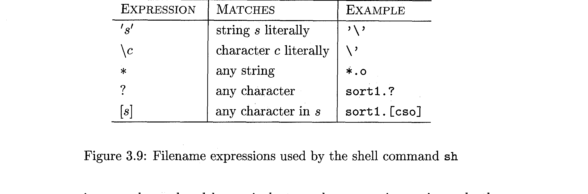
*Figure 18.1: Filename Expressions Used by the UNIX Shell Command sh (Dragon Book Fig 3.9)*

**Translation Table:**

| Shell Wildcard | Shell Semantics | Equivalent Formal Regular Expression |
|---|---|---|
| `*` | Any string of 0 or more characters | $\Sigma^*$ (where $\Sigma$ is all valid filename characters) |
| `?` | Exactly one arbitrary character | $\Sigma$ (any single character) |
| `[s]` | Any single character in set $s$ | $(c_1 \mid c_2 \mid \dots \mid c_k)$ for each character in $s$ |
| `*.o` | All files ending in `.o` | $\Sigma^* \cdot \mathbf{o}$ |
| `sort1.?` | `sort1.` followed by any single char | $\mathbf{sort1.} \cdot \Sigma$ |

---

#### 📝 Exercise 3.3.12
> **Problem Statement:**  
> SQL allows patterns where underscore `_` matches any single character and `%` matches any string of zero or more characters. A user may specify an escape character $e$ (e.g., `ESCAPE '\'`). Show how to express any SQL pattern as a regular expression.

**Solution:**  
Let $e$ be the designated escape character. We translate the SQL string left-to-right into a regular expression:
1. `_` (not preceded by $e$) $\implies \Sigma$ (any single character).
2. `%` (not preceded by $e$) $\implies \Sigma^*$ (zero or more arbitrary characters).
3. $e \_$ (escaped underscore) $\implies \mathbf{\_}$ (literal underscore).
4. $e \%$ (escaped percent) $\implies \mathbf{\%}$ (literal percent).
5. $ee$ (escaped escape character) $\implies \mathbf{e}$ (literal $e$).
6. Any regular character $c$ $\implies \mathbf{c}$.

---

## 19. Interactive Review Quiz Cards

Test your mastery of Lecture 2 concepts with these university exam review questions:

#### Q1: What is the primary difference between a Token, a Pattern, and a Lexeme?
<details>
<summary><b>Click to see answer</b></summary>
A <b>Token</b> is the abstract category output to the parser (e.g., <code>id</code>).  
A <b>Pattern</b> is the grammatical rule/regular expression describing what characters can form the token (e.g., <code>[a-zA-Z_][a-zA-Z0-9_]*</code>).  
A <b>Lexeme</b> is the concrete substring of source code text that matched the pattern (e.g., <code>totalScore</code>).
</details>

---

#### Q2: Why does the Lexical Analyzer return an attribute value alongside the token name?
<details>
<summary><b>Click to see answer</b></summary>
Because multiple distinct lexemes can match the same token name (for example, numbers <code>0</code> and <code>42</code> both produce token <code>number</code>). While the parser only needs the token name to verify grammar, the Code Generator must know the exact value or the variable's Symbol Table address to generate correct machine instructions.
</details>

---

#### Q3: Why can't a Lexical Analyzer detect if a variable name has been misspelled (like <code>fi</code> instead of <code>if</code>)?
<details>
<summary><b>Click to see answer</b></summary>
The lexical analyzer has no global syntactic or semantic context; it only inspects patterns. Because <code>fi</code> satisfies the regular expression for an identifier (<code>id</code>), the lexer treats it as a valid variable name. The error is only discovered later by the Parser when it finds an unexpected identifier where a condition statement was required.
</details>

---

#### Q4: How does the Sentinel technique optimize the double-buffer lookahead algorithm?
<details>
<summary><b>Click to see answer</b></summary>
Without sentinels, the inner scanning loop must perform two checks per character: (1) check if the buffer end is reached, and (2) perform a multiway switch on the character. By appending an <code>eof</code> sentinel at the end of each buffer, the buffer-end test is merged into the switch statement, reducing the overhead to a single test per character for normal source characters.
</details>

---

#### Q5: What is the difference between Kleene Closure ($L^*$) and Positive Closure ($L^+$)?
<details>
<summary><b>Click to see answer</b></summary>
$L^*$ represents zero or more concatenations ($L^* = \bigcup_{i=0}^\infty L^i$) and is guaranteed to contain the empty string $\epsilon$.  
$L^+$ represents one or more concatenations ($L^+ = \bigcup_{i=1}^\infty L^i$). $L^+ = LL^*$, and $\epsilon \in L^+$ only if $\epsilon \in L$.
</details>

---

#### Q6: Why must keyword rules appear BEFORE identifier rules in a Lex/Flex specification file?
<details>
<summary><b>Click to see answer</b></summary>
Because keywords (like <code>while</code>) also match the general regular expression for identifiers. When two rules match the exact same input length, Lex resolves the conflict by choosing the rule that appears first in the specification file. Placing keywords first ensures they are recognized as keywords rather than identifiers.
</details>

---

#### Q7: In practical regex engines, what is the difference between a Greedy quantifier and a Possessive quantifier?
<details>
<summary><b>Click to see answer</b></summary>
A <b>Greedy quantifier</b> (e.g., <code>.*</code>) matches as much as possible, but will backtrack and give back characters if subsequent patterns fail to match.  
A <b>Possessive quantifier</b> (e.g., <code>.*+</code>) matches as much as possible and <b>never backtracks</b>. This eliminates backtracking overhead and protects against catastrophic backtracking.
</details>

---

#### Q8: What is a Zero-Width Assertion? Give two examples.
<details>
<summary><b>Click to see answer</b></summary>
A zero-width assertion matches a condition or position in the text without consuming any characters from the input stream. Examples include line anchors (<code>^</code> for line start, <code>$</code> for line end) and lookarounds (<code>(?=abc)</code> for positive lookahead).
</details>

---

#### Q9: What is "Panic Mode" lexical error recovery?
<details>
<summary><b>Click to see answer</b></summary>
When the lexical analyzer encounters characters that match no valid token pattern, it discards characters one by one until it finds a character that can validly begin a known token.
</details>

---

#### Q10: Why are regular definitions forbidden from being recursive?
<details>
<summary><b>Click to see answer</b></summary>
If regular definitions allowed recursion, they could describe nested structures like balanced parentheses ($a^n b^n$). Finite Automata have no memory stack to count arbitrarily nested parentheses; handling recursion requires Context-Free Grammars and pushdown automata in the Parsing phase.
</details>

---

## 20. Key Takeaways & Master Exam Revision Card

```
╔══════════════════════════════════════════════════════════════════════════════════════╗
║                     CSE 420: LECTURE 2 — MASTER EXAM REVISION CARD                   ║
╠══════════════════════════════════════════════════════════════════════════════════════╣
║                                                                                      ║
║  1. THE LEXICAL ANALYZER (SCANNER):                                                  ║
║     • First phase of Compiler Front End (Analysis Realm).                            ║
║     • Input: Stream of raw characters.                                               ║
║     • Output: Stream of tokens ⟨Token Name, Attribute Value⟩ to Parser.             ║
║     • Housekeeping: Strips comments, removes whitespace, tracks line numbers.        ║
║                                                                                      ║
║  2. THE CORE TRINITY:                                                                ║
║     • Token: Abstract syntactic category processed by Parser (e.g., id, relop).     ║
║     • Pattern: Formal description/rule specified via Regular Expression.            ║
║     • Lexeme: Concrete sequence of characters in source code matching pattern.       ║
║                                                                                      ║
║  3. TOKEN ATTRIBUTES & SYMBOL TABLE:                                                 ║
║     • Token Name influences grammatical parsing decisions.                           ║
║     • Attribute Value influences code generation (e.g., pointer to Symbol Table).   ║
║                                                                                      ║
║  4. INPUT BUFFERING & SENTINELS:                                                     ║
║     • Double-Buffer scheme: Two buffers of size N (4096 bytes) alternate.            ║
║     • Pointers: lexemeBegin (start of lexeme) and forward (lookahead scanner).       ║
║     • Sentinels: Append 'eof' at end of each buffer to collapse 2 tests per char    ║
║       into a single switch (*forward++) test!                                        ║
║                                                                                      ║
║  5. FORMAL LANGUAGE THEORY:                                                          ║
║     • Alphabet (Σ): Finite set of symbols.                                           ║
║     • String: Finite sequence of symbols. Length |s|. Empty string ε (|ε| = 0).      ║
║     • Language: Any countable set of strings over Σ.                                 ║
║     • Operations: Union (L ∪ M), Concatenation (LM), Kleene Closure (L*),            ║
║       Positive Closure (L+). Note: ε is ALWAYS in L*!                                ║
║                                                                                      ║
║  6. REGULAR DEFINITIONS:                                                             ║
║     • Sequence of definitions d_i → r_i where r_i only uses previous symbols.       ║
║     • NO RECURSION ALLOWED! (Recursion requires Context-Free Grammars).              ║
║                                                                                      ║
║  7. LEX / FLEX DISAMBIGUATION RULES:                                                 ║
║     • Rule 1 (Longest Match): Lexer always absorbs the longest matching prefix.      ║
║     • Rule 2 (First Match): On tie, the rule appearing first in the file wins.       ║
║     • Keyword Priority: Always write Keywords BEFORE Identifiers in Lex!             ║
║                                                                                      ║
║  8. PRACTICAL REGEX QUANTIFIERS:                                                     ║
║     • Greedy (.*): Matches maximum, backtracks on failure.                           ║
║     • Reluctant (.*?): Matches minimum, expands on failure.                          ║
║     • Possessive (.*+): Matches maximum, NEVER backtracks (high speed, safe).        ║
║                                                                                      ║
║  9. ZERO-WIDTH LOOKAROUNDS:                                                          ║
║     • Positive Lookahead: (?=...)    Negative Lookahead: (?!...)                     ║
║     • Positive Lookbehind: (?<=...)   Negative Lookbehind: (?<!...)                  ║
║     • Consume ZERO characters; do not capture; perform contextual checks.            ║
║                                                                                      ║
║ 10. ERROR RECOVERY:                                                                  ║
║     • Lexers have local context only (cannot detect spelling mistakes like 'fi').    ║
║     • Panic Mode: Discard input characters until a valid token prefix appears.       ║
║     • 4 Transforms: Delete char, Insert char, Replace char, Transpose two chars.     ║
║                                                                                      ║
╚══════════════════════════════════════════════════════════════════════════════════════╝
```

---

> 📖 **Looking Ahead to Lecture 3:**  
> In Lecture 3, we advance to **Phase 2: Syntax Analysis (Parsing)**—exploring **Context-Free Grammars (CFGs)**, Derivations, Ambiguity resolution, Left Recursion Elimination, Left Factoring, and Top-Down Predictive Parsing (**LL(1)** Parsers with FIRST and FOLLOW set computation).

---

### 📚 Primary Reading Material Citations:
1. **Aho, A. V., Lam, M. S., Sethi, R., & Ullman, J. D.** (2006). *Compilers: Principles, Techniques, and Tools* (2nd Edition / "The Dragon Book"). Pearson / Addison-Wesley. Chapter 3: Lexical Analysis (Sections 3.1–3.4).
2. **Yanhaona, Dr. Muhammad Nur.** *Lesson 2: Introduction to Lexical Analysis*. Department of Computer Science and Engineering.
3. **Toal, Ray.** (2024). *Regular Expressions: Practical and Theoretical Guide*. Loyola Marymount University Computer Science Notes.
