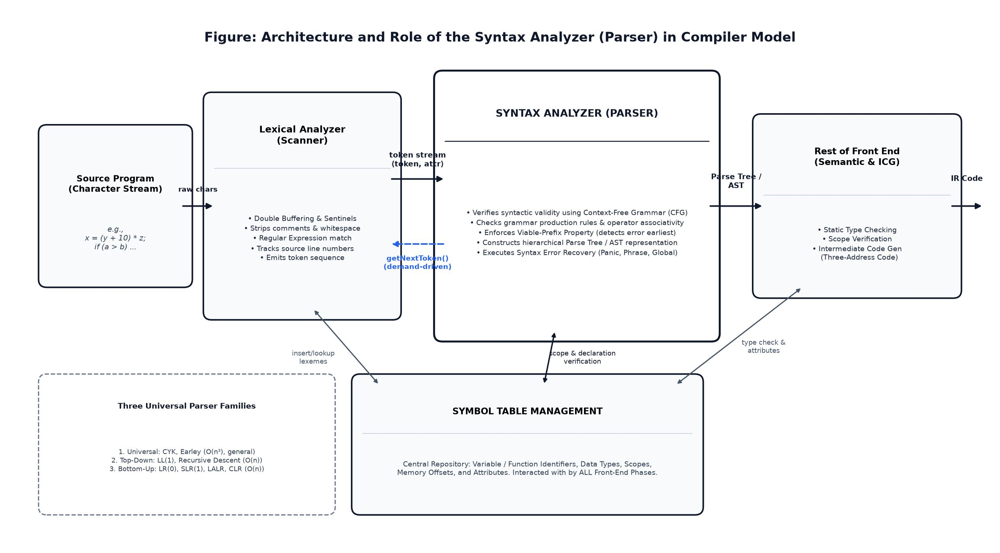
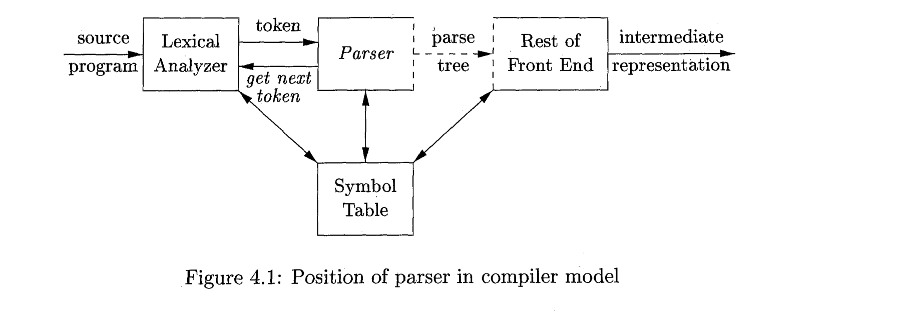
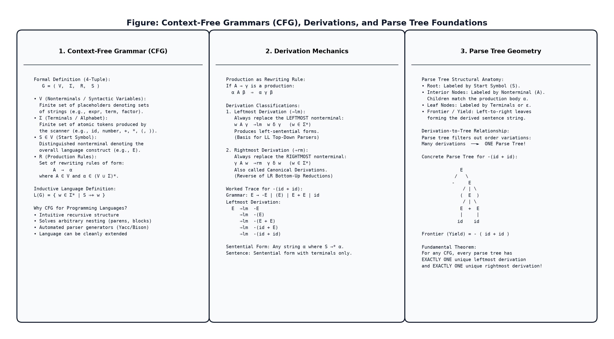
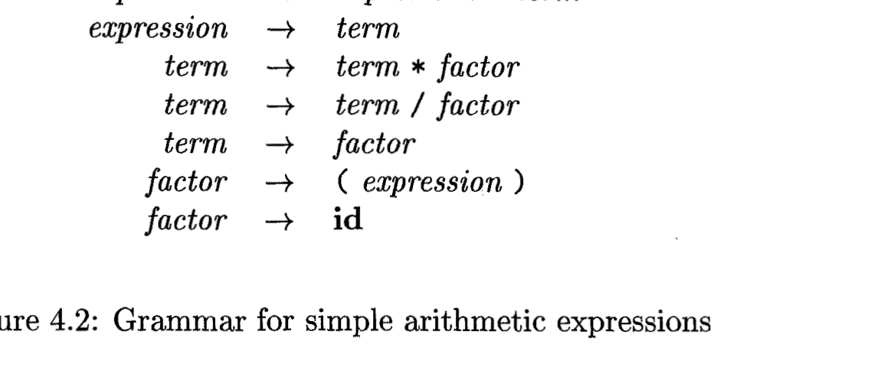
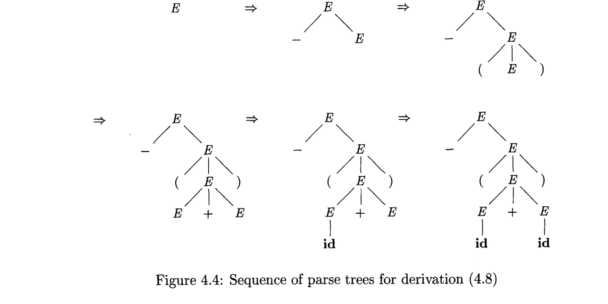
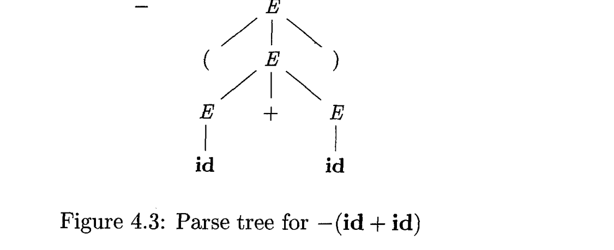
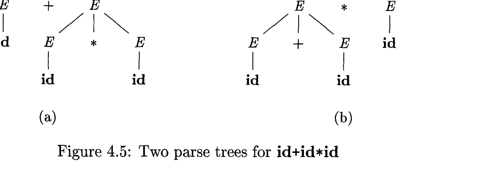
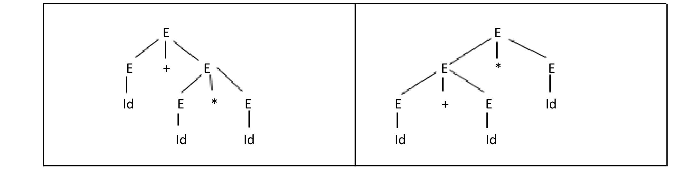
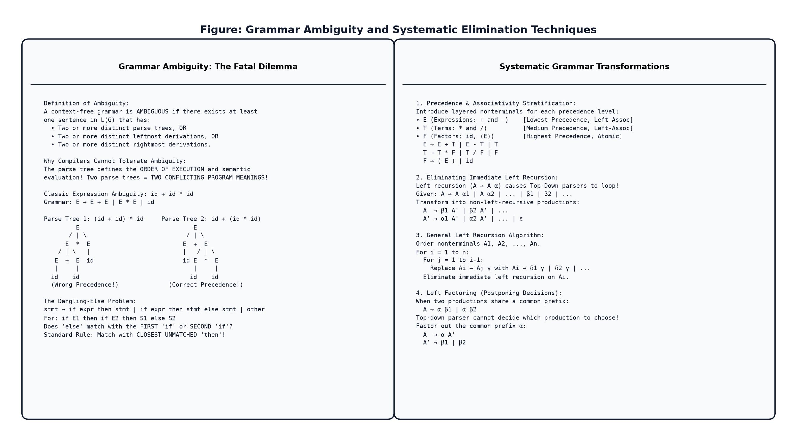
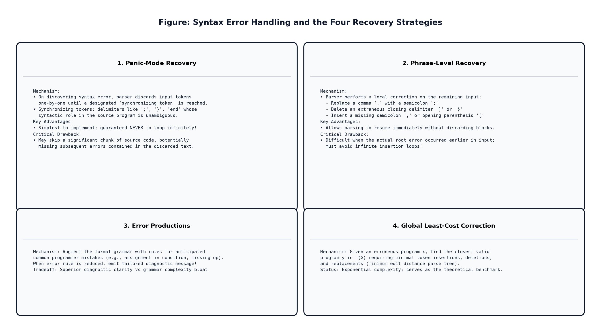

# 📚 CSE 420 — Compiler Design
## Lecture 3: Syntax Analysis — Context-Free Grammars, Derivations, Parse Trees, Ambiguity & Error Recovery

> **Course:** CSE 420 — Compiler Design  
> **Topic:** Lecture 3 — Syntax Analysis (The Parser, Context-Free Grammars, Derivation Relations, Parse Trees, Grammar Ambiguity, Left Recursion Elimination, Left Factoring, and Error-Recovery Strategies)  
> **Reference Textbook:** *Compilers: Principles, Techniques, and Tools* (2nd Edition / "The Dragon Book") by Alfred V. Aho, Monica S. Lam, Ravi Sethi, and Jeffrey D. Ullman (Chapter 4, Sections 4.1 & 4.2)  
> **Course Lectures & Notes:** Dr. Muhammad Nur Yanhaona (Department of Computer Science & Engineering)  
> **Companion Reading:** *Modern Compiler Implementation in C/Java* by Andrew W. Appel & *Engineering a Compiler* by Keith D. Cooper and Linda Torczon  

---

## 📑 Table of Contents

1. [Overview & Role of the Syntax Analyzer (Parser)](#1-overview--role-of-the-syntax-analyzer-parser)
   - [1.1 What is Syntax Analysis (Parsing)?](#11-what-is-syntax-analysis-parsing)
   - [1.2 Position of the Parser in the Compiler Model](#12-position-of-the-parser-in-the-compiler-model)
   - [1.3 The getNextToken() Mechanism: Demand-Driven Architecture](#13-the-getnexttoken-mechanism-demand-driven-architecture)
   - [1.4 Natural Language vs Programming Language Parsing (The Essay Analogy)](#14-natural-language-vs-programming-language-parsing-the-essay-analogy)
   - [1.5 Why Grammar Matters: Four Vital Engineering Advantages](#15-why-grammar-matters-four-vital-engineering-advantages)
2. [Taxonomy of Parsing Techniques](#2-taxonomy-of-parsing-techniques)
   - [2.1 The Three General Parser Classes](#21-the-three-general-parser-classes)
   - [2.2 Universal Parsing: CYK & Earley Algorithms ($O(n^3)$ Complexity)](#22-universal-parsing-cyk--earley-algorithms-on3-complexity)
   - [2.3 Top-Down Parsing: The LL Family ($O(n)$ Linear Scan)](#23-top-down-parsing-the-ll-family-on-linear-scan)
   - [2.4 Bottom-Up Parsing: The LR Family ($O(n)$ Shift-Reduce Power)](#24-bottom-up-parsing-the-lr-family-on-shift-reduce-power)
   - [2.5 Comparative Architecture Matrix: Universal vs Top-Down vs Bottom-Up](#25-comparative-architecture-matrix-universal-vs-top-down-vs-bottom-up)
3. [Context-Free Grammars: Formal Mathematical Foundations](#3-context-free-grammars-formal-mathematical-foundations)
   - [3.1 Limitations of Regular Expressions: The Memory Problem](#31-limitations-of-regular-expressions-the-memory-problem)
   - [3.2 The Formal Definition of a Context-Free Grammar ($G = (V, \Sigma, R, S)$)](#32-the-formal-definition-of-a-context-free-grammar-g--v-\sigma-r-s)
   - [3.3 Terminals vs Nonterminals: Alphabet and Containers](#33-terminals-vs-nonterminals-alphabet-and-containers)
   - [3.4 The Start Symbol & Production Rules](#34-the-start-symbol--production-rules)
   - [3.5 Inductive Definition of the Language Generated by a Grammar ($L(G)$)](#35-inductive-definition-of-the-language-generated-by-a-grammar-lg)
   - [3.6 Context-Free vs Context-Full: Natural Speech vs Programming Syntax](#36-context-free-vs-context-full-natural-speech-vs-programming-syntax)
4. [Notational Conventions & Syntax Design](#4-notational-conventions--syntax-design)
   - [4.1 The Dragon Book Notational Standard](#41-the-dragon-book-notational-standard)
   - [4.2 Backus-Naur Form (BNF) & Extended BNF (EBNF)](#42-backus-naur-form-bnf--extended-ebnf)
   - [4.3 Programming Language Syntax Design: Why Languages Look the Way They Do](#43-programming-language-syntax-design-why-languages-look-the-way-they-do)
5. [Representative Grammars for Programming Constructs](#5-representative-grammars-for-programming-constructs)
   - [5.1 The Ambiguous Arithmetic Grammar](#51-the-ambiguous-arithmetic-grammar)
   - [5.2 The Standard Left-Recursive Expression Grammar (LR-Ready)](#52-the-standard-left-recursive-expression-grammar-lr-ready)
   - [5.3 The Non-Left-Recursive Expression Grammar (LL-Ready)](#53-the-non-left-recursive-expression-grammar-ll-ready)
   - [5.4 Grammars for Control Flow, Blocks, and Declarations](#54-grammars-for-control-flow-blocks-and-declarations)
6. [Derivations: The Mechanics of Program Generation](#6-derivations-the-mechanics-of-program-generation)
   - [6.1 The Rewriting Relation ($\Rightarrow$, $\Rightarrow^*$, $\Rightarrow^+$)](#61-the-rewriting-relation)
   - [6.2 Sentential Forms vs Sentences](#62-sentential-forms-vs-sentences)
   - [6.3 Leftmost Derivations ($\Rightarrow_{lm}$) & Left-Sentential Forms](#63-leftmost-derivations-and-left-sentential-forms)
   - [6.4 Rightmost Derivations ($\Rightarrow_{rm}$, Canonical Derivations)](#64-rightmost-derivations-canonical-derivations)
   - [6.5 Complete Worked Derivation: $x = (y + 10) * z$](#65-complete-worked-derivation-x--y--10--z)
   - [6.6 Complete Worked Derivation: $-(id + id)$](#66-complete-worked-derivation--id--id)
7. [Parse Trees: Hierarchy, Geometry, and Properties](#7-parse-trees-hierarchy-geometry-and-properties)
   - [7.1 Formal Definition and Anatomy of a Parse Tree](#71-formal-definition-and-anatomy-of-a-parse-tree)
   - [7.2 Leaves, Interior Nodes, and the Yield (Frontier)](#72-leaves-interior-nodes-and-the-yield-frontier)
   - [7.3 Inductive Construction of a Parse Tree from a Derivation](#73-inductive-construction-of-a-parse-tree-from-a-derivation)
   - [7.4 Step-by-Step Parse Tree Evolution for $-(id + id)$](#74-step-by-step-parse-tree-evolution-for--id--id)
   - [7.5 Derivations vs Parse Trees: The Fundamental Equivalence Theorem](#75-derivations-vs-parse-trees-the-fundamental-equivalence-theorem)
   - [7.6 Parse Trees (CST) vs Abstract Syntax Trees (AST)](#76-parse-trees-cst-vs-abstract-syntax-trees-ast)
8. [Grammar Ambiguity: The Fatal Compiler Dilemma](#8-grammar-ambiguity-the-fatal-compiler-dilemma)
   - [8.1 Precise Definition of Ambiguity](#81-precise-definition-of-ambiguity)
   - [8.2 Why Compilers Cannot Tolerate Ambiguity: The Semantic Catastrophe](#82-why-compilers-cannot-tolerate-ambiguity-the-semantic-catastrophe)
   - [8.3 Proof Technique: Demonstrating Ambiguity via Dual Parse Trees](#83-proof-technique-demonstrating-ambiguity-via-dual-parse-trees)
   - [8.4 The Canonical Ambiguity Case Study: $id + id * id$](#84-the-canonical-ambiguity-case-study-id--id--id)
   - [8.5 Associativity & Precedence Distortion](#85-associativity--precedence-distortion)
   - [8.6 Undecidability of Ambiguity: Post's Correspondence Connection](#86-undecidability-of-ambiguity-posts-correspondence-connection)
9. [The Dangling-Else Ambiguity & Syntactic Solutions](#9-the-dangling-else-ambiguity--syntactic-solutions)
   - [9.1 The Classic Dangling-Else Problem](#91-the-classic-dangling-else-problem)
   - [9.2 Proof of Ambiguity with Nested Conditionals](#92-proof-of-ambiguity-with-nested-conditionals)
   - [9.3 Grammar Refactoring: Matched vs Open Statements](#93-grammar-refactoring-matched-vs-open-statements)
   - [9.4 Parser Disambiguating Rules: The Closest-Unmatched Principle](#94-parser-disambiguating-rules-the-closest-unmatched-principle)
   - [9.5 Modern Language Syntax Innovations (Ada, Python, Rust, Go)](#95-modern-language-syntax-innovations-ada-python-rust-go)
10. [Eliminating Left Recursion: Preparing Grammars for Top-Down Parsing](#10-eliminating-left-recursion-preparing-grammars-for-top-down-parsing)
    - [10.1 The Left-Recursion Trap: Infinite Loops in Top-Down Parsers](#101-the-left-recursion-trap-infinite-loops-in-top-down-parsers)
    - [10.2 Immediate Left Recursion: The Standard Algebraic Conversion](#102-immediate-left-recursion-the-standard-algebraic-conversion)
    - [10.3 Handling Multiple Recursive & Non-Recursive Alternatives](#103-handling-multiple-recursive--non-recursive-alternatives)
    - [10.4 The General (Indirect) Left-Recursion Elimination Algorithm](#104-the-general-indirect-left-recursion-elimination-algorithm)
    - [10.5 Step-by-Step Worked Problem: Eliminating Indirect Left Recursion](#105-step-by-step-worked-problem-eliminating-indirect-left-recursion)
11. [Left Factoring: Resolving Predictive Choice Dilemmas](#11-left-factoring-resolving-predictive-choice-dilemmas)
    - [11.1 The Common Prefix Problem in Predictive Parsing](#111-the-common-prefix-problem-in-predictive-parsing)
    - [11.2 The Left-Factoring Algorithm: Postponing Grammatical Decisions](#112-the-left-factoring-algorithm-postponing-grammatical-decisions)
    - [11.3 Step-by-Step Worked Problem: Left Factoring Conditional Statements](#113-step-by-step-worked-problem-left-factoring-conditional-statements)
12. [Verifying the Language Generated by a Grammar](#12-verifying-the-language-generated-by-a-grammar)
    - [12.1 The Two-Way Mathematical Proof Structure](#121-the-two-way-mathematical-proof-structure)
    - [12.2 Complete Induction Proof: Grammar for Balanced Parentheses ($S \to (S)S \mid \epsilon$)](#122-complete-induction-proof-grammar-for-balanced-parentheses)
13. [Syntax Error Handling: Foundations & The Viable-Prefix Property](#13-syntax-error-handling-foundations--the-viable-prefix-property)
    - [13.1 The Nature of Program Errors: The 4-Level Classification](#131-the-nature-of-program-errors-the-4-level-classification)
    - [13.2 The Core Mandates of a Robust Syntax Error Handler](#132-the-core-mandates-of-a-robust-syntax-error-handler)
    - [13.3 The Viable-Prefix Property: Detecting Errors at the Earliest Token](#133-the-viable-prefix-property-detecting-errors-at-the-earliest-token)
    - [13.4 Error Reporting Architecture: Offending Lines, Pointers, and Suppression](#134-error-reporting-architecture-offending-lines-pointers-and-suppression)
14. [Error-Recovery Strategy 1: Panic-Mode Recovery](#14-error-recovery-strategy-1-panic-mode-recovery)
    - [14.1 Operational Mechanism & Synchronizing Tokens](#141-operational-mechanism--synchronizing-tokens)
    - [14.2 Selection Principles for Synchronizing Sets](#142-selection-principles-for-synchronizing-sets)
    - [14.3 Concrete Walkthrough: Recovering from a Missing Parenthesis](#143-concrete-walkthrough-recovering-from-a-missing-parenthesis)
    - [14.4 Trade-off Analysis: Simplicity vs Information Loss](#144-trade-off-analysis-simplicity-vs-information-loss)
15. [Error-Recovery Strategy 2: Phrase-Level Recovery](#15-error-recovery-strategy-2-phrase-level-recovery)
    - [15.1 Operational Mechanism: Local String Transformations](#151-operational-mechanism-local-string-transformations)
    - [15.2 Common Local Repair Heuristics](#152-common-local-repair-heuristics)
    - [15.3 The Critical Trap: Avoiding Infinite Repair Loops](#153-the-critical-trap-avoiding-infinite-repair-loops)
    - [15.4 Comparison with Panic-Mode](#154-comparison-with-panic-mode)
16. [Error-Recovery Strategies 3 & 4: Error Productions & Global Correction](#16-error-recovery-strategies-3--4-error-productions--global-correction)
    - [16.1 Error Productions: Augmenting Grammar with Anticipated Mistakes](#161-error-productions-augmenting-grammar-with-anticipated-mistakes)
    - [16.2 Diagnostic Quality vs Grammar Bloat Trade-off](#162-diagnostic-quality-vs-grammar-bloat-trade-off)
    - [16.3 Global Correction: The Minimum Edit Distance Ideal](#163-global-correction-the-minimum-edit-distance-ideal)
    - [16.4 Why Global Correction Remains a Theoretical Yardstick](#164-why-global-correction-remains-a-theoretical-yardstick)
17. [Cross-Language Architectural Implementations: Industrial Parsers](#17-cross-language-architectural-implementations-industrial-parsers)
    - [17.1 C / C++ (Clang / GCC): Recursive Descent, Pratt Parsing & Fix-It Hints](#171-c--c-clang--gcc-recursive-descent-pratt-parsing--fix-it-hints)
    - [17.2 Python: The Evolution from LL(1) to PEG (Parsing Expression Grammars)](#172-python-the-evolution-from-ll1-to-peg-parsing-expression-grammars)
    - [17.3 Rust (`rustc`): High-Precision Diagnostics, Span Tracking & Error Recovery](#173-rust-rustc-high-precision-diagnostics-span-tracking--error-recovery)
    - [17.4 Java (`javac`): Recursive Descent and Tree-Building Passes](#174-java-javac-recursive-descent-and-tree-building-passes)
18. [Dragon Book Exercises with Complete Step-by-Step Solutions](#18-dragon-book-exercises-with-complete-step-by-step-solutions)
    - [18.1 Exercise 4.2.1: Postfix Expression Grammar ($S \to S S + \mid S S * \mid a$)](#181-exercise-421-postfix-expression-grammar)
    - [18.2 Exercise 4.2.2: Context-Free Language $0^n 1^n$ ($S \to 0 S 1 \mid 0 1$)](#182-exercise-422-context-free-language-0n-1n)
    - [18.3 Exercise 4.2.3: Designing CFGs for Specialized Notations & Operator Precedence](#183-exercise-423-designing-cfgs-for-specialized-notations--operator-precedence)
    - [18.4 Exercise 4.2.4: The Dangling-Else Ambiguity and Matched-Open Refactoring](#184-exercise-424-the-dangling-else-ambiguity-and-matched-open-refactoring)
    - [18.5 Exercise 4.2.5: Left Recursion Elimination & Factoring on Arithmetic Grammar](#185-exercise-425-left-recursion-elimination--factoring-on-arithmetic-grammar)
19. [Interactive Review Quiz Cards](#19-interactive-review-quiz-cards)
20. [Key Takeaways & Master Exam Revision Card](#20-key-takeaways--master-exam-revision-card)

---

---

## 1. Overview & Role of the Syntax Analyzer (Parser)

### 1.1 What is Syntax Analysis (Parsing)?

In the standard compiler pipeline, **Syntax Analysis**—conventionally designated as **Parsing**—constitutes the second phase of the compiler front end. It immediately succeeds the Lexical Analyzer (Scanner) and precedes the Semantic Analyzer.

While the Lexical Analyzer is concerned with the microscopic anatomy of a program—scanning linear streams of characters into discrete, atomic **tokens**—the Syntax Analyzer is responsible for the macroscopic architectural structure: validating whether the sequence of token names conforms to the formal grammatical rules of the source language.

> 🎯 **Primary Mission of the Syntax Analyzer (Parser):**  
> 1. Consume the linear token stream $\langle \text{token-name}, \text{attribute-value} \rangle$ emitted by the Lexical Analyzer.  
> 2. Determine whether the string of token names can be generated by the source language's formal **Context-Free Grammar (CFG)**.  
> 3. Construct a hierarchical syntactic representation—conventionally an **Abstract Syntax Tree (AST)** or concrete **Parse Tree**—that reflects the grammatical nesting, associativity, and operator precedence of the program.  
> 4. Intercept, report, and gracefully recover from syntactic syntax errors, guiding the programmer with intelligible diagnostic coordinates while continuing analysis on the remainder of the compilation unit.

```
                    ┌────────────────────────────┐
                    │        Source Code         │
                    │  (Raw Character Stream)    │
                    │   e.g., "x = (y + 10) * z" │
                    └─────────────┬──────────────┘
                                  │
                                  ▼
                    ┌────────────────────────────┐
                    │      LEXICAL ANALYZER      │ ◄────► [ Symbol Table ]
                    │         (Scanner)          │
                    └─────────────┬──────────────┘
                                  │
                                  ▼  Token Stream ⟨id, "x"⟩, ⟨assign, =⟩...
                    ┌────────────────────────────┐
                    │      SYNTAX ANALYZER       │ ◄────► [ Symbol Table ]
                    │          (Parser)          │
                    └─────────────┬──────────────┘
                                  │
                                  ▼  Hierarchical Parse Tree / AST
                    ┌────────────────────────────┐
                    │     REST OF FRONT END      │
                    │   (Semantic Analysis &     │ ◄────► [ Symbol Table ]
                    │     Intermediate Code)     │
                    └─────────────┬──────────────┘
                                  │
                                  ▼  Three-Address Code (TAC)
```


*Figure 1.1: Complete architectural data flow of the Syntax Analyzer within the compiler front-end model, illustrating bidirectional Symbol Table interaction and demand-driven token delivery.*

---

### 1.2 Position of the Parser in the Compiler Model

The classic Dragon Book architectural diagram (*Section 4.1.1, Figure 4.1*) reveals that the parser occupies the central switching hub of the compiler front end:


*Figure 1.2: Position of the parser in the compiler model (Dragon Book Figure 4.1). The parser consumes tokens from the Lexical Analyzer, outputs parse trees or intermediate code to the Rest of Front End, and continuously coordinates with the central Symbol Table.*

The parser operates as the conductor of the front end:
1. **Upstream Interaction (with the Lexical Analyzer):**  
   The parser does not wait for the entire source file to be tokenized into gigabytes of memory. Instead, it drives the tokenization process through an on-demand subroutine call.
2. **Internal Processing (Grammar Matching & Error Detection):**  
   The parser checks whether the token stream satisfies the productions of a Context-Free Grammar using either top-down derivation or bottom-up reduction.
3. **Downstream Interaction (with Semantic Analysis & ICG):**  
   Conceptually, the parser builds an explicit Parse Tree and hands it to subsequent phases. In practice, however, production compilers frequently interleave syntax analysis, static type checking, symbol table entry, and intermediate code generation within a single integrated pass.
4. **Symbol Table Coordination:**  
   During parsing, identifier tokens are checked against the symbol table to enforce lexical scoping, determine variable declarations, resolve type definitions (such as C `typedef`), and store expression type metadata.

---

### 1.3 The getNextToken() Mechanism: Demand-Driven Architecture

A foundational architectural design principle of modern compilers is the **producer-consumer / demand-driven** relationship between the Parser and the Scanner:

- The **Parser** acts as the *master / consumer*.
- The **Lexical Analyzer** acts as the *subroutine / producer*.

```
   ┌────────────────────────────────────────────────────────┐
   │                         PARSER                         │
   │                                                        │
   │   needs next grammar symbol to make parsing decision   │
   └───────────────┬────────────────────────▲───────────────┘
                   │                        │
     Token nextTok = getNextToken();        │ Token emitted
                   │                        │ ⟨id, "val"⟩
                   ▼                        │
   ┌────────────────────────────────────────┴───────────────┐
   │                    LEXICAL ANALYZER                    │
   │                                                        │
   │  advances forward pointer, strips whitespace/comments, │
   │  matches regex pattern, and yields next token object   │
   └────────────────────────────────────────────────────────┘
```

#### Why Demand-Driven Compilation Wins:
1. **Minimal Memory Footprint:**  
   If a compiler tokenized a 2,000,000-line industrial codebase upfront, the token stream alone could consume gigabytes of RAM. With `getNextToken()`, only a few tokens reside in memory at any instant.
2. **Immediate Error Interception:**  
   As soon as an illegal character sequence or malformed syntax construct appears, the compiler halts or enters error recovery immediately—without wasting cycles scanning millions of subsequent characters.
3. **Pipelined Concurrent Processing:**  
   As noted by Dr. Muhammad Nur Yanhaona, lexical analysis, syntax parsing, and initial semantic validation happen concurrently in a tightly synchronized lockstep loop.

---

### 1.4 Natural Language vs Programming Language Parsing (The Essay Analogy)

In his lecture notes (*Lesson 3: Introduction to Syntax Analysis*), **Dr. Muhammad Nur Yanhaona** introduces an illuminating parallel between natural language essay editing and compiler parsing:

> 💡 **Dr. Yanhaona's Essay Analogy:**  
> When a human teacher reviews an English essay:
> - The teacher checks the spelling of individual words (Lexical Analysis).
> - The teacher checks that each sentence follows Subject-Verb-Object grammatical rules (Syntax Analysis).
> - However, in natural language, grammar is exclusively concerned with the structure of *individual sentences*. We say an essay has *"grammatical errors in its sentences,"* but we never say *"the entire essay as an aggregate entity is grammatically invalid."*
> 
> **The Critical Difference in Compilers:**  
> In a programming language, the Context-Free Grammar prescribes the syntactic structure of **both** the microscopic units (expressions, statements) **and the program as an indivisible whole**! A single missing brace, mismatched parentheses, or illegal statement at line 5,000 renders the entire compilation unit syntactically rejected.

---

### 1.5 Why Grammar Matters: Four Vital Engineering Advantages

Why do compiler designers universally formalize programming languages through formal grammars (Context-Free Grammars / BNF) rather than ad-hoc parsing scripts?

The Dragon Book (*Section 4.1*) and Dr. Yanhaona highlight **four fundamental engineering advantages**:

| Advantage | Technical Reality & Compiler Impact |
|:---|:---|
| **1. Precise & Unambiguous Specification** | A grammar provides a mathematically rigorous, human-readable specification of the exact legal syntax of a language, eliminating ambiguities between language designers, compiler writers, and application programmers. |
| **2. Automated Parser Generation** | Just as regular expressions allow tools like `lex` or `flex` to generate deterministic finite automata automatically, Context-Free Grammars allow tools like `yacc`, `bison`, `ANTLR`, or `Menhir` to generate high-performance linear-time parsers automatically. |
| **3. Iterative Language Evolution** | When language architects introduce new constructs (e.g., adding `async/await`, lambda expressions, or pattern matching to Java/C#), new productions can be seamlessly integrated into the existing grammar without rewriting the entire front-end parser from scratch. |
| **4. Seamless Intermediate Translation** | The hierarchical parse tree directly mirrors the semantic breakdown of the source program, making it trivial to attach syntax-directed translation rules (SDTs) that generate Intermediate Representations (IR) like Three-Address Code (TAC). |

---

## 2. Taxonomy of Parsing Techniques

### 2.1 The Three General Parser Classes

In compiler literature, parsers for context-free grammars are partitioned into three principal families based on algorithmic approach and theoretical generality:

```
                              ┌───────────────────────────────────┐
                              │     COMPILER PARSING METHODS      │
                              └─────────────────┬─────────────────┘
                                                │
         ┌──────────────────────────────┬───────┴──────────────────────────────┐
         ▼                              ▼                                      ▼
┌──────────────────┐           ┌──────────────────┐           ┌──────────────────┐
│ UNIVERSAL PARSER │           │ TOP-DOWN PARSER  │           │ BOTTOM-UP PARSER │
│ (CYK / Earley)   │           │ (LL Family)      │           │ (LR Family)      │
│ O(n³) Complexity │           │ O(n) Complexity  │           │ O(n) Complexity  │
│ Any General CFG  │           │ Root-to-Leaves   │           │ Leaves-to-Root   │
└──────────────────┘           └──────────────────┘           └──────────────────┘
```

---

### 2.2 Universal Parsing: CYK & Earley Algorithms ($O(n^3)$ Complexity)

Universal parsing algorithms—most notably the **Cocke-Younger-Kasami (CYK)** algorithm (which requires grammars in Chomsky Normal Form) and **Earley's Algorithm** (which parses arbitrary CFGs via dynamic programming state sets)—can parse **literally any Context-Free Grammar**, including ambiguous, cyclic, and heavily left-recursive grammars.

#### Why Universal Parsers are Unusable in Production Compilers:
Universal parsers possess a worst-case computational complexity of **$O(n^3)$**, where $n$ is the number of tokens:
- For a small 100-token script: $100^3 = 1,000,000$ operations (negligible).
- For a real-world software project with $500,000$ tokens:  
  $$(500,000)^3 = 1.25 \times 10^{17} \text{ operations!}$$
  At 3 GHz (3 billion operations/sec), compilation would take **over 1.3 years** for a single program!

Consequently, production compilers restrict themselves to subclasses of grammars that admit **deterministic linear-time ($O(n)$) parsing**.

---

### 2.3 Top-Down Parsing: The LL Family ($O(n)$ Linear Scan)

Top-Down parsers construct the parse tree starting at the root (labeled by the Start Symbol $S$) and incrementally grow the branches downward toward the leaves (labeled by the source tokens).

- **Execution Strategy:** Left-to-right scan of input, constructing a **Leftmost Derivation** ($\Rightarrow_{lm}$).
- **The Core Family:**
  - Recursive-Descent Parsing (hand-written mutually recursive C/C++ functions).
  - Predictive Non-Recursive Parsers using explicit parsing tables and pushdown stacks (**LL(1)**).
- **Notation: $\text{LL}(k)$:**
  - First **L**: Scans input from **L**eft to right.
  - Second **L**: Constructs a **L**eftmost derivation.
  - **$k$**: Number of lookahead tokens inspected (virtually always $k=1$).
- **Grammar Restrictions:** Cannot handle left-recursive grammars ($A \to A\alpha$) without falling into infinite loops; requires left-factored grammars.

---

### 2.4 Bottom-Up Parsing: The LR Family ($O(n)$ Shift-Reduce Power)

Bottom-Up parsers construct the parse tree starting from the leaves (the actual tokens received from the scanner) and work their way upward toward the root start symbol $S$.

- **Execution Strategy:** Left-to-right scan of input, constructing the reverse of a **Rightmost Derivation** (the *canonical derivation*, $\Rightarrow_{rm}$).
- **The Core Mechanism:** The **Shift-Reduce** engine operating with a pushdown stack and deterministic finite automata (DFA) of items.
- **The Core Family:**
  - **LR(0):** Simplest, no lookahead (too weak for practical programming languages).
  - **SLR(1):** Simple LR, uses $\text{FOLLOW}(A)$ sets to resolve conflicts.
  - **LALR(1):** Lookahead LR (the engine powering `yacc` and `bison`), merges core states to minimize table size while retaining high expressive power.
  - **CLR(1) / Canonical LR(1):** Most powerful deterministic linear parser; carries full lookahead tokens within items.
- **Notation: $\text{LR}(k)$:**
  - **L**: Scans input from **L**eft to right.
  - **R**: Constructs a **R**ightmost derivation in reverse.
  - **$k$**: Lookahead tokens (typically $k=1$).

---

### 2.5 Comparative Architecture Matrix: Universal vs Top-Down vs Bottom-Up

| Dimension | Universal Parsers (CYK / Earley) | Top-Down Parsers (LL(1) / Predictive) | Bottom-Up Parsers (LR(1) / LALR(1)) |
|:---|:---|:---|:---|
| **Grammar Class** | Any arbitrary Context-Free Grammar | Subclass: $\text{LL}(k)$ Grammars (strictly deterministic) | Subclass: $\text{LR}(k)$ Grammars (much broader than LL) |
| **Time Complexity** | Worst-case $O(n^3)$ ($O(n^2)$ for unambiguous) | Strictly linear: $O(n)$ | Strictly linear: $O(n)$ |
| **Tree Construction** | Graph / tabular dynamic programming | Root-to-Leaves (top-down expansion) | Leaves-to-Root (bottom-up reduction) |
| **Derivation Produced** | All possible derivations | **Leftmost derivation** ($\Rightarrow_{lm}$) | Reverse of **Rightmost derivation** ($\Rightarrow_{rm}$) |
| **Left Recursion** | Handled natively without looping | **Fatal:** Causes infinite recursive loops! | Handled naturally and efficiently |
| **Left Factoring** | Not required | **Mandatory** for common prefixes | Not required; handled by shift states |
| **Implementation Style** | Complex matrix / state-set algorithms | Very easy to hand-code via Recursive Descent | Typically constructed via automated tools (`bison`) |
| **Industrial Usage** | Natural language processing (NLP), linguistics | GCC, Clang, Rustc, Javac (Handwritten Recursive Descent) | Yacc, Bison, parser generators, DSL engines |

---

## 3. Context-Free Grammars: Formal Mathematical Foundations

### 3.1 Limitations of Regular Expressions: The Memory Problem

In Lecture 2, we explored Regular Expressions and Finite Automata. While regular expressions are ideal for defining token patterns (identifiers, numeric literals, keywords), they possess an insurmountable theoretical limitation:

> ⚠️ **The Fundamental Boundary of Regular Languages:**  
> Finite Automata have **finite memory**—they can only remember what state they are currently in. They possess **no auxiliary storage or pushdown stack** to count unbounded numbers of events.

#### The Canonical Counterexample: Balanced Parentheses
Consider the language of nested, matched parentheses:
$$L = \{ (^n )^n \mid n \ge 1 \}$$
Strings in $L$ include `()`, `(())`, `((()))`, `(((())))`, etc.

- To verify whether a closing parenthesis `)` matches an opening parenthesis `(`, an automaton must keep an exact tally of how many `(` have been encountered so far.
- Because $n$ can be arbitrarily large (10, 1,000, 100,000), a finite-state machine would need infinitely many states to count them all!
- By the **Pumping Lemma for Regular Languages**, $L$ cannot be recognized by any finite automaton or regular expression.

Since virtually every programming language construct involves arbitrary recursive nesting:
- Nested arithmetic expressions: `(a + (b * (c - (d / e))))`
- Nested control blocks: `if (...) { while (...) { if (...) { ... } } }`
- Nested function invocations: `f(g(h(x)))`

Compilers **must** transition to the next tier of the Chomsky Hierarchy: **Context-Free Grammars (Type 2)** powered by **Pushdown Automata (Automata with a Stack)**!

---

### 3.2 The Formal Definition of a Context-Free Grammar ($G = (V, \Sigma, R, S)$)

Formally, a **Context-Free Grammar (CFG)** is defined as a mathematical 4-tuple:

$$G = (V, \Sigma, R, S)$$


*Figure 3.1: Context-Free Grammars (CFG) foundations: 4-tuple formal components, derivation relations (leftmost vs rightmost), and parse tree geometry.*

---

### 3.3 Terminals vs Nonterminals: Alphabet and Containers

Let us dissect the two disjoint sets of symbols in $G$:

#### 1. Terminals ($\Sigma$): The Concrete Alphabet
- **Terminals** are the fundamental, indivisible atomic symbols from which strings of the language are formed.
- In compiler architecture, **terminal = token name** produced by the lexical analyzer.
- The parser cannot decompose a terminal into smaller grammatical units.
- Examples: `id`, `number`, `+`, `-`, `*`, `/`, `if`, `else`, `(`, `)`, `;`.

#### 2. Nonterminals ($V$): The Syntactic Containers
- **Nonterminals** (also called *syntactic variables*) are placeholders that represent sets of strings.
- Each nonterminal defines a distinct sub-language or grammatical category within the program.
- Nonterminals impose the hierarchical nesting and modular architecture of programming languages.
- Examples: `expression`, `statement`, `declaration`, `term`, `factor`, `program`.
- **Disjointness Axiom:** $V \cap \Sigma = \emptyset$ (no symbol can be simultaneously a nonterminal and a terminal).

---

### 3.4 The Start Symbol & Production Rules

#### 3. The Start Symbol ($S \in V$):
- One distinguished nonterminal $S$ is designated as the **Start Symbol**.
- The start symbol represents the entire program or the root syntactic construct being analyzed (e.g., `Program`, `CompilationUnit`, or `Expression`).
- Conventionally, in grammar listings, the head of the very first production rule is the start symbol unless explicitly specified otherwise.

#### 4. The Production Rules ($R$):
- A **production rule** specifies the legal rewriting substitution through which nonterminals are expanded into combinations of terminals and nonterminals.
- Every context-free production has the canonical structure:
  $$A \to \alpha$$
  where:
  - $A \in V$ is a **single nonterminal** known as the **head** (or left-hand side, LHS).
  - The arrow symbol $\to$ (or $::=$ in BNF) signifies *"can be rewritten as"*.
  - $\alpha \in (V \cup \Sigma)^*$ is a finite (possibly empty) sequence of terminals and nonterminals called the **body** (or right-hand side, RHS).
  - If $\alpha = \epsilon$ (the empty string), the production $A \to \epsilon$ is called an **$\epsilon$-production** (or erasing rule).

---

### 3.5 Inductive Definition of the Language Generated by a Grammar ($L(G)$)

The **language generated by a grammar $G$**, denoted $L(G)$, is formally defined as the set of all terminal strings that can be derived by starting from the start symbol $S$ and applying one or more production rules:

$$L(G) = \{ w \in \Sigma^* \mid S \Rightarrow^+ w \}$$

- A string $w$ is called a **sentence of $G$** if and only if $w \in L(G)$ (i.e., $w$ consists solely of terminal symbols and $S \Rightarrow^* w$).
- If a string $\alpha \in (V \cup \Sigma)^*$ contains nonterminals and $S \Rightarrow^* \alpha$, then $\alpha$ is designated as a **sentential form of $G$**.
- A language $L$ is a **Context-Free Language (CFL)** if there exists at least one context-free grammar $G$ such that $L = L(G)$.
- Two grammars $G_1$ and $G_2$ are said to be **equivalent** if and only if they generate the exact same language: $L(G_1) = L(G_2)$.

---

### 3.6 Context-Free vs Context-Full: Natural Speech vs Programming Syntax

In *Lesson 3*, Dr. Yanhaona presents a profound linguistic distinction that clarifies why programming grammars are named **"Context-Free"**:

> 🗣️ **Natural Language is Context-Full (Context-Sensitive):**  
> Consider the following natural speech:  
> *"I heard that Breaking Bad is a wonderful TV series. Have you watched it?"*  
> To understand the word **"it"** in the second sentence, the human brain *must* remember the context provided by the preceding sentence! Without that contextual backdrop, "it" is entirely ambiguous—it could refer to a football game, a movie, or a pet.  
> Natural languages are profoundly context-dependent.
> 
> ⚙️ **Programming Grammars are Context-Free:**  
> In contrast, in a Context-Free Grammar, whenever you encounter a nonterminal $A$, you can replace it with its production body $\alpha$ **regardless of the surrounding symbols (the context)**!  
> For example, in the Python snippet:
> ```python
> if x > 10:
>     y = z + k
> ```
> The assignment statement `y = z + k` is parsed and validated using the exact same expression production rules, whether it appears inside an `if` block, inside a `while` loop, inside a class method, or at top-level module scope! The production rules do not need to know what encircles them.

*(Note: Contextual semantic constraints—such as ensuring variable `z` has been declared and is in scope—are intentionally decoupled from the parser and deferred to the Semantic Analysis phase).*

---

## 4. Notational Conventions & Syntax Design

### 4.1 The Dragon Book Notational Standard

To avoid cumbersome repetitions such as *"where $E$ is a nonterminal and $+$ is a terminal"*, the Dragon Book (*Section 4.2.2*) establishes an internationally recognized mathematical shorthand:

```
┌───────────────────────────────────────────────────────────────────────────────────────┐
│                          DRAGON BOOK NOTATIONAL CONVENTIONS                           │
├───────────────────────────────────────────────────────────────────────────────────────┤
│ 1. TERMINALS (Σ):                                                                     │
│    • Lowercase letters early in alphabet: a, b, c, d, e                               │
│    • Operator symbols: +, -, *, /, =, <, >                                            │
│    • Punctuation symbols: (, ), ;, ,, [, ], {, }                                      │
│    • Numeric digits: 0, 1, 2, ..., 9                                                  │
│    • Boldface reserved keywords: id, if, else, while, return                          │
│                                                                                       │
│ 2. NONTERMINALS (V):                                                                  │
│    • Uppercase letters early in alphabet: A, B, C, D                                  │
│    • The letter S (conventionally designated as Start Symbol)                         │
│    • Lowercase italicized names: expr, stmt, term, factor                             │
│    • Uppercase single letters for constructs: E (expr), T (term), F (factor)          │
│                                                                                       │
│ 3. GRAMMAR SYMBOLS (V ∪ Σ):                                                           │
│    • Uppercase letters late in alphabet: X, Y, Z (can be terminal OR nonterminal)     │
│                                                                                       │
│ 4. STRINGS OF TERMINALS (Σ*):                                                         │
│    • Lowercase letters late in alphabet: u, v, w, x, y, z                             │
│                                                                                       │
│ 5. STRINGS OF GRAMMAR SYMBOLS ((V ∪ Σ)*):                                             │
│    • Lowercase Greek letters: α, β, γ, δ                                              │
│                                                                                       │
│ 6. ALTERNATIVES NOTATION:                                                             │
│    • A → α1 | α2 | ... | αk  abbreviates the k distinct productions                   │
│      A → α1,  A → α2,  ...,  A → αk                                                   │
└───────────────────────────────────────────────────────────────────────────────────────┘
```

---

### 4.2 Backus-Naur Form (BNF) & Extended BNF (EBNF)

In formal computer science specifications, Context-Free Grammars are expressed using **Backus-Naur Form (BNF)**, originally invented by John Backus and Peter Naur for defining ALGOL 60.

#### Standard BNF Notation:
- Nonterminals are enclosed in angle brackets: `<expr>`, `<stmt>`.
- The rewriting arrow is written as `::=`.
- Alternatives are separated by vertical bars `|`.

```bnf
<stmt> ::= if ( <expr> ) <stmt>
         | if ( <expr> ) <stmt> else <stmt>
         | <id> = <expr> ;
```

#### Extended BNF (EBNF) Extensions:
To streamline repetitive grammar patterns, EBNF introduces regular expression operators:
- **Optionality `[ ... ]` or `?`:**  
  `stmt -> if ( expr ) stmt [ else stmt ]`
- **Zero or More Repetitions `{ ... }` or `*`:**  
  `stmtList -> { stmt }`
- **Grouping `( ... )`:**  
  `expr -> term ( (+ | -) term )*`

---

### 4.3 Programming Language Syntax Design: Why Languages Look the Way They Do

In *Lesson 3*, Dr. Yanhaona raises a compelling question that bridges theory and language engineering:  
*Why do Python, C, and Java look so drastically different in syntax? Are keywords, semicolons, and curly braces chosen merely for pretty visual aesthetics?*

> 🎯 **Dr. Yanhaona's Core Insight:**  
> **Syntax rules are engineered specifically to make writing a deterministic, unambiguous grammar feasible!**
> 
> - **In Python:**  
>   Consider function definitions:
>   ```python
>   def printHello():
>       print("Hello there!")
>   ```
>   The `def` keyword, the parentheses `()`, the mandatory colon `:`, and the strict block indentation are not cosmetic. Without the leading keyword `def`, the parser could not distinguish a function header from an identifier assignment or expression without deep lookahead. The colon `:` serves as an explicit terminal boundary marking the end of the header and the beginning of the body.
> 
> - **In C and Java:**  
>   Statements end with a semicolon `;` and code blocks are enclosed in curly braces `{}`.  
>   The semicolon `;` acts as an unambiguous **synchronizing statement terminator**, freeing C from newline sensitivity and allowing expressions to span across lines effortlessly.

---

## 5. Representative Grammars for Programming Constructs

Throughout this chapter and compiler design courses worldwide, three canonical arithmetic expression grammars are referenced continuously:


*Figure 5.1: Dragon Book Figure 4.2: Grammar for simple arithmetic expressions with layered operator precedence.*

---

### 5.1 The Ambiguous Arithmetic Grammar

The simplest intuitive grammar for binary arithmetic expressions treats all operators uniformly:

$$	ext{Grammar (4.3): } \quad E 	o E + E \mid E * E \mid - E \mid ( E ) \mid 	ext{id}$$

- **Characteristics:** Highly concise and intuitive.
- **Fatal Flaw:** It is **severely ambiguous**! It permits multiple parse trees for sentences like `id + id * id`, failing to enforce operator precedence ($* > +$) or left-associativity.

---

### 5.2 The Standard Left-Recursive Expression Grammar (LR-Ready)

To enforce correct operator precedence and left-associativity without ambiguity, the grammar is stratified into hierarchical tiers: **Expressions ($E$)**, **Terms ($T$)**, and **Factors ($F$)**:

$$egin{aligned}
E &	o E + T \mid E - T \mid T \\
T &	o T * F \mid T / F \mid F \\
F &	o ( E ) \mid 	ext{id} \mid 	ext{number}
\end{aligned}$$

#### The Stratification Principle:
1. **$E$ (Expression):** Handles lowest precedence operators ($+$, $-$). Because the recursive call is on the left ($E 	o E + T$), it enforces **left-associativity** (evaluates $(a + b) + c$).
2. **$T$ (Term):** Handles medium precedence operators ($*$, $/$) in a left-recursive structure ($T 	o T * F$).
3. **$F$ (Factor):** Handles highest precedence atomic units (parenthesized expressions $(E)$, variable identifiers `id`, and numeric literals `number`).

> 📌 **Parsing Suitability:**  
> Grammar (4.1) is perfectly suited for **Bottom-Up (LR) Parsers**.  
> However, because it contains **Left Recursion** ($E 	o E + T$), it will trap Top-Down (LL) Parsers in infinite recursive loops!

---

### 5.3 The Non-Left-Recursive Expression Grammar (LL-Ready)

To adapt the arithmetic grammar for **Top-Down Predictive Parsers (LL(1))**, we systematically eliminate left recursion by introducing auxiliary primed nonterminals ($E'$ and $T'$):

$$egin{aligned}
E &	o T E' \\
E' &	o + T E' \mid - T E' \mid \epsilon \\
T &	o F T' \\
T' &	o * F T' \mid / F T' \mid \epsilon \\
F &	o ( E ) \mid 	ext{id} \mid 	ext{number}
\end{aligned}$$

- **Characteristics:** Generates the exact same language as Grammar (4.1), but contains zero left recursion!
- **Parsing Suitability:** Perfectly suited for **Top-Down (LL(1)) Predictive Hand-Coded Parsers**.

---

### 5.4 Grammars for Control Flow, Blocks, and Declarations

Real programming languages extend beyond arithmetic to encompass complex control-flow grammars:

```
Program       →  StmtList
StmtList      →  Stmt StmtList  |  ε
Stmt          →  MatchedStmt  |  OpenStmt
MatchedStmt   →  if ( Expr ) MatchedStmt else MatchedStmt
              |  while ( Expr ) MatchedStmt
              |  for ( Expr ; Expr ; Expr ) MatchedStmt
              |  id = Expr ;
              |  { StmtList }
OpenStmt      →  if ( Expr ) Stmt
              |  if ( Expr ) MatchedStmt else OpenStmt
              |  while ( Expr ) OpenStmt
```


---

## 6. Derivations: The Mechanics of Program Generation

### 6.1 The Rewriting Relation ($\Rightarrow$, $\Rightarrow^*$, $\Rightarrow^+$)

To formalize how a grammar constructs a program, we adopt a **derivational view**: treating production rules as generative string-rewriting operators.

Let $G = (V, \Sigma, R, S)$ be a Context-Free Grammar.
- If $A \to \gamma$ is a production rule in $R$, and $\alpha$ and $\beta$ are arbitrary strings in $(V \cup \Sigma)^*$, then we say that $\alpha A \beta$ **directly derives** $\alpha \gamma \beta$ in one single rewriting step, written as:
  $$\alpha A \beta \Rightarrow \alpha \gamma \beta$$
- If a string $\alpha_1$ derives $\alpha_n$ through a sequence of zero or more derivation steps:
  $$\alpha_1 \Rightarrow \alpha_2 \Rightarrow \dots \Rightarrow \alpha_n$$
  we write:
  $$\alpha_1 \Rightarrow^* \alpha_n$$
  The symbol $\Rightarrow^*$ represents the **reflexive and transitive closure** of the direct derivation relation $\Rightarrow$.
  *(Note that $\alpha \Rightarrow^* \alpha$ for any string $\alpha$ in zero steps).*
- If the derivation requires **one or more steps** ($n \ge 2$), we write:
  $$\alpha_1 \Rightarrow^+ \alpha_n$$
  The symbol $\Rightarrow^+$ represents the **transitive closure** of $\Rightarrow$.

---

### 6.2 Sentential Forms vs Sentences

Precision of terminology is vital in formal syntax analysis:

```
┌────────────────────────────────────────────────────────────────────────────────────────┐
│                        SENTENTIAL FORMS VS SENTENCES                                   │
├────────────────────────────────────────────────────────────────────────────────────────┤
│ • SENTENTIAL FORM:                                                                     │
│   Any string α ∈ (V ∪ Σ)* that can be derived from the start symbol S:                 │
│                              S ⇒* α                                                    │
│   A sentential form may contain nonterminals, terminals, or a mixture of both.         │
│                                                                                        │
│ • SENTENCE:                                                                            │
│   A sentential form w that contains EXCLUSIVELY terminal symbols (w ∈ Σ*):             │
│                              S ⇒+ w                                                    │
│   A sentence is a complete, syntactically legal program in the language L(G)!          │
│                                                                                        │
│ • LANGUAGE OF G (L(G)):                                                                │
│   The set of all sentences derivable from the start symbol:                            │
│                  L(G) = { w ∈ Σ* | S ⇒+ w }                                            │
└────────────────────────────────────────────────────────────────────────────────────────┘
```

---

### 6.3 Leftmost Derivations ($\Rightarrow_{lm}$) & Left-Sentential Forms

At each step of a derivation, if a sentential form contains more than one nonterminal, the parser has a choice of which nonterminal to expand.

> 🔷 **Leftmost Derivation ($\Rightarrow_{lm}$):**  
> A derivation in which the **leftmost nonterminal** in each sentential form is strictly chosen for replacement at every single step.

Formally, if $w \in \Sigma^*$ is a string of terminals, $A \in V$, and $\gamma, \delta \in (V \cup \Sigma)^*$, a direct leftmost step is written:
$$w A \gamma \Rightarrow_{lm} w \delta \gamma$$

- If $S \Rightarrow_{lm}^* \alpha$, then $\alpha$ is designated as a **left-sentential form** of the grammar.
- **Compiler Significance:** **Top-Down Parsers (LL(1), Recursive Descent)** operate by discovering and constructing a **Leftmost Derivation** of the input program!

---

### 6.4 Rightmost Derivations ($\Rightarrow_{rm}$, Canonical Derivations)

> 🔶 **Rightmost Derivation ($\Rightarrow_{rm}$):**  
> A derivation in which the **rightmost nonterminal** in each sentential form is strictly chosen for replacement at every single step.

Formally, if $w \in \Sigma^*$ is a string of terminals, $A \in V$, and $\gamma, \delta \in (V \cup \Sigma)^*$, a direct rightmost step is written:
$$\gamma A w \Rightarrow_{rm} \gamma \delta w$$

- In compiler literature, rightmost derivations are famously known as **Canonical Derivations**.
- If $S \Rightarrow_{rm}^* \alpha$, then $\alpha$ is a **right-sentential form** of the grammar.
- **Compiler Significance:** **Bottom-Up Parsers (LR(1), LALR, Shift-Reduce)** operate by discovering the **reverse of a Rightmost Derivation** (called a *canonical reduction*)!

---

### 6.5 Complete Worked Derivation: $x = (y + 10) * z$

Let us examine the concrete derivation presented in **Dr. Muhammad Nur Yanhaona's Lesson 3 notes**:

#### Input Statement:
```c
x = (y + 10) * z;
```
#### Token Stream emitted by Lexical Analyzer:
The scanner emits:
$$\textbf{id}_1 = ( \textbf{id}_2 + \textbf{number} ) * \textbf{id}_3$$

#### Grammar Rules (Grammar 1):
$$\begin{aligned}
A &\to \textbf{id} = E \\
E &\to E + T \mid E - T \mid T \\
T &\to T * F \mid T / F \mid F \\
F &\to \textbf{id} \mid \textbf{number} \mid ( E )
\end{aligned}$$

#### Step-by-Step Leftmost Derivation ($\Rightarrow_{lm}$):

$$\begin{aligned}
A &\Rightarrow_{lm} \textbf{id} = E & \text{[Apply } A \to \textbf{id} = E \text{]} \\
  &\Rightarrow_{lm} \textbf{id} = T & \text{[Apply } E \to T \text{]} \\
  &\Rightarrow_{lm} \textbf{id} = T * F & \text{[Apply } T \to T * F \text{]} \\
  &\Rightarrow_{lm} \textbf{id} = F * F & \text{[Apply } T \to F \text{]} \\
  &\Rightarrow_{lm} \textbf{id} = ( E ) * F & \text{[Apply } F \to ( E ) \text{]} \\
  &\Rightarrow_{lm} \textbf{id} = ( E + T ) * F & \text{[Apply } E \to E + T \text{]} \\
  &\Rightarrow_{lm} \textbf{id} = ( T + T ) * F & \text{[Apply } E \to T \text{]} \\
  &\Rightarrow_{lm} \textbf{id} = ( F + T ) * F & \text{[Apply } T \to F \text{]} \\
  &\Rightarrow_{lm} \textbf{id} = ( \textbf{id} + T ) * F & \text{[Apply } F \to \textbf{id} \text{]} \\
  &\Rightarrow_{lm} \textbf{id} = ( \textbf{id} + F ) * F & \text{[Apply } T \to F \text{]} \\
  &\Rightarrow_{lm} \textbf{id} = ( \textbf{id} + \textbf{number} ) * F & \text{[Apply } F \to \textbf{number} \text{]} \\
  &\Rightarrow_{lm} \textbf{id} = ( \textbf{id} + \textbf{number} ) * \textbf{id} & \text{[Apply } F \to \textbf{id} \text{]}
\end{aligned}$$

> ✅ **Syntactic Conclusion:**  
> Because the input string $\textbf{id} = ( \textbf{id} + \textbf{number} ) * \textbf{id}$ can be completely derived from the start symbol $A$ via valid productions, the statement is proved to be **syntactically valid**! If no derivation were possible, a syntax error would be diagnosed.

---

### 6.6 Complete Worked Derivation: $-(id + id)$

Consider the canonical Dragon Book derivation (*Section 4.2.3, Derivations 4.8 & 4.9*) under the grammar:
$$E \to - E \mid ( E ) \mid E + E \mid \textbf{id}$$

Let us derive the sentence $-(\textbf{id} + \textbf{id})$ using both Leftmost and Rightmost derivations:

#### Leftmost Derivation ($\Rightarrow_{lm}$):
$$\begin{aligned}
E &\Rightarrow_{lm} - E \\
  &\Rightarrow_{lm} - ( E ) \\
  &\Rightarrow_{lm} - ( E + E ) \\
  &\Rightarrow_{lm} - ( \textbf{id} + E ) \\
  &\Rightarrow_{lm} - ( \textbf{id} + \textbf{id} )
\end{aligned}$$

#### Rightmost Derivation ($\Rightarrow_{rm}$):
$$\begin{aligned}
E &\Rightarrow_{rm} - E \\
  &\Rightarrow_{rm} - ( E ) \\
  &\Rightarrow_{rm} - ( E + E ) \\
  &\Rightarrow_{rm} - ( E + \textbf{id} ) \\
  &\Rightarrow_{rm} - ( \textbf{id} + \textbf{id} )
\end{aligned}$$

Notice that both derivations replace the exact same nonterminals with the exact same production bodies, but the **order of replacement is strictly reversed** in the final two steps.

---

## 7. Parse Trees: Hierarchy, Geometry, and Properties

### 7.1 Formal Definition and Anatomy of a Parse Tree

A **Parse Tree** is a graphical, hierarchical representation of a derivation that abstracts away the arbitrary temporal sequence in which nonterminals were rewritten.

```
                                  [ Root Node ]
                                     (S / E)
                                    /   |                                      /    |                              [ Interior Nodes ]                             (Nonterminals A)                                 /     \                                        /       \                                  [ Leaves ]  [ Leaves ]   [ Leaves ]
                       (Terminals / ε) ────────► YIELD / FRONTIER
```

#### Precise Structural Anatomy:
1. **The Root Node:** Always labeled by the grammar's **Start Symbol ($S$)**.
2. **Interior Nodes:** Every internal node is labeled by a **Nonterminal symbol ($A \in V$)**.
   - If an interior node $A$ has children labeled $X_1, X_2, \dots, X_k$ from left to right, then:
     $$A \to X_1 X_2 \dots X_k$$
     must be an authorized production rule in the grammar!
3. **Leaf Nodes (Terminal Leaves):**
   - Every leaf node is labeled by either a **Terminal symbol ($a \in \Sigma$)** or the **empty string ($\epsilon$)**.
   - If a leaf is labeled $\epsilon$, it must be the sole child of its parent node $A$ (corresponding to production $A \to \epsilon$).

---

### 7.2 Leaves, Interior Nodes, and the Yield (Frontier)

> 🍃 **The Yield (Frontier) of a Parse Tree:**  
> Reading the leaf nodes of a parse tree in an in-order left-to-right sweep yields a string of terminals and nonterminals called the **yield** (or **frontier**) of the tree.

- If all leaves are terminals, the yield is a valid **sentence** in $L(G)$.
- The yield of any sub-tree rooted at nonterminal $A$ is the exact string derived from $A$ ($A \Rightarrow^* w$).

---

### 7.3 Inductive Construction of a Parse Tree from a Derivation

The Dragon Book (*Section 4.2.4*) provides a formal mathematical induction showing how every derivation $\alpha_1 \Rightarrow \alpha_2 \Rightarrow \dots \Rightarrow \alpha_n$ constructs a corresponding parse tree:

- **Basis Step ($n=1$):**  
  For $\alpha_1 = S$, the parse tree is a single root node labeled $S$.
- **Inductive Step:**  
  Suppose we have constructed a tree with yield $\alpha_{i-1} = X_1 X_2 \dots X_k$.  
  Suppose $\alpha_i$ is obtained by replacing nonterminal $X_j$ via production:
  $$X_j \to Y_1 Y_2 \dots Y_m$$
  To model this step in the tree, locate the $j$-th leaf from the left (labeled $X_j$), and attach $m$ children to it, labeled $Y_1, Y_2, \dots, Y_m$ in left-to-right order. If $m=0$ ($X_j \to \epsilon$), attach a single child labeled $\epsilon$.

---

### 7.4 Step-by-Step Parse Tree Evolution for $-(id + id)$

Figure 4.4 from the Dragon Book illustrates the incremental growth of the parse tree during the leftmost derivation of $-(\textbf{id} + \textbf{id})$:


*Figure 7.1: Step-by-step sequence of parse tree growth for the derivation of $-(	extbf{id} + 	extbf{id})$ (Dragon Book Figure 4.4).*

The final complete parse tree is captured in Figure 4.3:


*Figure 7.2: Final completed parse tree for $-(	extbf{id} + 	extbf{id})$ (Dragon Book Figure 4.3). Notice that the frontier leaves read left-to-right form $- ( 	extbf{id} + 	extbf{id} )$.*

---

### 7.5 Derivations vs Parse Trees: The Fundamental Equivalence Theorem

A pivotal question in formal language theory:  
*What is the exact mathematical relationship between Derivations and Parse Trees?*

```
     Many Arbitrary Derivations ────────┐
     (different nonterminal orders)     │
                                        ▼
                             [ UNIQUE PARSE TREE ]
                                        ▲
        ┌───────────────────────────────┴───────────────────────────────┐
        │                                                               │
        ▼                                                               ▼
[ Unique Leftmost Derivation ]                  [ Unique Rightmost Derivation ]
```

> 📜 **The Fundamental Equivalence Theorem:**  
> 1. **Many-to-One Mapping:** Many different derivations can correspond to the exact same parse tree, because a parse tree ignores irrelevant variations in the temporal order of expanding independent nonterminals.  
> 2. **One-to-One Correspondence:** For any valid parse tree in a Context-Free Grammar, there exists:  
>    - **EXACTLY ONE unique Leftmost Derivation**, and  
>    - **EXACTLY ONE unique Rightmost Derivation**!

Because of this one-to-one bijection, parsers do not need to search through all arbitrary derivations—they exclusively produce either the canonical leftmost derivation (top-down) or canonical rightmost derivation in reverse (bottom-up).

---

### 7.6 Parse Trees (CST) vs Abstract Syntax Trees (AST)

In practical compiler design, a critical distinction is drawn between a **Concrete Syntax Tree (Parse Tree)** and an **Abstract Syntax Tree (AST)**:

```
    CONCRETE SYNTAX TREE (Parse Tree)              ABSTRACT SYNTAX TREE (AST)
            (Syntactic Detail)                         (Semantic Cleanliness)

                    E                                           =
                /   |   \                                     /                 id    =    E                                   x     *
             (x)       / | \                                      / \
                      E  +  T                                    +   z
                     (y)    |                                   / \
                            T                                  y   10
                          / |                          T  *  F
                        (10)  (z)
```

| Dimension | Concrete Parse Tree (CST) | Abstract Syntax Tree (AST) |
|:---|:---|:---|
| **Primary Consumer** | The Parser (during grammar checking) | Semantic Analyzer & Intermediate Code Generator |
| **Node Representation** | Interior nodes represent Nonterminals ($E, T, F$) | Interior nodes represent Operators / Actions ($+, *, =$) |
| **Syntactic Clutter** | Retains parentheses `()`, semicolons `;`, commas `,` | Drops parentheses, commas, punctuation entirely |
| **Size & Memory** | Massive footprint; contains auxiliary single-child chains | Compact and lean; stores only semantic operands |
| **Tree Geometry** | Deeply nested following grammar stratification | Minimal depth reflecting actual operand relationships |

---

## 8. Grammar Ambiguity: The Fatal Compiler Dilemma

### 8.1 Precise Definition of Ambiguity

> 🛑 **Formal Definition of Grammar Ambiguity:**  
> A Context-Free Grammar $G$ is said to be **ambiguous** if there exists at least one sentence $w \in L(G)$ that possesses:
> 1. **Two or more distinct parse trees**, OR
> 2. **Two or more distinct leftmost derivations**, OR
> 3. **Two or more distinct rightmost derivations**.

If even a single sentence in $L(G)$ produces multiple parse trees, the entire grammar is classified as ambiguous.

---

### 8.2 Why Compilers Cannot Tolerate Ambiguity: The Semantic Catastrophe

In *Lesson 3*, Dr. Muhammad Nur Yanhaona explains the crucial difference between ambiguity in human language and programming languages:

> 🐺 **Dr. Yanhaona's Jackal & Rabbit Analogy:**  
> In natural language, we constantly navigate ambiguities using contextual clues and common sense. Consider:  
> *"The Jackal swiftly killed the rabbit. It did not make any sound."*  
> Grammatically, the pronoun **"It"** could refer to either the jackal or the rabbit! Humans resolve this through common sense (prey usually screams or dies silently; predators hunt quietly) or we ask the speaker for clarification.  
> 
> 💻 **Why Compilers Cannot Guess:**  
> A compiler cannot stop execution, call the programmer on the phone, and ask: *"Did you mean to multiply first or add first?"*  
> The shape of the parse tree dictates the **exact instruction sequence and memory evaluation order** of the resulting executable. If a grammar has two parse trees, the compiler could produce two conflicting machine executables that produce different mathematical answers for the same program!

---

### 8.3 Proof Technique: Demonstrating Ambiguity via Dual Parse Trees

To mathematically prove that a grammar $G$ is ambiguous:
1. You only need to discover **ONE single sentence** $w \in L(G)$.
2. Show that $w$ produces **two distinct parse trees** (or equivalently, two distinct leftmost derivations).

---

### 8.4 The Canonical Ambiguity Case Study: $id + id * id$

Consider the ambiguous arithmetic grammar (Grammar 4.3):
$$E \to E + E \mid E * E \mid ( E ) \mid \textbf{id}$$

Let us parse the sentence:
$$w = \textbf{id} + \textbf{id} * \textbf{id}$$


*Figure 8.1: Dragon Book Figure 4.5: Two conflicting parse trees for the sentence $	extbf{id} + 	extbf{id} * 	extbf{id}$ derived from the ambiguous grammar.*

Let us also examine the two parse trees from **Dr. Muhammad Nur Yanhaona's Lesson 3 notes**:


*Figure 8.2: Dr. Yanhaona's side-by-side comparison of parse trees for $	extbf{id} + 	extbf{id} * 	extbf{id}$, illustrating how tree geometry dictates semantic evaluation.*


*Figure 8.3: Master overview of Grammar Ambiguity, the semantic catastrophe of operator precedence distortion, and systematic transformation techniques.*

---

### 8.5 Associativity & Precedence Distortion

Let us trace the two distinct Leftmost Derivations for $\textbf{id} + \textbf{id} * \textbf{id}$:

#### Derivation 1: Addition at Root (Multiplication Evaluated First)
$$\begin{aligned}
E &\Rightarrow_{lm} E + E \\
  &\Rightarrow_{lm} \textbf{id} + E \\
  &\Rightarrow_{lm} \textbf{id} + E * E \\
  &\Rightarrow_{lm} \textbf{id} + \textbf{id} * E \\
  &\Rightarrow_{lm} \textbf{id} + \textbf{id} * \textbf{id}
\end{aligned}$$
- **Tree Geometry:** The $*$ node is deeper down in the tree. Because tree evaluation proceeds from leaves upward to root, the multiplication $\textbf{id} * \textbf{id}$ is computed first, and its product is added to $\textbf{id}$.
- **Semantic Meaning:** $\textbf{id} + (\textbf{id} * \textbf{id})$. **Correct mathematical precedence!**

#### Derivation 2: Multiplication at Root (Addition Evaluated First)
$$\begin{aligned}
E &\Rightarrow_{lm} E * E \\
  &\Rightarrow_{lm} E + E * E \\
  &\Rightarrow_{lm} \textbf{id} + E * E \\
  &\Rightarrow_{lm} \textbf{id} + \textbf{id} * E \\
  &\Rightarrow_{lm} \textbf{id} + \textbf{id} * \textbf{id}
\end{aligned}$$
- **Tree Geometry:** The $+$ node is deeper down in the tree. The addition $\textbf{id} + \textbf{id}$ is computed first, and its sum is multiplied by $\textbf{id}$.
- **Semantic Meaning:** $(\textbf{id} + \textbf{id}) * \textbf{id}$. **Grossly violates standard precedence!**

For input `2 + 3 * 4`:
- Derivation 1 produces: $2 + (3 \times 4) = 14$.
- Derivation 2 produces: $(2 + 3) \times 4 = 20$.
A single ambiguous grammar would allow the compiler to generate arbitrary calculations!

---

### 8.6 Undecidability of Ambiguity: Post's Correspondence Connection

A natural question arises:  
*Can we write an automated software tool that inspects any given Context-Free Grammar and tells us with 100% certainty whether it is ambiguous or unambiguous?*

> 🚨 **Fundamental Theorem of Formal Grammars (Cantor / Post / Turing):**  
> **Grammar Ambiguity is PROVABLY UNDECIDABLE!**

By mathematical reduction from **Post's Correspondence Problem (PCP)** or the **Halting Problem**, it has been proven that:
- There is **no algorithm** that can decide, for an arbitrary Context-Free Grammar $G$, whether $G$ is ambiguous.
- Furthermore, there exist certain context-free languages that are **inherently ambiguous**—meaning *every possible CFG* that generates the language is guaranteed to be ambiguous! (An example is $L = \{ a^i b^j c^k \mid i = j \text{ or } j = k \}$).

#### How Industrial Compilers Cope with Undecidability:
Because general ambiguity cannot be checked algorithmically, compiler designers:
1. Restrict language grammars to deterministic, unambiguous subclasses ($	ext{LL}(1)$, $	ext{LR}(1)$, $	ext{LALR}(1)$) where deterministic table construction algorithms are guaranteed to expose conflicts.
2. Use parser generator **disambiguating rules** (e.g., precedence and associativity directives) to discard conflicting parse trees deterministically.

---

## 9. The Dangling-Else Ambiguity & Syntactic Solutions

### 9.1 The Classic Dangling-Else Problem

In many programming languages (including C, C++, Java, and Pascal), conditional statements allow an optional `else` clause. The classic grammar fragment is:

$$\begin{aligned}
stmt &\to \textbf{if } expr \textbf{ then } stmt \\
     &\mid \textbf{if } expr \textbf{ then } stmt \textbf{ else } stmt \\
     &\mid \textbf{other}
\end{aligned}$$

---

### 9.2 Proof of Ambiguity with Nested Conditionals

Consider the compound nested conditional sentence:
$$\textbf{if } E_1 \textbf{ then if } E_2 \textbf{ then } S_1 \textbf{ else } S_2$$

This sentence admits **two completely distinct parse trees**:

```
           PARSE TREE 1 (Inner Match)                     PARSE TREE 2 (Outer Match)
        [else matches closest if E2]                    [else matches furthest if E1]

                    stmt                                            stmt
              /   /      \   \                                      /   /   |   \   \
            if  expr    then   stmt                                if  expr then stmt else stmt
                (E1)         /  / | \   \                             (E1)      |         (S2)
                           if expr then stmt else stmt                          stmt
                             (E2)       (S1)      (S2)                        /  / | \
                                                                             if expr then stmt
                                                                               (E2)       (S1)
```

#### The Behavioral Dilemma:
- Under **Parse Tree 1**: If $E_1$ is true and $E_2$ is false, $S_2$ executes. If $E_1$ is false, nothing executes.
- Under **Parse Tree 2**: If $E_1$ is false, $S_2$ executes!
The program's logical behavior is radically different!

---

### 9.3 Grammar Refactoring: Matched vs Open Statements

To eliminate this ambiguity purely within the grammar without external tools, we rewrite the grammar by partitioning statements into two categories:
- **`MatchedStmt`:** A statement where every single `then` is paired with an authorized `else`.
- **`OpenStmt`:** A statement that contains an unmatched `then`.

$$\begin{aligned}
stmt &\to MatchedStmt \mid OpenStmt \\
MatchedStmt &\to \textbf{if } expr \textbf{ then } MatchedStmt \textbf{ else } MatchedStmt \\
            &\mid \textbf{other} \\
OpenStmt    &\to \textbf{if } expr \textbf{ then } stmt \\
            &\mid \textbf{if } expr \textbf{ then } MatchedStmt \textbf{ else } OpenStmt
\end{aligned}$$

In this refactored grammar, between a `then` and an `else`, only a `MatchedStmt` is legally allowed. This structurally forces every `else` to bind to the closest preceding `if`, completely resolving the ambiguity!

---

### 9.4 Parser Disambiguating Rules: The Closest-Unmatched Principle

While the Matched/Open grammar refactoring is mathematically elegant, it noticeably bloats the grammar size.  
In production compiler tools like `yacc` and `bison`, compiler writers retain the simple ambiguous grammar and supply a **disambiguating rule**:

> 🛡️ **The Closest-Unmatched Disambiguating Rule:**  
> When the parser encounters a shift/reduce conflict on the token `else`:
> - Always prefer **SHIFT** over **REDUCE**!
> - Shifting the `else` token automatically binds it to the most recent, innermost unclosed `if`.

---

### 9.5 Modern Language Syntax Innovations (Ada, Python, Rust, Go)

Modern programming language designers recognized that relying on subtle parsing heuristics for conditional branching causes widespread software bugs. They introduced syntax designs that eliminate dangling-else at the language specification level:

1. **Mandatory Curly Braces (Go, Rust, Swift):**
   ```rust
   // Rust requires braces: Ambiguity is impossible!
   if e1 {
       if e2 { s1; }
   } else {
       s2;
   }
   ```
2. **Explicit Block Terminators (Ada, Algol 68, Bash):**
   ```bash
   if [ $e1 ]; then
       if [ $e2 ]; then s1; fi
   else
       s2
   fi
   ```
3. **Strict Lexical Indentation (Python):**
   Indentation levels visually and syntactically dictate block ownership without ambiguity.


---

## 10. Eliminating Left Recursion: Preparing Grammars for Top-Down Parsing

### 10.1 The Left-Recursion Trap: Infinite Loops in Top-Down Parsers

A production rule is said to be **left recursive** if the leftmost symbol in its body is the nonterminal at its head.

Formally:
- A nonterminal $A$ is **immediately left recursive** if it has a production:
  $$A \to A \alpha$$
- A grammar is **generally (indirectly) left recursive** if there exists a derivation of one or more steps:
  $$A \Rightarrow^+ A \alpha$$
  for some string $\alpha \in (V \cup \Sigma)^*$.

#### Why Left Recursion is Fatal to Top-Down Parsers:
In a Top-Down parser (whether hand-coded Recursive Descent or table-driven LL(1)), parsing a nonterminal $A$ involves invoking a subroutine `A()`, or matching $A$ on top of a pushdown parsing stack.

If the parser uses production $A \to A\alpha$:
1. To parse $A$, the parser attempts to parse the body $A\alpha$.
2. To parse the first symbol $A$ in the body, the parser recursively invokes `A()`.
3. To parse that $A$, it again invokes `A()`...
4. **Result:** The parser enters an **infinite recursive loop** without consuming a single token from the input stream, terminating in a catastrophic call-stack overflow!

Therefore, before any grammar can be implemented in a Top-Down predictive parser, **all left recursion must be systematically eliminated**.

---

### 10.2 Immediate Left Recursion: The Standard Algebraic Conversion

Consider a nonterminal $A$ with two productions:
$$A \to A \alpha \mid \beta$$
where:
- $\alpha$ is a non-empty string of grammar symbols.
- $\beta$ does not begin with $A$.

#### Linguistic Analysis:
What terminal strings does this grammar generate?
- Step 1: $A \Rightarrow \beta$
- Step 2: $A \Rightarrow A \alpha \Rightarrow \beta \alpha$
- Step 3: $A \Rightarrow A \alpha \Rightarrow A \alpha \alpha \Rightarrow \beta \alpha \alpha$
- Step $k$: $A \Rightarrow^* \beta \alpha^k$

The language generated by $A$ is precisely:
$$L(A) = \beta \alpha^*$$
that is, a single $\beta$ followed by zero or more $\alpha$'s!

#### Algebraic Conversion to Right Recursion:
We can generate the identical regular pattern $\beta \alpha^*$ using a right-recursive grammar by introducing a new auxiliary nonterminal $A'$:

$$\begin{aligned}
A  &\to \beta A' \\
A' &\to \alpha A' \mid \epsilon
\end{aligned}$$

- Nonterminal $A$ produces the mandatory leading $\beta$, followed by $A'$.
- Nonterminal $A'$ produces zero or more $\alpha$'s right-recursively, terminating with $\epsilon$.
- **Result:** Left recursion is completely eliminated, language equivalence is strictly preserved, and Top-Down parsers can parse the grammar deterministically!

---

### 10.3 Handling Multiple Recursive & Non-Recursive Alternatives

In real compilers, a nonterminal often has multiple left-recursive and multiple non-recursive alternatives:

$$A \to A \alpha_1 \mid A \alpha_2 \mid \dots \mid A \alpha_m \mid \beta_1 \mid \beta_2 \mid \dots \mid \beta_n$$
*(where no $\beta_i$ begins with the nonterminal $A$).*

#### General Immediate Elimination Transformation:
Replace the entire set of $A$-productions with:

$$\begin{aligned}
A  &\to \beta_1 A' \mid \beta_2 A' \mid \dots \mid \beta_n A' \\
A' &\to \alpha_1 A' \mid \alpha_2 A' \mid \dots \mid \alpha_m A' \mid \epsilon
\end{aligned}$$

#### Concrete Example: Arithmetic Expressions
Consider the classic left-recursive addition grammar:
$$E \to E + T \mid T$$
Here: $\alpha = + T$, and $\beta = T$.  
Applying the transformation:
$$\begin{aligned}
E  &\to T E' \\
E' &\to + T E' \mid \epsilon
\end{aligned}$$
Similarly, for multiplication $T \to T * F \mid F$:
$$\begin{aligned}
T  &\to F T' \\
T' &\to * F T' \mid \epsilon
\end{aligned}$$

This yields the canonical non-left-recursive expression grammar (Grammar 4.2) used in every LL(1) compiler!

---

### 10.4 The General (Indirect) Left-Recursion Elimination Algorithm

Left recursion can hide across cycles of multiple nonterminals. For example:
$$\begin{aligned}
S &\to A a \mid b \\
A &\to S c \mid d
\end{aligned}$$
Notice that $S \Rightarrow A a \Rightarrow S c a$. Here, $S$ derives a sentential form beginning with $S$ in two steps, forming **indirect left recursion**!

The Dragon Book (*Algorithm 4.19*) provides a foolproof, systematic algorithm to eliminate all left recursion (both immediate and indirect), provided the grammar contains no cycles ($A \Rightarrow^+ A$) and no $\epsilon$-productions ($A \to \epsilon$).

```
╔══════════════════════════════════════════════════════════════════════════════════════╗
║               ALGORITHM 4.19: SYSTEMATIC LEFT RECURSION ELIMINATION                  ║
╠══════════════════════════════════════════════════════════════════════════════════════╣
║ Input:  Context-Free Grammar G with no cycles and no ε-productions.                  ║
║ Output: An equivalent grammar with no left recursion (direct or indirect).           ║
║                                                                                      ║
║ 1. Impose an arbitrary linear ordering on the nonterminals:                          ║
│    A1, A2, A3, ..., An                                                               │
║                                                                                      ║
║ 2. for i = 1 to n do:                                                                ║
║      for j = 1 to i - 1 do:                                                          ║
║        replace each production of the form:                                          ║
║             Ai → Aj γ                                                                ║
║        by the productions:                                                           ║
║             Ai → δ1 γ | δ2 γ | ... | δk γ                                            ║
║        where Aj → δ1 | δ2 | ... | δk are all current productions for Aj.             ║
║      end                                                                             ║
║      eliminate immediate left recursion among the current Ai-productions.            ║
║    end                                                                               ║
╚══════════════════════════════════════════════════════════════════════════════════════╝
```

---

### 10.5 Step-by-Step Worked Problem: Eliminating Indirect Left Recursion

Let us execute Algorithm 4.19 step-by-step on the indirect left-recursive grammar:
$$\begin{aligned}
S &\to A a \mid b \\
A &\to S c \mid d
\end{aligned}$$

#### Step 1: Order Nonterminals
Set $A_1 = S$, and $A_2 = A$.

#### Step 2: Outer Loop $i = 1$ ($A_1 = S$)
- Inner loop $j$ ranges from $1$ to $0$ (does not execute).
- Check immediate left recursion on $S$:  
  $S \to A a \mid b$ contains no immediate left recursion.
- $S$-productions remain unchanged:
  $$S \to A a \mid b$$

#### Step 3: Outer Loop $i = 2$ ($A_2 = A$)
- Inner loop $j = 1$ ($A_1 = S$):  
  Look for productions of form $A \to S \gamma$.  
  We find: $A \to S c$ (where $\gamma = c$).
- Substitute all bodies of $S$ into $A \to S c$:  
  Since $S \to A a \mid b$, replacing $S$ yields:
  $$A \to (A a) c \mid (b) c \mid d$$
  Simplifying:
  $$A \to A a c \mid b c \mid d$$
- Now eliminate **immediate left recursion** on $A$:  
  In $A \to A a c \mid b c \mid d$:
  - Left-recursive alternative: $\alpha = a c$.
  - Non-left-recursive alternatives: $\beta_1 = b c$, $\beta_2 = d$.
- Applying immediate transformation:
  $$\begin{aligned}
  A  &\to b c A' \mid d A' \\
  A' &\to a c A' \mid \epsilon
  \end{aligned}$$

#### Final Equivalent Unambiguous Grammar:
$$\begin{aligned}
S  &\to A a \mid b \\
A  &\to b c A' \mid d A' \\
A' &\to a c A' \mid \epsilon
\end{aligned}$$

Left recursion has been completely eliminated!

---

## 11. Left Factoring: Resolving Predictive Choice Dilemmas

### 11.1 The Common Prefix Problem in Predictive Parsing

When a Top-Down predictive parser inspects the next input token, it must decide which production rule to expand.

Suppose a nonterminal $A$ has two productions sharing a common prefix of grammar symbols:
$$A \to \alpha \beta_1 \mid \alpha \beta_2$$

- If the parser sees an input token that could begin the prefix $\alpha$, **it cannot know which production to select** without reading past $\alpha$!
- For an $\text{LL}(1)$ parser with only 1 token of lookahead, this creates a deterministic choice conflict.

> 💡 **Left Factoring Philosophy:**  
> Left factoring is a grammar transformation that **postpones the grammatical decision** until enough of the input has been scanned to make the correct choice unambiguously.

---

### 11.2 The Left-Factoring Algorithm: Postponing Grammatical Decisions

```
╔══════════════════════════════════════════════════════════════════════════════════════╗
║                        ALGORITHM: LEFT FACTORING A CFG                               ║
╠══════════════════════════════════════════════════════════════════════════════════════╣
║ For each nonterminal A:                                                              ║
║   Find the longest prefix α common to two or more of its alternatives.               ║
║   If α ≠ ε:                                                                          ║
║     Replace all productions:                                                         ║
║          A → α β1 | α β2 | ... | α βk | γ                                            ║
║     with:                                                                            ║
║          A  → α A' | γ                                                               ║
║          A' → β1 | β2 | ... | βk                                                     ║
║     where γ represents all alternatives that do not begin with α.                    ║
║   Repeat until no two alternatives for any nonterminal share a common prefix.        ║
╚══════════════════════════════════════════════════════════════════════════════════════╝
```

---

### 11.3 Step-by-Step Worked Problem: Left Factoring Conditional Statements

Consider the classic conditional statement grammar:
$$stmt \to \textbf{if } expr \textbf{ then } stmt \mid \textbf{if } expr \textbf{ then } stmt \textbf{ else } stmt \mid \textbf{other}$$

#### Step 1: Identify the Longest Common Prefix
Both conditional alternatives share the common prefix:
$$\alpha = \textbf{if } expr \textbf{ then } stmt$$
The suffixes are:
- $\beta_1 = \epsilon$ (from the first production)
- $\beta_2 = \textbf{else } stmt$ (from the second production)
- The non-matching alternative is $\gamma = \textbf{other}$.

#### Step 2: Apply Left Factoring
Introduce the primed nonterminal $stmt'$:

$$\begin{aligned}
stmt  &\to \textbf{if } expr \textbf{ then } stmt \; stmt' \mid \textbf{other} \\
stmt' &\to \textbf{else } stmt \mid \epsilon
\end{aligned}$$

#### How the Parser Operates Now:
1. When the parser encounters $\textbf{if}$, it expands $stmt \to \textbf{if } expr \textbf{ then } stmt \; stmt'$.
2. It consumes $\textbf{if}$, parses $expr$, consumes $\textbf{then}$, and recursively parses $stmt$.
3. Only *then* does it arrive at $stmt'$!
4. The parser inspects the next single lookahead token:
   - If the next token is $\textbf{else}$, it cleanly expands $stmt' \to \textbf{else } stmt$.
   - If the next token is anything else (e.g., `;`, `}`, or another statement), it expands $stmt' \to \epsilon$.
Choice resolved with 1 single token of lookahead!

---

## 12. Verifying the Language Generated by a Grammar

### 12.1 The Two-Way Mathematical Proof Structure

Although compiler designers rarely write formal mathematical proofs for massive 500-rule industrial grammars, constructing correctness proofs for small, tricky language constructs is an essential technique.

> ⚖️ **The Two-Way Proof Obligation:**  
> To formally prove that a grammar $G$ generates a specified language $L$ (i.e., $L(G) = L$), you must prove **two subset inclusions**:
> 1. **Soundness ($L(G) \subseteq L$):** Every terminal string derivable from the start symbol $S$ is indeed a valid member of $L$.
> 2. **Completeness ($L \subseteq L(G)$):** Every valid string in $L$ can be derived from $S$ using the productions of $G$.

---

### 12.2 Complete Induction Proof: Grammar for Balanced Parentheses

Consider Dragon Book Example 4.12: the grammar for balanced strings of parentheses:
$$S \to ( S ) S \mid \epsilon$$

Let $L$ be the language of all strings of balanced parentheses. We shall prove that $L(G) = L$.

#### Part 1: Proving Soundness ($L(G) \subseteq L$)
We prove by mathematical induction on the number of steps $n$ in a derivation that every sentence derived from $S$ is balanced:

- **Basis Step ($n=1$):**  
  The only terminal string derivable in 1 step is $S \Rightarrow \epsilon$. The empty string $\epsilon$ has $0$ left and $0$ right parentheses and is trivially balanced.
- **Inductive Step:**  
  Assume that every derivation of fewer than $n$ steps produces a balanced string.  
  Consider a leftmost derivation of exactly $n$ steps ($n > 1$). Such a derivation must begin with $S \Rightarrow ( S ) S$. The derivation continues:
  $$S \Rightarrow ( S ) S \Rightarrow^* ( x ) S \Rightarrow^* ( x ) y$$
  where $S \Rightarrow^* x$ in $j$ steps and $S \Rightarrow^* y$ in $k$ steps, with $j, k < n$.  
  By the inductive hypothesis, both $x$ and $y$ are balanced strings.  
  Because $x$ is balanced, $( x )$ has equal numbers of `(` and `)`, and every prefix contains at least as many `(` as `)`.  
  Appending balanced string $y$ maintains this property across the entire string $( x ) y$.  
  Therefore, $( x ) y \in L$.

#### Part 2: Proving Completeness ($L \subseteq L(G)$)
We prove by induction on string length $2k$ that every balanced string $w \in L$ can be derived from $S$:
- **Basis ($2k = 0$):**  
  $w = \epsilon$, derived via $S \to \epsilon$.
- **Inductive Step:**  
  Suppose every balanced string of length $< 2k$ can be derived from $S$. Let $w \in L$ have length $2k > 0$.  
  Since $w$ is balanced, it must begin with `(`. Scan $w$ from left to right until the first prefix with an equal number of `(` and `)` is encountered. This prefix must be of the form $( x )$, where $x$ is balanced.  
  The remainder of $w$ is a string $y$, which must also be balanced.  
  Thus, $w = ( x ) y$. Since $|x| < 2k$ and $|y| < 2k$, by the induction hypothesis $S \Rightarrow^* x$ and $S \Rightarrow^* y$.  
  We can derive $w$ via:
  $$S \Rightarrow ( S ) S \Rightarrow^* ( x ) S \Rightarrow^* ( x ) y = w$$
  Therefore, $w \in L(G)$.

This concludes the proof that $L(G) = L$.

---

## 13. Syntax Error Handling: Foundations & The Viable-Prefix Property

### 13.1 The Nature of Program Errors: The 4-Level Classification

In an ideal theoretical world, compilers would only process syntactically pristine code. In the real world, **compilers spend the vast majority of their CPU cycles parsing incorrect, half-written, buggy programs**!

The Dragon Book (*Section 4.1.3*) partitions programming errors into four hierarchical levels:

```
┌────────────────────────────────────────────────────────────────────────────────────────┐
│                      FOUR LEVELS OF PROGRAMMING ERRORS                                 │
├────────────────────────────────────────────────────────────────────────────────────────┤
│ 1. LEXICAL ERRORS:                                                                     │
│    • Detected by Lexical Analyzer (Scanner).                                           │
│    • Misspellings of keywords/operators (e.g., 'whiile', 'elipsesize').               │
│    • Illegal characters (e.g., '@' in standard C).                                     │
│    • Unterminated string literals or block comments.                                   │
│                                                                                        │
│ 2. SYNTACTIC ERRORS:                                                                   │
│    • Detected by Syntax Analyzer (Parser).                                             │
│    • Misplaced punctuation: missing ';', extra comma ','.                              │
│    • Unbalanced brackets: mismatched '{' or missing ')'.                               │
│    • Malformed statements: 'case' outside a 'switch', or expression as LHS of '='.     │
│                                                                                        │
│ 3. SEMANTIC ERRORS:                                                                    │
│    • Detected by Semantic Analyzer / Type Checker.                                     │
│    • Type mismatches: assigning a string literal to an integer variable.               │
│    • Scope violations: undeclared variables, duplicate symbol definitions.             │
│    • Incompatible return types: 'return 42;' inside a void-returning function.        │
│                                                                                        │
│ 4. LOGICAL ERRORS:                                                                     │
│    • CANNOT BE DETECTED AT COMPILE-TIME! Program is fully syntactically legal.         │
│    • Infinite loops, off-by-one array iterations.                                     │
│    • Typing 'if (x = 5)' instead of 'if (x == 5)' in C/C++.                            │
└────────────────────────────────────────────────────────────────────────────────────────┘
```

---

### 13.2 The Core Mandates of a Robust Syntax Error Handler

When the input token stream violates the grammar, the parser's error handler must satisfy three demanding goals:

1. **Clear and Accurate Diagnostic Reporting:**  
   Report the exact file name, line number, column offset, and provide an intelligible human-readable message explaining what was expected versus what was found.
2. **Rapid Error Recovery:**  
   Recover from the error quickly enough to continue scanning the remainder of the compilation unit, uncovering subsequent syntactic errors in a single pass.
3. **Minimal Overhead on Correct Programs:**  
   The error handling mechanisms must impose **zero runtime penalty** when parsing valid source files.

---

### 13.3 The Viable-Prefix Property: Detecting Errors at the Earliest Token

The cornerstone of modern syntax error detection is the **Viable-Prefix Property**:

> ⚡ **The Viable-Prefix Property:**  
> A parsing algorithm possesses the viable-prefix property if it detects that an error has occurred **at the earliest possible instant**—specifically, as soon as the scanned token sequence forms a prefix that **cannot be completed by ANY string of tokens** to form a legal sentence in the language!

- **Why this is revolutionary:**  
  The parser never consumes valid tokens past the point of error. As soon as token $a_k$ appears that makes continuation impossible, the parser halts immediately!
- Both **LL parsers** and **LR parsers** strictly possess the viable-prefix property.

---

### 13.4 Error Reporting Architecture: Offending Lines, Pointers, and Suppression

A high-quality industrial compiler (like Clang or GCC) implements a sophisticated error-reporting pipeline:

```
example.c:42:18: error: expected ';' after expression
    position = rate + 100
                         ^
                         ;
```

#### Vital Error Reporting Architectural Rules:
1. **The Caret Pointer (`^`):** Always print the offending source line accompanied by a visual pointer indicating the precise column of failure.
2. **Preventing Error Cascades (Spurious Errors):**  
   A single missing semicolon can trigger 50 subsequent fake errors if the parser remains out of sync. Compilers maintain a counter: if more than 20 errors accumulate within 10 lines, error printing is suppressed.


---

## 14. Error-Recovery Strategy 1: Panic-Mode Recovery

### 14.1 Operational Mechanism & Synchronizing Tokens

**Panic-Mode Recovery** is the simplest, most universal error-recovery mechanism in compiler construction. It forms the primary baseline defense in almost every production parser.


*Figure 14.1: Comparative breakdown of the four classic syntax error recovery strategies, highlighting their operational mechanisms, trade-offs, and compiler architectures.*

> 🚨 **The Panic-Mode Protocol:**  
> Upon detecting an unexpected token that violates all valid grammar production continuations:
> 1. Emit an intelligible syntax error message indicating the unexpected token.
> 2. Discard incoming tokens from the input stream one by one.
> 3. Continue discarding until the parser encounters a token belonging to a designated set of **Synchronizing Tokens**.
> 4. Once a synchronizing token is reached, pop the parsing stack to a clean state and resume normal parsing!

---

### 14.2 Selection Principles for Synchronizing Sets

How does the compiler designer choose which tokens qualify as **synchronizing tokens**?

1. **Statement Delimiters (The Highest Priority):**  
   Punctuation marks whose role is crystal-clear and unambiguous:
   - Semicolons `;` (in C, C++, Java)
   - Closing curly braces `}` (block terminators)
   - Closing parentheses `)`
2. **Statement Initiators (Keywords):**  
   Tokens that begin major new language statements:
   - `if`, `while`, `for`, `return`, `class`, `def`.
   If a statement initiator appears, the parser assumes the previous corrupted statement is finished and starts fresh with the new statement.
3. **Symbols in $\text{FOLLOW}(A)$:**  
   In predictive $\text{LL}(1)$ parsing, if an error occurs while evaluating nonterminal $A$, tokens in $\text{FOLLOW}(A)$ are used as synchronizers. When a symbol in $\text{FOLLOW}(A)$ is seen, $A$ is popped from the stack, allowing parsing to proceed with the outer construct.

---

### 14.3 Concrete Walkthrough: Recovering from a Missing Parenthesis

Consider the following erroneous C statement:
```c
if (a > b {
    x = 10;
}
```
1. The parser processes `if`, `(`, and the condition `a > b`.
2. The grammar demands a closing parenthesis `)` after the expression.
3. Instead, the scanner delivers `{` (an unexpected token!).
4. The parser prints:  
   `error: expected ')' after if-condition; found '{'`
5. **Panic Recovery Triggered:**  
   `{` is in the synchronizing set (block starter).  
   The parser pretends `)` was matched, adjusts its stack state, and enters the `{` block cleanly!
6. Parsing of `x = 10;` and subsequent code continues with **zero spurious errors**.

---

### 14.4 Trade-off Analysis: Simplicity vs Information Loss

| Advantages of Panic-Mode | Disadvantages of Panic-Mode |
|:---|:---|
| **Guaranteed Non-Looping:** Unlike phrase-level repair, panic mode *never* enters an infinite loop because it strictly discards input. | **Information Discarded:** Skipping tokens may conceal secondary syntax errors inside the skipped text. |
| **Zero Performance Penalty:** Has zero overhead during compilation of correct programs. | **Cascading Declaration Loss:** If variable declarations are skipped, subsequent valid statements will trigger false *"undeclared variable"* semantic errors! |
| **Simplicity:** Trivial to implement in both recursive descent and table-driven parsers. | **Crude Diagnostics:** Does not attempt to guess the programmer's intent. |

---

## 15. Error-Recovery Strategy 2: Phrase-Level Recovery

### 15.1 Operational Mechanism: Local String Transformations

In **Phrase-Level Recovery**, the parser does not discard large chunks of input. Instead, it attempts to perform a **local string surgical repair** on the remaining unparsed token stream.

> 🩹 **The Phrase-Level Repair Protocol:**  
> When an unexpected token is encountered:
> - Replace a prefix of the remaining input with a corrected token sequence that allows the parser to advance.
> - Typical operations include:
>   - **Insertion:** Insert a missing token (e.g., insert `;` or `)`).
>   - **Deletion:** Delete an extraneous token (e.g., delete a stray `;` or comma `,`).
>   - **Substitution:** Replace an invalid token with a valid alternative (e.g., replace `,` with `;`).

---

### 15.2 Common Local Repair Heuristics

Production compilers implement domain-specific heuristics tuned to the most frequent human typing errors:

1. **The Missing Semicolon Heuristic:**  
   If a newline or closing brace `}` is encountered where a `;` is required, the parser automatically synthesizes and inserts a virtual `;` token, issues a diagnostic warning, and continues. (This is the foundation of Automatic Semicolon Insertion in JavaScript).
2. **The Extraneous Comma Heuristic:**  
   In function parameter lists: `foo(a, b, )`. The parser deletes the trailing comma without crashing.
3. **The Mismatched Bracket Heuristic:**  
   If `[x)` is encountered, the parser transforms `)` into `]`, matching the opening delimiter.

---

### 15.3 The Critical Trap: Avoiding Infinite Repair Loops

The greatest engineering hazard in Phrase-Level recovery is the **Infinite Insertion Loop**:

```
[ Error Detected ] ──► [ Insert Missing Token ] ──► [ Error Detected Again ]
        ▲                                                    │
        └────────────────────────────────────────────────────┘
               PARSER FROZEN IN INFINITE REPAIR LOOP!
```

- **The Nightmare Scenario:** Suppose the parser responds to an error by always inserting a token ahead of the current input symbol without advancing the input cursor.
- If the inserted token fails to resolve the underlying conflict, the parser re-encounters the exact same error, inserts another token, and loops infinitely until RAM is exhausted!
- **Engineering Rule:** Every phrase-level transformation **must strictly consume at least one input token** or transition the parser into a provably progressive state before another insertion is permitted.

---

### 15.4 Comparison with Panic-Mode

| Feature | Panic-Mode Recovery | Phrase-Level Recovery |
|:---|:---|:---|
| **Action** | Discards tokens until delimiter | Mutates token stream locally |
| **Code Preservation** | May skip entire statements/blocks | Preserves entire code structure |
| **Looping Risk** | **0% (Provably Impossible)** | Real risk; requires careful guards |
| **Implementation** | Trivial (a single `while` loop) | Complex (requires handcrafted heuristics) |
| **IDE Suitability** | Poor (breaks syntax trees) | **Ideal for IDEs and auto-complete** |

---

## 16. Error-Recovery Strategies 3 & 4: Error Productions & Global Correction

### 16.1 Error Productions: Augmenting Grammar with Anticipated Mistakes

If a compiler designer knows through experience that programmers frequently write a particular erroneous construct, the grammar itself can be **augmented with explicit "Error Productions"**:

```bnf
stmt  ::= if ( expr ) stmt
        | if expr stmt                 /* Error Production: Missing parentheses! */
        | for ( expr expr expr ) stmt  /* Error Production: Missing semicolons! */
```

#### Operational Workflow:
1. The compiler constructs its standard parser tables from the augmented grammar.
2. During compilation of correct programs, the error productions are never touched.
3. When a student programmer writes `if x > 10 doSomething();`, the parser matches the error production `stmt -> if expr stmt`.
4. The parser executes the semantic action associated with that production:  
   `emit_error("Syntax Error: 'if' condition must be enclosed in parentheses '()'");`
5. Parsing proceeds smoothly without any stack desynchronization!

---

### 16.2 Diagnostic Quality vs Grammar Bloat Trade-off

- **Supreme Diagnostic Quality:** Generates the most human-friendly, educational error messages possible.
- **The Cost (Grammar Explosion):**  
  Augmenting a grammar with dozens of error productions drastically enlarges the parser's state space, leading to potential shift/reduce ambiguities and increasing table memory. Used judiciously for only the top 10 most common student mistakes.

---

### 16.3 Global Correction: The Minimum Edit Distance Ideal

From a theoretical standpoint, what would the perfect error-repairing compiler look like?

> 🌐 **The Global Correction Paradigm:**  
> Given an invalid source program $x$ and a formal Context-Free Grammar $G$:
> - Find an authorized sentence $y \in L(G)$ such that the **transformation cost** (the weighted sum of token insertions, deletions, and replacements required to mutate $x$ into $y$) is **globally minimized**.
> - Construct the parse tree for the optimal program $y$!

Algorithms developed by Aho and Peterson formulate global correction through dynamic programming and graph shortest-path searches.

---

### 16.4 Why Global Correction Remains a Theoretical Yardstick

Despite its mathematical elegance, Global Correction is **never implemented in production compilers**:

1. **Prohibitive Computational Complexity:**  
   Finding the globally optimal least-cost correction requires exponential time and cubic space, making it utterly unfeasible for files with thousands of lines.
2. **The "Alien Program" Paradox:**  
   The program with the minimum mathematical edit distance is very frequently **NOT what the human programmer had in mind**!  
   - For instance, if a programmer accidentally omits a single closing brace at the start of a 200-line class, a global correction algorithm might decide that deleting all 200 lines has a lower edit cost than restructuring the block!
3. **Enduring Utility:**  
   Global correction serves as an invaluable **theoretical benchmark (yardstick)** against which practical phrase-level heuristics are quantitatively evaluated.

---

## 17. Cross-Language Architectural Implementations: Industrial Parsers

How do contemporary industrial language compilers construct their syntax analysis phase?

### 17.1 C / C++ (Clang / GCC): Recursive Descent, Pratt Parsing & Fix-It Hints

- **Historical Shift:** In their early decades, GCC and early C compilers relied on Bison/Yacc LALR(1) table-driven parsers.
- **The Modern Standard:** Both **LLVM/Clang** and modern **GCC** abandoned parser generators in favor of a **hand-written, recursive-descent parser** coupled with a **Pratt Parser (Top-Down Operator Precedence)** for expressions.
- **Why Hand-Coded Recursive Descent Won:**
  1. **World-Class Error Recovery:** Clang can inspect arbitrary lookahead, synthesize tokens, and generate precise `"Fix-It"` hints that IDEs apply with a single keystroke.
  2. **C++ Grammatical Ambiguities:** C++ is notoriously undecidable to parse with pure LR tools due to ambiguities like the *"Most Vexing Parse"* (`A a(B());`) and template bracket ambiguities (`vector<vector<int>>`). Recursive descent allows arbitrary semantic feedback from the symbol table directly into parsing decisions.

---

### 17.2 Python: The Evolution from LL(1) to PEG (Parsing Expression Grammars)

- **Python 1.0 through 3.8:** Guido van Rossum originally built Python using a custom LL(1) parser generator named `pgen`. This constrained Python's grammar to constructs that could be parsed with a single token of lookahead.
- **Python 3.9+ (The PEG Revolution):**  
  In PEP 617, the Python core team replaced `pgen` with a **PEG (Parsing Expression Grammar)** parser based on **Packrat Parsing**.
- **Benefits of PEG in Python:**
  - Eliminates LL(1) lookahead restrictions.
  - Allows Python language designers to introduce natural syntax like parenthesized context managers (`with (open("a"), open("b")):`) and structural pattern matching (`match / case`) that were impossible under LL(1).

---

### 17.3 Rust (`rustc`): High-Precision Diagnostics, Span Tracking & Error Recovery

- The Rust compiler (`rustc`) utilizes a hand-written recursive descent parser.
- **Source Span Tracking:** Every single AST node retains a byte-precise `Span` (file, start offset, end offset).
- When a syntax error occurs, `rustc` does not merely state the error; it uses sophisticated phrase-level heuristics to print color-coded ASCII diagrams illustrating the exact missing lifetime, parenthesis, or keyword.

---

### 17.4 Java (`javac`): Recursive Descent and Tree-Building Passes

- The reference OpenJDK Java compiler (`javac`) implements parsing via `com.sun.tools.javac.parser.JavacParser`.
- Implements a recursive descent parser that converts Java source directly into an Abstract Syntax Tree composed of `JCTree` nodes.
- Parsing is followed by attribution (`Attr`), type flow analysis (`Flow`), and desugaring (`Lower`) before bytecode generation.


---

## 18. Dragon Book Exercises with Complete Step-by-Step Solutions

### 18.1 Exercise 4.2.1: Postfix Expression Grammar

#### Problem Statement:
Consider the Context-Free Grammar $G$:
$$S \to S S + \mid S S * \mid a$$

1. Show how the string $w = a a + a *$ can be generated by this grammar using:
   - A **Leftmost Derivation** ($\Rightarrow_{lm}$)
   - A **Rightmost Derivation** ($\Rightarrow_{rm}$)
2. Construct the **Parse Tree** for this string.
3. What language is generated by this grammar? Justify your answer.
4. Is this grammar ambiguous?

---

#### Detailed Step-by-Step Solution:

#### 1. Derivations for $w = a a + a *$:

- **Leftmost Derivation ($\Rightarrow_{lm}$):**
  $$\begin{aligned}
  S &\Rightarrow_{lm} S S * & \text{[Apply } S \to S S * \text{]} \\
    &\Rightarrow_{lm} S S + S * & \text{[Apply } S \to S S + \text{ to leftmost } S \text{]} \\
    &\Rightarrow_{lm} a S + S * & \text{[Apply } S \to a \text{ to leftmost } S \text{]} \\
    &\Rightarrow_{lm} a a + S * & \text{[Apply } S \to a \text{ to leftmost } S \text{]} \\
    &\Rightarrow_{lm} a a + a * & \text{[Apply } S \to a \text{ to leftmost } S \text{]}
  \end{aligned}$$

- **Rightmost Derivation ($\Rightarrow_{rm}$):**
  $$\begin{aligned}
  S &\Rightarrow_{rm} S S * & \text{[Apply } S \to S S * \text{]} \\
    &\Rightarrow_{rm} S a * & \text{[Apply } S \to a \text{ to rightmost } S \text{]} \\
    &\Rightarrow_{rm} S S + a * & \text{[Apply } S \to S S + \text{ to rightmost } S \text{]} \\
    &\Rightarrow_{rm} S a + a * & \text{[Apply } S \to a \text{ to rightmost } S \text{]} \\
    &\Rightarrow_{rm} a a + a * & \text{[Apply } S \to a \text{ to rightmost } S \text{]}
  \end{aligned}$$

---

#### 2. Parse Tree Construction:

```
                      S
                   /  |  \
                  S   S   *
                / | \ |
               S  S + a
               |  |
               a  a
```

- **Verification of Yield (Frontier):** Reading the leaf nodes from left to right gives:  
  $$a \cdot a \cdot + \cdot a \cdot * = a a + a *$$
  Matches the target string perfectly!

---

#### 3. Language Characterization:
$L(G)$ is the language of all valid, non-empty **postfix (Reverse Polish Notation) arithmetic expressions** composed of the atomic operand $a$ and binary operators $+$ and $*$.  
- In postfix notation, every binary operator is preceded immediately by its two evaluated operands.
- If we denote each operand $a$ as adding $+1$ to a stack counter and each binary operator ($+, *$) as consuming two operands and pushing one (net change $-1$), then every prefix of a postfix expression has a strictly positive balance, and the entire expression balances out to $+1$.

---

#### 4. Ambiguity Analysis:
**The grammar is UNAMBIGUOUS.**  
In standard postfix notation, parenthesization is never required because operator associativity and precedence are intrinsically encoded in the linear token position. Every valid postfix expression has a unique syntax tree representing the order of evaluation.

---

### 18.2 Exercise 4.2.2: Context-Free Language $0^n 1^n$

#### Problem Statement:
Consider the grammar:
$$S \to 0 S 1 \mid 0 1$$

1. What formal language is generated by this grammar?
2. Construct derivations and the parse tree for the string $000111$.
3. Prove that this grammar is unambiguous.

---

#### Detailed Step-by-Step Solution:

#### 1. Language Generated:
$$L(G) = \{ 0^n 1^n \mid n \ge 1 \}$$
that is, strings consisting of $n$ zeros followed by an equal number of $n$ ones ($n \ge 1$).

#### 2. Derivation and Parse Tree for $000111$ ($n=3$):
$$\begin{aligned}
S &\Rightarrow 0 S 1 \\
  &\Rightarrow 0 (0 S 1) 1 = 0 0 S 1 1 \\
  &\Rightarrow 0 0 (0 1) 1 1 = 0 0 0 1 1 1
\end{aligned}$$

```
                   S
                /  |  \
               0   S   1
                 / | \
                0  S  1
                   |
                  0 1
```
Leaves read left-to-right: `0 0 0 1 1 1`.

#### 3. Proof of Unambiguity:
- Any sentence $w \in L(G)$ has length $2n$.
- At each step, if the remaining string has length $> 2$, the only production capable of expanding without terminating is $S \to 0 S 1$.
- When the string reaches remaining length $2$, the only terminal production is $S \to 0 1$.
- At every step of the derivation, exactly **one production choice** is possible. Hence, every sentence has one and only one parse tree. The grammar is **unambiguous**.

---

### 18.3 Exercise 4.2.3: Designing CFGs for Specialized Notations & Operator Precedence

#### Part (a): Prefix Notation Expressions
Design a CFG for arithmetic expressions in prefix (Polish) notation over operand $a$ and binary operators $+$, $*$:
$$E \to + E E \mid * E E \mid a$$

*Trace for $+ * a a a$:*  
$E \Rightarrow + E E \Rightarrow + * E E E \Rightarrow + * a a a$ (corresponds to $(a * a) + a$).

---

#### Part (b): Left-Associative Lists of Identifiers Separated by Commas
We require lists like `id`, `id, id`, `id, id, id` with left-associative tree grouping:
$$\begin{aligned}
L &\to L , \textbf{id} \mid \textbf{id}
\end{aligned}$$
*Parse tree for `a, b, c`:* `((a, b), c)` grouped leftwards.

---

#### Part (c): Right-Associative Lists of Identifiers Separated by Commas
$$\begin{aligned}
L &\to \textbf{id} , L \mid \textbf{id}
\end{aligned}$$
*Parse tree for `a, b, c`:* `(a, (b, c))` grouped rightwards.

---

#### Part (d): Arithmetic Expressions with Precedence Hierarchy:
- Operators: $+$ and $-$ (lowest precedence, left-associative)
- Operators: $*$ and $/$ (medium precedence, left-associative)
- Operator: $\uparrow$ or `^` (highest precedence binary, **right-associative**!)
- Unary operator: $-$ (highest precedence unary)

```bnf
E  ::= E + T | E - T | T
T  ::= T * P | T / P | P
P  ::= U ^ P | U           /* Right-associative exponentiation! P recurses on RIGHT */
U  ::= - U | F             /* Unary minus */
F  ::= ( E ) | id | number
```

---

### 18.4 Exercise 4.2.4: The Dangling-Else Ambiguity and Matched-Open Refactoring

#### Problem Statement:
Given the ambiguous grammar:
$$stmt \to \textbf{if } expr \textbf{ then } stmt \mid \textbf{if } expr \textbf{ then } stmt \textbf{ else } stmt \mid \textbf{other}$$

1. Prove that the sentence $\textbf{if } E_1 \textbf{ then if } E_2 \textbf{ then } S_1 \textbf{ else } S_2$ is ambiguous.
2. Provide an unambiguous refactored grammar that associates each $\textbf{else}$ with the closest preceding unmatched $\textbf{then}$.

---

#### Detailed Step-by-Step Solution:

#### 1. Ambiguity Demonstration:
We show two distinct Leftmost Derivations:

- **Derivation 1 (Inner Binding):**
  $$\begin{aligned}
  stmt &\Rightarrow_{lm} \textbf{if } expr \textbf{ then } stmt \\
       &\Rightarrow_{lm} \textbf{if } E_1 \textbf{ then } stmt \\
       &\Rightarrow_{lm} \textbf{if } E_1 \textbf{ then if } expr \textbf{ then } stmt \textbf{ else } stmt \\
       &\Rightarrow_{lm} \textbf{if } E_1 \textbf{ then if } E_2 \textbf{ then } S_1 \textbf{ else } S_2
  \end{aligned}$$

- **Derivation 2 (Outer Binding):**
  $$\begin{aligned}
  stmt &\Rightarrow_{lm} \textbf{if } expr \textbf{ then } stmt \textbf{ else } stmt \\
       &\Rightarrow_{lm} \textbf{if } E_1 \textbf{ then } stmt \textbf{ else } stmt \\
       &\Rightarrow_{lm} \textbf{if } E_1 \textbf{ then if } expr \textbf{ then } stmt \textbf{ else } stmt \\
       &\Rightarrow_{lm} \textbf{if } E_1 \textbf{ then if } E_2 \textbf{ then } S_1 \textbf{ else } S_2
  \end{aligned}$$
Two distinct leftmost derivations for the same sentence proves **ambiguity**.

---

#### 2. Unambiguous Refactored Grammar:
$$\begin{aligned}
stmt &\to MatchedStmt \mid OpenStmt \\
MatchedStmt &\to \textbf{if } expr \textbf{ then } MatchedStmt \textbf{ else } MatchedStmt \\
            &\mid \textbf{other} \\
OpenStmt    &\to \textbf{if } expr \textbf{ then } stmt \\
            &\mid \textbf{if } expr \textbf{ then } MatchedStmt \textbf{ else } OpenStmt
\end{aligned}$$

- **Why this eliminates the ambiguity:**  
  Notice that in $MatchedStmt \to \textbf{if } expr \textbf{ then } MatchedStmt \textbf{ else } MatchedStmt$, the statement occurring between $\textbf{then}$ and $\textbf{else}$ *must* be a `MatchedStmt`. An `OpenStmt` (which contains an unclosed `if`) is syntactically forbidden between `then` and `else`!  
  This eliminates the outer-binding derivation and forces `else` to bind to the innermost `if`.

---

### 18.5 Exercise 4.2.5: Left Recursion Elimination & Factoring on Arithmetic Grammar

#### Problem Statement:
Consider the standard arithmetic expression grammar:
$$\begin{aligned}
E &\to E + T \mid E - T \mid T \\
T &\to T * F \mid T / F \mid F \\
F &\to ( E ) \mid \textbf{id} \mid \textbf{num}
\end{aligned}$$

1. Eliminate all Left Recursion to make it suitable for Top-Down parsing.
2. Verify whether Left Factoring is required.

---

#### Detailed Step-by-Step Solution:

#### 1. Eliminating Immediate Left Recursion on $E$:
The productions are: $E \to E + T \mid E - T \mid T$.
- Left recursive suffixes: $\alpha_1 = + T$, $\alpha_2 = - T$.
- Non-left recursive base: $\beta = T$.
Applying the transformation:
$$\begin{aligned}
E  &\to T E' \\
E' &\to + T E' \mid - T E' \mid \epsilon
\end{aligned}$$

#### 2. Eliminating Immediate Left Recursion on $T$:
The productions are: $T \to T * F \mid T / F \mid F$.
- Left recursive suffixes: $\alpha_1 = * F$, $\alpha_2 = / F$.
- Non-left recursive base: $\beta = F$.
Applying the transformation:
$$\begin{aligned}
T  &\to F T' \\
T' &\to * F T' \mid / F T' \mid \epsilon
\end{aligned}$$

#### 3. Inspecting $F$:
The productions are: $F \to ( E ) \mid \textbf{id} \mid \textbf{num}$.  
Contains zero left recursion!

#### 4. Checking for Left Factoring:
In $E' \to + T E' \mid - T E' \mid \epsilon$:
- Alternatives begin with $+$ and $-$. No common prefixes exist.
In $T' \to * F T' \mid / F T' \mid \epsilon$:
- Alternatives begin with $*$ and $/$. No common prefixes exist.
In $F \to ( E ) \mid \textbf{id} \mid \textbf{num}$:
- Alternatives begin with `(`, `id`, and `num`. No common prefixes exist.  
Left factoring is **not required**.

#### Final Fully Transformed LL(1)-Ready Grammar:
$$\begin{aligned}
E  &\to T E' \\
E' &\to + T E' \mid - T E' \mid \epsilon \\
T  &\to F T' \\
T' &\to * F T' \mid / F T' \mid \epsilon \\
F  &\to ( E ) \mid \textbf{id} \mid \textbf{num}
\end{aligned}$$

---

## 19. Interactive Review Quiz Cards

Test your conceptual mastery of syntax analysis with these exam review cards:

#### Q1: What is the Viable-Prefix Property, and why is it essential for efficient syntax error detection?
<details>
<summary><b>Click to see answer</b></summary>
A parser possesses the <b>Viable-Prefix Property</b> if it detects a syntactic error at the earliest possible instant—specifically, as soon as the scanned token prefix cannot be extended by ANY terminal string to form a valid sentence in the language. This guarantees that the parser never consumes invalid tokens past the point of error, preventing cascading corruption and enabling immediate diagnostic pinpointing. Both LL and LR parsers possess this property.
</details>

---

#### Q2: Why can't regular expressions be used to specify programming language syntax like balanced parentheses or nested blocks?
<details>
<summary><b>Click to see answer</b></summary>
Regular expressions denote Regular Languages recognized by <b>Finite Automata</b>, which have finite states and <b>zero auxiliary stack memory</b>. By the Pumping Lemma, finite automata cannot count arbitrary numbers of opening parentheses to ensure an equal number of closing parentheses (e.g., $L = \{(^n )^n \mid n \ge 1\}$). Programming syntax involves arbitrary nesting, requiring <b>Context-Free Grammars</b> and pushdown stack automata.
</details>

---

#### Q3: What is the formal mathematical difference between a Sentential Form and a Sentence?
<details>
<summary><b>Click to see answer</b></summary>
A <b>Sentential Form</b> is ANY string $lpha \in (V \cup \Sigma)^*$ derivable from the start symbol ($S \Rightarrow^* lpha$), which may contain a mixture of nonterminals and terminals. A <b>Sentence</b> is a sentential form that contains <b>EXCLUSIVELY terminal symbols</b> ($w \in \Sigma^*$). A sentence is a complete, syntactically legal program.
</details>

---

#### Q4: Why does a single parse tree correspond to multiple derivations, but to EXACTLY ONE unique leftmost derivation?
<details>
<summary><b>Click to see answer</b></summary>
A parse tree graphical structure captures parent-child production relationships while filtering out the arbitrary temporal order in which independent sibling nonterminals were rewritten. Because arbitrary derivations can expand nonterminals in any order, many derivations map to the same tree. However, a <b>Leftmost Derivation</b> strictly forces the leftmost nonterminal to be rewritten at every step, removing all ordering freedom and establishing a strict <b>one-to-one bijection</b> with the parse tree.
</details>

---

#### Q5: Why is Left Recursion fatal to Top-Down (LL) parsers, but completely harmless to Bottom-Up (LR) parsers?
<details>
<summary><b>Click to see answer</b></summary>
In a Top-Down parser, parsing nonterminal $A$ invokes a subroutine or stack match for $A$. If $A 	o A lpha$, the parser attempts to expand $A$ by calling $A$ again before consuming any input token, triggering an <b>infinite recursive loop</b> and stack overflow. In contrast, Bottom-Up parsers read tokens first, shifting them onto a stack, and only reduce to $A$ after the entire handle $A lpha$ has been seen; thus, left recursion operates as a natural, highly efficient iterative reduction.
</details>

---

#### Q6: What is the difference between Immediate Left Recursion and Indirect Left Recursion? Give an example of indirect left recursion.
<details>
<summary><b>Click to see answer</b></summary>
<b>Immediate left recursion</b> occurs in a single production step ($A 	o A lpha$). <b>Indirect left recursion</b> occurs across two or more derivation steps ($A \Rightarrow^+ A lpha$). For example, in $S 	o A a \mid b$ and $A 	o S c \mid d$, expanding $S$ yields $S \Rightarrow A a \Rightarrow S c a$, forming an indirect cycle where $S$ derives a string starting with $S$.
</details>

---

#### Q7: What is the purpose of Left Factoring in compiler grammar design?
<details>
<summary><b>Click to see answer</b></summary>
When two productions for a nonterminal share a common prefix ($A 	o lpha eta_1 \mid lpha eta_2$), a predictive top-down parser cannot decide which production to expand upon seeing a token matching $lpha$. <b>Left factoring</b> rewrites the grammar ($A 	o lpha A', A' 	o eta_1 \mid eta_2$), <b>postponing the decision</b> until the common prefix $lpha$ has been scanned, enabling unambiguous selection using 1 token of lookahead.
</details>

---

#### Q8: In Panic-Mode error recovery, what are "synchronizing tokens", and what tokens are typically selected?
<details>
<summary><b>Click to see answer</b></summary>
<b>Synchronizing tokens</b> are delimiters whose grammatical role in the source program is unambiguous. When an error is detected, the parser discards input tokens until a synchronizing token appears. Typical synchronizers include statement terminators (semicolon <code>;</code>), block delimiters (closing brace <code>}</code>), and major statement keywords (<code>if</code>, <code>while</code>, <code>return</code>).
</details>

---

#### Q9: Why is deciding whether an arbitrary Context-Free Grammar is ambiguous mathematically undecidable?
<details>
<summary><b>Click to see answer</b></summary>
By mathematical reduction from <b>Post's Correspondence Problem (PCP)</b> or Turing's Halting Problem, there is provably no general algorithm that can determine whether an arbitrary CFG is ambiguous. Compilers bypass this undecidability by restricting themselves to deterministic grammar subclasses ($	ext{LL}(1)$, $	ext{LR}(1)$) where deterministic table construction algorithms expose any conflict.
</details>

---

#### Q10: Contrast Concrete Syntax Trees (CSTs / Parse Trees) with Abstract Syntax Trees (ASTs). Why do compilers convert CSTs to ASTs?
<details>
<summary><b>Click to see answer</b></summary>
A <b>Concrete Syntax Tree (Parse Tree)</b> contains every grammatical detail, including nonterminal chains ($E 	o T 	o F$), parentheses, commas, and semicolons, resulting in a bloated memory structure. An <b>Abstract Syntax Tree (AST)</b> strips away syntactic punctuation and helper chains, representing operators as interior nodes and operands as children. Compilers convert CSTs to ASTs to provide a lean, semantic-focused representation for type checking, optimization, and code generation.
</details>

---

## 20. Key Takeaways & Master Exam Revision Card

```
╔══════════════════════════════════════════════════════════════════════════════════════╗
║                     CSE 420: LECTURE 3 — MASTER EXAM REVISION CARD                   ║
╠══════════════════════════════════════════════════════════════════════════════════════╣
║                                                                                      ║
║  1. THE SYNTAX ANALYZER (PARSER):                                                    ║
║     • Second phase of Compiler Front End (Analysis Realm).                           ║
║     • Input: Stream of tokens ⟨token-name, attribute-value⟩ from Lexical Analyzer.   ║
║     • Output: Hierarchical Parse Tree or Abstract Syntax Tree (AST).                 ║
║     • Driver: Operates on-demand via getNextToken() producer-consumer loop.          ║
║     • Enforces Viable-Prefix Property: Detects error at earliest possible token!    ║
║                                                                                      ║
║  2. CONTEXT-FREE GRAMMARS (CFG):                                                     ║
║     • Mathematical 4-tuple: G = ( V, Σ, R, S ).                                      ║
║     • V: Nonterminals (syntactic placeholders/containers).                           ║
║     • Σ: Terminals (atomic token names emitted by scanner; V ∩ Σ = ∅).               ║
║     • S ∈ V: Distinguished Start Symbol.                                             ║
║     • R: Productions of the form A → α, where A ∈ V and α ∈ (V ∪ Σ)*.                ║
║     • Language: L(G) = { w ∈ Σ* | S ⇒+ w }.                                          ║
║                                                                                      ║
║  3. DERIVATIONS (REWRITING MECHANICS):                                               ║
║     • Leftmost Derivation (⇒lm): Strictly replace leftmost nonterminal at each step.║
║       (Foundation of LL Top-Down Parsers).                                           ║
║     • Rightmost Derivation (⇒rm / Canonical): Strictly replace rightmost nonterminal. ║
║       (Reverse of LR Bottom-Up Reductions).                                          ║
║     • Sentential Form: S ⇒* α (terminals + nonterminals).                            ║
║     • Sentence: S ⇒+ w (exclusively terminals w ∈ Σ*).                               ║
║                                                                                      ║
║  4. PARSE TREE GEOMETRY:                                                             ║
║     • Root: Start symbol S.                                                          ║
║     • Interior Nodes: Nonterminals (production heads).                               ║
║     • Leaves: Terminals or ε.                                                        ║
║     • Yield / Frontier: Left-to-right sweep of leaves = derived sentence.            ║
║     • Bijection: Each parse tree has EXACTLY ONE unique leftmost and ONE rightmost   ║
║       derivation, filtering out irrelevant temporal ordering variations!             ║
║                                                                                      ║
║  5. GRAMMAR AMBIGUITY:                                                               ║
║     • A grammar is AMBIGUOUS if any sentence has ≥ 2 distinct parse trees (or ≥ 2    ║
║       distinct leftmost derivations).                                                ║
║     • Semantic Catastrophe: Ambiguous trees = conflicting execution meanings!        ║
║     • General ambiguity is PROVABLY UNDECIDABLE (Post Correspondence Problem).       ║
║     • Canonical proof: Show two parse trees for id + id * id.                        ║
║                                                                                      ║
║  6. THE DANGLING-ELSE AMBIGUITY:                                                     ║
║     • Occurs in nested: if E1 then if E2 then S1 else S2.                            ║
║     • Ambiguity: Does 'else' belong to outer 'if E1' or inner 'if E2'?               ║
║     • Resolution: Associate 'else' with the CLOSEST UNMATCHED 'then'                 ║
║       (Shift/reduce preference, Matched/Open grammar refactoring, or braces).        ║
║                                                                                      ║
║  7. LEFT RECURSION ELIMINATION:                                                      ║
║     • Left recursion (A → A α) traps Top-Down parsers in infinite loops!             ║
║     • Immediate Formula: A → A α | β  ⟹  A → β A',  A' → α A' | ε                   ║
║     • General Indirect Algorithm: Impose ordering A1..An, substitute prior rules,    ║
║       then eliminate immediate recursion on Ai.                                      ║
║                                                                                      ║
║  8. LEFT FACTORING:                                                                  ║
║     • Resolves common prefixes: A → α β1 | α β2  ⟹  A → α A',  A' → β1 | β2         ║
║     • Postpones parser decision until common prefix α has been consumed!             ║
║                                                                                      ║
║  9. ERROR RECOVERY STRATEGIES:                                                       ║
║     • Panic-Mode: Discard tokens until synchronizing token (;, }, end).              ║
║       (Fast, simple, guaranteed NEVER to loop infinitely!).                          ║
║     • Phrase-Level: Local insertion/deletion/substitution (risk of infinite loops!). ║
║     • Error Productions: Augment grammar with common mistakes (high diagnostic).     ║
║     • Global Correction: Minimum edit distance parse tree (theoretical ideal).       ║
║                                                                                      ║
║ 10. PARSER TAXONOMY:                                                                 ║
║     • Universal: CYK, Earley (O(n³), too slow for production compilers).             ║
║     • Top-Down: LL(1), Recursive Descent (O(n), linear, root-to-leaves).             ║
║     • Bottom-Up: LR(0), SLR(1), LALR(1), CLR(1) (O(n), linear, leaves-to-root).     ║
║                                                                                      ║
╚══════════════════════════════════════════════════════════════════════════════════════╝
```

---

> 📖 **Looking Ahead to Lecture 4:**  
> In Lecture 4, we advance deeper into **Syntax Analysis** by exploring **Bottom-Up Shift-Reduce Parsing**, Handle Pruning, Viable Prefixes, and the complete construction of **LR Parsing Tables: LR(0), SLR(1), LALR(1), and Canonical LR(1)** parsers, accompanied by industrial parser generators like **Yacc and Bison**.

---

### 📚 Primary Reading Material Citations:
1. **Aho, A. V., Lam, M. S., Sethi, R., & Ullman, J. D.** (2006). *Compilers: Principles, Techniques, and Tools* (2nd Edition / "The Dragon Book"). Pearson / Addison-Wesley. Chapter 4: Syntax Analysis (Sections 4.1 & 4.2).
2. **Yanhaona, Dr. Muhammad Nur.** *Lesson 3: Introduction to Syntax Analysis*. Department of Computer Science and Engineering.
3. **Appel, Andrew W.** (2002). *Modern Compiler Implementation in C / Java*. Cambridge University Press. Chapter 3: Parsing.
4. **Cooper, Keith D., & Torczon, Linda.** (2011). *Engineering a Compiler* (2nd Edition). Morgan Kaufmann. Chapter 3: Parsers.

