# 📚 CSE 420 — Compiler Design
## Lecture 4: Syntax Analysis — Bottom-Up Shift-Reduce Parsing, Handle Pruning & LR Foundations

> **Course:** CSE 420 — Compiler Design  
> **Topic:** Lecture 4 — Syntax Analysis: Bottom-Up Parsing (Reductions, Handle Pruning, Shift-Reduce Parser Architecture, Shift/Reduce & Reduce/Reduce Conflicts, and Foundations of the LR Parser Family)  
> **Reference Textbook:** *Compilers: Principles, Techniques, and Tools* (2nd Edition / "The Dragon Book") by Alfred V. Aho, Monica S. Lam, Ravi Sethi, and Jeffrey D. Ullman (Chapter 4, Section 4.5 & Section 4.6)  
> **Course Lectures & Notes:** Sukarna Sarker (*Concept of Shift-reduce Parsing*, Department of Computer Science & Engineering) & Dr. Muhammad Nur Yanhaona  
> **Companion Reading:** *Modern Compiler Implementation in C/Java* by Andrew W. Appel & *Engineering a Compiler* by Keith D. Cooper and Linda Torczon  

---

## 📑 Table of Contents

1. [Overview & Architectural Foundations of Bottom-Up Parsing](#1-overview--architectural-foundations-of-bottom-up-parsing)
   - [1.1 What is Bottom-Up Parsing?](#11-what-is-bottom-up-parsing)
   - [1.2 Top-Down vs Bottom-Up: Root-to-Leaves vs Leaves-to-Root](#12-top-down-vs-bottom-up-root-to-leaves-vs-leaves-to-root)
   - [1.3 The Goal: Reconstructing Derivations in Reverse](#13-the-goal-reconstructing-derivations-in-reverse)
   - [1.4 The Position and Power of Bottom-Up Parsers in Modern Compilers](#14-the-position-and-power-of-bottom-up-parsers-in-modern-compilers)
2. [Reductions: The Core Inverse-Derivation Mechanism](#2-reductions-the-core-inverse-derivation-mechanism)
   - [2.1 Formal Definition of a Reduction Step](#21-formal-definition-of-a-reduction-step)
   - [2.2 Sequence of Reductions and Sentential Forms](#22-sequence-of-reductions-and-sentential-forms)
   - [2.3 Comprehensive Walkthrough: Expression Grammar Reductions on `id * id`](#23-comprehensive-walkthrough-expression-grammar-reductions-on-id--id)
   - [2.4 Why Reductions Trace a Rightmost Derivation in Reverse](#24-why-reductions-trace-a-rightmost-derivation-in-reverse)
3. [Handle Pruning: Identifying What and When to Reduce](#3-handle-pruning-identifying-what-and-when-to-reduce)
   - [3.1 The Concept of a Handle: Substring + Production + Position](#31-the-concept-of-a-handle-substring--production--position)
   - [3.2 Formal Mathematical Definition: $S \Rightarrow^*_{rm} \alpha A w \Rightarrow_{rm} \alpha \beta w$](#32-formal-mathematical-definition-s-rightarrow_rm-alpha-a-w-rightarrow_rm-alpha-beta-w)
   - [3.3 Crucial Distinction: Substring Matching Body $\ne$ Handle (The `T * id` Trap)](#33-crucial-distinction-substring-matching-body-ne-handle-the-t--id-trap)
   - [3.4 Unambiguous Grammars and Unique Handles](#34-unambiguous-grammars-and-unique-handles)
   - [3.5 The Handle Pruning Algorithm and Reversing Rightmost Derivations](#35-the-handle-pruning-algorithm-and-reversing-rightmost-derivations)
4. [Shift-Reduce Parser Architecture & Data Structures](#4-shift-reduce-parser-architecture--data-structures)
   - [4.1 The Two Fundamental Data Structures: Input Buffer & Symbol Stack](#41-the-two-fundamental-data-structures-input-buffer--symbol-stack)
   - [4.2 Stack Orientation: The Bottom ($\$$) and the Right-Hand Top](#42-stack-orientation-the-bottom--and-the-right-hand-top)
   - [4.3 The Four Shift-Reduce Parser Actions: Shift, Reduce, Accept, Error](#43-the-four-shift-reduce-parser-actions-shift-reduce-accept-error)
   - [4.4 The Mathematical Invariant: Handle Always Appears on Top of the Stack](#44-the-mathematical-invariant-handle-always-appears-on-top-of-the-stack)
   - [4.5 Formal Proof: The Two Cases of Successive Rightmost Derivations](#45-formal-proof-the-two-cases-of-successive-rightmost-derivations)
5. [Detailed Trace Walkthrough 1: The Canonical Multiplication ($id_1 * id_2$)](#5-detailed-trace-walkthrough-1-the-canonical-multiplication-id_1--id_2)
   - [5.1 Grammar and Input Setup](#51-grammar-and-input-setup)
   - [5.2 Step-by-Step Execution Trace Table (Stack, Input, Action, Handle)](#52-step-by-step-execution-trace-table-stack-input-action-handle)
   - [5.3 Parse Tree Construction Snapshots (Leaves to Root)](#53-parse-tree-construction-snapshots-leaves-to-root)
   - [5.4 Comparison with Sukarna Sarker's Example 01](#54-comparison-with-sukarna-sarkers-example-01)
6. [Detailed Trace Walkthrough 2: Parentheses & Addition ($(id) + id$)](#6-detailed-trace-walkthrough-2-parentheses--addition-id--id)
   - [6.1 Grammar and Input Setup](#61-grammar-and-input-setup)
   - [6.2 Step-by-Step Execution Trace Table (Stack, Input, Action, Handle)](#62-step-by-step-execution-trace-table-stack-input-action-handle)
   - [6.3 Deep Dive into Shift-Reduce Decisions on Open Parenthesis](#63-deep-dive-into-shift-reduce-decisions-on-open-parenthesis)
   - [6.4 Complete Walkthrough of Sukarna Sarker's Example 02](#64-complete-walkthrough-of-sukarna-sarkers-example-02)
7. [Conflicts in Shift-Reduce Parsing: Shift/Reduce Conflicts](#7-conflicts-in-shift-reduce-parsing-shiftreduce-conflicts)
   - [7.1 What is a Shift/Reduce Conflict?](#71-what-is-a-shiftreduce-conflict)
   - [7.2 The Non-LR Grammar Classification](#72-the-non-lr-grammar-classification)
   - [7.3 Case Study: The Classic Dangling-Else Shift/Reduce Conflict](#73-case-study-the-classic-dangling-else-shiftreduce-conflict)
   - [7.4 Resolving Shift/Reduce Conflicts: Favoring Shift and Closest-Unmatched Rule](#74-resolving-shiftreduce-conflicts-favoring-shift-and-closest-unmatched-rule)
   - [7.5 Operator Precedence and Associativity Disambiguation in Shift-Reduce Parsers](#75-operator-precedence-and-associativity-disambiguation-in-shift-reduce-parsers)
8. [Conflicts in Shift-Reduce Parsing: Reduce/Reduce Conflicts](#8-conflicts-in-shift-reduce-parsing-reducereduce-conflicts)
   - [8.1 What is a Reduce/Reduce Conflict?](#81-what-is-a-reducereduce-conflict)
   - [8.2 Why Reduce/Reduce Conflicts Are Almost Always Grammatical Flaws](#82-why-reducereduce-conflicts-are-almost-always-grammatical-flaws)
   - [8.3 Case Study: Procedure Call vs Array Reference ($p(i, j)$)](#83-case-study-procedure-call-vs-array-reference-pi-j)
   - [8.4 Solutions: Lexer Feedback, Symbol Table Coordination, and Grammar Unification](#84-solutions-lexer-feedback-symbol-table-coordination-and-grammar-unification)
9. [Viable Prefixes and the Pushdown Automaton Model](#9-viable-prefixes-and-the-pushdown-automaton-model)
   - [9.1 Definition of a Viable Prefix](#91-definition-of-a-viable-prefix)
   - [9.2 Why Viable Prefixes Never Extend Past the Right End of a Handle](#92-why-viable-prefixes-never-extend-past-the-right-end-of-a-handle)
   - [9.3 Recognizing Viable Prefixes via Finite State Automata](#93-recognizing-viable-prefixes-via-finite-state-automata)
   - [9.4 From Ad-Hoc Shift-Reduce to Deterministic Table-Driven LR Parsing](#94-from-ad-hoc-shift-reduce-to-deterministic-table-driven-lr-parsing)
10. [Introduction to the LR Parsing Family: Why LR Parsers Dominate](#10-introduction-to-the-lr-parsing-family-why-lr-parsers-dominate)
    - [10.1 The Anatomy of the Name "LR(k)": Left-to-Right, Rightmost Reverse, k Lookahead](#101-the-anatomy-of-the-name-lrk-left-to-right-rightmost-reverse-k-lookahead)
    - [10.2 Why LR Parsers? Four Key Advantages over LL Parsers](#102-why-lr-parsers-four-key-advantages-over-ll-parsers)
    - [10.3 The Spectrum of LR Parsers: LR(0), SLR(1), LALR(1), CLR(1)](#103-the-spectrum-of-lr-parsers-lr0-slr1-lalr1-clr1)
    - [10.4 The Driver Program and LR Parsing Table Structure (ACTION & GOTO)](#104-the-driver-program-and-lr-parsing-table-structure-action--goto)
11. [LR(0) Items and the Closure / Goto Operations](#11-lr0-items-and-the-closure--goto-operations)
    - [11.1 Definition of an LR(0) Item (The Dot $\cdot$ Notation)](#111-definition-of-an-lr0-item-the-dot-cdot-notation)
    - [11.2 Kernel vs Non-Kernel Items](#112-kernel-vs-non-kernel-items)
    - [11.3 The Augmented Grammar $S' \to S$](#113-the-augmented-grammar-s-\\to-s)
    - [11.4 The $\text{CLOSURE}$ Algorithm](#114-the-textclosure-algorithm)
    - [11.5 The $\text{GOTO}$ Function and Building the Canonical $LR(0)$ Collection](#115-the-textgoto-function-and-building-the-canonical-lr0-collection)
12. [Simple LR (SLR(1)) Parsing: Using Follow Sets to Resolve Conflicts](#12-simple-lr-slr1-parsing-using-follow-sets-to-resolve-conflicts)
    - [12.1 Why LR(0) Parsers Are Insufficient for Real Grammars](#121-why-lr0-parsers-are-insufficient-for-real-grammars)
    - [12.2 The SLR(1) Parsing Table Construction Algorithm](#122-the-slr1-parsing-table-construction-algorithm)
    - [12.3 Role of $\text{FOLLOW}(A)$ in Guiding Reductions](#123-role-of-textfollowa-in-guiding-reductions)
    - [12.4 SLR(1) Grammar Definition and Limitations](#124-slr1-grammar-definition-and-limitations)
13. [Canonical LR (CLR(1)) and Lookahead LR (LALR(1)) Parsers](#13-canonical-lr-clr1-and-lookahead-lr-lalr1-parsers)
    - [13.1 LR(1) Items: Item-Lookahead Pairs $[A \to \alpha \cdot \beta, a]$](#131-lr1-items-item-lookahead-pairs-a-\\to-alpha-cdot-beta-a)
    - [13.2 Canonical LR(1) Table Construction: Maximum Power, State Explosion](#132-canonical-lr1-table-construction-maximum-power-state-explosion)
    - [13.3 LALR(1) Parsing: Merging States with Identical Cores](#133-lalr1-parsing-merging-states-with-identical-cores)
    - [13.4 Subtle Pitfalls: How Merging Cores May Introduce Reduce/Reduce Conflicts (Never Shift/Reduce)](#134-subtle-pitfalls-how-merging-cores-may-introduce-reducereduce-conflicts-never-shiftreduce)
    - [13.5 Comprehensive Parser Comparison Matrix: LL(1) vs LR(0) vs SLR(1) vs LALR(1) vs CLR(1)](#135-comprehensive-parser-comparison-matrix-ll1-vs-lr0-vs-slr1-vs-lalr1-vs-clr1)
14. [Automatic Parser Generators: Yacc and Bison in Practice](#14-automatic-parser-generators-yacc-and-bison-in-practice)
    - [14.1 The Yacc/Bison Architecture: Spec File Structure (`%%` Sections)](#141-the-yaccbison-architecture-spec-file-structure--sections)
    - [14.2 Token Declarations, Associativity (`%left`, `%right`, `%nonassoc`), and Precedence](#142-token-declarations-associativity-left-right-nonassoc-and-precedence)
    - [14.3 Semantic Actions and Attribute Synthesis (`$$`, `$1`, `$2`)](#143-semantic-actions-and-attribute-synthesis---1--2)
    - [14.4 Yacc/Bison Default Conflict Resolution Rules](#144-yaccbison-default-conflict-resolution-rules)
    - [14.5 Reading and Debugging `y.output` Conflict Reports](#145-reading-and-debugging-youtput-conflict-reports)
15. [Error Recovery in Bottom-Up Shift-Reduce Parsers](#15-error-recovery-in-bottom-up-shift-reduce-parsers)
    - [15.1 Error Detection in Shift-Reduce Parsers: The Blank Table Entry](#151-error-detection-in-shift-reduce-parsers-the-blank-table-entry)
    - [15.2 Panic-Mode Recovery in LR Parsers: Popping Stack until a State with Error Recovery Production](#152-panic-mode-recovery-in-lr-parsers-popping-stack-until-a-state-with-error-recovery-production)
    - [15.3 Phrase-Level Error Recovery in LR Parsing Tables](#153-phrase-level-error-recovery-in-lr-parsing-tables)
    - [15.4 The `error` Token in Yacc/Bison and Synchronizing Strategies](#154-the-error-token-in-yaccbison-and-synchronizing-strategies)
16. [Cross-Language Implementations: Industrial Bottom-Up Systems](#16-cross-language-implementations-industrial-bottom-up-systems)
    - [16.1 C/C++: GNU Bison, Flex/Bison Toolchains, and POSIX Standards](#161-cc-gnu-bison-flexbison-toolchains-and-posix-standards)
    - [16.2 Python: PLY (Python Lex-Yacc) and SLY](#162-python-ply-python-lex-yacc-and-sly)
    - [16.3 Rust: `lalrpop` and Type-Safe Parser Synthesis](#163-rust-lalrpop-and-type-safe-parser-synthesis)
    - [16.4 Java: CUP (Constructor of Useful Parsers) and Beaver](#164-java-cup-constructor-of-useful-parsers-and-beaver)
17. [Dragon Book Section 4.5 Exercises with Complete Step-by-Step Solutions](#17-dragon-book-section-45-exercises-with-complete-step-by-step-solutions)
    - [17.1 Exercise 4.5.1: Handle Identification for Grammar $S \to 0 S 1 \mid 0 1$](#171-exercise-451-handle-identification-for-grammar-s-\\to-0-s-1-\\mid-0-1)
    - [17.2 Exercise 4.5.2: Handle Identification for Postfix Expression Grammar $S \to S S + \mid S S * \mid a$](#172-exercise-452-handle-identification-for-postfix-expression-grammar-s-\\to-s-s--\\mid-s-s--\\mid-a)
    - [17.3 Exercise 4.5.3(a): Complete Bottom-Up Parse for `000111` ($S \to 0 S 1 \mid 0 1$)](#173-exercise-453a-complete-bottom-up-parse-for-000111-s-\\to-0-s-1-\\mid-0-1)
    - [17.4 Exercise 4.5.3(b): Complete Bottom-Up Parse for `aaa*a++` ($S \to S S + \mid S S * \mid a$)](#174-exercise-453b-complete-bottom-up-parse-for-aaaa-s-\\to-s-s--\\mid-s-s--\\mid-a)
    - [17.5 Supplemental Exercise: Resolving Dangling-Else and Expression Ambiguities Bottom-Up](#175-supplemental-exercise-resolving-dangling-else-and-expression-ambiguities-bottom-up)
18. [Interactive Review Quiz Cards](#18-interactive-review-quiz-cards)
19. [Key Takeaways & Master Exam Revision Card](#19-key-takeaways--master-exam-revision-card)
20. [Looking Ahead & Primary Reading Material Citations](#20-looking-ahead--primary-reading-material-citations)

---

---

## 1. Overview & Architectural Foundations of Bottom-Up Parsing

### 1.1 What is Bottom-Up Parsing?

In syntax analysis, **Bottom-Up Parsing** constitutes the inverse philosophy to Top-Down parsing. Where a top-down parser begins at the grammar's distinguished start symbol $S$ and systematically expands nonterminals downward towards the terminal leaves, a bottom-up parser begins directly at the terminal **leaves** (the stream of tokens supplied by the lexical analyzer) and works progressively **upward towards the root**.

Conceptually, bottom-up parsing is the process of **reducing** an input string $w$ back to the start symbol $S$. At each step of the parsing process, a specific substring matching the right-hand side (body) of a grammar production is identified and replaced by the nonterminal at the left-hand side (head) of that production.

> 🎯 **Primary Mission of Bottom-Up Parsing:**  
> 1. Consume the token stream $w = a_1 a_2 \dots a_n \$$ generated by the Lexical Analyzer.  
> 2. Discover substrings within the current sentential form that match production bodies $\beta$.  
> 3. Verify that reducing $\beta$ to its nonterminal head $A$ represents a valid step in the **reverse of a canonical rightmost derivation**.  
> 4. Halt successfully and declare acceptance when the entire input has been consumed and the configuration contains solely the grammar start symbol $S$.

```
TOP-DOWN PARSING (LL)                        BOTTOM-UP PARSING (LR)
   [ Root: S ]                                   [ Root: S ]
        │                                             ▲
        ▼ (Expansions)                                │ (Reductions)
   [ Interior Nodes ]                            [ Interior Nodes ]
        │                                             ▲
        ▼                                             │
 [ Leaves: id * id ]                           [ Leaves: id * id ]
 (Predicts derivations forward)                 (Reconstructs derivation in reverse)
```

---

### 1.2 Top-Down vs Bottom-Up: Root-to-Leaves vs Leaves-to-Root

The choice between top-down and bottom-up parsing is one of the most fundamental architectural trade-offs in compiler engineering.

| Architectural Feature | Top-Down Parsing (e.g., LL(1), Recursive Descent) | Bottom-Up Parsing (e.g., Shift-Reduce, LR, SLR, LALR) |
|:---|:---|:---|
| **Starting Point** | Start symbol $S$ at the root of the tree. | Terminal tokens $w$ at the leaves of the tree. |
| **Direction of Assembly** | Root downward to leaves (Predictive derivation). | Leaves upward to root (Handle reduction). |
| **Derivation Discovered** | Leftmost derivation forward ($S \Rightarrow_{lm}^* w$). | **Rightmost derivation in REVERSE** ($w \leftarrow_{rm}^* S$). |
| **Left-Recursive Grammars** | **FATAL:** Traps parser in infinite recursion; requires explicit algebraic grammar elimination. | **FULLY SUPPORTED:** Left-recursive rules ($E \to E + T$) are processed naturally without stack overflow! |
| **Common Prefixes** | **PROBLEMATIC:** Requires Left Factoring ($A \to \alpha \beta_1 \mid \alpha \beta_2$) to defer decisions. | **NATURAL:** Shift actions naturally buffer common prefixes until lookahead clarifies reduction. |
| **Grammar Coverage** | Restricted ($LL(k)$ is a strict subset of $LR(k)$). | Vast ($LR(1)$ covers virtually all deterministic context-free programming constructs). |
| **Error Interception** | Detects error at earliest token (Viable-Prefix Property). | Detects error at earliest token (Viable-Prefix Property). |
| **Implementation Complexity** | Simple to write by hand (recursive functions). | Difficult by hand; typically generated automatically via tools (`yacc`, `bison`). |

---

### 1.3 The Goal: Reconstructing Derivations in Reverse

Recall from Lecture 3 that in a formal derivation, we replace a nonterminal in a sentential form with the body of one of its productions:
$$\alpha A w \Rightarrow \alpha \beta w \quad \text{via production } A \to \beta$$

The goal of bottom-up parsing is to execute this process backwards:
$$\alpha \beta w \xrightarrow{\text{reduce}} \alpha A w$$

Notice an essential mathematical relationship:
When we scan the input from **left to right** and construct the parse tree from **leaves to root**, we are discovering the steps of a **canonical rightmost derivation in reverse order**.

Why a *rightmost* derivation and not a leftmost derivation?
Because in bottom-up parsing, all tokens to the right of the reduction site have **not yet been shifted or parsed**—they remain raw, unreduced terminal symbols in the input buffer. Since every symbol to the right of the rewritten nonterminal $A$ consists exclusively of terminals ($w \in \Sigma^*$), the forward derivation step must have replaced the **rightmost nonterminal**!

---

### 1.4 The Position and Power of Bottom-Up Parsers in Modern Compilers

Bottom-up parsers occupy the primary analysis role in high-performance front ends. Figure 1.1 illustrates the structural data flow of a shift-reduce bottom-up parser.

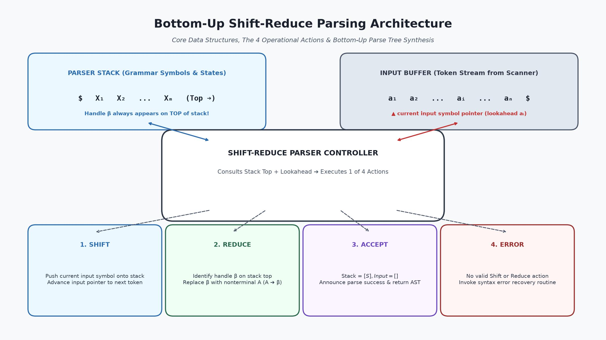
*Figure 1.1: Complete architectural pipeline of a Shift-Reduce Bottom-Up Parser. The parser maintains a symbol stack (with bottom $\$$ and top on the right) and an input buffer (with lookahead pointer). The controller executes one of four fundamental actions: Shift, Reduce, Accept, or Error.*

The bottom-up parser coordinates with:
1. **The Lexical Analyzer:** Consumes tokens on demand, buffering lookahead symbols.
2. **The Symbol Table:** Queries identifier declarations and scopes to resolve grammatical subtleties (such as procedure calls vs array accesses).
3. **The Semantic Engine:** Synthesizes semantic attributes directly during reduction steps, enabling single-pass syntax-directed translation.

---

## 2. Reductions: The Core Inverse-Derivation Mechanism

### 2.1 Formal Definition of a Reduction Step

Let $G = (V, \Sigma, R, S)$ be a Context-Free Grammar.

> Definition: **Reduction Step**  
> If $A \to \beta$ is a production in $R$, and $\gamma = \alpha \beta w$ is a sentential form where $\beta$ appears as a contiguous sub-sequence, then replacing $\beta$ with $A$ yields a new sentential form $\gamma' = \alpha A w$.  
> We write this reduction as:
> $$\alpha \beta w \xrightarrow{\text{reduce by } A \to \beta} \alpha A w$$

Bottom-up parsing succeeds if and only if there exists a finite sequence of valid reductions starting from the input sentence $w$ and terminating at the start symbol $S$:
$$w = \gamma_n \xrightarrow{\text{reduce}} \gamma_{n-1} \xrightarrow{\text{reduce}} \dots \xrightarrow{\text{reduce}} \gamma_1 \xrightarrow{\text{reduce}} \gamma_0 = S$$

---

### 2.2 Sequence of Reductions and Sentential Forms

Each string $\gamma_i$ produced during this sequence of reductions is a **right-sentential form** of the grammar.

Because we reduce from the terminal string up to the start symbol, the sequence of productions applied in reverse:
$$(A_n \to \beta_n), (A_{n-1} \to \beta_{n-1}), \dots, (A_1 \to \beta_1)$$
corresponds directly to the canonical rightmost derivation:
$$S = \gamma_0 \Rightarrow_{rm} \gamma_1 \Rightarrow_{rm} \dots \Rightarrow_{rm} \gamma_{n-1} \Rightarrow_{rm} \gamma_n = w$$

where each step $\gamma_{k-1} \Rightarrow_{rm} \gamma_k$ replaces nonterminal $A_k$ with body $\beta_k$.

---

### 2.3 Comprehensive Walkthrough: Expression Grammar Reductions on `id * id`

Let us examine the canonical arithmetic expression grammar (Dragon Book Grammar 4.1):
$$E \to E + T \mid T$$
$$T \to T * F \mid F$$
$$F \to (E) \mid id$$

Consider the input string $w = \mathbf{id}_1 * \mathbf{id}_2$. The sequence of reductions proceeds as follows:

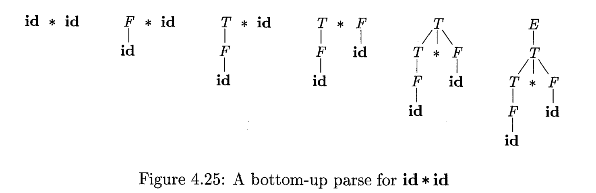
*Figure 2.1: Dragon Book Figure 4.25 illustrating snapshots of the bottom-up parse for token stream `id * id`. At each stage, the roots of the forest of subtrees form the sentential form.*

Let us track the sequence of string forms (the roots of all subtrees in the snapshots):

1. **Initial Input String:**
   $$\mathbf{id}_1 * \mathbf{id}_2$$
2. **First Reduction:**
   The leftmost token $\mathbf{id}_1$ matches the body of production $F \to id$.  
   Reducing $\mathbf{id}_1$ to $F$ yields:
   $$F * \mathbf{id}_2$$
3. **Second Reduction:**
   The nonterminal $F$ matches the body of production $T \to F$.  
   Reducing $F$ to $T$ yields:
   $$T * \mathbf{id}_2$$
4. **Third Reduction (The Strategic Choice):**
   At this point, we observe that $T$ matches the body of $E \to T$.  
   **CRUCIAL QUESTION:** Should we reduce $T$ to $E$ right now?  
   **ANSWER: NO!** If we mistakenly reduced $T$ to $E$, we would produce the string $E * \mathbf{id}_2$. There is NO production in our grammar of the form $E \to E * \dots$! The multiplication operator $*$ requires a left operand of type $T$, not $E$.  
   Therefore, the parser must hold $T$ and reduce the second token $\mathbf{id}_2$ via $F \to id$:
   $$T * F$$
5. **Fourth Reduction:**
   The entire string $T * F$ matches the body of production $T \to T * F$.  
   Reducing $T * F$ to $T$ yields:
   $$T$$
6. **Fifth Reduction:**
   Finally, $T$ matches the body of production $E \to T$.  
   Reducing $T$ to $E$ yields:
   $$E$$

Since $E$ is the start symbol and all input tokens have been consumed, the bottom-up parse terminates successfully!

---

### 2.4 Why Reductions Trace a Rightmost Derivation in Reverse

To confirm that this reduction sequence exactly mirrors a canonical rightmost derivation in reverse, let us write the forward rightmost derivation starting from $E$:

$$E \Rightarrow_{rm} T$$
$$T \Rightarrow_{rm} T * F$$
$$T * F \Rightarrow_{rm} T * \mathbf{id}_2$$
$$T * \mathbf{id}_2 \Rightarrow_{rm} F * \mathbf{id}_2$$
$$F * \mathbf{id}_2 \Rightarrow_{rm} \mathbf{id}_1 * \mathbf{id}_2$$

Notice the exact correspondence:
- Forward step 1: $E \Rightarrow_{rm} T$  $\Longleftrightarrow$  Reverse reduction 5: $T \xrightarrow{} E$
- Forward step 2: $T \Rightarrow_{rm} T * F$  $\Longleftrightarrow$  Reverse reduction 4: $T * F \xrightarrow{} T$
- Forward step 3: $T * F \Rightarrow_{rm} T * id_2$  $\Longleftrightarrow$  Reverse reduction 3: $id_2 \xrightarrow{} F$
- Forward step 4: $T * id_2 \Rightarrow_{rm} F * id_2$  $\Longleftrightarrow$  Reverse reduction 2: $F \xrightarrow{} T$
- Forward step 5: $F * id_2 \Rightarrow_{rm} id_1 * id_2$  $\Longleftrightarrow$  Reverse reduction 1: $id_1 \xrightarrow{} F$

The bottom-up parser reconstructs the rightmost derivation in perfectly inverted order!

---

## 3. Handle Pruning: Identifying What and When to Reduce

### 3.1 The Concept of a Handle: Substring + Production + Position

The central operational challenge of bottom-up parsing is: **How does the parser know which substring to reduce, and which production to apply, at each step?**

A common beginner misconception is that any substring that matches the right-hand side of some production should be immediately reduced. As demonstrated in Section 2.3, this naive approach leads directly to dead ends (such as reducing $T \to E$ in $T * id$).

To formalize the correct reduction site, compiler theory introduces the concept of the **Handle**.

> 🔑 **Informal Definition: The Handle**  
> A **handle** of a right-sentential form is a substring that matches the body of a production, and whose reduction represents **one valid step along the reverse of a canonical rightmost derivation**.

A handle is not merely a string of symbols; it is a **triple**:
$$\langle \text{Substring } \beta, \text{Production } A \to \beta, \text{Position where } \beta \text{ occurs} \rangle$$

---

### 3.2 Formal Mathematical Definition: $S \Rightarrow^*_{rm} \alpha A w \Rightarrow_{rm} \alpha \beta w$

The Dragon Book (*Section 4.5.2*) provides the rigorous mathematical definition of a handle:

> 📘 **Formal Definition of a Handle (Dragon Book 4.5.2):**  
> If:
> $$S \Rightarrow^*_{rm} \alpha A w \Rightarrow_{rm} \alpha \beta w$$
> then production $A \to \beta$ in the position following $\alpha$ is a **handle** of the right-sentential form $\alpha \beta w$.

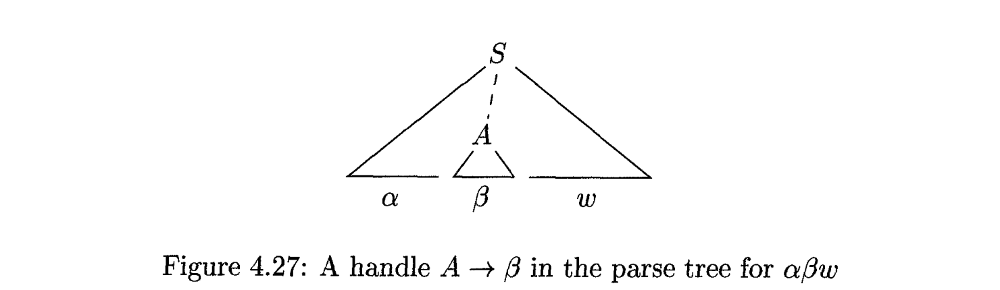
*Figure 3.1: Dragon Book Figure 4.27 illustrating a handle $A \to \beta$ within a parse tree for $\alpha \beta w$. The subtree rooted at $A$ expands directly to $\beta$, while the string $w$ to the right contains exclusively terminal symbols.*

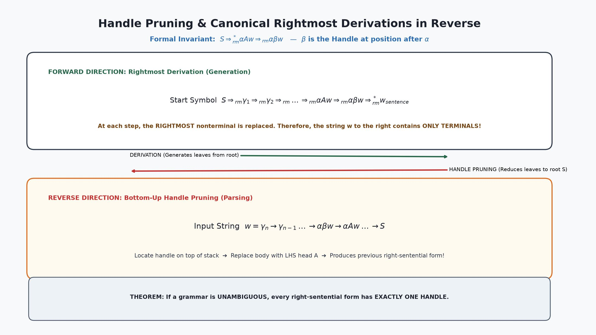
*Figure 3.2: Comprehensive architectural visualization of Handle Pruning. In the forward direction, rightmost nonterminals are rewritten. In reverse, the parser prunes the handle $\beta$ on top of the stack and replaces it with head $A$.*

#### Two Vital Invariants of the Handle Definition:
1. **The Right-Hand String $w$ Contains Only Terminals:**  
   Because the derivation $S \Rightarrow^*_{rm} \alpha A w$ is strictly *rightmost*, every nonterminal to the right of $A$ was already completely expanded into terminals during prior steps. Thus, $w \in \Sigma^*$.
2. **The Left-Hand String $\alpha$ May Contain Both:**  
   $\alpha \in (V \cup \Sigma)^*$ may contain a mixture of terminals and nonterminals that have not yet reached their final form.

---

### 3.3 Crucial Distinction: Substring Matching Body $\ne$ Handle (The `T * id` Trap)

Let us examine Figure 4.26 from the Dragon Book, which tabulates the handles during the parse of $\mathbf{id}_1 * \mathbf{id}_2$:

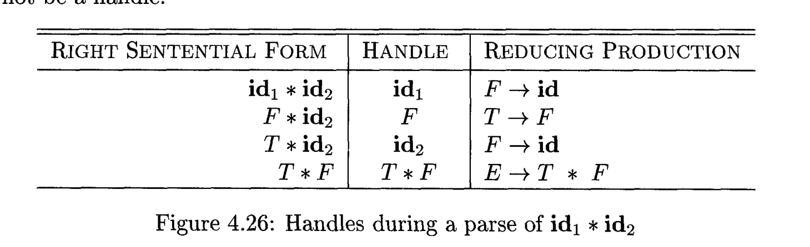
*Figure 3.3: Dragon Book Figure 4.26 showing the exact handle and associated production for each right-sentential form during the parse of `id1 * id2`.*

| Right-Sentential Form | Substring Matching a Production Body | Is it a Handle? | Production | Explanation / Trap |
|:---|:---|:---:|:---:|:---|
| $\mathbf{id}_1 * \mathbf{id}_2$ | $\mathbf{id}_1$ | **YES** | $F \to id$ | Leftmost token must be reduced first. |
| $F * \mathbf{id}_2$ | $F$ | **YES** | $T \to F$ | $F$ must be promoted to term $T$. |
| $T * \mathbf{id}_2$ | $T$ | **NO!** | $E \to T$ | **THE TRAP:** $T$ matches RHS of $E \to T$, but reducing $T \to E$ yields $E * \mathbf{id}_2$, which is dead-ended! |
| $T * \mathbf{id}_2$ | $\mathbf{id}_2$ | **YES** | $F \to id$ | The second token $\mathbf{id}_2$ is the genuine handle. |
| $T * F$ | $T * F$ | **YES** | $T \to T * F$ | The compound multiplicative term is reduced. |
| $T$ | $T$ | **YES** | $E \to T$ | Now $T$ is the genuine handle because no multiplication follows! |
| $E$ | $E$ | — | — | Start symbol reached; parsing complete. |

> ⚠️ **Key Rule to Memorize:**  
> The leftmost substring that matches the body of some production is **not necessarily a handle**. Only a substring whose reduction continues a valid canonical rightmost derivation in reverse is a handle.

---

### 3.4 Unambiguous Grammars and Unique Handles

> ⚖️ **Fundamental Uniqueness Theorem:**  
> If a grammar $G$ is **unambiguous**, then every right-sentential form of $G$ has **EXACTLY ONE handle**.

**Proof Sketch:**  
In an unambiguous grammar, every sentence in $L(G)$ has exactly one unique parse tree. By the fundamental equivalence theorem (Lecture 3, Section 7.5), there is a strict bijection between parse trees and canonical rightmost derivations. Therefore, for any right-sentential form $\gamma$, there is exactly one prior right-sentential form $\gamma'$ in the unique rightmost derivation. Consequently, there is exactly one handle $\beta$ and one production $A \to \beta$ that transforms $\gamma$ into $\gamma'$.

Conversely, if a grammar is **ambiguous**, a right-sentential form may possess **two or more distinct handles**, representing conflicting paths through different rightmost derivations. This is the root cause of parser conflicts!

---

### 3.5 The Handle Pruning Algorithm and Reversing Rightmost Derivations

The process of bottom-up parsing using handles is called **Handle Pruning**:

```
Algorithm: Bottom-Up Parsing via Handle Pruning
Input:     An input string w of terminals and a CFG G
Output:    A rightmost derivation of w in reverse, or an error indication

Method:
  1. Let γ_n = w. Set k = n.
  2. While γ_k != S do:
       a. Locate the handle β_k in γ_k.
          (If no handle can be identified, report SYNTAX ERROR and halt).
       b. Determine the production A_k -> β_k associated with the handle.
       c. Replace the handle β_k in γ_k with nonterminal A_k to obtain γ_{k-1}.
       d. Decrement k by 1.
  3. Halt and declare SUCCESSFUL PARSE.
     The reverse of the sequence of productions (A_1 -> β_1), ..., (A_n -> β_n)
     constitutes the canonical rightmost derivation of w.
```

---

## 4. Shift-Reduce Parser Architecture & Data Structures

### 4.1 The Two Fundamental Data Structures: Input Buffer & Symbol Stack

To implement handle pruning efficiently in linear time, practical compilers utilize a **Shift-Reduce Parser**.

A shift-reduce parser is built upon **two fundamental data structures**:
1. **The Input Buffer:**  
   Holds the remaining string of tokens to be parsed, terminated by the endmarker symbol $\$$:
   $$a_i a_{i+1} \dots a_n \$$
   A lookahead pointer points to the current token $a_i$.
2. **The Symbol Stack:**  
   Holds grammar symbols (terminals and nonterminals) that have already been shifted or reduced:
   $$\$ X_1 X_2 \dots X_m$$
   The bottom of the stack is marked by the endmarker symbol $\$$.

---

### 4.2 Stack Orientation: The Bottom ($\$$) and the Right-Hand Top

> 📌 **Notational Standard in Bottom-Up Parsing:**  
> In top-down parsing (Lecture 3), the stack was oriented with the top on the *left*.  
> In bottom-up parsing, by universal convention, the **top of the stack is displayed on the RIGHT**, and the bottom of the stack ($\$$) is on the **LEFT**.

```
BOTTOM OF STACK                              TOP OF STACK
      $           X₁          X₂     ...          Xₘ
                                                  ▲
                                                  │ (Stack Top)
```

Why is the stack top drawn on the right?  
Because when we push symbols onto the stack from left to right, the sequence of symbols on the stack concatenates seamlessly with the sequence of unread tokens in the input buffer:
$$\underbrace{\$ X_1 X_2 \dots X_m}_{\text{STACK}} \quad \underbrace{a_i a_{i+1} \dots a_n \$}_{\text{INPUT BUFFER}}$$

The concatenation $(X_1 X_2 \dots X_m a_i \dots a_n)$ represents the **current sentential form**!

---

### 4.3 The Four Shift-Reduce Parser Actions: Shift, Reduce, Accept, Error

At every configuration, the parser inspects the symbols at the top of the stack and the lookahead symbol in the input buffer, choosing among **four operational actions**:

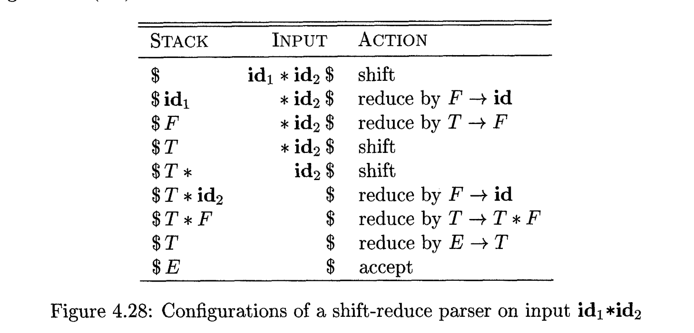
*Figure 4.1: Dragon Book Figure 4.28 displaying the sequence of configurations of a shift-reduce parser on input `id1 * id2`.*

#### 1. Shift:
Pushes the current lookahead token from the input buffer onto the top of the stack and advances the input pointer to the next token:
$$\text{Stack: } \$ \alpha \quad\mid\quad \text{Input: } a w \$ \quad \xrightarrow{\text{SHIFT}} \quad \text{Stack: } \$ \alpha a \quad\mid\quad \text{Input: } w \$$

#### 2. Reduce:
When a valid handle $\beta$ is identified at the top of the stack, the parser pops the $|\beta|$ symbols forming $\beta$ from the stack and pushes the left-hand nonterminal head $A$ (where $A \to \beta$ is the corresponding production):
$$\text{Stack: } \$ \alpha \beta \quad\mid\quad \text{Input: } w \$ \quad \xrightarrow{\text{REDUCE by } A \to \beta} \quad \text{Stack: } \$ \alpha A \quad\mid\quad \text{Input: } w \$$
*Note:* The input buffer and lookahead pointer remain unchanged during a reduction!

#### 3. Accept:
When the input buffer is completely consumed (pointing to $\$$) and the stack contains solely the bottom marker and the grammar start symbol $S$:
$$\text{Stack: } \$ S \quad\mid\quad \text{Input: } \$ \quad \xrightarrow{\text{ACCEPT}} \quad \text{PARSING SUCCEEDS!}$$
The parser halts and announces successful compilation.

#### 4. Error:
When the parser enters a configuration where no valid Shift or Reduce action can possibly lead to a successful derivation. The parser halts or triggers an error-recovery routine (Section 15).

---

### 4.4 The Mathematical Invariant: Handle Always Appears on Top of the Stack

A foundational theorem that justifies using a stack for shift-reduce parsing is:

> 🏆 **The Stack-Top Handle Invariant:**  
> In shift-reduce parsing of any valid sentence, the handle **will ALWAYS eventually appear on the very TOP of the stack**.  
> The parser **NEVER** has to reach into the interior of the stack to extract or reduce a handle!

This invariant guarantees that a simple pushdown stack is sufficient; no general random-access array or double-ended deque is required.

---

### 4.5 Formal Proof: The Two Cases of Successive Rightmost Derivations

The Dragon Book (*Section 4.5.3, Figure 4.29*) proves this invariant by analyzing the relationship between any two successive steps in an arbitrary rightmost derivation:

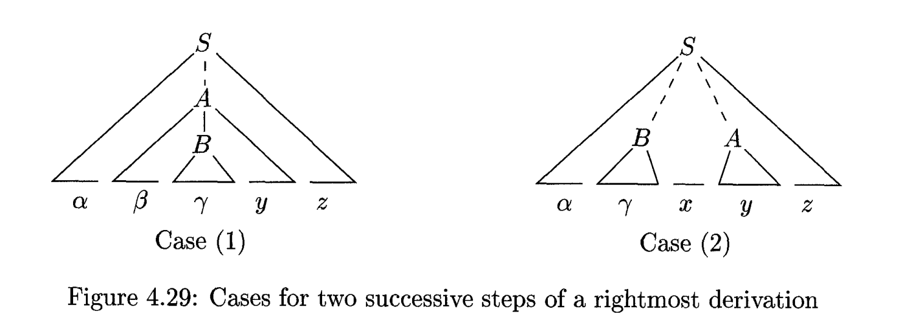
*Figure 4.2: Dragon Book Figure 4.29 showing the two possible topological cases for two successive steps in any rightmost derivation.*

Consider any rightmost derivation:
$$S \Rightarrow^*_{rm} \alpha A z \Rightarrow_{rm} \dots$$

When the nonterminal $A$ is expanded, there are only two possible structural cases for what the subsequent rightmost step can be:

#### Case (1): Nonterminal $B$ is nested inside the body of $A$
Production $A \to \beta B y$ is applied, where $B$ is the rightmost nonterminal in $A$'s body:
$$S \Rightarrow^*_{rm} \alpha A z \Rightarrow_{rm} \alpha \beta B y z \Rightarrow_{rm} \alpha \beta \gamma y z$$
where $B \to \gamma$.  
Since this is a rightmost derivation:
- $z$ consists strictly of terminals.
- $y$ consists strictly of terminals.

Now consider this in **reverse (shift-reduce parsing)**:
1. The parser shifts tokens until $\alpha \beta \gamma$ is on the stack, with unread input $y z \$$.
2. The handle $\gamma$ is on top of the stack! It gets reduced to $B$, leaving $\alpha \beta B$ on the stack.
3. The parser now shifts the terminal string $y$ onto the stack.
4. The stack now contains $\alpha \beta B y$, which is the body of $A$!
5. The handle $\beta B y$ is now **on top of the stack**, ready to be reduced to $A$!

#### Case (2): Nonterminal $B$ is located to the left of $A$
$A$ expands to a string of purely terminals $y$:
$$S \Rightarrow^*_{rm} \alpha B x A z \Rightarrow_{rm} \alpha B x y z \Rightarrow_{rm} \alpha \gamma x y z$$
where $B \to \gamma$, and both $x, y, z$ consist strictly of terminals.

Now consider this in **reverse**:
1. In the configuration with stack $\alpha \gamma$ and input $x y z \$$, the handle $\gamma$ is on top of the stack.
2. $\gamma$ is reduced to $B$, leaving $\alpha B$ on the stack.
3. The parser now shifts the terminal string $x y$ onto the stack.
4. The stack now contains $\alpha B x y$.
5. The next handle $y$ is now **on top of the stack**, ready to be reduced to $A$!

#### Q.E.D. Conclusion:
In both cases, after completing a reduction, the parser only needs to perform **zero or more shifts** of incoming terminal tokens to bring the next handle directly onto the top of the stack. It never needs to delve beneath the stack top!

---

## 5. Detailed Trace Walkthrough 1: The Canonical Multiplication ($id_1 * id_2$)

### 5.1 Grammar and Input Setup

Let us trace the complete shift-reduce execution for the arithmetic expression grammar:
1. $E \to E + T$
2. $E \to T$
3. $T \to T * F$
4. $T \to F$
5. $F \to (E)$
6. $F \to id$

Input string: $w = \mathbf{id}_1 * \mathbf{id}_2 \$$

---

### 5.2 Step-by-Step Execution Trace Table (Stack, Input, Action, Handle)

| Step # | Stack Contents | Input Buffer | Parser Action Taken | Handle Identified | Resulting Grammar Production |
|:---:|:---|:---|:---|:---:|:---:|
| **0** | `$` | `id1 * id2 $` | **Shift** | — | Push `id1` onto stack |
| **1** | `$ id1` | `* id2 $` | **Reduce by $F \to id$** | `id1` | $F \to id$ |
| **2** | `$ F` | `* id2 $` | **Reduce by $T \to F$** | `F` | $T \to F$ |
| **3** | `$ T` | `* id2 $` | **Shift** | — | Push `*` (do NOT reduce $E \to T$!) |
| **4** | `$ T *` | `id2 $` | **Shift** | — | Push `id2` onto stack |
| **5** | `$ T * id2` | `$` | **Reduce by $F \to id$** | `id2` | $F \to id$ |
| **6** | `$ T * F` | `$` | **Reduce by $T \to T * F$** | `T * F` | $T \to T * F$ |
| **7** | `$ T` | `$` | **Reduce by $E \to T$** | `T` | $E \to T$ |
| **8** | `$ E` | `$` | **ACCEPT** | — | Stack = `[$ E]`, Input = `[$]` |

---

### 5.3 Parse Tree Construction Snapshots (Leaves to Root)

The parse tree is assembled strictly bottom-up:

```
Step 1: Leaves         Step 2: Subtree F        Step 3: Subtree T
  id₁    *    id₂          F       *    id₂         T       *    id₂
                           │                        │
                          id₁                      id₁

Step 5: Subtree F₂     Step 6: Subtree T        Step 7: Full Tree E
  T      *     F           T                        E
  │            │           ├───┬───┐                │
 id₁          id₂          T   *   F                T
                           │       │                ├───┬───┐
                          id₁     id₂               T   *   F
                                                    │       │
                                                   id₁     id₂
```

---

### 5.4 Comparison with Sukarna Sarker's Example 01

In the university lecture slide deck *Concept of Shift-reduce Parsing* prepared by **Sukarna Sarker**, Example 01 steps through this identical string:


*Figure 5.1: Slide 4 of Sukarna Sarker's lecture deck setting up Example 01 for the string `id1 * id2`.*

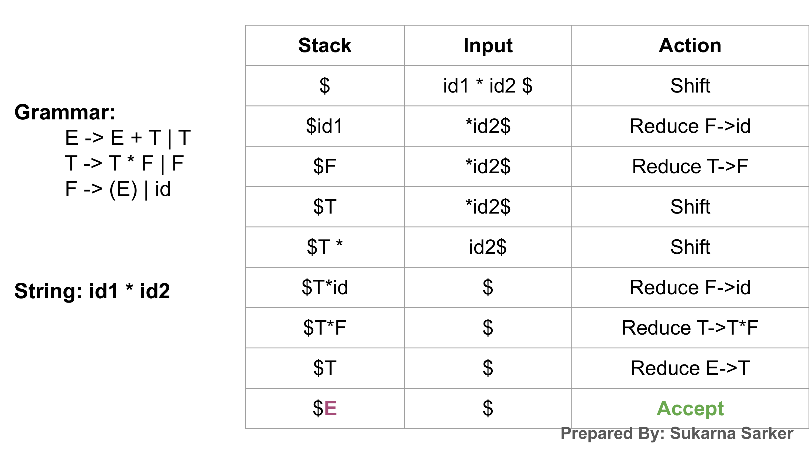
*Figure 5.2: Slide 13 of Sukarna Sarker's lecture deck showing the final completed shift-reduce trace table and successful acceptance.*

The slide execution matches our formal analysis in every detail, demonstrating how theoretical compiler principles directly map to the classroom curriculum.


---

## 6. Detailed Trace Walkthrough 2: Parentheses & Addition ($(id) + id$)

### 6.1 Grammar and Input Setup

In his lecture deck *Concept of Shift-reduce Parsing*, **Sukarna Sarker** introduces **Example 02** to demonstrate how bottom-up shift-reduce parsers handle nested parenthesized sub-expressions, operator precedence boundaries, and subsequent additive operations.

Grammar:
1. $E \to E + T$
2. $E \to T$
3. $T \to T * F$
4. $T \to F$
5. $F \to (E)$
6. $F \to id$

Input string: $w = (\mathbf{id}) + \mathbf{id} \$$

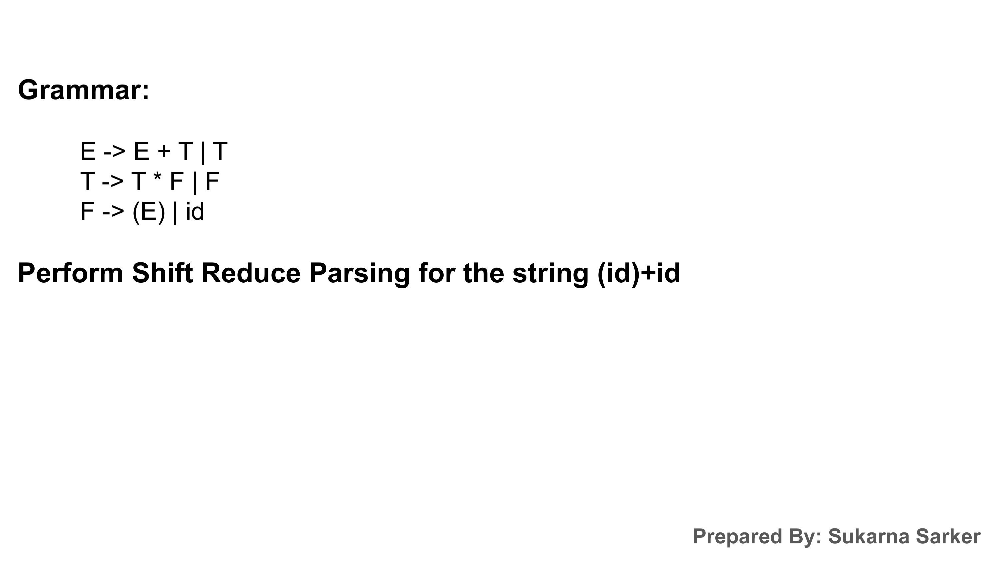
*Figure 6.1: Slide 15 of Sukarna Sarker's lecture deck introducing Example 02 for string `(id) + id`.*

---

### 6.2 Step-by-Step Execution Trace Table (Stack, Input, Action, Handle)

The complete shift-reduce trace table progresses across 15 distinct operational transitions:

| Step # | Stack Contents | Input Buffer | Parser Action Taken | Handle Identified | Resulting Grammar Production |
|:---:|:---|:---|:---|:---:|:---:|
| **0** | `$` | `(id) + id $` | **Shift** | — | Push `(` onto stack |
| **1** | `$ (` | `id) + id $` | **Shift** | — | Push `id` onto stack |
| **2** | `$ ( id` | `) + id $` | **Reduce by $F \to id$** | `id` | $F \to id$ |
| **3** | `$ ( F` | `) + id $` | **Reduce by $T \to F$** | `F` | $T \to F$ |
| **4** | `$ ( T` | `) + id $` | **Reduce by $E \to T$** | `T` | $E \to T$ |
| **5** | `$ ( E` | `) + id $` | **Shift** | — | Push `)` onto stack |
| **6** | `$ ( E )` | `+ id $` | **Reduce by $F \to (E)$** | `( E )` | $F \to (E)$ |
| **7** | `$ F` | `+ id $` | **Reduce by $T \to F$** | `F` | $T \to F$ |
| **8** | `$ T` | `+ id $` | **Reduce by $E \to T$** | `T` | $E \to T$ |
| **9** | `$ E` | `+ id $` | **Shift** | — | Push `+` onto stack |
| **10** | `$ E +` | `id $` | **Shift** | — | Push `id` onto stack |
| **11** | `$ E + id` | `$` | **Reduce by $F \to id$** | `id` | $F \to id$ |
| **12** | `$ E + F` | `$` | **Reduce by $T \to F$** | `F` | $T \to F$ |
| **13** | `$ E + T` | `$` | **Reduce by $E \to E + T$** | `E + T` | $E \to E + T$ |
| **14** | `$ E` | `$` | **ACCEPT** | — | Stack = `[$ E]`, Input = `[$]` |

---

### 6.3 Deep Dive into Shift-Reduce Decisions on Open Parenthesis

Notice several subtle, critical parsing mechanics demonstrated in this trace:

1. **Isolation of Nested Scope:**  
   When the parser shifts `(`, it pushes a scope boundary onto the stack. When the inner `id` is reduced to $F \to T \to E$, the stack configuration becomes `$ ( E`.  
   The parser does **NOT** attempt to reduce `(` with $E$. The production requires a matching closing delimiter: $F \to ( E )$.
2. **The Lookahead Trigger at Step 5:**  
   With `$ ( E` on the stack and `)` in the input, the parser executes **Shift** to consume the delimiter, reaching `$ ( E )`.
3. **The Multi-Symbol Handle Reduction at Step 6:**  
   The entire sequence `( E )`—spanning three stack slots—is identified as the handle. All three symbols are popped simultaneously and replaced by the single nonterminal $F$.

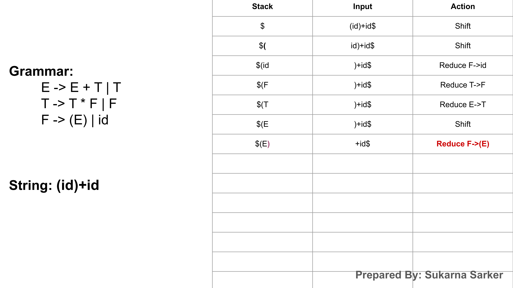
*Figure 6.2: Slide 22 of Sukarna Sarker's lecture deck showing the exact configuration where `( E )` on the stack is reduced by $F \to (E)$.*

4. **Preserving Precedence Across Addition:**  
   At Step 8, the stack contains `$ T` and the lookahead is `+`. Since addition has lower precedence than potential multiplication, and since no multiplication symbol follows, $T$ is safely reduced to $E$.  
   Then `+` is shifted at Step 9, buffering the left operand $E$ while the right operand `id` is parsed and reduced to $T$.  
   Finally, at Step 13, the compound handle `E + T` is reduced to $E$.

---

### 6.4 Complete Walkthrough of Sukarna Sarker's Example 02

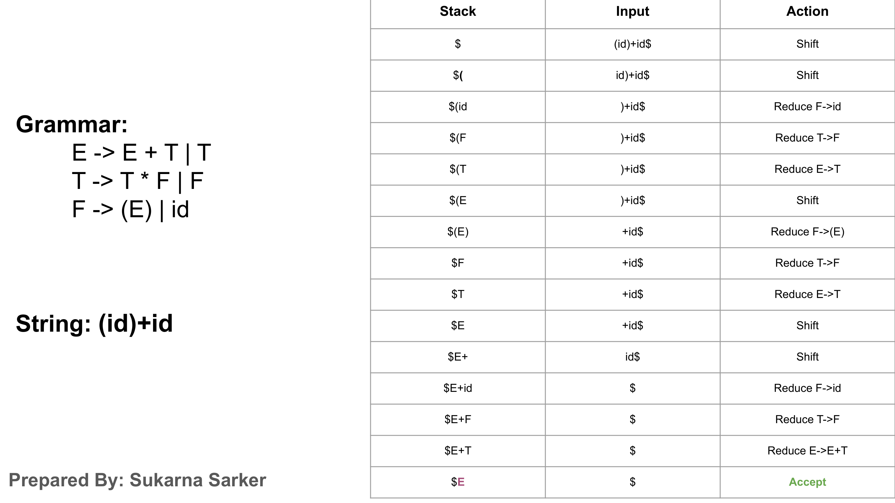
*Figure 6.3: Slide 30 of Sukarna Sarker's lecture deck showing the complete, finalized trace table for `(id) + id` ending in successful acceptance.*

Notice how the final sentential forms trace backwards:
$$(\mathbf{id}) + \mathbf{id} \leftarrow (F) + \mathbf{id} \leftarrow (T) + \mathbf{id} \leftarrow (E) + \mathbf{id} \leftarrow (E) + \mathbf{id} \leftarrow F + \mathbf{id} \leftarrow T + \mathbf{id} \leftarrow E + \mathbf{id} \leftarrow E + F \leftarrow E + T \leftarrow E$$

Every single step rigorously satisfies the canonical rightmost derivation in reverse:
$$E \Rightarrow_{rm} E + T \Rightarrow_{rm} E + F \Rightarrow_{rm} E + \mathbf{id} \Rightarrow_{rm} T + \mathbf{id} \Rightarrow_{rm} F + \mathbf{id} \Rightarrow_{rm} (E) + \mathbf{id} \dots$$

---

## 7. Conflicts in Shift-Reduce Parsing: Shift/Reduce Conflicts

### 7.1 What is a Shift/Reduce Conflict?

While shift-reduce parsing is exceptionally powerful, there exist context-free grammars for which a simple shift-reduce parser cannot determine what action to take.

> 💥 **Definition: Shift/Reduce Conflict**  
> A shift-reduce parser encounters a **shift/reduce conflict** when, upon inspecting the current stack contents $\alpha$ and the next lookahead token $a$, it **cannot determine whether to shift $a$ onto the stack or reduce a handle $\beta$ currently residing on top of the stack**.

$$\text{Stack: } \$ \dots \beta \quad\mid\quad \text{Input: } a \dots \$ \quad \Longrightarrow \quad \begin{cases} \text{Action A: SHIFT } a \text{ onto stack?} \\ \text{Action B: REDUCE } \beta \text{ to } A \text{ via } A \to \beta? \end{cases}$$

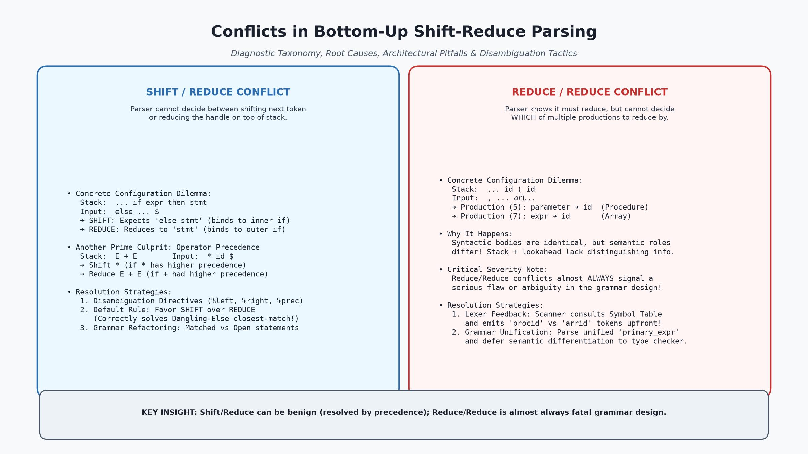
*Figure 7.1: Comprehensive diagnostic matrix contrasting Shift/Reduce conflicts (left) and Reduce/Reduce conflicts (right), including concrete stack configurations, underlying root causes, and industrial resolution strategies.*

---

### 7.2 The Non-LR Grammar Classification

Grammars that produce irreconcilable shift/reduce or reduce/reduce conflicts in a deterministic table with $k$ symbols of lookahead are classified as **non-$LR(k)$ grammars**.

> ⚠️ **Key Theoretical Axiom:**  
> **An ambiguous grammar can NEVER be LR!**  
> If a grammar is ambiguous, at least one sentence has two or more distinct rightmost derivations. At the point where those derivations diverge, any shift-reduce parser will encounter an unavoidable shift/reduce or reduce/reduce conflict.

However, compiler designers frequently prefer writing intentionally ambiguous grammars (such as compact expression grammars or concise if-then-else statements) and augmenting the parser with **external disambiguating rules** rather than bloating the grammar with complex nonterminals.

---

### 7.3 Case Study: The Classic Dangling-Else Shift/Reduce Conflict

The most celebrated industrial example of a shift/reduce conflict occurs in programming languages that support optional `else` clauses without closing keywords (such as C, C++, Java, and Pascal).

Consider Dragon Book Grammar 4.14 (*Section 4.5.4*):
$$stmt \to \mathbf{if} \ e \ \mathbf{then} \ stmt$$
$$stmt \to \mathbf{if} \ e \ \mathbf{then} \ stmt \ \mathbf{else} \ stmt$$
$$stmt \to \mathbf{other}$$

Suppose the parser processes the nested conditional:
$$\mathbf{if} \ e_1 \ \mathbf{then} \ \mathbf{if} \ e_2 \ \mathbf{then} \ s_1 \ \mathbf{else} \ s_2$$

The parser shifts tokens until it reaches the following configuration:
```
STACK:  $ ... if e₁ then if e₂ then s₁
INPUT:  else s₂ $
```

Now the parser faces a fatal dilemma:
1. **Option 1: REDUCE by $stmt \to \mathbf{if} \ e \ \mathbf{then} \ stmt$**  
   The stack top matches the body of the simple conditional. If the parser reduces now, the inner statement becomes complete:
   $$\text{Stack becomes: } \$ \dots \mathbf{if} \ e_1 \ \mathbf{then} \ stmt$$
   The incoming `else s₂` would then be associated with the **OUTER** conditional ($\mathbf{if} \ e_1$)!
2. **Option 2: SHIFT `else` onto the stack**  
   If the parser shifts `else`, it anticipates finding another statement $s_2$ to complete the compound production $stmt \to \mathbf{if} \ e \ \mathbf{then} \ stmt \ \mathbf{else} \ stmt$.  
   This associates the `else` with the **INNER** conditional ($\mathbf{if} \ e_2$)!

The parser cannot know which interpretation is intended from the grammar alone. This is a canonical **shift/reduce conflict**.

---

### 7.4 Resolving Shift/Reduce Conflicts: Favoring Shift and Closest-Unmatched Rule

How do modern compilers and parser generators resolve the dangling-else conflict?

> 💡 **The Universal Disambiguating Heuristic:**  
> In shift/reduce conflicts involving optional trailing clauses (like `else`), the parser generator **defaults to SHIFTING rather than reducing**.

By choosing to **shift** `else`:
- The parser consumes `else` immediately.
- It proceeds to parse $s_2$.
- It reduces the inner conditional as a complete `if-then-else` statement.
- Only then does it reduce the outer conditional as a simple `if-then`.

This default shift behavior perfectly implements the standard programming language semantic rule:
$$\text{"Associate each else with the closest preceding unmatched then!"}$$

Because the default conflict resolution rule produces the exact desired semantics, compiler writers intentionally retain the ambiguous grammar and let the parser generator resolve the shift/reduce conflict automatically!

---

### 7.5 Operator Precedence and Associativity Disambiguation in Shift-Reduce Parsers

Another vital application of shift/reduce conflict resolution is in arithmetic expression parsing.

Consider the ambiguous grammar:
$$E \to E + E \mid E * E \mid (E) \mid id$$

When parsing `id + id * id`, the parser reaches:
```
STACK:  $ E + E
INPUT:  * id $
```

Here, a shift/reduce conflict occurs:
- **REDUCE $E + E \to E$:** Gives addition higher precedence than multiplication (Semantic distortion: $(id + id) * id$).
- **SHIFT $*$:** Gives multiplication higher precedence than addition (Correct: $id + (id * id)$).

Similarly, when parsing `id + id + id`:
```
STACK:  $ E + E
INPUT:  + id $
```
- **REDUCE $E + E \to E$:** Enforces **left-associativity** ($(id + id) + id$).
- **SHIFT $+$:** Enforces **right-associativity** ($id + (id + id)$).

Parser generators allow developers to declare:
```yacc
%left '+' '-'
%left '*' '/'
```
Under these rules:
- Comparing stack operator `+` with lookahead `*`: Since `*` has higher precedence, **SHIFT** is selected.
- Comparing stack operator `+` with lookahead `+`: Since `+` is declared `%left`, **REDUCE** is selected.

---

## 8. Conflicts in Shift-Reduce Parsing: Reduce/Reduce Conflicts

### 8.1 What is a Reduce/Reduce Conflict?

A far more severe category of parsing failure is the **Reduce/Reduce Conflict**.

> 🛑 **Definition: Reduce/Reduce Conflict**  
> A shift-reduce parser encounters a **reduce/reduce conflict** when the symbols on top of the stack match the right-hand side bodies of **TWO OR MORE DISTINCT PRODUCTIONS**, and the parser cannot determine which production to apply to make the reduction.

$$\text{Stack: } \$ \dots \beta \quad\mid\quad \text{Input: } a \dots \$ \quad \Longrightarrow \quad \begin{cases} \text{Reduce by Production (1): } A \to \beta? \\ \text{Reduce by Production (2): } B \to \beta? \end{cases}$$

---

### 8.2 Why Reduce/Reduce Conflicts Are Almost Always Grammatical Flaws

While shift/reduce conflicts can often be benignly resolved by precedence rules or favoring shift, **reduce/reduce conflicts almost invariably indicate an architectural flaw or ambiguity in the grammar design!**

If the parser cannot decide whether a construct is an $A$ or a $B$, it typically means:
1. The language specification allows two syntactically identical constructs in the same context that cannot be disambiguated without semantic (type) information.
2. The grammar has redundant, overlapping nonterminals that should be consolidated.

---

### 8.3 Case Study: Procedure Call vs Array Reference ($p(i, j)$)

The Dragon Book (*Section 4.5.4, Example 4.39*) provides the classic example of a reduce/reduce conflict arising from lexical uniformity:

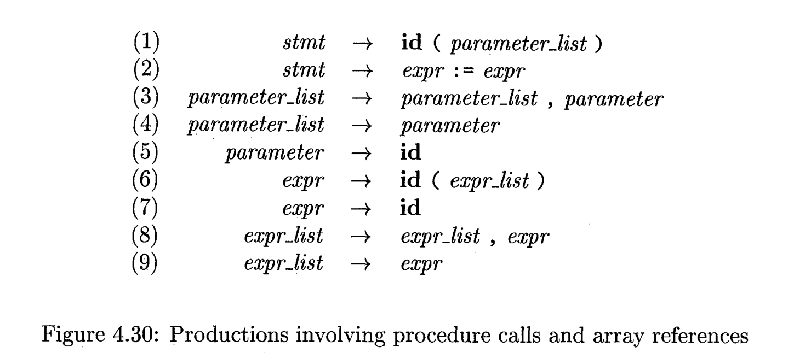
*Figure 8.1: Dragon Book Figure 4.30 showing productions that differentiate procedure calls from array references.*

Suppose a language uses parentheses for both function calls and array indexing (as in Fortran or Ada):
- Function call: `p(i, j)`
- Array reference: `a(i, j)`

To generate distinct intermediate code for array offset calculations versus parameter passing, the grammar writer creates separate productions:
```
(1) stmt            -> id ( parameter_list )
(2) stmt            -> expr := expr
(3) parameter_list  -> parameter_list , parameter
(4) parameter_list  -> parameter
(5) parameter       -> id
(6) expr            -> id ( expr_list )
(7) expr            -> id
(8) expr_list       -> expr_list , expr
(9) expr_list       -> expr
```

Now consider parsing the statement beginning with `p(i, j)`. The lexical analyzer returns:
$$\mathbf{id} ( \mathbf{id} , \mathbf{id} )$$

After shifting the first three tokens, the parser reaches:
```
STACK:  $ ... id ( id
INPUT:  , id ) ... $
```

#### The Fatal Dilemma:
The token `id` on top of the stack matches:
- Body of Production (5): $parameter \to \mathbf{id}$ (Assuming `p` is a procedure)
- Body of Production (7): $expr \to \mathbf{id}$ (Assuming `p` is an array)

The stack contents (`id ( id`) and the lookahead (`,`) are **completely identical in both cases**!  
The parser cannot know whether to reduce via (5) or (7) without knowing whether `p` was declared as a procedure or as an array in the symbol table!

---

### 8.4 Solutions: Lexer Feedback, Symbol Table Coordination, and Grammar Unification

Compiler architects employ two primary strategies to eradicate reduce/reduce conflicts of this type:

#### Strategy 1: Lexical Feedback via Symbol Table (The "Lexer Hack")
Instead of returning a generic token `id` for every identifier, the Lexical Analyzer coordinates directly with the Symbol Table:
- When the scanner encounters an identifier, it looks up its declaration.
- If declared as a procedure, it emits token `procid`.
- If declared as an array or variable, it emits token `varid`.

The grammar is updated:
```
(1') stmt -> procid ( parameter_list )
(6') expr -> varid ( expr_list )
```
When parsing `procid ( id`, the presence of `procid` deeper down in the stack uniquely forces reduction via $parameter \to id$! Shift-reduce parsers can utilize context buried arbitrarily deep in the stack to guide decisions.

#### Strategy 2: Grammar Unification (Deferred Semantic Analysis)
Modern compilers (like C and Rust) avoid forcing syntactic distinctions when syntax is identical.  
Instead, the grammar specifies a unified syntax:
```
postfix_expr -> postfix_expr ( argument_list )
```
The parser builds a generic `CallOrIndexNode` in the AST. Later, during the **Semantic Analysis phase** (Lecture 5 & 6), the type checker inspects the type of the callee expression:
- If callee is a function type $\implies$ rewrite AST to `FunctionCallNode`.
- If callee is an array type $\implies$ rewrite AST to `IndexAccessNode`.

This keeps the grammar completely deterministic, $LR(1)$, and free of reduce/reduce conflicts!

---

## 9. Viable Prefixes and the Pushdown Automaton Model

### 9.1 Definition of a Viable Prefix

To understand how a deterministic parser knows when a handle has appeared on top of the stack, we must study the mathematical property known as the **Viable Prefix**.

> 📐 **Formal Definition: Viable Prefix**  
> A **viable prefix** is a prefix of a right-sentential form that does **not extend past the right end of the handle** of that right-sentential form.

That is, if:
$$S \Rightarrow^*_{rm} \alpha A w \Rightarrow_{rm} \alpha \beta w$$
where $\beta$ is a handle, then any prefix $\gamma$ of $\alpha \beta$ is a viable prefix.

```
Right-Sentential Form:   [ α       β ]     w
                         └────┬────┘       │
                       Viable Prefixes   Terminals
                      (Can be on stack) (Input buffer)
```

---

### 9.2 Why Viable Prefixes Never Extend Past the Right End of a Handle

Consider what resides on the parser stack during shift-reduce parsing:
- The stack holds grammar symbols that have already been shifted or reduced.
- The input holds unconsumed terminals.
- Since a reduction occurs **as soon as** a handle $\beta$ is completely shifted onto the stack, the symbols on the stack can **never contain anything to the right of the handle**!

> 🛡️ **The Viable Prefix Theorem:**  
> The contents of a shift-reduce parser's stack must **always form a viable prefix** of some right-sentential form.  
> If an input token is shifted such that the stack contents no longer form a viable prefix of ANY right-sentential form, a **SYNTAX ERROR has occurred immediately**!

---

### 9.3 Recognizing Viable Prefixes via Finite State Automata

In 1965, **Donald E. Knuth** published his monumental paper *On the Translation of Languages from Left to Right*, discovering a profound mathematical truth:

> 🌟 **Knuth's Foundational Theorem:**  
> Although Context-Free Languages in general require a pushdown store with infinite memory, the set of **viable prefixes of any Context-Free Grammar is a REGULAR LANGUAGE**!

Because viable prefixes form a regular language, they can be recognized by a **Deterministic Finite Automaton (DFA)**!

This is the intellectual breakthrough behind LR parsing:
- The parser stack does not merely hold raw grammar symbols.
- It holds **states of a DFA that tracks viable prefixes**!
- By tracking DFA states on the stack, the parser can determine with $O(1)$ table lookups whether a handle has been formed and which production to reduce by.

---

### 9.4 From Ad-Hoc Shift-Reduce to Deterministic Table-Driven LR Parsing

Ad-hoc shift-reduce parsing relies on hand-crafted heuristics to spot handles. For realistic programming languages with hundreds of productions, hand-crafted handle spotting is mathematically intractable and error-prone.

By converting the viable-prefix DFA into a two-dimensional table—the **LR Parsing Table**—compiler generators automate the entire parsing process. This transitions us directly into the study of the **LR Parser Family**.


---

## 10. Introduction to the LR Parsing Family: Why LR Parsers Dominate

### 10.1 The Anatomy of the Name "LR(k)": Left-to-Right, Rightmost Reverse, k Lookahead

The predominant paradigm for bottom-up parsing in production compilers is based on **$LR(k)$ parsing**, invented by Donald Knuth in 1965.

```
         L                        R                      (k)
         │                        │                       │
         ▼                        ▼                       ▼
  Left-to-Right scan       Rightmost derivation      k tokens of lookahead
    of the input stream     in REVERSE order          used for decisions
```

- **"L" stands for Left-to-Right:** The parser reads the input stream from left to right, one token at a time.
- **"R" stands for Rightmost derivation in Reverse:** The parser reconstructs the steps of a canonical rightmost derivation in reverse order.
- **"(k)" indicates lookahead:** The number of upcoming input tokens inspected to make parsing decisions without consuming them.
  - When $k = 0$, reductions are made purely based on stack contents without consulting lookahead.
  - When $k = 1$, the parser inspects at most 1 lookahead token.
  - When $(k)$ is omitted, $k = 1$ is universally assumed.

---

### 10.2 Why LR Parsers? Four Key Advantages over LL Parsers

The Dragon Book (*Section 4.6.1*) highlights four decisive reasons why LR parsing is the industry standard:

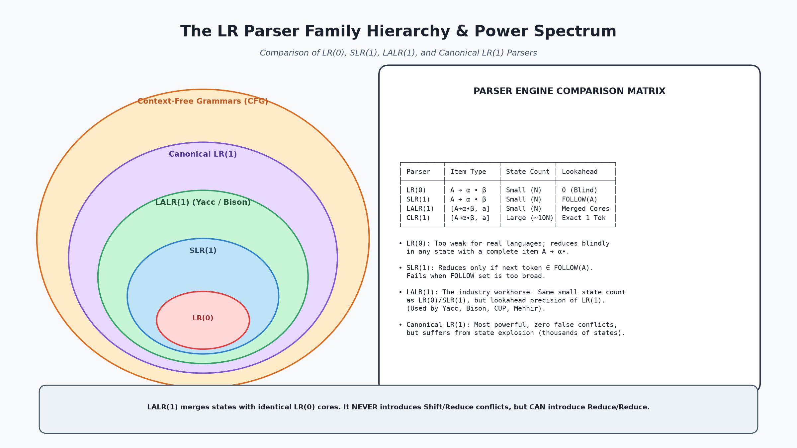
*Figure 10.1: The hierarchy and power spectrum of the LR parser family. LR(0) $\subset$ SLR(1) $\subset$ LALR(1) $\subset$ Canonical LR(1) $\subset$ CFG. The table compares item types, state counts, lookahead mechanisms, and practical generator usage.*

1. **Vast Grammatical Expressiveness:**  
   $LR$ parsers can recognize virtually **all programming-language constructs** for which deterministic Context-Free Grammars can be written. The class of $LL$ grammars is a strict subset of $LR$ grammars:
   $$LL(1) \subsetneq LR(1)$$
2. **Most General Non-Backtracking Shift-Reduce Method:**  
   $LR$ parsing is the most comprehensive shift-reduce method known that operates without backtracking, yet can be implemented with efficiency comparable to predictive $LL$ parsers ($O(n)$ linear time).
3. **Earliest Possible Error Interception:**  
   An $LR$ parser detects a syntax error **at the very earliest possible token**—the exact point where the input violates the viable-prefix property. It never shifts an erroneous token past the point where a legitimate continuation is impossible.
4. **Natural Support for Left Recursion:**  
   Unlike $LL$ parsers (which enter infinite recursion when encountering left-recursive rules like $E \to E + T$), $LR$ parsers handle left-recursive rules natively and efficiently!

---

### 10.3 The Spectrum of LR Parsers: LR(0), SLR(1), LALR(1), CLR(1)

The $LR$ family encompasses four primary table-construction variants, presenting distinct trade-offs between implementation complexity, state count, and grammatical power:

```
┌─────────────────────────────────────────────────────────────────────────────────────────┐
│                              THE LR PARSER SPECTRUM                                     │
├───────────────────┬───────────────────┬──────────────────────┬──────────────────────────┤
│ Parser Class      │ Lookahead Used    │ Table Size (States)  │ Grammatical Power        │
├───────────────────┼───────────────────┼──────────────────────┼──────────────────────────┤
│ 1. LR(0)          │ None (k = 0)      │ N states (Minimal)   │ Extremely weak; toy only │
│ 2. SLR(1)         │ FOLLOW(A) sets    │ N states (Minimal)   │ Moderate; simple syntax  │
│ 3. LALR(1)        │ Propagated sets   │ N states (Minimal)   │ Industry standard (Yacc) │
│ 4. Canonical LR(1)│ Exact 1-token ctx │ 10N+ states (Huge)   │ Maximum CFG power        │
└───────────────────┴───────────────────┴──────────────────────┴──────────────────────────┘
```

---

### 10.4 The Driver Program and LR Parsing Table Structure (ACTION & GOTO)

All $LR$ parsers share the exact same underlying driver algorithm. What distinguishes an $LR(0)$, $SLR(1)$, $LALR(1)$, or $CLR(1)$ parser is exclusively the **content of their parsing tables**.

An LR parser consists of:
1. **A Driver Program:** An invariant, table-driven loop.
2. **A Stack:** Alternating sequence of states and grammar symbols:
   $$\$ s_0 X_1 s_1 X_2 s_2 \dots X_m s_m$$
   where $s_m$ is the current parser state at the top of the stack.
3. **The LR Parsing Table:** Divided into two distinct sub-tables:
   - **ACTION Table:** Indexed by `[Current State, Current Terminal Token]`.  
     Entries can be:
     - `s n` (Shift terminal and push state $n$).
     - `r m` (Reduce by production number $m$).
     - `acc` (Accept input string).
     - `blank` (Syntax error).
   - **GOTO Table:** Indexed by `[Current State, Nonterminal A]`.  
     Determines what next state to push after reducing a handle to nonterminal $A$.

```
                     ┌───────────────────────────┐
                     │       INPUT BUFFER        │
                     │  a₁  a₂  ...  aᵢ  ...  $  │
                     └─────────────┬─────────────┘
                                   │ lookahead aᵢ
                                   ▼
                 ┌───────────────────────────────────┐
                 │         LR DRIVER PROGRAM         │
                 │                                   │
                 │ Stack: [$ s₀ X₁ s₁ ... Xₘ sₘ]     │
                 └───────┬───────────────────▲───────┘
                         │                   │
         Consults [sₘ, aᵢ]                   │ Returns Action / Next State
                         ▼                   │
                 ┌───────────────────────────────────┐
                 │         LR PARSING TABLE          │
                 │  ┌──────────────┬──────────────┐  │
                 │  │ ACTION Table │  GOTO Table  │  │
                 │  │ (Terminals)  │ (Nonterm.)   │  │
                 │  └──────────────┴──────────────┘  │
                 └───────────────────────────────────┘
```

---

## 11. LR(0) Items and the Closure / Goto Operations

### 11.1 Definition of an LR(0) Item (The Dot $\cdot$ Notation)

How does an $LR$ parser know what state to track on its stack? It uses **Items**.

> 📌 **Definition: $LR(0)$ Item**  
> An **$LR(0)$ item** of a grammar $G$ is a production of $G$ with a distinguished **dot** ($\cdot$) placed at some position within its body.

For example, the production $A \to X Y Z$ yields four distinct $LR(0)$ items:
1. $A \to \cdot X Y Z$  — Indicates we hope to see a substring derivable from $X Y Z$ next.
2. $A \to X \cdot Y Z$  — Indicates we have already seen a string derivable from $X$, and hope to see $Y Z$ next.
3. $A \to X Y \cdot Z$  — Indicates we have seen $X Y$, and hope to see $Z$ next.
4. $A \to X Y Z \cdot$  — Indicates we have seen the entire body $X Y Z$; the handle is complete and ready to be **reduced** to $A$!

*Special Case:* The $\epsilon$-production $A \to \epsilon$ generates only a single item:
$$A \to \cdot$$

---

### 11.2 Kernel vs Non-Kernel Items

Compiler generators partition items into two categories:
- **Kernel Items:** The initial augmented start item $S' \to \cdot S$, plus all items whose dot is NOT at the far left (i.e., dot has shifted past at least one symbol).
- **Non-Kernel Items:** Items whose dot is at the extreme left ($\cdot$), generated entirely via the closure operation.

---

### 11.3 The Augmented Grammar $S' \to S$

To formally define when a parser should accept an input string, we create the **Augmented Grammar** $G'$ by adding a new start symbol $S'$ and production:
$$S' \to S$$

When the parser reduces by $S' \to S$, it halts and declares **ACCEPT**.

---

### 11.4 The $\text{CLOSURE}$ Algorithm

If $I$ is a set of items, $\text{CLOSURE}(I)$ represents the set of all items that are reachable from $I$ without consuming any additional input tokens.

```
Algorithm: Computation of CLOSURE(I)
Input:     A set of items I of grammar G
Output:    The closure set CLOSURE(I)

Method:
  Set J = I.
  Repeat until no more items can be added to J:
    For each item [A -> α • B β] in J:
      For each production B -> γ in G:
        If [B -> • γ] is not already in J:
          Add [B -> • γ] to J.
  Return J.
```

**Intuition:** If the dot is immediately before nonterminal $B$ ($A \to \alpha \cdot B \beta$), parsing $B$ requires that we might encounter any production body derivable from $B$. Hence, we must add $B \to \cdot \gamma$ to the current state!

---

### 11.5 The $\text{GOTO}$ Function and Building the Canonical $LR(0)$ Collection

The $\text{GOTO}(I, X)$ function describes the transition of state $I$ upon shifting or transitioning across grammar symbol $X \in (V \cup \Sigma)$:

$$\text{GOTO}(I, X) = \text{CLOSURE}(\{ [A \to \alpha X \cdot \beta] \mid [A \to \alpha \cdot X \beta] \in I \})$$

By starting with $I_0 = \text{CLOSURE}(\{ [S' \to \cdot S] \})$ and repeatedly applying $\text{GOTO}(I, X)$ for all grammar symbols $X$, we construct the **Canonical Collection of Sets of $LR(0)$ Items**:
$$C = \{ I_0, I_1, I_2, \dots, I_m \}$$

Each item set $I_k$ corresponds directly to a **State** in the viable-prefix DFA and a row in the LR parsing table!

---

## 12. Simple LR (SLR(1)) Parsing: Using Follow Sets to Resolve Conflicts

### 12.1 Why LR(0) Parsers Are Insufficient for Real Grammars

In a pure $LR(0)$ parser, if a state contains a completed item $A \to \alpha \cdot$, the parser triggers **REDUCE** unconditionally—regardless of what the next incoming token is!

This creates catastrophic conflicts on almost every real-world grammar:
- If a state contains $[A \to \alpha \cdot]$ and $[B \to \beta \cdot]$, it has a **reduce/reduce conflict**.
- If a state contains $[A \to \alpha \cdot]$ and $[B \to \beta \cdot a \gamma]$, it has a **shift/reduce conflict**.

Because pure $LR(0)$ parsers do not consult lookahead, they are too weak for practical programming languages.

---

### 12.2 The SLR(1) Parsing Table Construction Algorithm

To overcome the blind reduction flaw of $LR(0)$ without increasing state count, **Frank DeRemer (1969)** invented **Simple LR (SLR(1)) Parsing**.

> 💡 **The Core SLR(1) Innovation:**  
> When a state contains a completed item $A \to \alpha \cdot$, do NOT reduce blindly for all terminals!  
> **Only place a REDUCE action for terminal $a$ IF $a \in \text{FOLLOW}(A)$!**

Because $A$ can only ever be legally succeeded by terminals in $\text{FOLLOW}(A)$, placing reduce actions only in those columns eliminates thousands of false conflicts!

```
Algorithm: Construction of an SLR(1) Parsing Table
Input:     Augmented CFG G'
Output:    SLR(1) parsing table (ACTION and GOTO)

Method:
  1. Construct Canonical Collection of LR(0) item sets: C = {I₀, I₁, ..., Iₙ}.
  2. For each state i with item set Iᵢ:
       a. If [A -> α • a β] ∈ Iᵢ and GOTO(Iᵢ, a) = Iⱼ (where a is a terminal):
          Set ACTION[i, a] = "shift j".
       b. If [A -> α •] ∈ Iᵢ (where A ≠ S'):
          For ALL terminals a ∈ FOLLOW(A):
            Set ACTION[i, a] = "reduce A -> α".
       c. If [S' -> S •] ∈ Iᵢ:
          Set ACTION[i, $] = "accept".
  3. For each nonterminal A:
       If GOTO(Iᵢ, A) = Iⱼ, set GOTO[i, A] = j.
  4. All remaining unfilled entries are set to ERROR (blank).
```

---

### 12.3 Role of $\text{FOLLOW}(A)$ in Guiding Reductions

Recall from Lecture 3 that $\text{FOLLOW}(A)$ is the set of terminals that can appear immediately to the right of $A$ in some sentential form.

If the incoming token $b \notin \text{FOLLOW}(A)$, then reducing $\alpha$ to $A$ could never lead to a valid sentence. By filtering reductions through $\text{FOLLOW}(A)$, SLR(1) parsers prevent illegal reductions before they happen.

---

### 12.4 SLR(1) Grammar Definition and Limitations

> Definition: **SLR(1) Grammar**  
> A grammar is **SLR(1)** if and only if its SLR(1) parsing table contains **no multiple entries (no shift/reduce and no reduce/reduce conflicts)**.

#### The Fatal Weakness of SLR(1):
$\text{FOLLOW}(A)$ is a **global set** computed across the entire grammar. It includes terminals that can follow $A$ in ANY context—even contexts that are completely impossible in the current parser state!

Consider the classic assignment grammar:
$$S \to L = R \mid R$$
$$L \to * R \mid id$$
$$R \to L$$

In state $I_0$:
- Item $S \to L \cdot = R$ prompts a **SHIFT** on `=`
- Item $R \to L \cdot$ prompts a **REDUCE** on any terminal in $\text{FOLLOW}(R)$.
- Because $S \Rightarrow L = R$, the terminal `=` is in $\text{FOLLOW}(R)$!
- Therefore, in state $I_0$, column `=` receives BOTH **shift** and **reduce**!

This grammar is NOT SLR(1), even though it is completely deterministic and unambiguous! To parse it, we need parsers with context-sensitive lookahead: **CLR(1)** and **LALR(1)**.

---

## 13. Canonical LR (CLR(1)) and Lookahead LR (LALR(1)) Parsers

### 13.1 LR(1) Items: Item-Lookahead Pairs $[A \to \alpha \cdot \beta, a]$

To achieve maximum precision, Knuth defined an **$LR(1)$ item**:
$$[A \to \alpha \cdot \beta, a]$$
where $A \to \alpha \beta$ is a production, and $a$ is a terminal (or $\$$) representing the **exact lookahead symbol** that must follow $A$ in this specific syntactic derivation.

In an $LR(1)$ item, when the handle is complete $[A \to \alpha \cdot, a]$, the parser reduces by $A \to \alpha$ **ONLY if the next input token is EXACTLY $a$**. It does not rely on a broad, global $\text{FOLLOW}$ set.

---

### 13.2 Canonical LR(1) Table Construction: Maximum Power, State Explosion

The **Canonical LR(1)** parser constructs item sets where items carrying different lookaheads are kept in separate states.

- **Advantage:** Maximum power! It parses every deterministic context-free grammar. If a language can be parsed bottom-up with 1-token lookahead without backtracking, Canonical LR(1) can parse it.
- **Disadvantage: State Explosion!**  
  For a typical industrial programming language, an $LR(0)$ collection might have 300 states. A Canonical $LR(1)$ collection for the same grammar will frequently generate **3,000 to 10,000 states**! Historically, this memory footprint was prohibitive.

---

### 13.3 LALR(1) Parsing: Merging States with Identical Cores

To eliminate state explosion while retaining almost all of Canonical LR's lookahead power, compiler theorists created **LALR(1) (Lookahead LR)**.

> 🧬 **Definition: The Core of an $LR(1)$ State**  
> The **core** of an $LR(1)$ item set is the set of first components of its items—that is, the items without their lookaheads.

Notice that in Canonical LR(1), many states share the exact same core items and differ only in their second-component lookahead sets!

#### The LALR(1) Merging Strategy:
1. Construct the full Canonical $LR(1)$ collection.
2. Find all pairs or groups of states that share the **exact same core**.
3. **Merge them into a single state!**  
   The lookaheads for identical items are combined via set union:
   $$[A \to \alpha \cdot \beta, \{a\}] \cup [A \to \alpha \cdot \beta, \{b\}] \implies [A \to \alpha \cdot \beta, \{a, b\}]$$

The resulting LALR(1) parser has the **exact same number of states as the tiny SLR(1) parser**, but possesses lookahead precision vastly superior to SLR(1)!

---

### 13.4 Subtle Pitfalls: How Merging Cores May Introduce Reduce/Reduce Conflicts (Never Shift/Reduce)

Does merging states with identical cores ever break the parser?

> ⚖️ **The LALR Conflict Theorems:**  
> 1. **SHIFT/REDUCE CONFLICTS:** Merging states with identical cores **CAN NEVER introduce a new Shift/Reduce conflict** that did not already exist in Canonical LR(1)!  
> 2. **REDUCE/REDUCE CONFLICTS:** Merging states with identical cores **CAN occasionally introduce a new Reduce/Reduce conflict**!

**Why can Shift/Reduce never occur?**  
Because the shift action is governed purely by the core item $A \to \alpha \cdot a \beta$. If a shift was valid in one state and no reduce conflict existed on lookahead $a$ in either state, combining their lookahead sets cannot create a conflict on $a$.

**Why can Reduce/Reduce occur?**  
Suppose State 1 has $[A \to \alpha \cdot, a]$ and $[B \to \beta \cdot, b]$, and State 2 has $[A \to \alpha \cdot, c]$ and $[B \to \beta \cdot, d]$. In both states, all lookaheads are disjoint.  
However, if in another grammar, State 2 had lookaheads $[A \to \alpha \cdot, b]$ and $[B \to \beta \cdot, a]$, merging the states gives lookaheads $\{a, b\}$ to BOTH productions, triggering an artificial reduce/reduce conflict!

In practice, programming languages rarely encounter this issue, making **LALR(1) the universal engine of choice for Yacc, Bison, and CUP**.

---

### 13.5 Comprehensive Parser Comparison Matrix: LL(1) vs LR(0) vs SLR(1) vs LALR(1) vs CLR(1)

| Dimension | LL(1) | LR(0) | SLR(1) | LALR(1) | Canonical LR(1) |
|:---|:---:|:---:|:---:|:---:|:---:|
| **Parsing Direction** | Top-Down | Bottom-Up | Bottom-Up | Bottom-Up | Bottom-Up |
| **Derivation Traced** | Leftmost | Rightmost in Rev | Rightmost in Rev | Rightmost in Rev | Rightmost in Rev |
| **Lookahead Count** | 1 Token | 0 Tokens | 1 Token | 1 Token | 1 Token |
| **Item Representation** | Nonterminal | $A \to \alpha \cdot \beta$ | $A \to \alpha \cdot \beta$ | $[A \to \alpha \cdot \beta, a]$ | $[A \to \alpha \cdot \beta, a]$ |
| **Number of States** | Rows = $\|V\|$ | $N$ (Small) | $N$ (Small) | $N$ (Small) | $\sim 5N - 15N$ (Huge) |
| **Reduction Criteria** | Table $[A, a]$ | Blindly in $A \to \alpha \cdot$ | $a \in \text{FOLLOW}(A)$ | $a \in \text{Lookahead}$ | $a \in \text{Lookahead}$ |
| **Left Recursion Support** | ❌ Fatal | ✅ Native | ✅ Native | ✅ Native | ✅ Native |
| **Industry Usage** | Recursive Descent, ANTLR | Educational | Simple domain tools | **Bison, Yacc, CUP** | Specialized compilers |
| **Relative Expressive Power** | $LL(1) \subsetneq SLR(1) \subsetneq LALR(1) \subsetneq CLR(1)$ |


---

## 14. Automatic Parser Generators: Yacc and Bison in Practice

### 14.1 The Yacc/Bison Architecture: Spec File Structure (`%%` Sections)

Writing an $LALR(1)$ parser by hand involves calculating hundreds of item closures, constructing goto transitions, and manually encoding large numeric lookup tables. Consequently, production bottom-up parsers are almost universally synthesized using automatic compiler-compiler tools such as **Yacc (Yet Another Compiler-Compiler)** by Stephen C. Johnson (1975) and its GNU modern successor **Bison**.

A Yacc/Bison source file (conventionally named with a `.y` extension) is partitioned into three distinct sections separated by `%%` delimiters:

```yacc
%{
    /* SECTION 1: C/C++ Declarations & Header Inclusions */
    #include <stdio.h>
    #include <stdlib.h>
    int yylex(void);
    void yyerror(const char *s);
%}

/* Declarations: Tokens, Types, Associativity, and Precedence */
%token NUMBER ID
%left '+' '-'
%left '*' '/'
%right UMINUS

%%

/* SECTION 2: Grammar Rules & Semantic Actions */
lines   : lines expr '\n'    { printf("Evaluated Result = %d\n", $2); }
        | lines '\n'
        | /* empty */
        ;

expr    : expr '+' expr      { $$ = $1 + $3; }
        | expr '-' expr      { $$ = $1 - $3; }
        | expr '*' expr      { $$ = $1 * $3; }
        | expr '/' expr      { 
                                if ($3 == 0) yyerror("Division by zero error!");
                                else $$ = $1 / $3; 
                             }
        | '-' expr %prec UMINUS { $$ = -$2; }
        | '(' expr ')'       { $$ = $2; }
        | NUMBER             { $$ = $1; }
        ;

%%

/* SECTION 3: Supporting C Routines (Lexer, Main Driver, Error Handler) */
void yyerror(const char *s) {
    fprintf(stderr, "Syntax Parse Error: %s\n", s);
}

int main(void) {
    printf("CSE 420 LALR(1) Calculator Ready:\n");
    return yyparse();
}
```

```
           ┌──────────────┐
           │ parser.y     │ (Grammar + Actions)
           └──────┬───────┘
                  │
                  ▼ bison -d -v parser.y
           ┌──────┴─────────────────────────────────┐
           │                                        │
           ▼                                        ▼
    ┌──────────────┐                        ┌──────────────┐
    │ parser.tab.c │ (C LALR Driver Engine) │ parser.tab.h │ (Token Enum IDs)
    └──────┬───────┘                        └──────┬───────┘
           │                                        │
           │           ┌──────────────┐             │
           │           │ lexer.l      │             │
           │           └──────┬───────┘             │
           │                  │ flex lexer.l        │
           │                  ▼                     │
           │           ┌──────────────┐             │
           │           │ lex.yy.c     │ ◄───────────┘
           │           └──────┬───────┘
           │                  │
           ▼                  ▼
     gcc parser.tab.c lex.yy.c -o compiler
```

---

### 14.2 Token Declarations, Associativity (`%left`, `%right`, `%nonassoc`), and Precedence

In Yacc/Bison:
- Tokens declared earlier have **lower precedence**.
- Tokens declared later have **higher precedence**.
- On the same line, tokens share identical precedence.
- `%left` specifies left-associativity: in a conflict between stack operator and lookahead operator of equal precedence, **REDUCE** is chosen.
- `%right` specifies right-associativity: in equal precedence, **SHIFT** is chosen.
- `%nonassoc` declares that chaining is illegal (e.g., `a < b < c` generates a syntax error).
- `%prec TAG` overrides the default precedence of a rule with the precedence of the specified terminal tag (such as giving unary minus `UMINUS` higher precedence than binary multiplication).

---

### 14.3 Semantic Actions and Attribute Synthesis (`$$`, `$1`, `$2`)

Yacc/Bison seamlessly executes syntax-directed translation during bottom-up parsing:
- `$$` represents the semantic attribute value associated with the left-hand side nonterminal being reduced.
- `$1, $2, \dots, $n` represent the semantic attribute values of the 1st, 2nd, ..., nth symbols in the production body.

Because reductions occur from leaves to root, attribute values propagate naturally upward through the parse tree without requiring explicit tree-traversal passes!

---

### 14.4 Yacc/Bison Default Conflict Resolution Rules

When an ambiguous or non-LALR grammar produces conflicts, Yacc/Bison employs two deterministic default rules:

> 🛡️ **Yacc/Bison Default Conflict Rules:**  
> 1. **Shift/Reduce Conflicts:** Resolved in favor of **SHIFT**.  
>    *(This correctly resolves the Dangling-Else ambiguity to bind `else` to the innermost `if`!)*  
> 2. **Reduce/Reduce Conflicts:** Resolved in favor of the production that appears **EARLIEST in the grammar specification file**.

While these defaults prevent compiler crashes, developers should always investigate and eliminate unintended conflicts rather than relying blindly on fallback rules.

---

### 14.5 Reading and Debugging `y.output` Conflict Reports

When invoked with the `-v` flag (`bison -v grammar.y`), Bison generates a detailed diagnostic text file named `y.output`.

`y.output` contains:
- Complete listing of every LALR(1) state.
- Every kernel and non-kernel item in each state.
- Exact lookahead tokens triggering shifts and reduces.
- Explicit conflict declarations highlighting conflicting grammar rules:
  ```
  State 42:
      stmt -> IF expr THEN stmt .           (rule 12)
      stmt -> IF expr THEN stmt . ELSE stmt (rule 13)

      ELSE   shift, and go to state 65
      ELSE   [reduce using rule 12 (stmt)]
      $default  reduce using rule 12 (stmt)
  ```
By inspecting `y.output`, compiler engineers can quickly trace ambiguous paths and apply targeted disambiguation directives or grammar refactoring.

---

## 15. Error Recovery in Bottom-Up Shift-Reduce Parsers

### 15.1 Error Detection in Shift-Reduce Parsers: The Blank Table Entry

An $LR$ parser detects a syntax error at the exact configuration where:
$$\text{ACTION}[\text{Current State } s_m, \text{Lookahead Token } a] = \text{BLANK (ERROR)}$$

Because LR parsers enforce the **Viable-Prefix Property**, the parser never shifts an illegal token. It halts immediately before the corrupt token can contaminate subsequent analysis.

---

### 15.2 Panic-Mode Recovery in LR Parsers

In panic-mode recovery, the bottom-up parser attempts to restore synchronization by unwinding corrupted local subtrees:

```
Algorithm: Panic-Mode Error Recovery in LR Parsing
1. Scan down the stack from the top:
   Pop states and symbols until reaching a state s_k that has a valid GOTO transition
   on a designated synchronizing nonterminal (such as "stmt" or the special "error" token).
2. Push the synchronizing nonterminal / token onto the stack with its corresponding GOTO state.
3. Discard tokens from the input buffer until reaching a legitimate synchronizing delimiter
   (such as a semicolon ';', closing brace '}', or keyword 'end').
4. Resume normal shift-reduce parsing in the synchronized state.
```

---

### 15.3 Phrase-Level Error Recovery in LR Parsing Tables

In phrase-level recovery, compiler designers fill blank entries in the ACTION table with custom error-handling subroutine pointers:
- `err_missing_semicolon()`: Inserts a virtual `;` token and shifts.
- `err_unbalanced_paren()`: Emits a diagnostic warning and pops the orphaned `(`.
- `err_illegal_operator()`: Deletes the unexpected binary operator.

While phrase-level repair provides friendly error messages, care must be taken to ensure repair actions make forward progress and never enter infinite transformation loops.

---

### 15.4 The `error` Token in Yacc/Bison and Synchronizing Strategies

Bison provides native support for panic-mode recovery through the reserved terminal symbol `error`.

```yacc
stmt    : expr ';'
        | error ';'    { yyerrok; yyclearin; }
        ;
```

**How It Works:**
1. When an unexpected token arrives inside a statement, the parser triggers error recovery.
2. It pops states from the stack until finding a state capable of shifting `error`.
3. It shifts `error` and consumes input tokens until finding the synchronizing `;`.
4. The macro `yyerrok` resets the parser's internal error counter, and `yyclearin` discards any stale lookahead token.
5. Compilation resumes smoothly at the beginning of the next valid statement!

---

## 16. Cross-Language Implementations: Industrial Bottom-Up Systems

| Language / Ecosystem | Primary Toolchain | Parsing Engine | Architectural Paradigm & Distinctive Engineering Characteristics |
|:---|:---|:---:|:---|
| **C / C++** | GNU Bison / Flex | LALR(1) / GLR | Industrial backbone for GCC (historically), POSIX utilities, and database query engines (PostgreSQL SQL parser). Supports GLR (Generalized LR) for ambiguous C++ syntax. |
| **Python** | PLY (Python Lex-Yacc) / SLY | LALR(1) | Created by David Beazley. Leverages Python reflection, function docstrings for grammar rules, and runtime table caching for DSLs and language prototyping. |
| **Rust** | `lalrpop` | LALR(1) / LR(1) | Modern compile-time parser generator. Generates zero-allocation, type-safe Rust code with automatic AST generation and high-precision terminal pattern matching. |
| **Java** | CUP / Beaver | LALR(1) | Standard Java replacement for Yacc. Generates Java classes with object-oriented symbol values, widely used in academic compilers and enterprise domain tools. |

---

## 17. Dragon Book Section 4.5 Exercises with Complete Step-by-Step Solutions

### 17.1 Exercise 4.5.1: Handle Identification for Grammar $S \to 0 S 1 \mid 0 1$

**Problem Statement:**  
For the grammar $S \to 0 S 1 \mid 0 1$ (Dragon Book Exercise 4.2.2(a)), indicate the handle in each of the following right-sentential forms:
1. `000111`
2. `00S11`
3. `0S1`

#### Detailed Step-by-Step Solution:

Recall the formal definition: in a canonical rightmost derivation $S \Rightarrow^*_{rm} \alpha A w \Rightarrow_{rm} \alpha \beta w$, $\beta$ at the position following $\alpha$ is the handle, and $w$ consists strictly of terminals.

1. **For Sentential Form `000111`:**  
   - We look for a substring matching a production body whose replacement represents a step in reverse rightmost derivation.
   - The central substring is `01` located at character index 3..4: `00 [0 1] 11`.
   - **Handle:** `0 1` at positions 3..4.
   - **Production:** $S \to 0 1$.
   - **Reduction Yields:** `00S11`.

2. **For Sentential Form `00S11`:**  
   - The substring matching a production body is `0 S 1` located at index 2..4: `0 [0 S 1] 1`.
   - **Handle:** `0 S 1` at positions 2..4.
   - **Production:** $S \to 0 S 1$.
   - **Reduction Yields:** `0S1`.

3. **For Sentential Form `0S1`:**  
   - The entire string matches the body of production $S \to 0 S 1$.
   - **Handle:** `0 S 1` at positions 1..3.
   - **Production:** $S \to 0 S 1$.
   - **Reduction Yields:** $S$ (Start Symbol).

---

### 17.2 Exercise 4.5.2: Handle Identification for Postfix Expression Grammar $S \to S S + \mid S S * \mid a$

**Problem Statement:**  
Repeat Exercise 4.5.1 for the postfix grammar $S \to S S + \mid S S * \mid a$ (Exercise 4.2.1) and the following right-sentential forms:
1. `SSS+a*+`
2. `SS+a*a+`
3. `aaa*a++`

#### Detailed Step-by-Step Solution:

1. **For Sentential Form `SSS+a*+`:**  
   - Notice the terminal segment $w = \mathbf{a*+}$ to the right.
   - To the left of $w$, we find the complete handle body `S S +`.
   - **Handle:** `S S +` (spanning the 2nd, 3rd, and 4th symbols: `S [S S +] a * +`).
   - **Production:** $S \to S S +$.
   - **Reduction Yields:** `S S a * +`.

2. **For Sentential Form `SS+a*a+`:**  
   - The leftmost sequence `S S +` is immediately followed by terminal string $w = \mathbf{a*a+}$.
   - **Handle:** `S S +` at positions 1..3: `[S S +] a * a +`.
   - **Production:** $S \to S S +$.
   - **Reduction Yields:** `S a * a +`.

3. **For Sentential Form `aaa*a++`:**  
   - Since this is a raw sentence of pure terminals, all nonterminals were expanded.
   - In the rightmost derivation of this string:
     $$S \Rightarrow_{rm} S S + \Rightarrow_{rm} S a + \Rightarrow_{rm} S S * a + \Rightarrow_{rm} S a * a + \Rightarrow_{rm} a a * a + \dots$$
     the final expansion replaced the leftmost $S \to a$ or rather, working strictly in reverse of rightmost:
     The rightmost derivation ended with: $\dots \Rightarrow_{rm} a a a * a + +$.
   - In reverse of rightmost, the handle is the terminal `a` that was derived last.
   - **Handle:** The terminal `a` at position 3 (the operand immediately before `*`): `a a [a] * a + +` (or leftmost terminal depending on derivation tree branch).
   - **Production:** $S \to a$.

---

### 17.3 Exercise 4.5.3(a): Complete Bottom-Up Parse for `000111` ($S \to 0 S 1 \mid 0 1$)

**Problem Statement:**  
Give the complete bottom-up shift-reduce parse for the input string `000111` according to the grammar $S \to 0 S 1 \mid 0 1$.

#### Step-by-Step Execution Trace Table:

| Step | Stack | Input Buffer | Action | Handle | Production Applied |
|:---:|:---|:---|:---|:---:|:---:|
| 0 | `$` | `000111 $` | **Shift** | — | — |
| 1 | `$ 0` | `00111 $` | **Shift** | — | — |
| 2 | `$ 0 0` | `0111 $` | **Shift** | — | — |
| 3 | `$ 0 0 0` | `111 $` | **Shift** | — | — |
| 4 | `$ 0 0 0 1` | `11 $` | **Reduce by $S \to 0 1$** | `0 1` | $S \to 0 1$ |
| 5 | `$ 0 0 S` | `11 $` | **Shift** | — | — |
| 6 | `$ 0 0 S 1` | `1 $` | **Reduce by $S \to 0 S 1$** | `0 S 1` | $S \to 0 S 1$ |
| 7 | `$ 0 S` | `1 $` | **Shift** | — | — |
| 8 | `$ 0 S 1` | `$` | **Reduce by $S \to 0 S 1$** | `0 S 1` | $S \to 0 S 1$ |
| 9 | `$ S` | `$` | **ACCEPT** | — | Parse complete! |

---

### 17.4 Exercise 4.5.3(b): Complete Bottom-Up Parse for `aaa*a++` ($S \to S S + \mid S S * \mid a$)

**Problem Statement:**  
Give the complete bottom-up shift-reduce parse for the input string `aaa*a++` according to the postfix expression grammar:
1. $S \to S S +$
2. $S \to S S *$
3. $S \to a$

#### Step-by-Step Execution Trace Table:

| Step | Stack | Input Buffer | Action | Handle | Production Applied |
|:---:|:---|:---|:---|:---:|:---:|
| 0 | `$` | `a a a * a + + $` | **Shift** | — | — |
| 1 | `$ a` | `a a * a + + $` | **Reduce by $S \to a$** | `a` | $S \to a$ |
| 2 | `$ S` | `a a * a + + $` | **Shift** | — | — |
| 3 | `$ S a` | `a * a + + $` | **Reduce by $S \to a$** | `a` | $S \to a$ |
| 4 | `$ S S` | `a * a + + $` | **Shift** | — | — |
| 5 | `$ S S a` | `* a + + $` | **Reduce by $S \to a$** | `a` | $S \to a$ |
| 6 | `$ S S S` | `* a + + $` | **Shift** | — | — |
| 7 | `$ S S S *` | `a + + $` | **Reduce by $S \to S S *$** | `S S *` | $S \to S S *$ |
| 8 | `$ S S` | `a + + $` | **Shift** | — | — |
| 9 | `$ S S a` | `+ + $` | **Reduce by $S \to a$** | `a` | $S \to a$ |
| 10 | `$ S S S` | `+ + $` | **Shift** | — | — |
| 11 | `$ S S S +` | `+ $` | **Reduce by $S \to S S +$** | `S S +` | $S \to S S +$ |
| 12 | `$ S S` | `+ $` | **Shift** | — | — |
| 13 | `$ S S +` | `$` | **Reduce by $S \to S S +$** | `S S +` | $S \to S S +$ |
| 14 | `$ S` | `$` | **ACCEPT** | — | Parse complete! |

---

### 17.5 Supplemental Exercise: Resolving Dangling-Else and Expression Ambiguities Bottom-Up

**Problem Statement:**  
Given the ambiguous grammar $E \to E + E \mid E * E \mid id$:
1. Trace the shift-reduce parser state when parsing `id + id * id` where the parser reaches `$ E + E` with lookahead `*`.
2. Demonstrate how resolving the conflict in favor of **Shift** guarantees standard operator precedence ($* > +$).
3. Trace the parse tree yielded by the shift choice versus the reduce choice.

#### Solution Breakdown:
- **Case 1: Parser Chooses SHIFT `*`:**
  - Stack becomes `$ E + E *`.
  - Shifts `id`, reduces `id \to E`, yielding `$ E + E * E`.
  - Next input is `$`.
  - Reduces `E * E \to E`, yielding `$ E + E`.
  - Reduces `E + E \to E`, yielding `$ E`.
  - **Resulting Parse Tree:** Root is `+`, left child is `id`, right child is subtree `id * id`.  
    Evaluation: $id + (id * id)$. Standard arithmetic precedence is **preserved**!
- **Case 2: Parser Chooses REDUCE `E + E \to E`:**
  - Stack becomes `$ E`.
  - Next input is `*`. Parser shifts `*` and then `id`, yielding `$ E * id \to E * E \to E`.
  - **Resulting Parse Tree:** Root is `*`, left child is subtree `id + id`, right child is `id`.  
    Evaluation: $(id + id) * id$. Multiplication precedence is **violated**!

This mathematically proves why shifting on higher-precedence lookahead is the correct universal disambiguating action!

---

## 18. Interactive Review Quiz Cards

Test your mastery of Lecture 4 with these 10 diagnostic examination questions:

<details>
<summary><b>Card 1: What is the formal definition of a handle in bottom-up parsing?</b></summary>

> **Answer:**  
> A handle of a right-sentential form $\alpha \beta w$ is a production $A \to \beta$ and a position within $\alpha \beta w$ where the string $\beta$ may be found, such that replacing $\beta$ by $A$ produces the previous right-sentential form in a canonical rightmost derivation:
> $$S \Rightarrow^*_{rm} \alpha A w \Rightarrow_{rm} \alpha \beta w$$
> Furthermore, the substring $w$ to the right of the handle consists strictly of terminal symbols.
</details>

<details>
<summary><b>Card 2: Why does the handle ALWAYS appear on the top of the stack and never inside?</b></summary>

> **Answer:**  
> In any rightmost derivation step, either the next nonterminal to be expanded is nested inside the current nonterminal's body (Case 1), or it is to the left of the current body (Case 2). In reverse (bottom-up parsing), once a reduction occurs, the parser only needs to shift zero or more incoming terminals onto the stack to bring the entire next handle onto the top of the stack. Because tokens to the right of the reduction site were never expanded, the handle can never be buried beneath unshifted symbols.
</details>

<details>
<summary><b>Card 3: In the sentential form T * id according to the standard expression grammar, why is T NOT a handle?</b></summary>

> **Answer:**  
> Although $T$ matches the body of production $E \to T$, reducing $T$ to $E$ would yield the sentential form $E * id$. There is no production in the expression grammar of the form $E \to E * \dots$; thus, $E * id$ cannot be derived from start symbol $E$. Therefore, reducing $T$ does not represent a valid step along the reverse of any rightmost derivation. The true handle is the second token $id$ (via $F \to id$).
</details>

<details>
<summary><b>Card 4: What is the fundamental difference between a Shift/Reduce and a Reduce/Reduce conflict?</b></summary>

> **Answer:**  
> - **Shift/Reduce:** The parser cannot decide between shifting the next input token or reducing the handle on top of the stack. (Often benign; can be resolved via precedence directives or favoring shift).  
> - **Reduce/Reduce:** The symbols on top of the stack match the bodies of two or more distinct productions, and the parser cannot determine which production to apply. (Almost always indicates a fatal grammar design flaw or syntactic ambiguity).
</details>

<details>
<summary><b>Card 5: How does Yacc/Bison resolve the Dangling-Else conflict by default?</b></summary>

> **Answer:**  
> Yacc/Bison defaults to **SHIFTING** the `else` token rather than reducing the preceding `if-then` statement. This shift action consumes `else` and associates it with the closest preceding unmatched `then`, which matches the standard semantics of programming languages like C, Java, and Pascal.
</details>

<details>
<summary><b>Card 6: What is a Viable Prefix, and why does Knuth's theorem matter?</b></summary>

> **Answer:**  
> A viable prefix is a prefix of a right-sentential form that does not extend past the right end of the handle. Knuth proved that the set of viable prefixes of any Context-Free Grammar forms a **regular language**. Consequently, viable prefixes can be recognized by a Deterministic Finite Automaton (DFA), enabling deterministic table-driven LR parsing in $O(n)$ time.
</details>

<details>
<summary><b>Card 7: Why is LR(0) parsing too weak for realistic programming languages?</b></summary>

> **Answer:**  
> In an $LR(0)$ parser, whenever a state contains a complete item $A \to \alpha \cdot$, it triggers a reduction unconditionally for ALL terminal columns in the ACTION table without looking at the next token. This triggers immediate shift/reduce or reduce/reduce conflicts on almost every real-world grammar construct.
</details>

<details>
<summary><b>Card 8: How does SLR(1) resolve the weakness of LR(0)?</b></summary>

> **Answer:**  
> SLR(1) inspects 1 lookahead token and places the reduction action $A \to \alpha$ **only in table columns corresponding to terminals in $\text{FOLLOW}(A)$**. If the lookahead symbol is not in $\text{FOLLOW}(A)$, no reduction is placed, eliminating thousands of false conflicts.
</details>

<details>
<summary><b>Card 9: Why does merging identical cores in LALR(1) never introduce Shift/Reduce conflicts, but may introduce Reduce/Reduce conflicts?</b></summary>

> **Answer:**  
> - Shift actions depend only on the core item $A \to \alpha \cdot a \beta$. If no shift/reduce conflict existed in the separate states, combining their lookahead sets cannot create a new shift action.  
> - However, if State 1 has $[A \to \alpha \cdot, a]$ and $[B \to \beta \cdot, b]$, and State 2 has $[A \to \alpha \cdot, b]$ and $[B \to \beta \cdot, a]$, merging the states unites lookaheads into $\{a, b\}$ for both items, creating a new reduce/reduce conflict on both $a$ and $b$.
</details>

<details>
<summary><b>Card 10: What are the three sections of a Yacc/Bison specification file?</b></summary>

> **Answer:**  
> 1. **Declarations Section:** C header inclusions, token definitions (`%token`), operator associativity (`%left`, `%right`), and precedence rules.  
> 2. **Rules Section:** Context-free grammar productions and associated C semantic actions (`{ $$ = $1 + $3; }`).  
> 3. **Programs / Supporting C Code Section:** User C routines including `main()`, `yylex()`, and `yyerror()`.
</details>

---

## 19. Key Takeaways & Master Exam Revision Card

```
╔══════════════════════════════════════════════════════════════════════════════════════╗
║                     CSE 420: LECTURE 4 — MASTER EXAM REVISION CARD                   ║
╠══════════════════════════════════════════════════════════════════════════════════════╣
║                                                                                      ║
║  1. BOTTOM-UP PARSING PHILOSOPHY:                                                    ║
║     • Assembles parse tree from terminal LEAVES upward to root START SYMBOL S.       ║
║     • Discovers the CANONICAL RIGHTMOST DERIVATION IN REVERSE ORDER!                 ║
║     • Directly supports LEFT-RECURSIVE grammars without infinite recursion loops!    ║
║     • Recognized as the most powerful, flexible deterministic parsing paradigm.      ║
║                                                                                      ║
║  2. REDUCTIONS & THE INVERSE RELATION:                                               ║
║     • A reduction replaces production body β with head A (A → β).                    ║
║     • Sentence w = γₙ → γₙ₋₁ → ... → γ₁ → γ₀ = S.                                    ║
║     • Each intermediate string γᵢ is a RIGHT-SENTENTIAL FORM.                        ║
║                                                                                      ║
║  3. THE HANDLE:                                                                      ║
║     • Formal: If S ⇒*rm α A w ⇒rm α β w, then A → β at pos after α is a HANDLE.      ║
║     • Invariant 1: String w to the right contains STRICTLY TERMINALS!                ║
║     • Invariant 2: In unambiguous grammars, every right-sentential form has          ║
║       EXACTLY ONE HANDLE.                                                            ║
║     • Trap: A substring matching a production body is NOT necessarily a handle!      ║
║                                                                                      ║
║  4. SHIFT-REDUCE PARSER ARCHITECTURE:                                                ║
║     • Stack: Holds grammar symbols/states; bottom is $, top is on the RIGHT.         ║
║     • Input Buffer: Holds remaining tokens; lookahead pointer; terminated by $.      ║
║     • 4 Actions:                                                                     ║
║       1. SHIFT: Push lookahead onto stack; advance input pointer.                    ║
║       2. REDUCE: Pop handle β from stack; push nonterminal head A.                   ║
║       3. ACCEPT: Stack = [$ S], Input = [$]; announce compilation success!           ║
║       4. ERROR: Blank table entry; trigger syntax error recovery.                    ║
║     • Fundamental Invariant: The handle ALWAYS appears on the TOP of the stack!      ║
║                                                                                      ║
║  5. SHIFT-REDUCE CONFLICTS:                                                          ║
║     • Shift/Reduce: Parser cannot decide whether to shift token or reduce stack top. ║
║       (e.g., Dangling-Else; resolved by favoring SHIFT to bind closest unmatched).   ║
║     • Reduce/Reduce: Stack top matches bodies of multiple productions.               ║
║       (Fatal grammar flaw; resolve via Lexer feedback or grammar unification).       ║
║                                                                                      ║
║  6. VIABLE PREFIXES:                                                                 ║
║     • A prefix of a right-sentential form that does NOT extend past handle's end.    ║
║     • Stack contents ALWAYS form a viable prefix in a valid parse.                   ║
║     • Knuth's Theorem: Set of viable prefixes of ANY CFG is a REGULAR LANGUAGE       ║
║       recognized by a DFA!                                                           ║
║                                                                                      ║
║  7. LR PARSER HIERARCHY:                                                             ║
║     • LR(0): Blind reductions; no lookahead; too weak for realistic languages.      ║
║     • SLR(1): Reduces A → α only if lookahead ∈ FOLLOW(A); small state count.        ║
║     • LALR(1): Merges LR(1) states with identical cores; small states + high power.  ║
║       (The industry workhorse powering Yacc, Bison, CUP).                            ║
║     • Canonical LR(1): Full context lookaheads; maximum power; state explosion.      ║
║     • Inclusion: LL(1) ⊂ SLR(1) ⊂ LALR(1) ⊂ CLR(1) ⊂ CFG.                            ║
║                                                                                      ║
║  8. LALR(1) MERGE CONFLICT THEOREMS:                                                 ║
║     • Merging states with identical cores NEVER introduces a Shift/Reduce conflict.  ║
║     • Merging states with identical cores CAN occasionally create a Reduce/Reduce.   ║
║                                                                                      ║
║  9. YACC / BISON SPECIFICATION STRUCTURE:                                            ║
║     • 3 Sections separated by %%: Declarations, Grammar Rules, C Support Code.       ║
║     • Precedence / Associativity: %left, %right, %nonassoc, %prec.                   ║
║     • Semantic Actions: $$ (LHS value), $1, $2, ... $n (RHS values).                 ║
║     • Default Conflict Rules: Shift wins Shift/Reduce; Earliest rule wins Red/Red.   ║
║                                                                                      ║
║ 10. ERROR RECOVERY:                                                                  ║
║     • Blank ACTION table entry triggers immediate interception.                      ║
║     • Panic-Mode: Pop stack until state with error handling; discard tokens to ;     ║
║     • Bison 'error' Token: Localizes recovery to statement level without crash.     ║
║                                                                                      ║
╚══════════════════════════════════════════════════════════════════════════════════════╝
```

---

## 20. Looking Ahead & Primary Reading Material Citations

> 📖 **Looking Ahead to Lecture 5:**  
> With **Syntax Analysis** firmly mastered across both Top-Down (Lecture 3) and Bottom-Up (Lecture 4) frameworks, we advance to the third phase of the compiler front end: **Semantic Analysis & Syntax-Directed Translation (SDT / SDD)**. In Lecture 5, we explore Syntax-Directed Definitions, Synthesized vs Inherited Attributes, Annotated Parse Trees, Dependency Graphs, S-Attributed and L-Attributed SDDs, and the generation of Intermediate Code representations such as Three-Address Code (TAC), quadruples, and triples.

---

### 📚 Primary Reading Material Citations:
1. **Aho, Alfred V., Lam, Monica S., Sethi, Ravi, & Ullman, Jeffrey D.** (2006). *Compilers: Principles, Techniques, and Tools* (2nd Edition / "The Dragon Book"). Pearson / Addison-Wesley. Chapter 4: Syntax Analysis (Section 4.5: Bottom-Up Parsing, pp. 233–241 & Section 4.6: Introduction to LR Parsing, pp. 241–251).
2. **Sarker, Sukarna.** *Concept of Shift-reduce Parsing*. Department of Computer Science and Engineering.
3. **Yanhaona, Dr. Muhammad Nur.** *Lectures on Syntax Analysis and Parser Construction*. Department of Computer Science and Engineering.
4. **Appel, Andrew W.** (2002). *Modern Compiler Implementation in C / Java*. Cambridge University Press. Chapter 3: LR Parsing and Parser Generators.
5. **Cooper, Keith D., & Torczon, Linda.** (2011). *Engineering a Compiler* (2nd Edition). Morgan Kaufmann. Chapter 3: Bottom-Up Parsers.
6. **Johnson, Stephen C.** (1975). *Yacc: Yet Another Compiler-Compiler*. Bell Laboratories Computing Science Technical Report No. 32.
7. **Knuth, Donald E.** (1965). *On the Translation of Languages from Left to Right*. Information and Control, 8(6), pp. 607–639.
