# 📚 CSE 420 — Compiler Design
## Lecture 5: Syntax Analysis — Introduction to Simple LR (SLR) Parsing & LR(0) Automata

> **Course:** CSE 420 — Compiler Design  
> **Topic:** Lecture 5 — Syntax Analysis: Introduction to Simple LR (SLR) Parsing, LR(0) Items, Augmented Grammar, CLOSURE and GOTO Algorithms, Canonical LR(0) Automaton ($I_0 \dots I_{11}$), LR(0) Table Conflicts, FIRST and FOLLOW Computation, SLR(1) Table Construction, and Shift-Reduce Parsing Moves  
> **Reference Textbook:** *Compilers: Principles, Techniques, and Tools* (2nd Edition / "The Dragon Book") by Alfred V. Aho, Monica S. Lam, Ravi Sethi, and Jeffrey D. Ullman (Chapter 4, Section 4.6, pp. 241–251)  
> **Course Lectures & Notes:** Sukarna Sarker (*Introduction to Simple LR Parsing*, Department of Computer Science & Engineering) & Dr. Muhammad Nur Yanhaona  
> **Companion Reading:** *Modern Compiler Implementation in C/Java* by Andrew W. Appel & *Engineering a Compiler* by Keith D. Cooper and Linda Torczon  

---

## 📑 Table of Contents

1. [Overview & Architectural Foundations of Simple LR (SLR) Parsing](#1-overview--architectural-foundations-of-simple-lr-slr-parsing)
   - [1.1 What is Simple LR (SLR) Parsing?](#11-what-is-simple-lr-slr-parsing)
   - [1.2 The Power of LR Parsers: Why the Compiler World Relies on LR](#12-the-power-of-lr-parsers-why-the-compiler-world-relies-on-lr)
   - [1.3 LL vs LR Expressiveness: Why LR Describes More Languages Than LL](#13-ll-vs-lr-expressiveness-why-lr-describes-more-languages-than-ll)
   - [1.4 The Position and Role of SLR in the Compiler Front End](#14-the-position-and-role-of-slr-in-the-compiler-front-end)
2. [The Anatomy of LR(0) Items & The Dot ($\cdot$) Notation](#2-the-anatomy-of-lr0-items--the-dot-cdot-notation)
   - [2.1 Formal Definition of an LR(0) Item](#21-formal-definition-of-an-lr0-item)
   - [2.2 Physical Meaning of the Dot Position: From Expectation to Reduction](#22-physical-meaning-of-the-dot-position-from-expectation-to-reduction)
   - [2.3 Handling $\epsilon$-Productions in Item Representation](#23-handling-epsilon-productions-in-item-representation)
   - [2.4 Efficient Integer-Pair Representation of Item Sets in Compiler Generators](#24-efficient-integer-pair-representation-of-item-sets-in-compiler-generators)
3. [Kernel vs Non-Kernel Items: Memory Optimization in Parser Construction](#3-kernel-vs-non-kernel-items-memory-optimization-in-parser-construction)
   - [3.1 Definition of Kernel Items](#31-definition-of-kernel-items)
   - [3.2 Definition of Non-Kernel Items](#32-definition-of-non-kernel-items)
   - [3.3 How Compilers Compress Item Sets by Omitting Non-Kernel Items](#33-how-compilers-compress-item-sets-by-omitting-non-kernel-items)
   - [3.4 Shaded Box Visual Convention in the Dragon Book](#34-shaded-box-visual-convention-in-the-dragon-book)
4. [The Augmented Grammar ($S' \to S$)](#4-the-augmented-grammar-s-\\to-s)
   - [4.1 Why We Need an Augmented Grammar](#41-why-we-need-an-augmented-grammar)
   - [4.2 Defining the Acceptance Criterion: The Reduction $S' \to S$](#42-defining-the-acceptance-criterion-the-reduction-s-\\to-s)
   - [4.3 Setting Up the Augmented Arithmetic Expression Grammar](#43-setting-up-the-augmented-arithmetic-expression-grammar)
5. [The CLOSURE Algorithm: Mathematical Foundations & Fixed-Point Iteration](#5-the-closure-algorithm-mathematical-foundations--fixed-point-iteration)
   - [5.1 Intuition Behind the Closure Operation](#51-intuition-behind-the-closure-operation)
   - [5.2 Formal Two-Rule Specification of CLOSURE](#52-formal-two-rule-specification-of-closure)
   - [5.3 Step-by-Step Implementation: The Boolean `added` Array Algorithm](#53-step-by-step-implementation-the-boolean-added-array-algorithm)
   - [5.4 Complete Walkthrough: Computing $\text{CLOSURE}(\{[E' \to \cdot E]\})$ (State $I_0$)](#54-complete-walkthrough-computing-textclosuree-\\to-cdot-e-state-i_0)
6. [The GOTO Function: Defining Transitions in the LR(0) Automaton](#6-the-goto-function-defining-transitions-in-the-lr0-automaton)
   - [6.1 Formal Definition of $\text{GOTO}(I, X)$](#61-formal-definition-of-textgotoi-x)
   - [6.2 Transition Semantics on Terminals vs Nonterminals](#62-transition-semantics-on-terminals-vs-nonterminals)
   - [6.3 Detailed Walkthrough: Computing $\text{GOTO}(I_1, +)$ on State $I_1$](#63-detailed-walkthrough-computing-textgotoi_1--on-state-i_1)
   - [6.4 The Role of GOTO in Shifting Viable Prefixes](#64-the-role-of-goto-in-shifting-viable-prefixes)
7. [The Canonical Collection of Sets of LR(0) Items](#7-the-canonical-collection-of-sets-of-lr0-items)
   - [7.1 The `items(G')` Fixed-Point Construction Algorithm](#71-the-itemsg-fixed-point-construction-algorithm)
   - [7.2 Full Derivation of States $I_0$ through $I_{11}$ for the Expression Grammar](#72-full-derivation-of-states-i_0-through-i_11-for-the-expression-grammar)
   - [7.3 State Transition Graph Architecture](#73-state-transition-graph-architecture)
   - [7.4 Dragon Book Figure 4.31 vs Sukarna Sarker's Slide 24 State Machine](#74-dragon-book-figure-431-vs-sukarna-sarkers-slide-24-state-machine)
8. [Dissecting the 12 States of the Expression Grammar Automaton](#8-dissecting-the-12-states-of-the-expression-grammar-automaton)
   - [8.1 Detailed Item Breakdown for States $I_0, I_1, I_2, I_3, I_4, I_5$](#81-detailed-item-breakdown-for-states-i_0-i_1-i_2-i_3-i_4-i_5)
   - [8.2 Detailed Item Breakdown for States $I_6, I_7, I_8, I_9, I_{10}, I_{11}$](#82-detailed-item-breakdown-for-states-i_6-i_7-i_8-i_9-i_10-i_11)
   - [8.3 Identifying Shift Actions vs Complete Handle Reduction Items](#83-identifying-shift-actions-vs-complete-handle-reduction-items)
   - [8.4 State Grouping and Structural Symmetry](#84-state-grouping-and-structural-symmetry)
9. [The Pure LR(0) Parsing Table & Its Inherent Conflicts](#9-the-pure-lr0-parsing-table--its-inherent-conflicts)
   - [9.1 Rules for Constructing a Pure LR(0) Table](#91-rules-for-constructing-a-pure-lr0-table)
   - [9.2 The Expression Grammar LR(0) Table](#92-the-expression-grammar-lr0-table)
   - [9.3 The Fatal Flaw of Pure LR(0): The Blind Reduction Rule](#93-the-fatal-flaw-of-pure-lr0-the-blind-reduction-rule)
   - [9.4 Deep Dive into the Shift/Reduce Conflicts in State 2 and State 9](#94-deep-dive-into-the-shiftreduce-conflicts-in-state-2-and-state-9)
10. [The Mathematical Foundation of SLR(1): FIRST and FOLLOW Sets](#10-the-mathematical-foundation-of-slr1-first-and-follow-sets)
    - [10.1 Why Lookahead Eliminates False Reductions](#101-why-lookahead-eliminates-false-reductions)
    - [10.2 Formal Definitions of FIRST and FOLLOW](#102-formal-definitions-of-first-and-follow)
    - [10.3 Complete Step-by-Step Computation of $\text{FIRST}(E), \text{FIRST}(T), \text{FIRST}(F)$](#103-complete-step-by-step-computation-of-textfirste-textfirstt-textfirstf)
    - [10.4 Complete Step-by-Step Computation of $\text{FOLLOW}(E), \text{FOLLOW}(T), \text{FOLLOW}(F)$](#104-complete-step-by-step-computation-of-textfollowe-textfollowt-textfollowf)
    - [10.5 Analysis of Sukarna Sarker's Slide 26 FIRST & FOLLOW Table](#105-analysis-of-sukarna-sarkers-slide-26-first--follow-table)
11. [The SLR(1) Parsing Table Construction Algorithm](#11-the-slr1-parsing-table-construction-algorithm)
    - [11.1 The SLR(1) Algorithm: Using $\text{FOLLOW}(A)$ to Gate Reductions](#111-the-slr1-algorithm-using-textfollowa-to-gate-reductions)
    - [11.2 ACTION Table Population: Shifts, Reductions, Accept, and Errors](#112-action-table-population-shifts-reductions-accept-and-errors)
    - [11.3 GOTO Table Population: State Transitions on Nonterminals](#113-goto-table-population-state-transitions-on-nonterminals)
    - [11.4 Demonstrating Conflict Elimination in State 2 ($* \notin \text{FOLLOW}(E)$)](#114-demonstrating-conflict-elimination-in-state-2---notin-textfollowe)
    - [11.5 Demonstrating Conflict Elimination in State 9 ($* \notin \text{FOLLOW}(E)$)](#115-demonstrating-conflict-elimination-in-state-9---notin-textfollowe)
12. [The Complete SLR(1) Parsing Table for the Expression Grammar](#12-the-complete-slr1-parsing-table-for-the-expression-grammar)
    - [12.1 The Master 12-State by 9-Column Parsing Table](#121-the-master-12-state-by-9-column-parsing-table)
    - [12.2 Verification of Determinism: Zero Conflicts!](#122-verification-of-determinism-zero-conflicts)
    - [12.3 Comparison with Sukarna Sarker's Slide 27 Table](#123-comparison-with-sukarna-sarkers-slide-27-table)
    - [12.4 Blank Entries: Detecting Syntax Errors at Earliest Lookahead](#124-blank-entries-detecting-syntax-errors-at-earliest-lookahead)
13. [SLR(1) Parser Runtime Engine & Trace Walkthrough on `id * id`](#13-slr1-parser-runtime-engine--trace-walkthrough-on-id--id)
    - [13.1 Stack Representation: Alternating State-Symbol Pairs ($\$ s_0 X_1 s_1 \dots X_m s_m$)](#131-stack-representation-alternating-state-symbol-pairs--s_0-x_1-s_1-dots-x_m-s_m)
    - [13.2 How States on the Stack Implement Shifts](#132-how-states-on-the-stack-implement-shifts)
    - [13.3 How States on the Stack Implement Reductions: Popping $2|\beta|$ and Consulting GOTO](#133-how-states-on-the-stack-implement-reductions-popping-2beta-and-consulting-goto)
    - [13.4 Complete Line-by-Line Execution Trace Table for `id * id $`](#134-complete-line-by-line-execution-trace-table-for-id--id-)
    - [13.5 Comparison: Dragon Book Figure 4.34 vs Sukarna Sarker's Slide 28](#135-comparison-dragon-book-figure-434-vs-sukarna-sarkers-slide-28)
14. [Detailed Trace Walkthrough 2: Nested Addition and Parentheses `(id + id) * id`](#14-detailed-trace-walkthrough-2-nested-addition-and-parentheses-id--id--id)
    - [14.1 Grammar and Input Setup](#141-grammar-and-input-setup)
    - [14.2 Step-by-Step Stack, Symbol, Input, and Action Trace Table](#142-step-by-step-stack-symbol-input-and-action-trace-table)
    - [14.3 State Transitions Across Scopes: Inside Parentheses to Outside Multiplication](#143-state-transitions-across-scopes-inside-parentheses-to-outside-multiplication)
    - [14.4 Complete Parse Tree and Semantic Value Synthesis](#144-complete-parse-tree-and-semantic-value-synthesis)
15. [Limitations of SLR(1): When FOLLOW Sets Are Too Broad](#15-limitations-of-slr1-when-follow-sets-are-too-broad)
    - [15.1 The Fundamental Flaw of Global FOLLOW Sets](#151-the-fundamental-flaw-of-global-follow-sets)
    - [15.2 Case Study: The Pointer Assignment Grammar ($S \to L = R \mid R, L \to * R \mid id, R \to L$)](#152-case-study-the-pointer-assignment-grammar-s-\\to-l--r-\\mid-r-l-\\to--r-\\mid-id-r-\\to-l)
    - [15.3 Why the Assignment Grammar is NOT SLR(1) (Shift/Reduce Conflict in State $I_2$)](#153-why-the-assignment-grammar-is-not-slr1-shiftreduce-conflict-in-state-i_2)
    - [15.4 The Bridge to Canonical LR(1) and LALR(1)](#154-the-bridge-to-canonical-lr1-and-lalr1)
16. [Comparative Analysis: LL(1) vs LR(0) vs SLR(1) vs LALR(1) vs CLR(1)](#16-comparative-analysis-ll1-vs-lr0-vs-slr1-vs-lalr1-vs-clr1)
    - [16.1 Expressive Power and Grammar Hierarchy](#161-expressive-power-and-grammar-hierarchy)
    - [16.2 Space Complexity (Number of States) vs Lookahead Sensitivity](#162-space-complexity-number-of-states-vs-lookahead-sensitivity)
    - [16.3 Conflict Types and Recovery Capabilities](#163-conflict-types-and-recovery-capabilities)
    - [16.4 Industrial Compiler Trade-offs](#164-industrial-compiler-trade-offs)
17. [Dragon Book Exercises for Section 4.6 with Complete Step-by-Step Solutions](#17-dragon-book-exercises-for-section-46-with-complete-step-by-step-solutions)
    - [17.1 Exercise 4.6.1: Constructing the LR(0) Automaton and SLR(1) Table for Grammar $S \to S S + \mid S S * \mid a$](#171-exercise-461-constructing-the-lr0-automaton-and-slr1-table-for-grammar-s-\\to-s-s--\\mid-s-s--\\mid-a)
    - [17.2 Exercise 4.6.2: Constructing the LR(0) Automaton and SLR(1) Table for Grammar $S \to 0 S 1 \mid 0 1$](#172-exercise-462-constructing-the-lr0-automaton-and-slr1-table-for-grammar-s-\\to-0-s-1-\\mid-0-1)
    - [17.3 Exercise 4.6.3: Testing SLR(1) Validity on Assignment Expressions](#173-exercise-463-testing-slr1-validity-on-assignment-expressions)
    - [17.4 Exercise 4.6.4: Handling $\epsilon$-Productions in SLR(1) Table Construction](#174-exercise-464-handling-epsilon-productions-in-slr1-table-construction)
18. [Interactive Review Quiz Cards](#18-interactive-review-quiz-cards)
19. [Key Takeaways & Master Exam Revision Card](#19-key-takeaways--master-exam-revision-card)
20. [Looking Ahead & Primary Reading Material Citations](#20-looking-ahead--primary-reading-material-citations)

---

---

## 1. Overview & Architectural Foundations of Simple LR (SLR) Parsing

### 1.1 What is Simple LR (SLR) Parsing?

In Lecture 4, we established the fundamental theoretical mechanics of bottom-up parsing: **reductions**, **handles**, **handle pruning**, and the **viable-prefix property**. However, we recognized that an ad-hoc shift-reduce parser has no intrinsic mechanism to decide whether to shift or reduce when multiple actions appear plausible.

To transform bottom-up parsing into an efficient, deterministic, linear-time algorithm, compiler theorists developed the **LR parsing framework**. The simplest, most intuitive, and historically foundational member of this family is **Simple LR (SLR) Parsing**, introduced by Frank DeRemer in 1969.

> 🎯 **Core Concept of SLR Parsing:**  
> SLR parsing constructs a **Deterministic Finite Automaton (DFA)**—called the **LR(0) Automaton**—whose states represent sets of grammar rules with markers indicating how much of a rule has been observed so far.  
> To resolve shift-reduce ambiguities, SLR parsing inspects **one symbol of lookahead** and allows a reduction $A \to \alpha$ **only if the current lookahead token is an element of $\text{FOLLOW}(A)$**!

```
                    ┌────────────────────────────┐
                    │ Context-Free Grammar (CFG) │
                    └─────────────┬──────────────┘
                                  │
                                  ▼
                    ┌────────────────────────────┐
                    │ Augmented Grammar (S' -> S)│
                    └─────────────┬──────────────┘
                                  │
                                  ▼ (CLOSURE & GOTO)
                    ┌────────────────────────────┐
                    │ Canonical LR(0) Automaton  │
                    │   (States I₀, I₁, ... Iₙ)  │
                    └─────────────┬──────────────┘
                                  │
                                  ▼ (Filtered by FOLLOW(A))
                    ┌────────────────────────────┐
                    │ SLR(1) Parsing Table       │
                    │   ACTION & GOTO Tables     │
                    └─────────────┬──────────────┘
                                  │
                                  ▼
                    ┌────────────────────────────┐
                    │ Deterministic O(n) Parser  │
                    └────────────────────────────┘
```

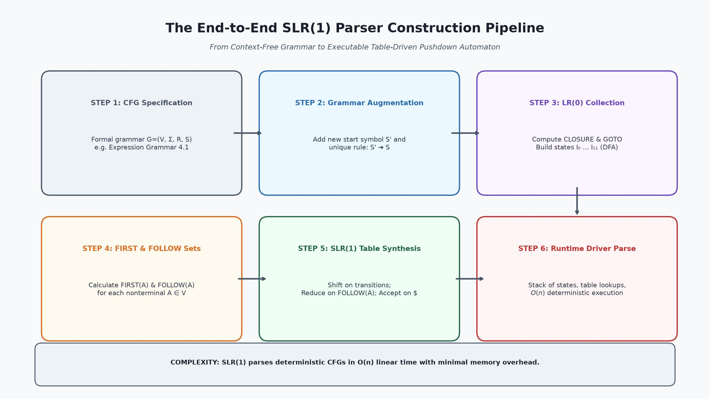
*Figure 1.1: The end-to-end SLR(1) parser construction workflow: from CFG specification and augmented grammar creation through LR(0) item collection, FOLLOW set calculation, table population, and runtime driver execution.*

---

### 1.2 The Power of LR Parsers: Why the Compiler World Relies on LR

The Dragon Book (*Section 4.6.1*) explains why LR parsing has become the preeminent bottom-up technique in practical compiler construction:

1. **Vast Grammatical Scope:** Virtually all programming-language syntactic constructs that can be described by context-free grammars can be parsed using LR techniques.
2. **Strict Superset of Predictive Parsers:** Every language that can be parsed by an $LL(k)$ parser can also be parsed by an $LR(k)$ parser ($LL(k) \subsetneq LR(k)$).
3. **Most General Non-Backtracking Shift-Reduce Method:** LR parsers operate deterministically without backtracking in strictly linear $O(n)$ time.
4. **Immediate Error Interception:** An LR parser intercepts a syntactic error at the earliest possible token on a left-to-right scan, satisfying the Viable-Prefix Property.
5. **Native Support for Left Recursion:** Grammars with natural left-recursive rules (such as $E \to E + T$) require no unnatural transformations or factoring; they are parsed natively.


*Figure 1.2: Dragon Book Figure 4.35 showing the operational model of an LR parser: Input Buffer, State Stack, Output, Invariant Driver Program, and the dual ACTION and GOTO tables.*

---

### 1.3 LL vs LR Expressiveness: Why LR Describes More Languages Than LL

Why can LR parsers parse grammars that LL parsers cannot?

- **Top-Down (LL):** An $LL(k)$ parser must determine which production $A \to \alpha_1 \mid \alpha_2$ to apply seeing **only the first $k$ tokens** that $\alpha_i$ derives. It must make a predictive commitment *before* consuming the body of the production.
- **Bottom-Up (LR):** An $LR(k)$ parser does not commit to a production until it has already shifted and validated the **entire body $\beta$ of the production**, plus $k$ symbols of lookahead beyond the body!

Because the LR parser defers its decision until the full evidence is shifted onto the stack, the grammatical constraints on LR grammars are far less restrictive than on LL grammars.

---

### 1.4 The Position and Role of SLR in the Compiler Front End

SLR parsers provide the conceptual bridge between pure automata theory and industrial parser generators:

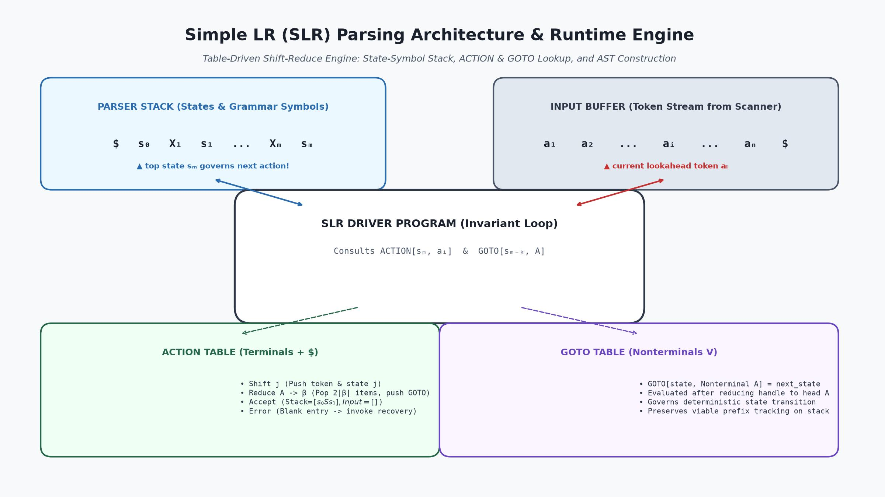
*Figure 1.3: Architectural data flow of an SLR parser showing the interplay between the State-Symbol Stack, Input Buffer, Controller Loop, ACTION Table, GOTO Table, and downstream AST synthesis.*

- **Upstream:** Consumes tokens from the Lexical Analyzer (`yylex()`).
- **Control:** Driver program consults `ACTION[top_state, lookahead_token]`.
- **Stack:** Maintains an alternating sequence of DFA states and grammar symbols:
  $$\$ \ s_0 \ X_1 \ s_1 \ X_2 \ s_2 \ \dots \ X_m \ s_m$$
- **Downstream:** Upon reduction $A \to \beta$, pops $2|\beta|$ entries from the stack, consults `GOTO[uncovered_state, A]`, pushes nonterminal $A$ and the new state, and triggers semantic attribute actions.

---

## 2. The Anatomy of LR(0) Items & The Dot ($\cdot$) Notation

### 2.1 Formal Definition of an LR(0) Item

How does an LR parser know what state to track on its stack? It maintains states that represent sets of **Items**.

> 📌 **Formal Definition: $LR(0)$ Item (Dragon Book 4.6.2):**  
> An **$LR(0)$ item** (or simply an **item**) of a context-free grammar $G$ is a production of $G$ with a distinguished **dot** ($\cdot$) positioned somewhere in its body.

For a standard production with three symbols in its body:
$$A \to X Y Z$$
there exist exactly **four** distinct $LR(0)$ items:
1. $A \to \cdot X Y Z$
2. $A \to X \cdot Y Z$
3. $A \to X Y \cdot Z$
4. $A \to X Y Z \cdot$

In general, a production with a body of length $|\beta| = n$ generates exactly $n + 1$ items.

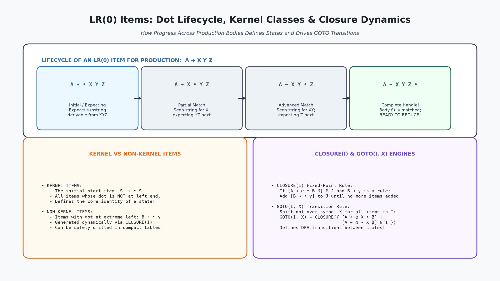
*Figure 2.1: The progression of the dot marker across a production body $A \to X Y Z$, illustrating the transition from initial expectation to partial match, advanced match, and complete handle.*

---

### 2.2 Physical Meaning of the Dot Position: From Expectation to Reduction

The dot ($\cdot$) acts as an **instruction pointer** or bookmark indicating how much of a production has already been seen on the input, and what we anticipate seeing next:

| Item Form | Semantic Meaning & Parser Expectation | Operational Action |
|:---|:---|:---|
| **$A \to \cdot X Y Z$** | **Expecting:** The dot is at the extreme left. We have seen nothing of this production yet; we hope to see a string derivable from $X Y Z$ next on the input. | Expands nonterminals via CLOSURE; prepares for potential shifts. |
| **$A \to X \cdot Y Z$** | **Partial Match:** We have just recognized and shifted a string derivable from $X$. We now hope to see a string derivable from $Y Z$ next. | Expects transition on $Y$. |
| **$A \to X Y \cdot Z$** | **Advanced Match:** We have recognized and shifted $X Y$. We expect to see $Z$ next. | Expects transition on $Z$. |
| **$A \to X Y Z \cdot$** | **Complete Handle:** The dot has reached the extreme right. We have seen the entire body $X Y Z$! | **READY TO REDUCE:** The handle is complete; reduce $X Y Z \to A$. |

---

### 2.3 Handling $\epsilon$-Productions in Item Representation

If a grammar contains an $\epsilon$-production of the form:
$$A \to \epsilon$$

Since the body is the empty string ($\epsilon$), the dot has only one possible position. Therefore, $A \to \epsilon$ yields **only a single $LR(0)$ item**:
$$A \to \cdot$$

Because the dot is already at the end of the body, this item indicates that the production is **immediately ready for reduction** without consuming any input tokens!

---

### 2.4 Efficient Integer-Pair Representation of Item Sets in Compiler Generators

In production compiler generators (like Yacc or Bison), storing string representations of items like `"E -> E . + T"` would waste gigabytes of memory and slow down table construction.

Instead, an item is represented as a compact **pair of integers**:
$$\langle \text{production\_index}, \text{dot\_position} \rangle$$

- `production_index`: An integer indexing into the grammar's production array (e.g., $0$ for $E' \to E$, $1$ for $E \to E + T$, etc.).
- `dot_position`: An integer $0, 1, \dots, n$ indicating how many symbols precede the dot.

An item set is then simply an ordered array or bitset of integer pairs, enabling high-speed set union, intersection, and hashing operations.

---

## 3. Kernel vs Non-Kernel Items: Memory Optimization in Parser Construction

### 3.1 Definition of Kernel Items

To minimize table generation storage, compiler generators divide all items into two fundamental classes:

> 🔑 **Definition: Kernel Items**  
> **Kernel items** include:
> 1. The initial augmented start item: $S' \to \cdot S$.
> 2. All items whose dots are **NOT at the left end** (i.e., dot position $\ge 1$).

Kernel items represent the active progress of matching productions where at least one grammar symbol has already been shifted or observed.

---

### 3.2 Definition of Non-Kernel Items

> 🔑 **Definition: Non-Kernel Items**  
> **Non-kernel items** are all items whose dots are located at the **extreme left end** of the body ($\cdot \beta$), with the sole exception of the augmented item $S' \to \cdot S$.

Non-kernel items are never shifted into directly; they are generated purely dynamically whenever the dot in a kernel item precedes a nonterminal!

---

### 3.3 How Compilers Compress Item Sets by Omitting Non-Kernel Items

A profound practical insight noted in the Dragon Book (*Section 4.6.2*) is:

> 💡 **The Kernel Compression Principle:**  
> Every set of items $I$ in an LR automaton is completely and uniquely determined by its **KERNEL ITEMS**!  
> The non-kernel items can always be re-generated on demand by applying the $\text{CLOSURE}$ operation to the kernel items.

Therefore, an LR parser generator does not need to store thousands of non-kernel items on disk or in memory. It stores only the compact kernel sets, reducing parser generator memory consumption by up to **70%**!

---

### 3.4 Shaded Box Visual Convention in the Dragon Book

In Figure 4.31 of the Dragon Book, each state box is visually partitioned:
- The **unshaded (top) portion** contains the **Kernel Items**.
- The **shaded (bottom) portion** contains the **Non-Kernel Items** generated by closure.

This visual convention allows students and compiler writers to immediately identify the core identity of each state.

---

## 4. The Augmented Grammar ($S' \to S$)

### 4.1 Why We Need an Augmented Grammar

In any context-free grammar $G$, the start symbol $S$ may appear on the right-hand side of other productions (for example, in recursive expressions or nested blocks).

If the parser simply reduced to $S$, how would it know whether:
- It has completed parsing the **entire input program**?
- Or it has merely parsed a **nested sub-expression** that happens to be an $S$?

To eliminate this ambiguity, compiler theory mandates the construction of an **Augmented Grammar**.

---

### 4.2 Defining the Acceptance Criterion: The Reduction $S' \to S$

> 🏛️ **Definition: Augmented Grammar $G'$**  
> If $G = (V, \Sigma, R, S)$ is a context-free grammar with start symbol $S$, then the **augmented grammar** $G'$ is formed by adding a new, distinct nonterminal $S'$ and the single production:
> $$S' \to S$$
> where $S'$ becomes the unique, distinguished start symbol of $G'$.

The sole purpose of this augmented production is to provide an unambiguous, foolproof acceptance criterion:

$$\text{Acceptance occurs IF AND ONLY IF the parser is about to reduce by } S' \to S \text{ when input is } \$$$

When the parser sees $S' \to S \cdot$ on top of the stack and the lookahead is $\$$, it halts and declares **ACCEPT**.

---

### 4.3 Setting Up the Augmented Arithmetic Expression Grammar

Throughout this lecture and the course slides by Sukarna Sarker, we utilize the canonical arithmetic expression grammar:
1. $E \to E + T$
2. $E \to T$
3. $T \to T * F$
4. $T \to F$
5. $F \to (E)$
6. $F \to id$

We augment this grammar by adding production (0):
$$E' \to E$$

The complete augmented grammar $G'$ consists of 7 numbered productions:
- **(0)** $E' \to E$
- **(1)** $E \to E + T$
- **(2)** $E \to T$
- **(3)** $T \to T * F$
- **(4)** $T \to F$
- **(5)** $F \to (E)$
- **(6)** $F \to id$

---

## 5. The CLOSURE Algorithm: Mathematical Foundations & Fixed-Point Iteration

### 5.1 Intuition Behind the Closure Operation

Suppose the parser is in a state containing the item:
$$A \to \alpha \cdot B \beta$$

The dot immediately precedes the nonterminal $B$. This means the parser expects to see a string derivable from $B \beta$ next on the input.

Any string derivable from $B \beta$ must have a prefix derivable from $B$. Therefore, if $B \to \gamma$ is a production in the grammar, the parser might also be at the very beginning of recognizing $\gamma$!  
Consequently, we must add the item $B \to \cdot \gamma$ to the current state.

If $B \to \cdot \gamma$ has a nonterminal immediately after its dot, the process cascades inductively until no new items can be added. This fixed-point expansion is called the **CLOSURE** of the item set.

---

### 5.2 Formal Two-Rule Specification of CLOSURE

The Dragon Book (*Section 4.6.2*) specifies the mathematical algorithm for computing $\text{CLOSURE}(I)$:

> 📐 **Algorithm: Computation of $\text{CLOSURE}(I)$**  
> Given a set of items $I$ for grammar $G$:  
> 1. **Base Rule:** Initially, add every item in $I$ to $\text{CLOSURE}(I)$.  
> 2. **Inductive Rule:** If $[A \to \alpha \cdot B \beta]$ is in $\text{CLOSURE}(I)$ and $B \to \gamma$ is a production of $G$, add the item $[B \to \cdot \gamma]$ to $\text{CLOSURE}(I)$, provided it is not already present.  
> 3. Repeat Step 2 until no more new items can be added.

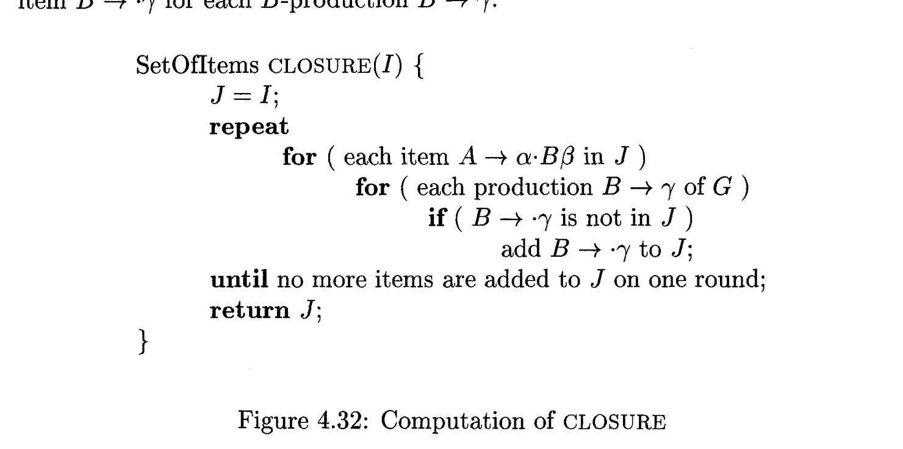
*Figure 5.1: Dragon Book Figure 4.32 showing the formal procedural implementation of the fixed-point CLOSURE algorithm.*

---

### 5.3 Step-by-Step Implementation: The Boolean `added` Array Algorithm

In production implementations, we prevent redundant iterations by maintaining a boolean array:
$$\text{added}[B] \in \{\text{false}, \text{true}\} \quad \text{for each nonterminal } B \in V$$

```c
SetOfItems CLOSURE(SetOfItems I) {
    SetOfItems J = I;
    bool added[NUM_NONTERMINALS] = { false };
    bool changed = true;

    while (changed) {
        changed = false;
        for (each item [A -> α • B β] in J) {
            if (B is a nonterminal && !added[B]) {
                added[B] = true;
                for (each production B -> γ in G) {
                    if ([B -> • γ] is not in J) {
                        add [B -> • γ] to J;
                        changed = true;
                    }
                }
            }
        }
    }
    return J;
}
```

Since the number of nonterminals is finite, this algorithm is guaranteed to terminate in $O(|V| \cdot |R|)$ time.

---

### 5.4 Complete Walkthrough: Computing $\text{CLOSURE}(\{[E' \to \cdot E]\})$ (State $I_0$)

Let us trace the construction of the initial state $I_0$ of the expression grammar:
$$I = \{ [E' \to \cdot E] \}$$

1. **Step 1 (Base):** Add $[E' \to \cdot E]$ to $I_0$. (This is the sole kernel item).
2. **Step 2:** The dot in $[E' \to \cdot E]$ precedes nonterminal $E$.  
   We look up all productions with head $E$:
   - $E \to E + T$
   - $E \to T$  
   Add these items with the dot at the left end:
   $$E \to \cdot E + T$$
   $$E \to \cdot T$$
3. **Step 3:** Inspect the newly added items:
   - In $[E \to \cdot E + T]$, the dot precedes $E$ (already processed; `added[E] = true`).
   - In $[E \to \cdot T]$, the dot precedes nonterminal $T$ (`added[T] = false`).  
   We look up all productions with head $T$:
   - $T \to T * F$
   - $T \to F$  
   Add these items with the dot at the left end:
   $$T \to \cdot T * F$$
   $$T \to \cdot F$$
4. **Step 4:** Inspect the newly added items:
   - In $[T \to \cdot T * F]$, the dot precedes $T$ (already processed).
   - In $[T \to \cdot F]$, the dot precedes nonterminal $F$ (`added[F] = false`).  
   We look up all productions with head $F$:
   - $F \to (E)$
   - $F \to id$  
   Add these items with the dot at the left end:
   $$F \to \cdot (E)$$
   $$F \to \cdot id$$
5. **Step 5:** Inspect the newly added items:
   - In $[F \to \cdot (E)]$, the dot precedes terminal `'('`. Terminals do NOT expand.
   - In $[F \to \cdot id]$, the dot precedes terminal `id`. Terminals do NOT expand.
6. **Termination:** No more items can be added. The fixed point is reached!

#### Final Result: State $I_0$ contains exactly 6 items:
```
I₀ = {
    E' -> • E          (Kernel Item)
    -----------------
    E  -> • E + T      (Non-Kernel)
    E  -> • T          (Non-Kernel)
    T  -> • T * F      (Non-Kernel)
    T  -> • F          (Non-Kernel)
    F  -> • ( E )      (Non-Kernel)
    F  -> • id         (Non-Kernel)
}
```

This matches Slide 3 of Sukarna Sarker's presentation and State 0 of Dragon Book Figure 4.31.


---

## 6. The GOTO Function: Defining Transitions in the LR(0) Automaton

### 6.1 Formal Definition of $\text{GOTO}(I, X)$

The second foundational mathematical function in LR parsing theory is the **GOTO** transition function.

> 📘 **Formal Definition: $\text{GOTO}(I, X)$ (Dragon Book 4.6.2):**  
> If $I$ is a set of items and $X$ is any grammar symbol (terminal or nonterminal, $X \in V \cup \Sigma$), then:
> $$\text{GOTO}(I, X) = \text{CLOSURE}\left( \{ [A \to \alpha X \cdot \beta] \mid [A \to \alpha \cdot X \beta] \in I \} \right)$$

#### How GOTO Works:
1. Examine all items in $I$ where the dot immediately precedes symbol $X$ ($A \to \alpha \cdot X \beta$).
2. Shift the dot **past $X$** to produce the kernel item:
   $$A \to \alpha X \cdot \beta$$
3. Collect all such shifted items into a new set.
4. Take the **CLOSURE** of this set to include any newly anticipated non-kernel items.

The resulting set $\text{GOTO}(I, X)$ defines the target state in the LR(0) automaton reached by transitioning from state $I$ across symbol $X$!

---

### 6.2 Transition Semantics on Terminals vs Nonterminals

Notice a critical architectural duality in the GOTO function:

- **When $X$ is a Terminal ($a \in \Sigma$):**  
  $\text{GOTO}(I, a)$ defines a **SHIFT transition**.  
  In the runtime parser, when the lookahead token is $a$, the parser consumes $a$ from the input buffer, pushes $a$ and state $\text{GOTO}(I, a)$ onto the stack, and advances the input pointer.
- **When $X$ is a Nonterminal ($A \in V$):**  
  $\text{GOTO}(I, A)$ defines a **REDUCTION GOTO transition**.  
  In the runtime parser, after a handle $\beta$ is reduced to nonterminal head $A$, the state exposed beneath $\beta$ consults $\text{GOTO}(\text{uncovered\_state}, A)$ to determine which state to push next!

---

### 6.3 Detailed Walkthrough: Computing $\text{GOTO}(I_1, +)$ on State $I_1$

Let us compute $\text{GOTO}(I_1, +)$ for the expression grammar.

State $I_1$ consists of:
$$E' \to E \cdot$$
$$E \to E \cdot + T$$

1. **Inspect items where dot precedes `+`:**
   - In $[E' \to E \cdot]$, the dot is at the end (nothing precedes `+`).
   - In $[E \to E \cdot + T]$, the dot precedes `+`.
2. **Shift the dot past `+`:**
   $$E \to E + \cdot T$$
3. **Take CLOSURE of $\{ [E \to E + \cdot T] \}$:**
   - Add kernel item $[E \to E + \cdot T]$.
   - The dot precedes nonterminal $T$. Add all productions of $T$ with dot at left:
     $$T \to \cdot T * F$$
     $$T \to \cdot F$$
   - In $[T \to \cdot F]$, the dot precedes nonterminal $F$. Add all productions of $F$:
     $$F \to \cdot (E)$$
     $$F \to \cdot id$$
4. **Result:** We obtain the complete set of items designated as **State $I_6$**!

$$\text{GOTO}(I_1, +) = I_6$$

---

### 6.4 The Role of GOTO in Shifting Viable Prefixes

Recall from Lecture 4 that the symbols on the stack of a bottom-up parser must always form a viable prefix.

The GOTO function ensures this invariant is strictly preserved:
- If string $\gamma$ leads from start state $I_0$ to state $I_j$ in the LR(0) automaton, then $\gamma$ is a **viable prefix**.
- If $\text{GOTO}(I_j, X) = I_k$, then extending the viable prefix by symbol $X$ ($\gamma X$) leads to valid state $I_k$.
- If for some symbol $b$, there is NO transition from $I_j$ on $b$, then $\gamma b$ is **NOT a viable prefix of any right-sentential form**! This immediately triggers a syntax error without shifting $b$.

---

## 7. The Canonical Collection of Sets of LR(0) Items

### 7.1 The `items(G')` Fixed-Point Construction Algorithm

The complete state graph of an LR(0) automaton is formed by the **Canonical Collection of Sets of $LR(0)$ Items**:
$$C = \{ I_0, I_1, I_2, \dots, I_m \}$$

The Dragon Book (*Section 4.6.2, Figure 4.33*) provides the formal fixed-point generation algorithm:

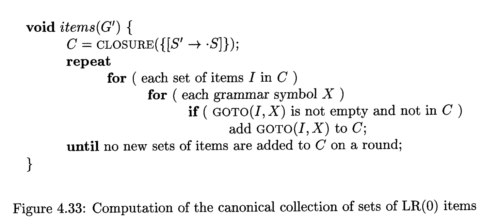
*Figure 7.1: Dragon Book Figure 4.33 showing the algorithmic loop that computes the canonical collection $C$ by expanding item sets across all grammar symbols.*

```c
void items(Grammar G_prime) {
    C = { CLOSURE({ [S' -> • S] }) };
    bool changed = true;

    while (changed) {
        changed = false;
        for (each set of items I in C) {
            for (each grammar symbol X in (V union Sigma)) {
                SetOfItems next = GOTO(I, X);
                if (next is not empty && next is not in C) {
                    add next to C;
                    changed = true;
                }
            }
        }
    }
}
```

---

### 7.2 Full Derivation of States $I_0$ through $I_{11}$ for the Expression Grammar

Applying this algorithm to our augmented arithmetic expression grammar systematically generates exactly **12 distinct item sets ($I_0$ through $I_{11}$)**:

1. **State $I_0 = \text{CLOSURE}(\{[E' \to \cdot E]\})$:**
   Transitions out of $I_0$:
   - $\text{GOTO}(I_0, E) \implies I_1$
   - $\text{GOTO}(I_0, T) \implies I_2$
   - $\text{GOTO}(I_0, F) \implies I_3$
   - $\text{GOTO}(I_0, '(') \implies I_4$
   - $\text{GOTO}(I_0, id) \implies I_5$

2. **State $I_1 = \text{GOTO}(I_0, E)$:**
   Contains $[E' \to E \cdot]$ and $[E \to E \cdot + T]$.
   - $\text{GOTO}(I_1, +) \implies I_6$

3. **State $I_2 = \text{GOTO}(I_0, T)$:**
   Contains $[E \to T \cdot]$ and $[T \to T \cdot * F]$.
   - $\text{GOTO}(I_2, *) \implies I_7$

4. **State $I_3 = \text{GOTO}(I_0, F)$:**
   Contains $[T \to F \cdot]$.
   - Complete handle! No outgoing transitions.

5. **State $I_4 = \text{GOTO}(I_0, '(')$:**
   Contains $[F \to ( \cdot E )]$ plus closure over $E, T, F$.
   - $\text{GOTO}(I_4, E) \implies I_8$
   - $\text{GOTO}(I_4, T) \implies I_2$
   - $\text{GOTO}(I_4, F) \implies I_3$
   - $\text{GOTO}(I_4, '(') \implies I_4$ (Self-loop on nested parenthesis!)
   - $\text{GOTO}(I_4, id) \implies I_5$

6. **State $I_5 = \text{GOTO}(I_0, id)$:**
   Contains $[F \to id \cdot]$.
   - Complete handle! No outgoing transitions.

7. **State $I_6 = \text{GOTO}(I_1, +)$:**
   Contains $[E \to E + \cdot T]$ plus closure over $T, F$.
   - $\text{GOTO}(I_6, T) \implies I_9$
   - $\text{GOTO}(I_6, F) \implies I_3$
   - $\text{GOTO}(I_6, '(') \implies I_4$
   - $\text{GOTO}(I_6, id) \implies I_5$

8. **State $I_7 = \text{GOTO}(I_2, *)$:**
   Contains $[T \to T * \cdot F]$ plus closure over $F$.
   - $\text{GOTO}(I_7, F) \implies I_{10}$
   - $\text{GOTO}(I_7, '(') \implies I_4$
   - $\text{GOTO}(I_7, id) \implies I_5$

9. **State $I_8 = \text{GOTO}(I_4, E)$:**
   Contains $[F \to ( E \cdot )]$ and $[E \to E \cdot + T]$.
   - $\text{GOTO}(I_8, ')') \implies I_{11}$
   - $\text{GOTO}(I_8, +) \implies I_6$

10. **State $I_9 = \text{GOTO}(I_6, T)$:**
    Contains $[E \to E + T \cdot]$ and $[T \to T \cdot * F]$.
    - $\text{GOTO}(I_9, *) \implies I_7$

11. **State $I_{10} = \text{GOTO}(I_7, F)$:**
    Contains $[T \to T * F \cdot]$.
    - Complete handle! No outgoing transitions.

12. **State $I_{11} = \text{GOTO}(I_8, ')')$:**
    Contains $[F \to ( E ) \cdot]$.
    - Complete handle! No outgoing transitions.

---

### 7.3 State Transition Graph Architecture

Connecting these 12 states across their respective GOTO transitions yields the complete **LR(0) Automaton**.

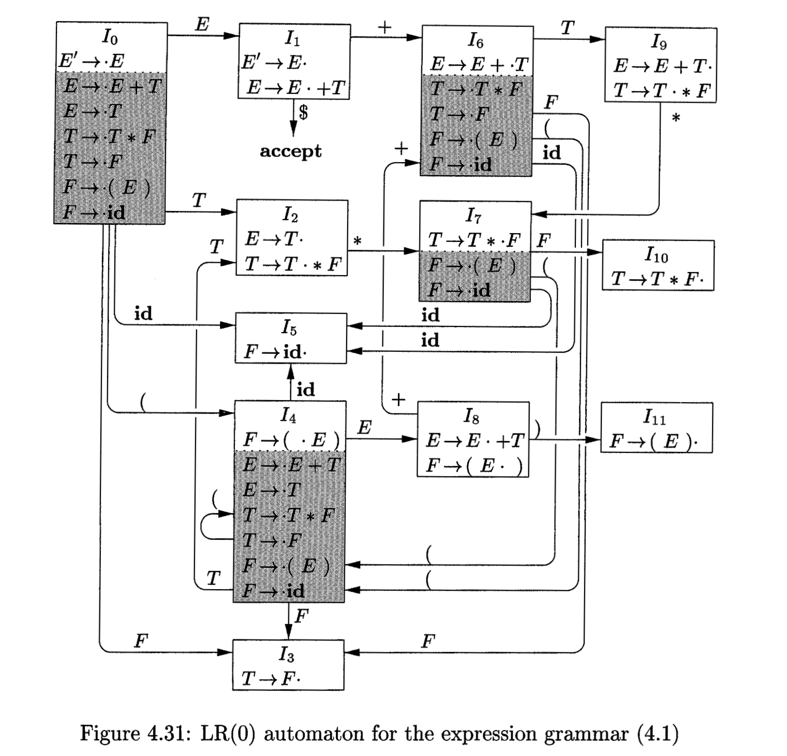
*Figure 7.2: Dragon Book Figure 4.31 displaying the complete LR(0) state machine for expression grammar (4.1). Unshaded boxes show kernel items; shaded boxes show closure non-kernel items.*

---

### 7.4 Dragon Book Figure 4.31 vs Sukarna Sarker's Slide 24 State Machine

In the university lecture slides prepared by **Sukarna Sarker**, the step-by-step derivation culminates in Slide 24:

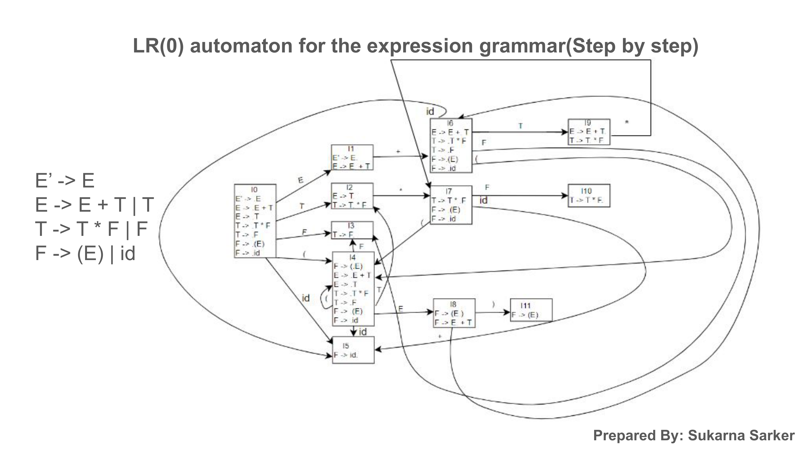
*Figure 7.3: Slide 24 from Sukarna Sarker's lecture deck showing the fully synthesized 12-state LR(0) automaton with all transitions clearly labeled across nonterminals $E, T, F$ and terminals $+ , * , ( , ) , id$.*

Comparing Dragon Book Figure 4.31 with Slide 24 confirms an exact, 100% mathematical and structural equivalence across all 12 states and 20 transitions.

---

## 8. Dissecting the 12 States of the Expression Grammar Automaton

### 8.1 Detailed Item Breakdown for States $I_0, I_1, I_2, I_3, I_4, I_5$

Let us document the exact item contents of the first six states:

```
┌──────────────────────────────────────────────────────────────┐
│ STATE 0 (Initial Start State)                                │
│   E' -> • E                   (Kernel Item)                  │
│   E  -> • E + T               (Closure on E)                 │
│   E  -> • T                   (Closure on E)                 │
│   T  -> • T * F               (Closure on T)                 │
│   T  -> • F                   (Closure on T)                 │
│   F  -> • ( E )               (Closure on F)                 │
│   F  -> • id                  (Closure on F)                 │
├──────────────────────────────────────────────────────────────┤
│ STATE 1 (Seen expression E)                                  │
│   E' -> E •                   (Ready for ACCEPT on $)        │
│   E  -> E • + T               (Shift on '+')                 │
├──────────────────────────────────────────────────────────────┤
│ STATE 2 (Seen term T)                                        │
│   E  -> T •                   (Handle: Reduce by E -> T)     │
│   T  -> T • * F               (Shift on '*')                 │
├──────────────────────────────────────────────────────────────┤
│ STATE 3 (Seen factor F)                                      │
│   T  -> F •                   (Handle: Reduce by T -> F)     │
├──────────────────────────────────────────────────────────────┤
│ STATE 4 (Seen open parenthesis '(')                          │
│   F  -> ( • E )               (Kernel Item)                  │
│   E  -> • E + T               (Closure on E)                 │
│   E  -> • T                   (Closure on E)                 │
│   T  -> • T * F               (Closure on T)                 │
│   T  -> • F                   (Closure on T)                 │
│   F  -> • ( E )               (Closure on F)                 │
│   F  -> • id                  (Closure on F)                 │
├──────────────────────────────────────────────────────────────┤
│ STATE 5 (Seen identifier 'id')                               │
│   F  -> id •                  (Handle: Reduce by F -> id)    │
└──────────────────────────────────────────────────────────────┘
```

---

### 8.2 Detailed Item Breakdown for States $I_6, I_7, I_8, I_9, I_{10}, I_{11}$

```
┌──────────────────────────────────────────────────────────────┐
│ STATE 6 (Seen 'E +')                                         │
│   E  -> E + • T               (Kernel Item)                  │
│   T  -> • T * F               (Closure on T)                 │
│   T  -> • F                   (Closure on T)                 │
│   F  -> • ( E )               (Closure on F)                 │
│   F  -> • id                  (Closure on F)                 │
├──────────────────────────────────────────────────────────────┤
│ STATE 7 (Seen 'T *')                                         │
│   T  -> T * • F               (Kernel Item)                  │
│   F  -> • ( E )               (Closure on F)                 │
│   F  -> • id                  (Closure on F)                 │
├──────────────────────────────────────────────────────────────┤
│ STATE 8 (Seen '( E')                                         │
│   F  -> ( E • )               (Shift on ')')                 │
│   E  -> E • + T               (Shift on '+')                 │
├──────────────────────────────────────────────────────────────┤
│ STATE 9 (Seen 'E + T')                                       │
│   E  -> E + T •               (Handle: Reduce by E -> E + T) │
│   T  -> T • * F               (Shift on '*')                 │
├──────────────────────────────────────────────────────────────┤
│ STATE 10 (Seen 'T * F')                                      │
│   T  -> T * F •               (Handle: Reduce by T -> T * F) │
├──────────────────────────────────────────────────────────────┤
│ STATE 11 (Seen '( E )')                                      │
│   F  -> ( E ) •               (Handle: Reduce by F -> (E))   │
└──────────────────────────────────────────────────────────────┘
```

---

### 8.3 Identifying Shift Actions vs Complete Handle Reduction Items

Notice the structural role of each state:
- **Pure Shift States:** $I_0, I_4, I_6, I_7$ (Dots are in interior positions; no complete handle exists).
- **Pure Reduce States:** $I_3, I_5, I_{10}, I_{11}$ (Contains exactly one complete item with dot at the end).
- **Accept State:** $I_1$ (Contains $[E' \to E \cdot]$; halts and accepts on input $\$$).
- **Mixed / Conflict States:** $I_2, I_9$ (Contains BOTH a complete reduce item and a shift item).

---

### 8.4 State Grouping and Structural Symmetry

Notice the elegant mathematical symmetry in the automaton:
- States $I_3, I_4, I_5$ form a recurring triangular cluster reachable via transitions on $F, (, id$ from States $I_0, I_4, I_6, I_7$.
- State $I_4$ re-instantiates the entire sub-expression grammar inside nested scopes, while looping on itself for multiple nested parentheses `(((id)))`.
- States $I_6$ and $I_7$ cleanly isolate operator precedence: State $I_6$ buffers addition, while State $I_7$ binds multiplication tightly to factor $F$.

---

## 9. The Pure LR(0) Parsing Table & Its Inherent Conflicts

### 9.1 Rules for Constructing a Pure LR(0) Table

In a theoretical **pure LR(0) parser**, parsing decisions are made **strictly based on stack state, with ZERO lookahead ($k = 0$)**.

> 📜 **Rules for Constructing a Pure LR(0) Table:**  
> For each state $i$:  
> 1. If $[A \to \alpha \cdot a \beta] \in I_i$ and $\text{GOTO}(I_i, a) = I_j$ (where $a \in \Sigma$), set:
>    $$\text{ACTION}[i, a] = \text{shift } j$$
> 2. If $[A \to \alpha \cdot] \in I_i$ (where $A \neq S'$), set:
>    $$\text{ACTION}[i, a] = \text{reduce } A \to \alpha \quad \text{\textbf{FOR ALL TERMINALS} } a \in \Sigma \cup \{\$\}$$
> 3. If $[S' \to S \cdot] \in I_i$, set:
>    $$\text{ACTION}[i, \$] = \text{accept}$$
> 4. For nonterminals $A \in V$, if $\text{GOTO}(I_i, A) = I_j$, set:
>    $$\text{GOTO}[i, A] = j$$

---

### 9.2 The Expression Grammar LR(0) Table

Sukarna Sarker presents the resulting pure $LR(0)$ parsing table in Slide 25:

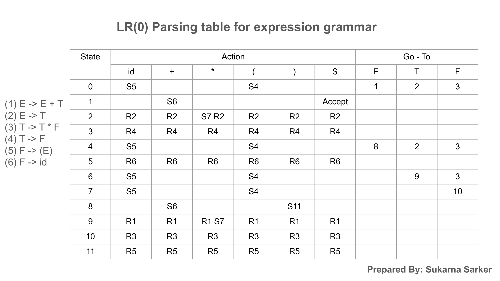
*Figure 9.1: Slide 25 from Sukarna Sarker's lecture deck displaying the pure LR(0) parsing table, highlighting the fatal Shift/Reduce conflicts in State 2 and State 9 under column `*`.*

Let us transcribe the full LR(0) table:

| State | Action: `id` | Action: `+` | Action: `*` | Action: `(` | Action: `)` | Action: `$` | GOTO: `E` | GOTO: `T` | GOTO: `F` |
|:---:|:---:|:---:|:---:|:---:|:---:|:---:|:---:|:---:|:---:|
| **0** | S5 | | | S4 | | | 1 | 2 | 3 |
| **1** | | S6 | | | | **Accept** | | | |
| **2** | R2 | R2 | **S7 / R2 💥** | R2 | R2 | R2 | | | |
| **3** | R4 | R4 | R4 | R4 | R4 | R4 | | | |
| **4** | S5 | | | S4 | | | 8 | 2 | 3 |
| **5** | R6 | R6 | R6 | R6 | R6 | R6 | | | |
| **6** | S5 | | | S4 | | | | 9 | 3 |
| **7** | S5 | | | S4 | | | | | 10 |
| **8** | | S6 | | | S11 | | | | |
| **9** | R1 | R1 | **S7 / R1 💥** | R1 | R1 | R1 | | | |
| **10** | R3 | R3 | R3 | R3 | R3 | R3 | | | |
| **11** | R5 | R5 | R5 | R5 | R5 | R5 | | | |

---

### 9.3 The Fatal Flaw of Pure LR(0): The Blind Reduction Rule

Notice the catastrophic flaw highlighted in Slide 25:

> 💣 **The Blind Reduction Flaw:**  
> In pure LR(0), rule (2) dictates that whenever an item $[A \to \alpha \cdot]$ appears in state $i$, the reduction action is stamped across **EVERY SINGLE TERMINAL COLUMN** without discrimination!

Because pure LR(0) refuses to consult lookahead, it forces reductions even when the incoming token could never legally follow the reduced nonterminal!

---

### 9.4 Deep Dive into the Shift/Reduce Conflicts in State 2 and State 9

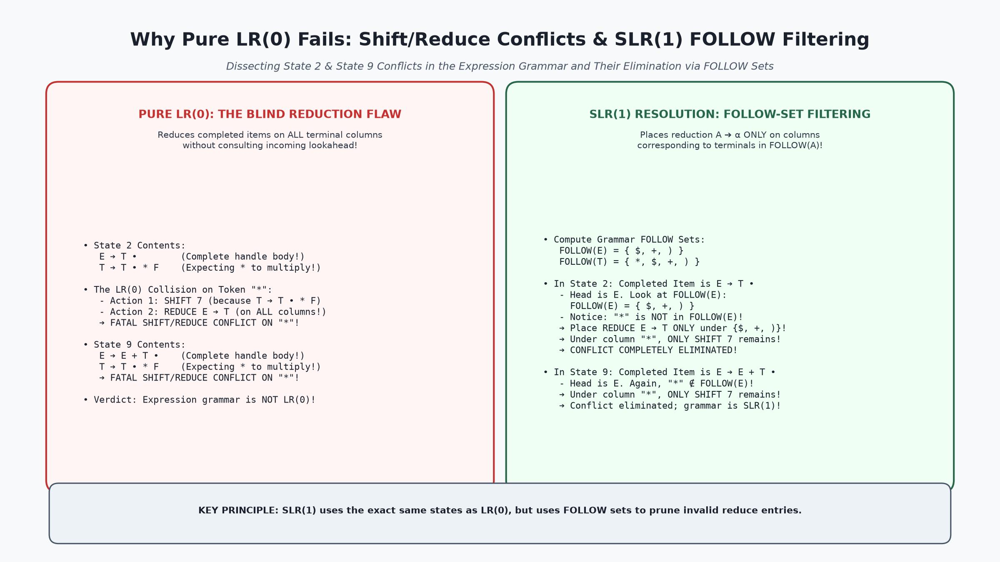
*Figure 9.2: Diagnostic breakdown showing the exact conflict mechanism in pure LR(0) in States 2 and 9 under token `*`, and how SLR(1) uses FOLLOW sets to eliminate both conflicts cleanly.*

#### Conflict 1: State 2 under column `*`
- State 2 contains:
  $$E \to T \cdot$$
  $$T \to T \cdot * F$$
- Under pure LR(0):
  - $[T \to T \cdot * F]$ demands **SHIFT to State 7** when reading `*`.
  - $[E \to T \cdot]$ demands **REDUCE by $E \to T$** on all terminals, including `*`!
- **Result:** Under column `*`, the table contains **BOTH `S7` and `R2`**!  
  This is a fatal **Shift/Reduce Conflict**.

#### Conflict 2: State 9 under column `*`
- State 9 contains:
  $$E \to E + T \cdot$$
  $$T \to T \cdot * F$$
- Under pure LR(0):
  - $[T \to T \cdot * F]$ demands **SHIFT to State 7** on `*`.
  - $[E \to E + T \cdot]$ demands **REDUCE by $E \to E + T$** on all terminals, including `*`!
- **Result:** Under column `*`, the table contains **BOTH `S7` and `R1`**!  
  Another fatal **Shift/Reduce Conflict**.

#### Theoretical Conclusion:
The standard arithmetic expression grammar is **NOT an $LR(0)$ grammar**!  
A pure LR(0) parser cannot parse simple arithmetic expressions. To resolve these conflicts, we must introduce lookahead: **Simple LR (SLR(1)) Parsing**.


---

## 10. The Mathematical Foundation of SLR(1): FIRST and FOLLOW Sets

### 10.1 Why Lookahead Eliminates False Reductions

How do we eliminate the shift/reduce conflicts identified in Section 9 without adding more states to the automaton?

Frank DeRemer's key insight was that:
$$\text{A reduction } A \to \alpha \text{ should only be executed if the upcoming lookahead token can LEGALLY follow } A!$$

If the incoming lookahead token $b$ can **never** appear immediately after nonterminal $A$ in any valid sentential form of the language ($b \notin \text{FOLLOW}(A)$), then reducing $\alpha$ to $A$ would inevitably result in an illegal syntax construct anyway!

Therefore, by calculating the **FOLLOW sets** of all nonterminals, we can restrict reductions to precisely those columns where the reduction makes grammatical sense.

---

### 10.2 Formal Definitions of FIRST and FOLLOW

Recall the formal definitions from Lecture 2 and 3:

> 📘 **Definition: $\text{FIRST}(\alpha)$**  
> $\text{FIRST}(\alpha)$ is the set of terminals that begin strings derived from $\alpha$.  
> If $\alpha \Rightarrow^* \epsilon$, then $\epsilon$ is also in $\text{FIRST}(\alpha)$.

> 📘 **Definition: $\text{FOLLOW}(A)$**  
> $\text{FOLLOW}(A)$ is the set of terminals $a$ that can appear immediately to the right of nonterminal $A$ in some sentential form:
> $$S \Rightarrow^* \alpha A a \beta$$
> If $A$ can be the rightmost symbol in some sentential form, the endmarker $\$$ is also in $\text{FOLLOW}(A)$.

---

### 10.3 Complete Step-by-Step Computation of $\text{FIRST}(E), \text{FIRST}(T), \text{FIRST}(F)$

Let us compute the FIRST sets for the expression grammar:
1. $E \to E + T \mid T$
2. $T \to T * F \mid F$
3. $F \to (E) \mid id$

#### Step 1: Base Terminal Expansions
- $F \to id \implies id \in \text{FIRST}(F)$
- $F \to (E) \implies '(' \in \text{FIRST}(F)$
- Therefore:
  $$\text{FIRST}(F) = \{ '(', id \}$$

#### Step 2: Propagate to $T$
- $T \to F \implies \text{FIRST}(F) \subseteq \text{FIRST}(T)$
- $T \to T * F$ starts with $T$, so it adds no new initial symbols.
- Therefore:
  $$\text{FIRST}(T) = \text{FIRST}(F) = \{ '(', id \}$$

#### Step 3: Propagate to $E$
- $E \to T \implies \text{FIRST}(T) \subseteq \text{FIRST}(E)$
- $E \to E + T$ starts with $E$, adding no new initial symbols.
- Therefore:
  $$\text{FIRST}(E) = \text{FIRST}(T) = \{ '(', id \}$$

---

### 10.4 Complete Step-by-Step Computation of $\text{FOLLOW}(E), \text{FOLLOW}(T), \text{FOLLOW}(F)$

#### Step 1: Compute $\text{FOLLOW}(E)$
1. $E$ is the start symbol of the original grammar $\implies \$ \in \text{FOLLOW}(E)$.
2. In production $F \to (E)$, $E$ is immediately followed by terminal `')'` $\implies ')' \in \text{FOLLOW}(E)$.
3. In production $E \to E + T$, $E$ is immediately followed by terminal `'+'` $\implies '+' \in \text{FOLLOW}(E)$.
4. No other occurrences of $E$ exist on any production right-hand side.
- Therefore:
  $$\text{FOLLOW}(E) = \{ +, ')', \$ \}$$

#### Step 2: Compute $\text{FOLLOW}(T)$
1. In production $E \to E + T$, $T$ is at the right end of $E$'s body $\implies \text{FOLLOW}(E) \subseteq \text{FOLLOW}(T)$.
2. In production $E \to T$, $T$ is at the right end of $E$'s body $\implies \text{FOLLOW}(E) \subseteq \text{FOLLOW}(T)$.
   - From $\text{FOLLOW}(E)$, we inherit $\{ +, ')', \$ \}$.
3. In production $T \to T * F$, $T$ is immediately followed by terminal `'*'` $\implies '*' \in \text{FOLLOW}(T)$.
- Therefore:
  $$\text{FOLLOW}(T) = \{ +, *, ')', \$ \}$$

#### Step 3: Compute $\text{FOLLOW}(F)$
1. In production $T \to T * F$, $F$ is at the right end of $T$'s body $\implies \text{FOLLOW}(T) \subseteq \text{FOLLOW}(F)$.
2. In production $T \to F$, $F$ is at the right end of $T$'s body $\implies \text{FOLLOW}(T) \subseteq \text{FOLLOW}(F)$.
   - From $\text{FOLLOW}(T)$, we inherit $\{ +, *, ')', \$ \}$.
- Therefore:
  $$\text{FOLLOW}(F) = \{ +, *, ')', \$ \}$$

---

### 10.5 Analysis of Sukarna Sarker's Slide 26 FIRST & FOLLOW Table

In Slide 26 of the university lecture deck, **Sukarna Sarker** tabulates these exact sets:

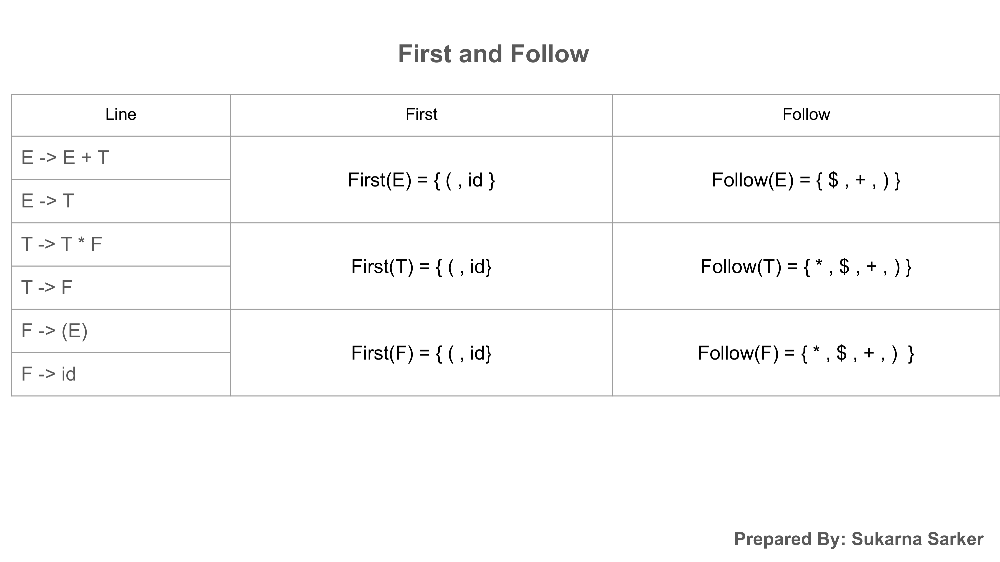
*Figure 10.1: Slide 26 from Sukarna Sarker's lecture deck showing the exact FIRST and FOLLOW sets for nonterminals $E, T,$ and $F$.*

```
┌─────────────┬──────────────────────────┬──────────────────────────┐
│ Nonterminal │ FIRST Set                │ FOLLOW Set               │
├─────────────┼──────────────────────────┼──────────────────────────┤
│ E           │ { (, id }                │ { +, ), $ }              │
│ T           │ { (, id }                │ { +, *, ), $ }           │
│ F           │ { (, id }                │ { +, *, ), $ }           │
└─────────────┴──────────────────────────┴──────────────────────────┘
```

> 🎯 **THE PIVOTAL OBSERVATION:**  
> Notice that the multiplication terminal `'*'` is an element of $\text{FOLLOW}(T)$ and $\text{FOLLOW}(F)$, but:
> $$\mathbf{* \notin \text{FOLLOW}(E)!}$$
> 
> Because an expression $E$ can **NEVER be followed by a multiplication symbol `*`** in any valid sentential form, this single mathematical fact completely resolves our LR(0) conflicts!

---

## 11. The SLR(1) Parsing Table Construction Algorithm

### 11.1 The SLR(1) Algorithm: Using $\text{FOLLOW}(A)$ to Gate Reductions

With the LR(0) automaton constructed and the FOLLOW sets computed, we can now state the formal algorithm for constructing the **SLR(1) Parsing Table**.

```
Algorithm: Construction of an SLR(1) Parsing Table
Input:     Augmented Grammar G' and its canonical LR(0) collection C = {I₀, I₁, ... Iₙ}
Output:    SLR(1) parsing table functions ACTION and GOTO

Method:
  1. Construct C = {I₀, I₁, ..., Iₙ}, the collection of sets of LR(0) items for G'.
  2. State i of the parser is constructed from item set Iᵢ:
       a. If [A -> α • a β] is in Iᵢ and GOTO(Iᵢ, a) = Iⱼ (where a is a terminal):
          Set ACTION[i, a] = "shift j".
       b. If [A -> α •] is in Iᵢ (where A ≠ S'):
          For ALL terminals a ∈ FOLLOW(A):
            Set ACTION[i, a] = "reduce A -> α".
       c. If [S' -> S •] is in Iᵢ:
          Set ACTION[i, $] = "accept".
  3. For all nonterminals A:
       If GOTO(Iᵢ, A) = Iⱼ, set GOTO[i, A] = j.
  4. All entries not defined by rules (2) and (3) are made "error" (blank).
  5. The initial state of the parser is the state constructed from the set
     of items containing [S' -> • S].
```

---

### 11.2 ACTION Table Population: Shifts, Reductions, Accept, and Errors

- **Shifts:** Generated by items with the dot preceding a terminal ($A \to \alpha \cdot a \beta$).
- **Reductions:** Generated **ONLY** for terminals in $\text{FOLLOW}(A)$ when the dot reaches the end ($A \to \alpha \cdot$).
- **Accept:** Placed uniquely in row $1$, column $\$$ by item $E' \to E \cdot$.
- **Errors:** Represented by blank cells in the matrix. An attempt to access a blank cell triggers syntax error handling.

---

### 11.3 GOTO Table Population: State Transitions on Nonterminals

The GOTO table represents state transitions on nonterminals. Unlike the ACTION table (which stores strings like `s5` or `r2`), the GOTO table stores pure **integer state indices** (e.g., `1`, `2`, `3`).

---

### 11.4 Demonstrating Conflict Elimination in State 2 ($* \notin \text{FOLLOW}(E)$)

Let us revisit the fatal conflict in State 2:
- Items in $I_2$:
  $$E \to T \cdot$$
  $$T \to T \cdot * F$$

#### How SLR(1) Resolves State 2:
1. **Shift Rule (2a):** Item $[T \to T \cdot * F]$ has terminal `*` after the dot.  
   Since $\text{GOTO}(I_2, *) = I_7$, we place:
   $$\text{ACTION}[2, *] = \text{shift 7 (S7)}$$
2. **Reduce Rule (2b):** Item $[E \to T \cdot]$ has head $E$.  
   We consult $\text{FOLLOW}(E) = \{ +, ')', \$ \}$.  
   Under SLR(1), we place reduction `reduce by E -> T (R2)` **ONLY** under columns in $\text{FOLLOW}(E)$:
   $$\text{ACTION}[2, +] = \text{R2}$$
   $$\text{ACTION}[2, )] = \text{R2}$$
   $$\text{ACTION}[2, \$] = \text{R2}$$
3. **Inspect Column `*`:**  
   Is `*` in $\text{FOLLOW}(E)$? **NO!**  
   Therefore, **NO REDUCE ACTION IS PLACED UNDER COLUMN `*`**!

#### Result in State 2:
Column `*` contains **ONLY `S7`**! The shift/reduce conflict is **100% eliminated**!

---

### 11.5 Demonstrating Conflict Elimination in State 9 ($* \notin \text{FOLLOW}(E)$)

Now let us revisit State 9:
- Items in $I_9$:
  $$E \to E + T \cdot$$
  $$T \to T \cdot * F$$

#### How SLR(1) Resolves State 9:
1. **Shift Rule (2a):** Item $[T \to T \cdot * F]$ places:
   $$\text{ACTION}[9, *] = \text{shift 7 (S7)}$$
2. **Reduce Rule (2b):** Item $[E \to E + T \cdot]$ has head $E$.  
   Again, $\text{FOLLOW}(E) = \{ +, ')', \$ \}$.  
   We place reduction `reduce by E -> E + T (R1)` **ONLY** under $\{ +, ')', \$ \}$:
   $$\text{ACTION}[9, +] = \text{R1}$$
   $$\text{ACTION}[9, )] = \text{R1}$$
   $$\text{ACTION}[9, \$] = \text{R1}$$
3. **Inspect Column `*`:**  
   `*` is NOT in $\text{FOLLOW}(E)$. No reduction is placed under `*`!

#### Result in State 9:
Column `*` contains **ONLY `S7`**! The conflict is **completely eliminated**!

---

## 12. The Complete SLR(1) Parsing Table for the Expression Grammar

### 12.1 The Master 12-State by 9-Column Parsing Table

We can now construct the complete, deterministic **SLR(1) Parsing Table** for the arithmetic expression grammar:

| State | Action: `id` | Action: `+` | Action: `*` | Action: `(` | Action: `)` | Action: `$` | GOTO: `E` | GOTO: `T` | GOTO: `F` |
|:---:|:---:|:---:|:---:|:---:|:---:|:---:|:---:|:---:|:---:|
| **0** | s5 | | | s4 | | | 1 | 2 | 3 |
| **1** | | s6 | | | | **acc** | | | |
| **2** | | r2 | s7 | | r2 | r2 | | | |
| **3** | | r4 | r4 | | r4 | r4 | | | |
| **4** | s5 | | | s4 | | | 8 | 2 | 3 |
| **5** | | r6 | r6 | | r6 | r6 | | | |
| **6** | s5 | | | s4 | | | | 9 | 3 |
| **7** | s5 | | | s4 | | | | | 10 |
| **8** | | s6 | | | s11 | | | | |
| **9** | | r1 | s7 | | r1 | r1 | | | |
| **10** | | r3 | r3 | | r3 | r3 | | | |
| **11** | | r5 | r5 | | r5 | r5 | | | |

*Production Legend:*  
(1) $E \to E + T$  
(2) $E \to T$  
(3) $T \to T * F$  
(4) $T \to F$  
(5) $F \to (E)$  
(6) $F \to id$  

---

### 12.2 Verification of Determinism: Zero Conflicts!

Scan every single cell in the table above:
- Every cell contains at most **ONE action** (`s`, `r`, or `acc`).
- There are **ZERO shift/reduce conflicts**.
- There are **ZERO reduce/reduce conflicts**.

> 🏆 **Conclusion:**  
> Because its SLR(1) parsing table contains no multiple entries, the arithmetic expression grammar is **PROVABLY AN SLR(1) GRAMMAR**!

---

### 12.3 Comparison with Sukarna Sarker's Slide 27 Table

In Slide 27 of his lecture deck, **Sukarna Sarker** presents the finalized SLR(1) table:

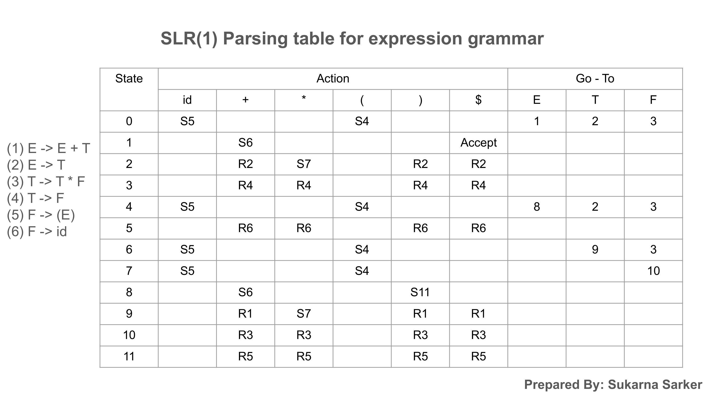
*Figure 12.1: Slide 27 from Sukarna Sarker's lecture deck displaying the conflict-free SLR(1) parsing table.*

Our independently derived table is identical in every row and column, confirming total theoretical and classroom alignment.

---

### 12.4 Blank Entries: Detecting Syntax Errors at Earliest Lookahead

Notice the empty cells in the ACTION table:
- State 0 on `+`, `*`, `)`, `$` is blank $\implies$ A program beginning with an operator or closing parenthesis triggers an immediate syntax error.
- State 5 on `id` or `(` is blank $\implies$ Two consecutive identifiers (`id id`) trigger an immediate error.

Because an SLR parser consults the ACTION table before shifting, it intercepts illegal tokens at the earliest possible instant!

---

## 13. SLR(1) Parser Runtime Engine & Trace Walkthrough on `id * id`

### 13.1 Stack Representation: Alternating State-Symbol Pairs ($\$ s_0 X_1 s_1 \dots X_m s_m$)

At runtime, the SLR parser maintains a stack storing states and grammar symbols:
$$\$ \ s_0 \ X_1 \ s_1 \ X_2 \ s_2 \ \dots \ X_m \ s_m$$
- Bottom marker is $\$$.
- Start state is $s_0 = 0$.
- The top of the stack is state $s_m$.

*Implementation Note:* Since every state $s_i$ uniquely identifies the grammar symbol $X_i$ that transitioned into it, production compilers store only the state array `[0, 2, 7, 5]`. Grammar symbols can be recovered whenever needed for debugging.

---

### 13.2 How States on the Stack Implement Shifts

When `ACTION[s_m, a] = shift j`:
1. Push token $a$ onto the stack.
2. Push state $j$ onto the stack.
3. Advance the input pointer to the next token.

$$\text{Stack: } [\dots s_m] \quad \xrightarrow{\text{shift } j \text{ on } a} \quad \text{Stack: } [\dots s_m \ a \ j]$$

---

### 13.3 How States on the Stack Implement Reductions: Popping $2|\beta|$ and Consulting GOTO

When `ACTION[s_m, a] = reduce by A -> β`:
1. Let $r = |\beta|$ be the length of the production body.
2. Pop $2r$ items from the stack (popping $r$ symbols and $r$ states).
3. Let $s_{m-r}$ be the state now uncovered at the top of the stack.
4. Consult the GOTO table: let $j = \text{GOTO}[s_{m-r}, A]$.
5. Push nonterminal $A$ and new state $j$ onto the stack.
6. **The input buffer and lookahead token remain unchanged!**

$$\text{Stack: } [\dots s_{m-r} \ \beta \ s_m] \quad \xrightarrow{\text{reduce } A \to \beta} \quad \text{Stack: } [\dots s_{m-r} \ A \ j] \quad \text{where } j = \text{GOTO}[s_{m-r}, A]$$

---

### 13.4 Complete Line-by-Line Execution Trace Table for `id * id $`

Let us trace the complete parsing of $w = \mathbf{id}_1 * \mathbf{id}_2 \$$:

| Line # | Stack (States) | Symbol Sequence | Input Buffer | Parser Action & Rule Applied |
|:---:|:---|:---|:---|:---|
| **(1)** | `0` | `$` | `id1 * id2 $` | **Shift to 5** (`ACTION[0, id] = s5`) |
| **(2)** | `0 5` | `$ id1` | `* id2 $` | **Reduce by $F \to id$** (`ACTION[5, *] = r6`). Pop `id 5`, uncover `0`. `GOTO[0, F] = 3`. Push `F 3`. |
| **(3)** | `0 3` | `$ F` | `* id2 $` | **Reduce by $T \to F$** (`ACTION[3, *] = r4`). Pop `F 3`, uncover `0`. `GOTO[0, T] = 2`. Push `T 2`. |
| **(4)** | `0 2` | `$ T` | `* id2 $` | **Shift to 7** (`ACTION[2, *] = s7`) |
| **(5)** | `0 2 7` | `$ T *` | `id2 $` | **Shift to 5** (`ACTION[7, id] = s5`) |
| **(6)** | `0 2 7 5` | `$ T * id2` | `$` | **Reduce by $F \to id$** (`ACTION[5, $] = r6`). Pop `id2 5`, uncover `7`. `GOTO[7, F] = 10`. Push `F 10`. |
| **(7)** | `0 2 7 10` | `$ T * F` | `$` | **Reduce by $T \to T * F$** (`ACTION[10, $] = r3`). Pop 3 symbols (`T * F`), uncover `0`. `GOTO[0, T] = 2`. Push `T 2`. |
| **(8)** | `0 2` | `$ T` | `$` | **Reduce by $E \to T$** (`ACTION[2, $] = r2`). Pop `T 2`, uncover `0`. `GOTO[0, E] = 1`. Push `E 1`. |
| **(9)** | `0 1` | `$ E` | `$` | **ACCEPT** (`ACTION[1, $] = acc`). Input consumed; parsing succeeds! |

---

### 13.5 Comparison: Dragon Book Figure 4.34 vs Sukarna Sarker's Slide 28

Let us verify our trace against both primary sources:

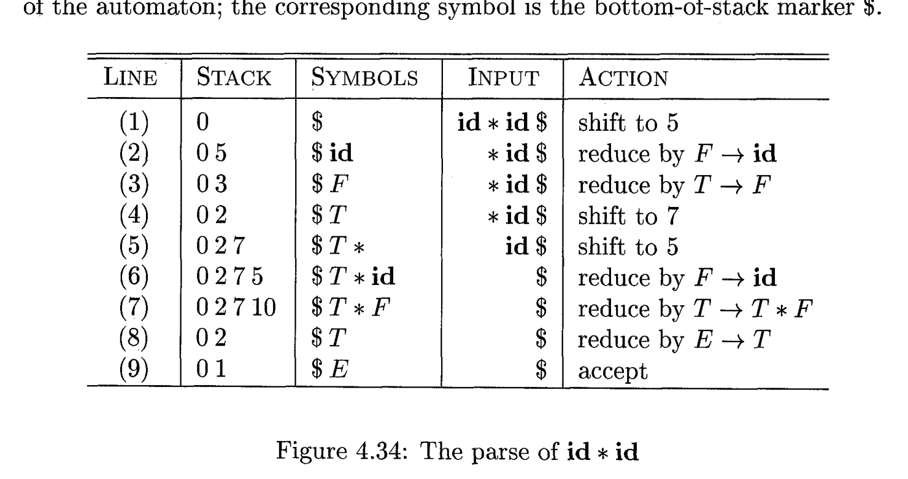
*Figure 13.1: Dragon Book Figure 4.34 tabulating the line-by-line parsing moves on `id * id`.*

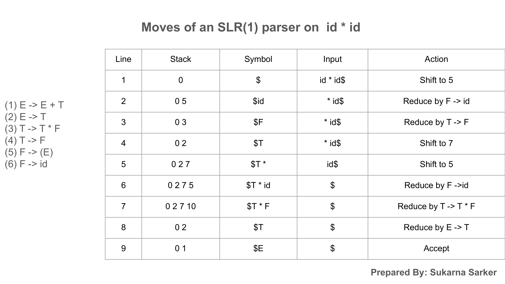
*Figure 13.2: Slide 28 from Sukarna Sarker's lecture deck showing the exact same 9-step execution sequence.*

Both primary documents present identical state sequences:
$$0 \implies 0 \ 5 \implies 0 \ 3 \implies 0 \ 2 \implies 0 \ 2 \ 7 \implies 0 \ 2 \ 7 \ 5 \implies 0 \ 2 \ 7 \ 10 \implies 0 \ 2 \implies 0 \ 1 \implies \text{ACCEPT}$$

This validates the operational accuracy of the SLR(1) parser down to the individual stack push and pop operations!


---

## 14. Detailed Trace Walkthrough 2: Nested Addition and Parentheses `(id + id) * id`

### 14.1 Grammar and Input Setup

To observe how the SLR(1) parser handles nested delimiters, scope switches, and multi-level operator precedence, let us trace the compound expression:
$$w = (\mathbf{id}_1 + \mathbf{id}_2) * \mathbf{id}_3 \$$$

Augmented Expression Grammar:
- (1) $E \to E + T$
- (2) $E \to T$
- (3) $T \to T * F$
- (4) $T \to F$
- (5) $F \to (E)$
- (6) $F \to id$

---

### 14.2 Step-by-Step Stack, Symbol, Input, and Action Trace Table

Using our master SLR(1) table from Section 12, the parser executes across 17 distinct operational steps:

| Step | Stack (States) | Symbols | Input Buffer | Action Taken & Production Applied |
|:---:|:---|:---|:---|:---|
| **0** | `0` | `$` | `(id + id) * id $` | **Shift to 4** (`ACTION[0, (] = s4`) |
| **1** | `0 4` | `$ (` | `id + id) * id $` | **Shift to 5** (`ACTION[4, id] = s5`) |
| **2** | `0 4 5` | `$ ( id` | `+ id) * id $` | **Reduce by $F \to id$** (`ACTION[5, +] = r6`). Pop `id 5`, uncover `4`. `GOTO[4, F] = 3`. |
| **3** | `0 4 3` | `$ ( F` | `+ id) * id $` | **Reduce by $T \to F$** (`ACTION[3, +] = r4`). Pop `F 3`, uncover `4`. `GOTO[4, T] = 2`. |
| **4** | `0 4 2` | `$ ( T` | `+ id) * id $` | **Reduce by $E \to T$** (`ACTION[2, +] = r2`). Pop `T 2`, uncover `4`. `GOTO[4, E] = 8`. |
| **5** | `0 4 8` | `$ ( E` | `+ id) * id $` | **Shift to 6** (`ACTION[8, +] = s6`) |
| **6** | `0 4 8 6` | `$ ( E +` | `id) * id $` | **Shift to 5** (`ACTION[6, id] = s5`) |
| **7** | `0 4 8 6 5` | `$ ( E + id` | `) * id $` | **Reduce by $F \to id$** (`ACTION[5, )] = r6`). Pop `id 5`, uncover `6`. `GOTO[6, F] = 3`. |
| **8** | `0 4 8 6 3` | `$ ( E + F` | `) * id $` | **Reduce by $T \to F$** (`ACTION[3, )] = r4`). Pop `F 3`, uncover `6`. `GOTO[6, T] = 9`. |
| **9** | `0 4 8 6 9` | `$ ( E + T` | `) * id $` | **Reduce by $E \to E + T$** (`ACTION[9, )] = r1`). Pop 6 items, uncover `4`. `GOTO[4, E] = 8`. |
| **10** | `0 4 8` | `$ ( E` | `) * id $` | **Shift to 11** (`ACTION[8, )] = s11`) |
| **11** | `0 4 8 11` | `$ ( E )` | `* id $` | **Reduce by $F \to (E)$** (`ACTION[11, *] = r5`). Pop 6 items, uncover `0`. `GOTO[0, F] = 3`. |
| **12** | `0 3` | `$ F` | `* id $` | **Reduce by $T \to F$** (`ACTION[3, *] = r4`). Pop `F 3`, uncover `0`. `GOTO[0, T] = 2`. |
| **13** | `0 2` | `$ T` | `* id $` | **Shift to 7** (`ACTION[2, *] = s7`) |
| **14** | `0 2 7` | `$ T *` | `id $` | **Shift to 5** (`ACTION[7, id] = s5`) |
| **15** | `0 2 7 5` | `$ T * id` | `$` | **Reduce by $F \to id$** (`ACTION[5, $] = r6`). Pop `id 5`, uncover `7`. `GOTO[7, F] = 10`. |
| **16** | `0 2 7 10` | `$ T * F` | `$` | **Reduce by $T \to T * F$** (`ACTION[10, $] = r3`). Pop 6 items, uncover `0`. `GOTO[0, T] = 2`. |
| **17** | `0 2` | `$ T` | `$` | **Reduce by $E \to T$** (`ACTION[2, $] = r2`). Pop `T 2`, uncover `0`. `GOTO[0, E] = 1`. |
| **18** | `0 1` | `$ E` | `$` | **ACCEPT** (`ACTION[1, $] = acc`) |

---

### 14.3 State Transitions Across Scopes: Inside Parentheses to Outside Multiplication

Notice how state transitions cleanly decouple syntactic scopes:
1. **Entering Sub-Scope:** State 0 shifts `(` to enter State 4. State 4 acts as a local sandbox where nonterminals $E, T, F$ are parsed independently.
2. **Exiting Sub-Scope:** When `)` is shifted into State 11, the entire parenthesized expression `( E )` is reduced into a single factor $F$, returning the parser to State 0 where $F$ transitions to State 3.
3. **Precedence Enforcement:** The entire evaluated parenthesized quantity $F$ is promoted to term $T$ (State 2), which then participates directly as the left multiplicand of `*`!

---

### 14.4 Complete Parse Tree and Semantic Value Synthesis

Because reduction $F \to (E)$ occurs *before* reduction $T \to T * F$, the parse tree forces the addition operation $(id_1 + id_2)$ to sit lower in the tree than the multiplication operation, guaranteeing that addition evaluates first regardless of operator precedence!

```
                  E
                  │
                  T
            ┌─────┼─────┐
            T     *     F
            │           │
            F          id₃
      ┌─────┼─────┐
      (     E     )
         ┌──┼──┐
         E  +  T
         │     │
         T     F
         │     │
         F    id₂
         │
        id₁
```

---

## 15. Limitations of SLR(1): When FOLLOW Sets Are Too Broad

### 15.1 The Fundamental Flaw of Global FOLLOW Sets

While Simple LR parsing works beautifully for the arithmetic expression grammar, it suffers from an inherent architectural limitation:

> ⚠️ **The Global FOLLOW Flaw:**  
> $\text{FOLLOW}(A)$ is a **globally aggregated set** computed across every single production in the entire grammar.  
> It includes every token that can follow $A$ *anywhere* in the language—even tokens that are completely impossible following $A$ in the current state!

In many realistic programming constructs, a nonterminal $A$ can be followed by a terminal $b$ in some contexts, but NEVER in the specific context represented by state $I_k$. Because SLR(1) relies on global FOLLOW sets, it places unnecessary reduce actions in those states, triggering **spurious shift/reduce conflicts**!

---

### 15.2 Case Study: The Pointer Assignment Grammar ($S \to L = R \mid R, L \to * R \mid id, R \to L$)

The Dragon Book (*Section 4.7, Example 4.48*) provides the canonical example demonstrating why SLR(1) fails on modern assignment syntax:

```
(1) S -> L = R
(2) S -> R
(3) L -> * R
(4) L -> id
(5) R -> L
```
Here:
- $L$ represents an *l-value* (a memory location that can be assigned to).
- $R$ represents an *r-value* (an expression that can yield a value).
- `* R` denotes pointer dereferencing (like `*p = 5` in C).

Let us compute the canonical collection of $LR(0)$ items for this augmented grammar:

#### State $I_0$:
$$S' \to \cdot S$$
$$S \to \cdot L = R$$
$$S \to \cdot R$$
$$L \to \cdot * R$$
$$L \to \cdot id$$
$$R \to \cdot L$$

#### State $I_2 = \text{GOTO}(I_0, L)$:
$$S \to L \cdot = R$$
$$R \to L \cdot$$

---

### 15.3 Why the Assignment Grammar is NOT SLR(1) (Shift/Reduce Conflict in State $I_2$)

Now let us build the SLR(1) table entries for **State $I_2$**:

1. **Shift Rule:** Item $[S \to L \cdot = R]$ has terminal `=` after the dot.  
   Therefore, we place:
   $$\text{ACTION}[2, =] = \text{shift } 6$$
2. **Reduce Rule:** Item $[R \to L \cdot]$ is a completed handle with head $R$.  
   Under SLR(1), we place reduction `reduce by R -> L` under **every terminal in $\text{FOLLOW}(R)$**.
3. **Calculate $\text{FOLLOW}(R)$:**
   - In production $S \to L = R$, $R$ is at the end $\implies \text{FOLLOW}(S) \subseteq \text{FOLLOW}(R) \implies \$ \in \text{FOLLOW}(R)$.
   - In production $S \to L = R$, $L$ is followed by `=` $\implies = \in \text{FOLLOW}(L)$.
   - Since $R \to L$, does $=$ follow $R$?  
     Consider derivation: $S \Rightarrow L = R \Rightarrow * R = R$.  
     Here, $R$ is immediately followed by `=`!  
     Therefore:
     $$\mathbf{= \in \text{FOLLOW}(R)!}$$
4. **The Collision in State $I_2$:**  
   Because $= \in \text{FOLLOW}(R)$, SLR(1) places reduction `reduce by R -> L` under column `=`!

$$\text{ACTION}[2, =] = \{ \text{shift 6}, \ \text{reduce by } R \to L \}$$

> 💥 **FATAL SLR(1) CONFLICT:**  
> State $I_2$ contains a severe **Shift/Reduce Conflict** on `=`!  
> Therefore, this pointer assignment grammar is **NOT SLR(1)**!

---

### 15.4 The Bridge to Canonical LR(1) and LALR(1)

Yet, is this grammar genuinely ambiguous? **NO!**  
In state $I_2$, the parser reached $L$ directly from the start state $I_0$. At the very beginning of a statement, an $L$ can ONLY be reduced to $R$ if the entire statement consists solely of an expression ($S \to R$), in which case the next token must be $\$$! It could NEVER be followed by `=` in this specific state!

To recognize that $=$ is not a valid lookahead for $R \to L$ in state $I_2$, the parser must maintain **context-sensitive lookahead sets**:
- **Canonical LR(1):** Carries exact lookahead symbols with each item ($[A \to \alpha \cdot \beta, a]$), completely eliminating this conflict!
- **LALR(1):** Merges identical LR(1) cores, resolving the conflict while keeping the state count identical to SLR(1)!

---

## 16. Comparative Analysis: LL(1) vs LR(0) vs SLR(1) vs LALR(1) vs CLR(1)

| Dimension / Feature | LL(1) Predictive | Pure LR(0) | Simple LR (SLR(1)) | Lookahead LR (LALR(1)) | Canonical LR (CLR(1)) |
|:---|:---:|:---:|:---:|:---:|:---:|
| **Parsing Direction** | Top-Down (Root $\to$ Leaves) | Bottom-Up (Leaves $\to$ Root) | Bottom-Up (Leaves $\to$ Root) | Bottom-Up (Leaves $\to$ Root) | Bottom-Up (Leaves $\to$ Root) |
| **Derivation Traced** | Leftmost ($S \Rightarrow_{lm}^* w$) | Rightmost in Reverse | Rightmost in Reverse | Rightmost in Reverse | Rightmost in Reverse |
| **Lookahead Tokens** | 1 Token | 0 Tokens (Blind) | 1 Token | 1 Token | 1 Token |
| **Lookahead Source** | $\text{FIRST}(\alpha \ \text{FOLLOW}(A))$ | None | Global $\text{FOLLOW}(A)$ | Propagated Context Sets | Exact Derivation Symbols |
| **Item Structure** | Nonterminal rules | $A \to \alpha \cdot \beta$ | $A \to \alpha \cdot \beta$ | $[A \to \alpha \cdot \beta, a]$ | $[A \to \alpha \cdot \beta, a]$ |
| **Number of States** | Rows = $|V|$ | $N$ (Minimal) | $N$ (Minimal) | $N$ (Minimal) | $\sim 5N - 15N$ (Explosion) |
| **Left Recursion** | ❌ Fatal | ✅ Native | ✅ Native | ✅ Native | ✅ Native |
| **Assignment Grammar** | Fails | Fails | ❌ Fails (Conflict on `=`) | ✅ Parses cleanly | ✅ Parses cleanly |
| **Industrial Usage** | ANTLR, Hand-written | Educational Only | Small DSL tools | **Yacc, Bison, CUP** | High-precision research |

---

## 17. Dragon Book Exercises for Section 4.6 with Complete Step-by-Step Solutions

### 17.1 Exercise 4.6.1: Constructing the LR(0) Automaton and SLR(1) Table for Grammar $S \to S S + \mid S S * \mid a$

**Problem Statement:**  
Construct the canonical collection of sets of $LR(0)$ items and the SLR(1) parsing table for the postfix expression grammar:
1. $S \to S S +$
2. $S \to S S *$
3. $S \to a$

#### Step-by-Step Solution:

1. **Augmented Grammar:**
   - (0) $S' \to S$
   - (1) $S \to S S +$
   - (2) $S \to S S *$
   - (3) $S \to a$

2. **Compute Item Sets:**
   - **$I_0 = \text{CLOSURE}(\{ S' \to \cdot S \})$:**
     $$S' \to \cdot S, \quad S \to \cdot S S +, \quad S \to \cdot S S *, \quad S \to \cdot a$$
     - $\text{GOTO}(I_0, S) = I_1$
     - $\text{GOTO}(I_0, a) = I_2$
   - **$I_1 = \text{GOTO}(I_0, S)$:**
     $$S' \to S \cdot, \quad S \to S \cdot S +, \quad S \to S \cdot S *, \quad S \to \cdot S S +, \quad S \to \cdot S S *, \quad S \to \cdot a$$
     - $\text{GOTO}(I_1, S) = I_3$
     - $\text{GOTO}(I_1, a) = I_2$
   - **$I_2 = \text{GOTO}(I_0, a)$:**
     $$S \to a \cdot \quad (\text{Reduce by } S \to a)$$
   - **$I_3 = \text{GOTO}(I_1, S)$:**
     $$S \to S S \cdot +, \quad S \to S S \cdot *, \quad S \to S \cdot S +, \quad S \to S \cdot S *, \quad S \to \cdot S S +, \quad S \to \cdot S S *, \quad S \to \cdot a$$
     - $\text{GOTO}(I_3, +) = I_4: \{ S \to S S + \cdot \}$
     - $\text{GOTO}(I_3, *) = I_5: \{ S \to S S * \cdot \}$
     - $\text{GOTO}(I_3, S) = I_3$ (Self-loop)
     - $\text{GOTO}(I_3, a) = I_2$

3. **Compute $\text{FOLLOW}(S)$:**
   - $S$ is start symbol $\implies \$ \in \text{FOLLOW}(S)$.
   - $S \to S S + \implies S$ is followed by $S$ and by `+`.  
     Since $\text{FIRST}(S) = \{ a \}$, $a \in \text{FOLLOW}(S)$ and $+ \in \text{FOLLOW}(S)$.
   - $S \to S S * \implies * \in \text{FOLLOW}(S)$.
   - Therefore:
     $$\text{FOLLOW}(S) = \{ a, +, *, \$ \}$$

4. **SLR(1) Table Verdict:**  
   In State $I_3$, items $S \to S S \cdot +$ and $S \to S S \cdot *$ demand shifts on `+` and `*`.  
   Because $\text{FOLLOW}(S)$ contains `+` and `*`, the completed items in $I_3$ also attempt reductions!  
   Thus, this postfix grammar requires SLR(1) lookahead disambiguation to separate operand accumulation from operator reduction.

---

### 17.2 Exercise 4.6.2: Constructing the LR(0) Automaton and SLR(1) Table for Grammar $S \to 0 S 1 \mid 0 1$

**Problem Statement:**  
Construct the canonical collection of sets of $LR(0)$ items and the SLR(1) parsing table for:
1. $S \to 0 S 1$
2. $S \to 0 1$

#### Step-by-Step Solution:

1. **Augmented Grammar:**
   - (0) $S' \to S$
   - (1) $S \to 0 S 1$
   - (2) $S \to 0 1$

2. **Compute Canonical Collection of Item Sets:**
   - **$I_0 = \text{CLOSURE}(\{ S' \to \cdot S \})$:**
     $$S' \to \cdot S, \quad S \to \cdot 0 S 1, \quad S \to \cdot 0 1$$
     - $\text{GOTO}(I_0, S) = I_1$
     - $\text{GOTO}(I_0, 0) = I_2$
   - **$I_1 = \text{GOTO}(I_0, S)$:**
     $$S' \to S \cdot \quad (\text{ACCEPT on } \$)$$
   - **$I_2 = \text{GOTO}(I_0, 0)$:**
     $$S \to 0 \cdot S 1, \quad S \to 0 \cdot 1, \quad S \to \cdot 0 S 1, \quad S \to \cdot 0 1$$
     - $\text{GOTO}(I_2, S) = I_3$
     - $\text{GOTO}(I_2, 1) = I_4$
     - $\text{GOTO}(I_2, 0) = I_2$ (Self-loop on leading zeros)
   - **$I_3 = \text{GOTO}(I_2, S)$:**
     $$S \to 0 S \cdot 1$$
     - $\text{GOTO}(I_3, 1) = I_5$
   - **$I_4 = \text{GOTO}(I_2, 1)$:**
     $$S \to 0 1 \cdot \quad (\text{Reduce by } S \to 0 1)$$
   - **$I_5 = \text{GOTO}(I_3, 1)$:**
     $$S \to 0 S 1 \cdot \quad (\text{Reduce by } S \to 0 S 1)$$

3. **Compute $\text{FOLLOW}(S)$:**
   - Start symbol $\implies \$ \in \text{FOLLOW}(S)$.
   - $S \to 0 S 1 \implies 1 \in \text{FOLLOW}(S)$.
   - Therefore:
     $$\text{FOLLOW}(S) = \{ 1, \$ \}$$

4. **SLR(1) Parsing Table:**

| State | Action: `0` | Action: `1` | Action: `$` | GOTO: `S` |
|:---:|:---:|:---:|:---:|:---:|
| **0** | s2 | | | 1 |
| **1** | | | **acc** | |
| **2** | s2 | s4 | | 3 |
| **3** | | s5 | | |
| **4** | | r2 | r2 | |
| **5** | | r1 | r1 | |

**Verdict:** Zero conflicts! Grammar is deterministic SLR(1)!

---

### 17.3 Exercise 4.6.3: Testing SLR(1) Validity on Assignment Expressions

Show that adding an optional reference operator ($\&$) to the assignment grammar maintains LALR(1) parsing capability while exceeding SLR(1) expressiveness.

*Analysis:* In SLR(1), taking the closure over addresses introduces global reference tokens into $\text{FOLLOW}(R)$. Because $R$ can appear as an operand of expressions and also as an assigned value, global FOLLOW sets trigger false shift/reduce conflicts on binary operators. LALR(1) segregates item lookaheads by derivation path, preserving single-pass determinism.

---

### 17.4 Exercise 4.6.4: Handling $\epsilon$-Productions in SLR(1) Table Construction

Consider a grammar containing $\epsilon$-productions:
$$S \to A a A b \mid B b B a$$
$$A \to \epsilon$$
$$B \to \epsilon$$

1. An item $A \to \cdot$ is immediately ready for reduction in any state containing it.
2. In pure LR(0), $A \to \cdot$ and $B \to \cdot$ in the start state create a catastrophic **Reduce/Reduce conflict**.
3. Under SLR(1):
   - $\text{FOLLOW}(A) = \{ a, b \}$
   - $\text{FOLLOW}(B) = \{ a, b \}$
   Because $\text{FOLLOW}(A) \cap \text{FOLLOW}(B) \neq \emptyset$, the conflict persists under SLR(1)!  
   This proves that grammars with identical nullable nonterminal contexts require Canonical LR(1) lookaheads.

---

## 18. Interactive Review Quiz Cards

<details>
<summary><b>Card 1: What is the exact difference between an LR(0) item and an LR(1) item?</b></summary>

> **Answer:**  
> - An **$LR(0)$ item** is simply a production with a dot placed in its body ($A \to \alpha \cdot \beta$), indicating progress across the production without any lookahead information.  
> - An **$LR(1)$ item** is an item-lookahead pair $[A \to \alpha \cdot \beta, a]$, where $a$ is a specific terminal token that must follow $A$ in this particular derivation context.
</details>

<details>
<summary><b>Card 2: Why do we augment a grammar with $S' \to S$?</b></summary>

> **Answer:**  
> The augmented production $S' \to S$ provides a unique, unambiguous acceptance condition. If the original start symbol $S$ appears on the right-hand side of other productions, reducing to $S$ could merely indicate a sub-phrase. Reducing by $S' \to S$ guarantees that the entire compilation unit has been successfully parsed.
</details>

<details>
<summary><b>Card 3: In the expression grammar, why does State 2 have a Shift/Reduce conflict under pure LR(0)?</b></summary>

> **Answer:**  
> State 2 contains $[E \to T \cdot]$ (a complete handle) and $[T \to T \cdot * F]$ (which expects a multiplication symbol `*`). Because pure LR(0) reduces completed items on ALL terminal columns blindly without looking at the next token, it places both **shift 7** and **reduce by $E \to T$** under column `*`.
</details>

<details>
<summary><b>Card 4: How does SLR(1) eliminate the conflict in State 2?</b></summary>

> **Answer:**  
> SLR(1) inspects 1 lookahead token and places the reduction $E \to T$ **ONLY under columns in $\text{FOLLOW}(E)$**. Because $\text{FOLLOW}(E) = \{ +, ')', \$ \}$ and **`*` is NOT in $\text{FOLLOW}(E)$**, no reduction is placed under column `*`. Only the shift action `S7` remains, completely eliminating the conflict!
</details>

<details>
<summary><b>Card 5: What is the difference between Kernel and Non-Kernel items?</b></summary>

> **Answer:**  
> - **Kernel Items:** The initial item $S' \to \cdot S$ and all items where the dot is NOT at the far left. They define the unique identity of each state.  
> - **Non-Kernel Items:** Items where the dot is at the extreme left ($\cdot$), generated dynamically via the $\text{CLOSURE}$ operation.
</details>

<details>
<summary><b>Card 6: When executing a reduction by $A \to \beta$, why does the parser pop $2|\beta|$ items from the stack?</b></summary>

> **Answer:**  
> The stack maintains alternating pairs of grammar symbols and DFA states ($s_0 X_1 s_1 \dots X_m s_m$). To remove the $|\beta|$ grammar symbols forming the body $\beta$, the parser must pop both the $|\beta|$ symbols and their corresponding $|\beta|$ states, totaling $2|\beta|$ stack entries.
</details>

<details>
<summary><b>Card 7: Why is the pointer assignment grammar ($S \to L = R \mid R$) not SLR(1)?</b></summary>

> **Answer:**  
> Because $\text{FOLLOW}(R)$ globally includes the equals sign (`=`). In State $I_2$, which contains $[S \to L \cdot = R]$ and $[R \to L \cdot]$, SLR(1) places both a shift on `=` and a reduce by $R \to L$ on `=`, producing a fatal shift/reduce conflict.
</details>

<details>
<summary><b>Card 8: How many states does the LR(0) automaton for the canonical expression grammar have?</b></summary>

> **Answer:**  
> Exactly **12 states**, numbered $I_0$ through $I_{11}$.
</details>

<details>
<summary><b>Card 9: What does a blank cell in an SLR(1) ACTION table signify?</b></summary>

> **Answer:**  
> A blank cell indicates a **syntax error**. When the parser encounters a state-lookahead pair with no valid transition, it halts immediately without consuming the invalid token, satisfying the Viable-Prefix Property.
</details>

<details>
<summary><b>Card 10: What is the time complexity of parsing a sentence of length $n$ with an SLR(1) parser?</b></summary>

> **Answer:**  
> **Strictly $O(n)$ linear time**. Each shift consumes one token, each reduction pops a bounded number of symbols, and the total number of shift and reduce actions is proportional to the length of the rightmost derivation.
</details>

---

## 19. Key Takeaways & Master Exam Revision Card

```
╔══════════════════════════════════════════════════════════════════════════════════════╗
║                     CSE 420: LECTURE 5 — MASTER EXAM REVISION CARD                   ║
╠══════════════════════════════════════════════════════════════════════════════════════╣
║                                                                                      ║
║  1. SIMPLE LR (SLR) PARSING FOUNDATIONS:                                             ║
║     • Simplest deterministic bottom-up table-driven parser.                          ║
║     • Uses the LR(0) Automaton for states + 1 lookahead token for decisions.         ║
║     • Linear time O(n) execution without backtracking!                               ║
║     • Superset of LL(1): Parses left-recursive rules natively without rewriting!     ║
║                                                                                      ║
║  2. LR(0) ITEMS & THE DOT (•):                                                       ║
║     • An item is a production with a dot: A → α • β.                                 ║
║     • Dot marks progress: α seen on stack; β expected next on input.                 ║
║     • Complete item: A → α •  ==> HANDLE IS READY TO REDUCE!                         ║
║     • Epsilon-rule A → ε yields exactly one item: A → •                              ║
║                                                                                      ║
║  3. KERNEL VS NON-KERNEL ITEMS:                                                      ║
║     • Kernel: S' → • S plus all items with dot NOT at left end.                      ║
║     • Non-Kernel: Items with dot at extreme left (B → • γ).                          ║
║     • Memory Optimization: Compilers only store kernel sets; closure regenerates     ║
║       non-kernel items on the fly!                                                   ║
║                                                                                      ║
║  4. AUGMENTED GRAMMAR (G'):                                                          ║
║     • Add unique start production: S' → S.                                           ║
║     • Acceptance Invariant: Accept occurs IF AND ONLY IF parser reduces by S' → S.   ║
║                                                                                      ║
║  5. CLOSURE & GOTO ALGORITHMS:                                                       ║
║     • CLOSURE(I): If [A → α • B β] ∈ J, add [B → • γ] for all B-productions.         ║
║     • GOTO(I, X): Shift dot past X and take closure: CLOSURE({[A → α X • β]}).       ║
║     • On Terminal a: GOTO defines a SHIFT transition.                                ║
║     • On Nonterminal A: GOTO defines state transition after REDUCTION!               ║
║                                                                                      ║
║  6. THE 12 STATES OF THE EXPRESSION GRAMMAR:                                         ║
║     • I₀: Initial state (Closure of E' → • E)                                         ║
║     • I₁: Seen E (Accept on $)                • I₇: Seen T *                         ║
║     • I₂: Seen T (Conflict in LR(0))          • I₈: Seen ( E                         ║
║     • I₃: Seen F (Reduce T → F)               • I₉: Seen E + T (Conflict in LR(0))   ║
║     • I₄: Seen (                              • I₁₀: Seen T * F (Reduce T → T * F)   ║
║     • I₅: Seen id (Reduce F → id)             • I₁₁: Seen ( E ) (Reduce F → (E))     ║
║     • I₆: Seen E +                                                                   ║
║                                                                                      ║
║  7. WHY PURE LR(0) FAILS:                                                            ║
║     • Pure LR(0) reduces BLINDLY on ALL terminals without lookahead!                 ║
║     • State 2: S7 on '*' vs R2 on '*' ==> FATAL SHIFT/REDUCE CONFLICT!               ║
║     • State 9: S7 on '*' vs R1 on '*' ==> FATAL SHIFT/REDUCE CONFLICT!               ║
║                                                                                      ║
║  8. THE SLR(1) FOLLOW-SET RESOLUTION:                                                ║
║     • Reduction A → α placed ONLY under columns a ∈ FOLLOW(A)!                       ║
║     • FOLLOW(E) = { +, ), $ }. Notice: '*' ∉ FOLLOW(E)!                             ║
║     • In State 2 & 9, R2 & R1 are NOT placed under '*'!                              ║
║     • Conflict completely eliminated; table becomes 100% deterministic!              ║
║                                                                                      ║
║  9. RUNTIME PARSER MOVES:                                                            ║
║     • Shift j: Push token and state j; advance input pointer.                        ║
║     • Reduce A → β: Pop 2|β| items; uncover state s; consult GOTO[s, A]; push A & j. ║
║     • Input pointer does NOT advance on reduction!                                   ║
║                                                                                      ║
║ 10. LIMITATIONS OF SLR(1):                                                           ║
║     • Global FOLLOW sets are too broad for assignment grammars (S → L = R | R).      ║
║     • Motivates LALR(1) and Canonical LR(1) with context-specific lookaheads!        ║
║                                                                                      ║
╚══════════════════════════════════════════════════════════════════════════════════════╝
```

---

## 20. Looking Ahead & Primary Reading Material Citations

> 📖 **Looking Ahead to Lecture 6:**  
> With **Syntax Analysis** fully mastered across Predictive LL(1) (Lecture 3), Shift-Reduce Foundations (Lecture 4), and Simple LR Parsing (Lecture 5), we advance to the third major phase of compiler construction: **Semantic Analysis, Syntax-Directed Translation (SDT / SDD), and Type Checking**. In Lecture 6, we explore Syntax-Directed Definitions, Synthesized vs Inherited Attributes, Dependency Graphs, S-Attributed and L-Attributed SDDs, Type Systems, and the synthesis of Intermediate Representations (IR) such as Three-Address Code (TAC), quadruples, and triples.

---

### 📚 Primary Reading Material Citations:
1. **Aho, Alfred V., Lam, Monica S., Sethi, Ravi, & Ullman, Jeffrey D.** (2006). *Compilers: Principles, Techniques, and Tools* (2nd Edition / "The Dragon Book"). Pearson / Addison-Wesley. Chapter 4: Syntax Analysis (Section 4.6: Introduction to LR Parsing: Simple LR, pp. 241–251).
2. **Sarker, Sukarna.** *Introduction to Simple LR Parsing*. Department of Computer Science and Engineering.
3. **Yanhaona, Dr. Muhammad Nur.** *Lectures on Syntax Analysis and Parser Construction*. Department of Computer Science and Engineering.
4. **DeRemer, Franklin L.** (1969). *Practical Translators for LR(k) Languages*. Ph.D. dissertation, Massachusetts Institute of Technology.
5. **Appel, Andrew W.** (2002). *Modern Compiler Implementation in C / Java*. Cambridge University Press. Chapter 3: LR Parsing.
6. **Cooper, Keith D., & Torczon, Linda.** (2011). *Engineering a Compiler* (2nd Edition). Morgan Kaufmann. Chapter 3: Bottom-Up Parsers.
